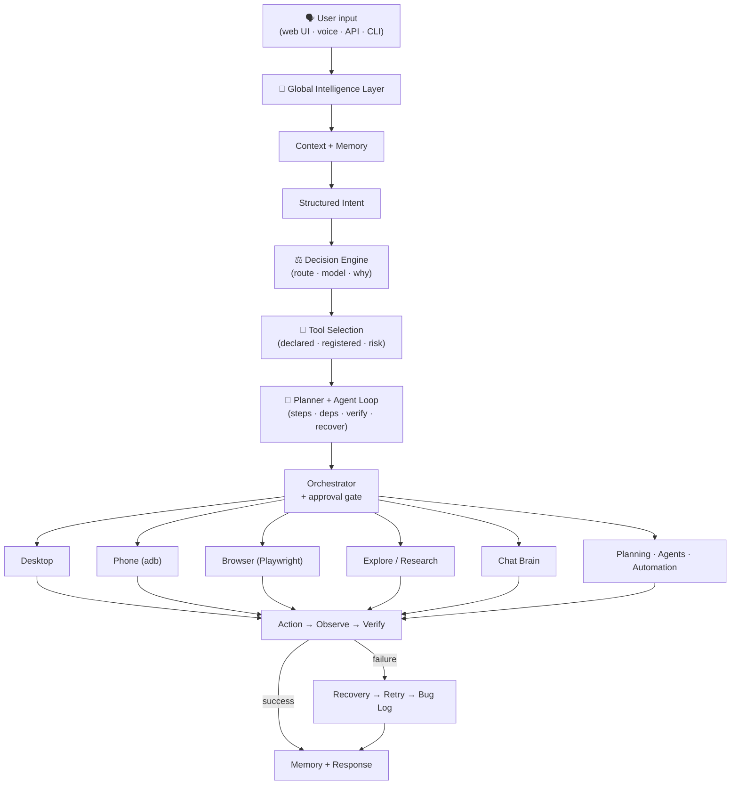

# NovaControl

> 🤖 **An AI-powered desktop automation assistant** — it understands natural-language commands and actually *does* them: driving your desktop, browser, and Android phone, with vision-guided verification, a live web UI, and a built-in bug journal.

NovaControl is a local-first, agentic computer-control system. You type or speak a command like *"open steam and go to library and launch gta v"*, and NovaControl normalizes it, resolves typos and context, plans ordered steps, executes them, and **verifies the result** — asking a precise clarification question only when the request is genuinely ambiguous.

One brain → many capabilities:

| Capability | What it does |
|---|---|
| 🧠 **Global Intelligence Layer** | Normalization, typo tolerance, intent detection, context/reference resolution, multi-intent decomposition |
| 🖥 **Desktop automation** | Open any installed app or folder, in-app chains, dictation, window focus, screenshots (Windows) |
| 🌐 **Browser automation** | Playwright-backed navigation, extraction, form filling, and web-app checks behind an approval policy |
| 👁 **Vision** | Screen understanding, guided clicks ("click the Library button"), pixel-diff verification, optional multimodal vision model |
| 📱 **Phone control** | Android over adb: launch apps, verified screenshots, pre-filled texts/calls |
| 🔎 **Research** | Multi-stage research pipeline that streams live progress into the UI; topics suggested from live daily news, answers synthesized from site-chrome-cleaned facts |
| 🧭 **Local by default** | A cloud key is STORED when you paste it and never becomes the brain until you pick Cloud in the Brain switch — auto mode means the local Ollama model when one is running, otherwise the offline scratch engine |
| 💬 **Dual brain** | Fully local scratch brain — incl. worded & exam-grade (JEE) math — or a real LLM: local **Ollama** (with a model picker) or a cloud key (**OpenAI-compatible, Gemini, Groq, and Claude text** speaking its native `/v1/messages` protocol); Claude vision is not supported |

---

## ✨ Key Features

- **Natural-language understanding that forgives humans** — punctuation, capitalization, spacing, and common typos all collapse to the same structured intent:

  | You type | NovaControl understands |
  |---|---|
  | `open chrome`, `open chrome.`, `Open Chrome!`, `OPEN   CHROME`, `please open chrome`, `launch chrome`, `opn chrme` | **OPEN_APPLICATION(chrome)** — all identical |
  | `take a screenshot`, `capture my screen` | **TAKE_SCREENSHOT** |
  | `text mom on my phone saying hi` | **PHONE_SEND_TEXT(recipient: mom, message: hi)** |
  | `open it` (after opening Chrome) | **OPEN_APPLICATION(chrome)** — resolved from context |

- **Layered resolution** — deterministic fast path → fuzzy typo correction → learned variations → contextual/reference resolution → semantic LLM fallback → one precise clarification. Trivial punctuation differences never wake the model.
- **Worded & exam-grade math, fully offline** — the scratch brain's declarative phrase registry computes compound worded arithmetic ("what is 2 cubed plus the square root of 9"), percentages ("15 percent of 200"), the natural fraction family ("half of 10", "one quarter of 8", "a third of 90", "three quarters of 200" — bare, article, and spelled numerators all work), large-scale operands ("3 million times 2", "2.5 billion divided by 4", "half of three million" — digits or words, through trillion), unit/time conversions, and JEE-style questions: logs (`log base 2 of 8`), degree trig (`sin 30 degrees`), combinatorics (`10C3`, `8 choose 2`, `factorial of 5`), full quadratic solving with discriminant and roots, and arithmetic-progression term/sum questions.
- **Multi-intent decomposition** — *"open notepad and take a screenshot"* becomes two planned, ordered steps.
- **Concurrent-activity safe** — every research and command execution is tagged with a run-scoped `correlation_id` that flows from the request through the event bus to the SSE channel; the web UI routes each progress frame to the run that owns it, so parallel activities never bleed into each other's panels.
- **Learning loop** — fuzzy/contextual resolutions teach the phrase back to the registry, so the same typo takes the fast path next time.
- **Teachable knowledge** — the Learn tab's *Teach* box and chat's "remember this: …" both persist typed facts as durable knowledge (SQLite-backed KNOWLEDGE namespace, duplicate detection included). Ask about a taught topic later — in chat or the Learn tab's recall — and it comes back: "remember this: the wifi password is hunter2" → "what is the wifi password?" → *"You taught me: the wifi password is hunter2"*.
- **Code-aware Build planning + coding agent** — the Build tab's *Plan The Code* turns a goal plus a language (Python, JS, TS, Go, Rust, Java, C#, C++, Ruby, Shell, SQL) into a real coding plan: language-idiomatic step sequence, a derived artifact file name (goal words → `fibonacci_generator.py`, `todo_cli_go.go`, …), language-appropriate test-file naming, and a drafted code artifact. When a model is configured, **the coding agent** (`core/code_agent.py`) drafts the code, **executes it in a sandboxed subprocess** (fresh temp cwd, no network on POSIX, 15s wall-clock timeout), reads the real interpreter error, and asks the model to fix exactly that — up to 3 fix rounds — shipping only code that ran clean (or an honest failure trace). The agent's draft → run → fix steps render in the Build tab, which also states up front whether the agent is live or only the runnable scaffold fallback is possible. A math-detection **parity corpus** also runs every math phrasing through both scratch.py and the routing explorer's JS mirror in CI, so the two classifiers can never silently drift apart.
  **Plan The Project** extends the same agent to multi-file work: the model returns a JSON file map (2–5 files + an entry point), the entry runs in the same sandbox, and real errors drive fixes to the affected files (same 3-round budget, whole-project re-runs). Every drafted file renders with a per-file Copy/Save, saved artifacts list in a **Saved Artifacts** strip, and **Run** re-executes any saved file through the same sandbox (`POST /build/artifacts`, `/build/run`, `/build/save`).
- **Self-improvement telemetry** — resolutions, clarifications, unknown intents, and failed entity resolutions are recorded and exposed as human-readable improvement findings.
- **Local knowledge you can point at** — a folder of docs, code or notes is ingested, chunked and indexed on this machine (BM25 always; embeddings only if you supply a model, and it is never held), searched with citations, and budgeted into context — and NovaControl can resolve "*fix the authentication issue*" into the active project, its branch, what recently changed, what errors are open, what the tests said and the few excerpts that actually match. Nothing leaves the machine, and project awareness never writes to your files.
- **Capability registry** — every subsystem declares its intents, required entities, risk level, executor, and *verification strategy*; the orchestrator derives execution and confirmation policy from that table.
- **Honest states, bounded recovery, and one risk answer** — the reliability layer judges a step by evidence (its own check, then its tool's strategy, then the check the action implies) and reports *unverified* rather than rounding up; it retries only what policy allows, never a destructive or external action and never a refusal; it moves a task through eleven formally checked states with cooperative cancellation honoured at checkpoints; and it derives one risk level from the declared metadata, the tool's own declaration and the action verb — naming which of the three decided.
- **Typed lifecycle events, and a real answer to "can you do that?"** — every event published from the live request path is one of a 28-name vocabulary (the request/plan/tool/task/check/model/vision lifecycle plus the six `plugin.*` moments) validated against its own payload schema *at the publisher*, carries the request's own `correlation_id` from a context variable (so work three layers down names the request that started it), and lands in a bounded history readable by `recent()`. `GET /capabilities` reports what this machine can actually do — availability measured, not assumed, and a missing model or tool reported as UNAVAILABLE with the reason — and `GET /capabilities/discover` ranks the few capabilities that fit a task with the evidence for each score.
- **Plugins that can fail without taking anything with them** — new functionality arrives as a `Plugin`: it declares its identity, capabilities, tools, permissions, risk level, required capabilities, external services, filesystem and network access, and configuration schema, then implements the lifecycle hooks it needs (`load` → `initialize` → `enable` → `disable` → `shutdown`). `PluginManager` discovers plugin directories, validates every declaration *before* anything runs, walks each plugin through the lifecycle exactly once, and **contains** what goes wrong: a plugin whose import raises, whose `load` raises, whose `enable` raises or whose `shutdown` raises becomes a `plugin.failed` record with the reason, while every other plugin keeps working — `enable_all()` stops at nothing. Security is the existing centralized layer, not a second one: the declaration is registered with `PermissionManager`, the same approval gateway the device actions use is asked when the policy requires it (denied by default), and a plugin's Python may not claim more than the `plugin.json` a person approved. Enabled plugins' tools land in the `ToolRegistry` and `ToolCatalog` and their capabilities in the `CapabilityRegistry` — and are withdrawn again on disable or unload. Three minimal examples (`SystemPlugin`, `DeveloperPlugin`, `BrowserPlugin`) duplicate no core behaviour.
- **Safety-first execution** — device actions require a server-minted, single-use, expiring approval token; auto-approve is opt-in.
- **One brain everywhere — Chat and Explore follow the same mode** — Explore's research synthesis uses whichever brain Chat uses (scratch templates, the local Ollama model, or the cloud provider), re-synced on every mode switch and boot; its report cache is keyed per synthesis brain, so switching modes never serves the previous brain's cached answer.
- **Cloud LLM with honest diagnostics** — Settings → Cloud LLM covers every preset with a **Test Connection** button that pings the provider with the pasted key *before* saving it (nothing is persisted on failure; the response names the failing stage — timeout vs rejected key). While a cloud brain is active, the System panel shows lifetime **token usage** (prompt/completion/total per the provider's own usage block) and the **last transport error** verbatim, so a dead key is visible at a glance. Claude uses its native text API; its wire format is covered by fake-transport tests, not a live paid-provider call in this audit, and Claude vision is unsupported.
- **Auto-resolving bug log** — open verification bugs are marked fixed automatically (with evidence) when a later pixel-diff proves the click actually changed the screen.
- **Routing Explorer** — a dedicated panel that traces any utterance through NovaBrain's intent gates, showing which rung owns it and a live preview of what you would actually see (the scratch answer text, the research headline, or the plan outline). Traced by the live server (`POST /brain/decide`); an embedded JS mirror takes over when the server is unreachable. A **broad-classifier toggle** re-runs the same utterance through the scratch engine's wide `_classify()` view and highlights where the narrow gate and the broad engine deliberately disagree (order / engine-only / breadth / unknown / match) — including casual phrasings, which the mirror's research detector knows ("things to know about X", "wtf is X", …), drift-guarded against the Python keyword list.
- **Full phone control over ADB** — the J.A.R.V.I.S phone mode opens any installed app (alias or package), runs in-app searches via deep links (YouTube/Google/Maps/Spotify…), texts saved contacts by name (resolved against the device contact book, never split by guesswork), and opens files/folders through the Files app or system chooser.
- **Answers built from content, not chrome** — search snippets routinely glue consent banners, footers, and trademark lines onto real text. A sentence-level site-chrome filter strips them *before* synthesis, so a researched answer explains the topic instead of quoting "By using this site, you agree to the Terms of Use" or "This page was last edited on …". Chat and Explore share the pipeline **and** the filter, so both answer from the same cleaned facts.
- **Research reads the pages, then answers from them** — a search result is a 150-character meta description, and no rule can turn one into an answer, so Explore fetches each source (`explore/page_reader.py`, standard library only) and works from the article's own prose: scripts, navigation, footers, labels, headings, and HTML artifacts are stripped, and the page is what the answer quotes. Reading is an upgrade, never a requirement — a blocked or script-only page keeps its summary, and the report says so.
- **Research answers the question, not the topic's keywords** — a connected model reads the user's own question and plans the searches itself (`explore/planner.py`): what is being asked, and two to four queries covering the angles that exist for it (direct answer, authoritative source, current state, counter-view). Relevance is then judged against that plan, so evidence that never repeats the user's phrasing still counts. Answer synthesis is question-first — the prompt carries the question and the planner's reading of it, plus the page prose, and the model is forbidden from listing source titles or pasting snippets, because a model that echoes the evidence reproduces the keyword-shaped non-answer this replaces.
- **The local answer is ranked evidence, not keyword buckets** — with no model connected, `explore/evidence.py` ranks every sentence the sources contain against the question (term rarity across the result set, how much the sentence actually says, cross-source agreement, specificity, position — no topic word lists anywhere) and composes the answer as prose plus supporting detail, attributed at the end rather than framed as "here is what the sources say about X". The answer, the highlight cards, the key points, and the sections each take a **different** slice of that pool, so the same sentence never appears twice on one page. A connected-but-broken brain (rejected key, stopped Ollama) is named in the report with its own error, never silently downgraded; with no model at all the report says the answer is assembled from source sentences.
- **Chat stays a conversation; Explore keeps the report** — a research question asked in Chat answers inside the chat stream as a structured answer card (the sourced answer text with its "What it is:" / "Key points:" sections, clickable source chips, and an `explore` chip that jumps to the full report); the full research page — sections, sources rail, related videos, follow-up suggestions — lives only in the Explore panel. "How to" instructional questions route to research instead of the chat fallback, and a compound topic needs two content-word matches before a source is accepted, so "container garden" no longer pulls in Docker pages.
- **Understands casual phrasing** — you don't have to type perfect questions. Scaffold forms ("things to know about X", "what should i know about X", "whats the deal with X", "tell me stuff about X", "any facts about X", "wtf is X") all route to research, and the search topic is anchored to what FOLLOWS the scaffold — so "the most important things to know about brics summit 2026" researches BRICS, not dictionary pages for the word "important". Explicit memory-store phrasing ("remember this: …") still outranks research words inside the remembered content.
- **Daily-updates topic suggestions** — the Explore panel's topic chips are never a hardcoded list: they come from `GET /explore/trending`, which fetches live top-story news headlines (Google News RSS, standard library only, no API key), trims each into a research topic, caches for 30 minutes, invalidates by day, and rotates the visible window hourly — so each visit suggests a different slice of what's actually happening in the world. When the feed is unreachable the panel degrades to a few static help examples.
- **Real system telemetry, never invented numbers** — the Command Center's **System Telemetry** section leads the panel with live metric cards (CPU, memory, storage, GPU, network, battery, temperature, uptime) and the ribbon carries a compact **NOVA CORE** indicator (`CPU 18% · RAM 40% · 3 TASKS`) that opens the full read-out. Every value is measured: `psutil` when installed, the platform's own facilities otherwise (Win32 `GetSystemTimes`/`GlobalMemoryStatusEx`/`GetSystemPowerStatus`, `shutil.disk_usage`, Windows GPU Engine perf counters, `Get-NetAdapterStatistics`, WMI thermal zones, `/proc` and `/sys` on Linux). A metric that cannot be obtained renders **Unavailable** with the reason and *no value at all* — never a zero that reads like a sensor reading — byte rates stay "measuring" until a second counter sample exists, and sampled values show their age. Cost is tiered so polling stays free: cheap metrics are read in-process per request, while GPU/network/temperature are sampled by a daemon thread on a slow cadence, so serving a poll never spawns a process (see [docs/TELEMETRY.md](docs/TELEMETRY.md)).
- **Gameplay control that proves itself, or refuses** — the Forge panel's Guardian tab now plans, runs and verifies a bounded action against one validated window: a plan is a **digest-bound proposal** (session + action + the pinned window's handle and pid) and sends nothing, a **run** revalidates the live window's identity, geometry and focus immediately before injecting through the same `InputGuard` the desktop controller uses, and the **verdict** comes from reading the window back — `verified_success` only when the OS says so, `unknown` when it cannot be read, never a guess. A refusal is not a failure and an execution is not a success, so nothing is remembered as a win because a key was sent. Exercised live against a disposable window that retitles itself on a real key press (15/15 acceptance steps), including a Guardian cancel that interrupted a 1500 ms hold in **254 ms** with no key left held.
- **Command-center web UI** — one committed design layer over every panel: a fluid layout (`clamp()` gutters, content-sized rails, breakpoints from 1920px down to phones) that reflows instead of clipping, plus a verified fit audit across all 11 panels and 11 widths. The audit also proves the screen shows ONE panel: each nav click is checked for a lone laid-out panel starting inside the viewport (an id-selector `display` rule once beat `.panel { display: none }`, keeping the Command Center rendered underneath every other panel and pushing the panel you clicked below the fold) that fills the workspace instead of leaving a dead strip down the right edge.

## 🧠 Architecture



**Language understanding is a platform capability.** No subsystem parses raw user strings on its own — JARVIS, Research, Automation, and the Browser Agent all consume the same structured intent.

### Key modules

```text
src/novacontrol/
  intelligence/   Global Input Intelligence: normalize, intent rules,
                  context/references, capability registry, telemetry,
                  StandardResult envelope, model lifecycle manager
  decision/       Decision Engine: what to do with an understood request
                  (route, capability, model, requirements) — provider-based,
                  local by default, never executes anything
  tools/          Tool registry, executor, and the tool layer above it:
                  metadata, a catalogue built from every source that knows a
                  tool, discovery that ranks the few relevant ones with scores,
                  strict call validation, output normalization and TTL caching
  planning/       Planner + agent loop: goals into dependency-ordered steps
                  that name a tool, an effect and a way to be verified, then
                  executed with bounded retries behind the approval gate
  reliability/    Honest verification, bounded recovery, task state and
                  permissions: the check a step is judged by, what may be
                  retried (and what never may), eleven formally checked task
                  states with cooperative cancellation at checkpoints, and one
                  ordered risk layer that names which source decided
  plugins/        Plugin SDK: the stable Plugin interface (identity,
                  capabilities, tools, permissions, risk, external services,
                  filesystem/network access, configuration schema, five
                  lifecycle hooks), a manager that discovers, validates, runs
                  and CONTAINS plugins, and the marketplace that installs them
                  behind approval
  knowledge/      Local knowledge + project awareness: documents/text/Markdown/
                  code/PDFs read off disk, chunked, indexed (BM25 always, plus
                  optional embeddings), retrieved, reranked and budgeted into
                  context — and the code project you are standing in, read from
                  the workspace and never written to
  brain/          Scratch brain (fully local answers) + LLM chat + routing
  desktop/        Desktop controller, parser/planner, vision-guided control
  phone/          adb bridge: connect, apps, texts, calls, screenshots
  browser/        Playwright runner + approval-aware workflow controller
  vision/         Vision pipeline: manager (OCR-first), replaceable provider, structured result
  models/         Model + hardware manager: capability registry (what each model
                  can DO, never its name), hardware monitor (RAM/CPU/GPU/NPU,
                  measured or reported as unmeasured), one place that answers
                  "which model, and is there room for it?"
  agentcore/      Task interpreter, adaptive planner, verifier, recovery
  agents/         Specialized agents (Phase 12): ONE shared pipeline —
                  NLU → Context → Decision → Planner → Tool Selection →
                  Execution → Verification → Recovery — with the developer
                  agent (inspect, search, plan, write only when authorized,
                  run tests, debug, read-only git) and the research agent
                  (cited, source-aware answers that label evidence apart from
                  inference) on it; the deterministic role stubs stay for the
                  roles no specialist implements
  voice/          STT/TTS via OS-native speech services
  tasks/          Task center (create, update, delete, clear)
  core/           Event bus, runtime, config, security (deny-by-default
                  approvals), bug log, audit trail, plus the typed lifecycle
                  event vocabulary (validated payloads, bounded history) that
                  every subsystem publishes through
  explore/        Research pipeline with live progress events
  memory/         Namespaced memory (SQLite-backed)
  api/            FastAPI surface + single SSE activity channel
  web/static/     The web UI (vanilla JS, no build step)
  gui/            PySide6 desktop dashboard
  cli/            Command-line interface and demos
```

### Safety model

- **Deny-by-default approvals** — device actions execute only with a server-minted, single-use, expiring token issued for that exact plan
- **Auto-approve is opt-in** (Settings checkbox, default off)
- Destructive/ambiguous + high-risk intents require explicit confirmation
- Phone texts and calls are **pre-fill only** — the human always presses send/dial on the device
- Self-improvement applies nothing without a sandboxed preview + approval

---

## 🚀 Requirements

| Requirement | Version |
|---|---|
| Python | **3.12+** |
| OS | Windows (desktop + voice features); Linux/macOS for core web/API |
| Ollama (optional) | Any recent version — local chat brain and/or a local vision model (e.g. `ollama pull qwen3-vl:4b` or `ollama pull llama3.2-vision`). On a CPU-only machine a non-reasoning model (`qwen2.5vl:3b`, `llava`, `moondream`) answers far more reliably — a `qwen3-vl` build that cannot stop thinking spends its whole budget reasoning |
| Android platform-tools (optional) | For phone control |

## 📦 Installation

```powershell
git clone <your-repo-url>
cd NovaControl

python -m venv .venv
.\.venv\Scripts\Activate.ps1
python -m pip install -e ".[dev]"
```

Optional extras (browser automation, GUI, vision, voice, git, database, Redis):

```powershell
python -m pip install -e ".[browser,gui]"
```

## ⚙️ Configuration

NovaControl is configured via environment variables — no `.env` file is required to run:

| Variable | Purpose | Default |
|---|---|---|
| `NOVACONTROL_API_TOKEN` | Require bearer-token auth on protected API routes | *(auth off)* |
| `NOVACONTROL_ENV` | Environment name | `dev` |
| `NOVACONTROL_LOG_LEVEL` | Logging level | `INFO` |
| `NOVACONTROL_REQUIRE_APPROVAL` | Toggle approval enforcement | `true` |
| `NOVACONTROL_DATABASE_URL` | Database connection (SQLite default) | local SQLite |
| `NOVACONTROL_REDIS_URL` | Redis for optional worker/queue features | — |
| `NOVACONTROL_OLLAMA_URL` | Ollama endpoint for the LLM brain | `http://127.0.0.1:11434` |
| `NOVACONTROL_DISABLE_OLLAMA` | Skip Ollama auto-detection | unset |
| `NOVACONTROL_OLLAMA_UNLOAD_ON_SWITCH` | Unload the other local model before a completion, so only one is ever resident | `on` |
| `NOVACONTROL_OLLAMA_KEEP_ALIVE` | Residency window applied to a model (re)loaded on a switch (e.g. `30m`) | Ollama's own default |
| `NOVACONTROL_ENABLE_EXTERNAL_LLM` | Enable OpenAI-compatible/Gemini-style cloud providers | unset |
| `NOVACONTROL_LLM_BASE_URL` | Cloud provider base URL | — |
| `NOVACONTROL_LLM_API_KEY` | Cloud provider API key | — |
| `NOVACONTROL_LLM_MODEL` | Model name | provider default |
| `NOVACONTROL_LLM_TIMEOUT` | Socket timeout in seconds for every provider request — raise it for CPU-only local models, which answer far slower than a cloud API | `600` |
| `NOVACONTROL_OLLAMA_MAX_TOKENS` | Reply ceiling for local completions — stops a reasoning-capable model from generating without bound; `0` disables it | `1024` |
| `NOVACONTROL_VISION_MAX_IMAGE_SIDE` | Longest edge (px) a screenshot is downscaled to before the vision model sees it — the main lever on local vision latency; coordinates stay resolution-independent, `0` sends full resolution | `1280` |
| `NOVACONTROL_VISION_MAX_TOKENS` | Reply budget for a locate request (one small JSON object is all it needs); `0` leaves it uncapped | `256` |
| `NOVACONTROL_NLU_FAST_CONFIDENCE` | Confidence at or above which a reading is trusted as-is — no verification, no model | `0.90` |
| `NOVACONTROL_NLU_VERIFY_CONFIDENCE` | Below this, understanding escalates to the language model (or asks a question when no model is available) | `0.70` |
| `NOVACONTROL_NLU_MULTI_STEP_CONFIDENCE` | Confidence a multi-clause request's *weakest* clause needs before it needs no extra verification | `0.88` |
| `NOVACONTROL_NLU_LEXICAL_CONFIDENCE` | Similarity the exemplar matcher must reach before it may claim an intent | `0.62` |
| `NOVACONTROL_NLU_REFERENCE_CONFIDENCE` | Confidence assigned to a target resolved from context ("open it") — lower than a named one, by design | `0.74` |
| `NOVACONTROL_NLU_ALLOW_LLM` | Allow understanding to escalate to a language model at all; `false` keeps the deterministic path and asks a question instead | `true` |
| `NOVACONTROL_NLU_LEXICAL_MATCHING` | Enable the TF-IDF/character-ngram exemplar matcher (the paraphrase layer) | `true` |
| `NOVACONTROL_NLU_SEMANTIC_CONFIDENCE` | *Calibrated* confidence an embedding match must reach before it may claim an intent — not a raw similarity | `0.60` |
| `NOVACONTROL_NLU_SEMANTIC_MATCHING` | Enable the embedding index (the second, independent paraphrase layer) | `true` |
| `NOVACONTROL_PLANNING_MAX_CYCLES` | How many understand→decide→plan→execute→verify cycles the agent loop gets before it stops and reports | `2` |
| `NOVACONTROL_PLANNING_MAX_STEP_ATTEMPTS` | Total attempts one plan step may have; `1` means "run once, never retry" | `2` |

> 🔐 **Secret handling:** API keys are stored locally and never returned by any API endpoint. This includes the vision-model key (`POST /vision/model` accepts it once and only ever reports a redacted tail). Never commit `.env` files or tokens — local artifacts like `token.txt` should stay out of version control.
>
> 💡 **Key formats matter:** each preset expects the key from that provider's own console — the Gemini preset wants an AI Studio key (`AIza…`), not a Vertex/ADC credential (a mismatch shows up as HTTP 400/401 on first chat). Use **Test Connection** in Settings → Cloud LLM to verify a key before saving it.

## 🏃 Usage

### Run the web app

```powershell
python -m uvicorn novacontrol.api.app:create_app --factory --host 127.0.0.1 --port 8000
```

Open **http://127.0.0.1:8000/** and try:

- `open notepad and type hello`
- `what is quantum tunneling` (research — streams live stages)
- `take a screenshot on my phone`
- `whats the deal with brics summit 2026` (casual phrasing — routes to research, searches the actual topic)
- The Explore panel opens with **today's news topics** as one-click research chips

### Natural-language command examples

```text
open chrome                              → launches Chrome, verifies the window
open steam and go to library and launch gta v
                                         → 3-step plan: launch → deep-link navigate →
                                           vision-guided launch with process verification
open notepad and type meeting notes      → dictation via clipboard-staged paste
open downloads                           → opens the folder in Explorer
open games folder                        → finds the real folder across drives and opens it
what is 2 cubed plus the square root of 9 → 11 (offline scratch brain)
log base 2 of 8 plus 10C3                → 123 (JEE-style: logs + combinatorics)
solve x^2 - 5x + 6 = 0                   → worked quadratic solution with roots
stop that                                → graceful WM_CLOSE of the last app
close chrome                             → the same window close, for a NAMED app
open it (after opening Chrome)           → plans "open chrome": the resolved target reaches the plan
open youtube on my phone                 → launches YouTube on the paired device
search cats on youtube on my phone       → YouTube deep-link search (nothing typed)
open the report.pdf file on my phone     → opens the file via the system chooser
open the downloads folder on my phone    → opens the Files app
open steam and go to library and launch gta v
                                         → 3-step desktop plan: launch → deep-link navigate →
                                           vision-guided launch with process verification
take a screenshot on my phone            → PNG pulled to data/screenshots/, verified
text sesi 2 saying hi from NovaControl  → resolves the saved contact → pre-fills messaging; you press send
how to start a container garden on a balcony → researches gardening (not Docker)
whats the deal with quantum computing    → researches quantum computing
tell me stuff about the mariana trench   → researches the mariana trench
remember this: facts about cats          → stores to memory (does NOT research cats)
add five and seven                       → 12 (spelled-out add form)
remember this: my wifi password is hunter2
                                         → taught as durable knowledge (Learn tab / chat)
what is the wifi password                → "You taught me: my wifi password is hunter2"
```

### How Explore understands what you type

Research queries rarely arrive as perfect sentences, so Explore's language layer anchors on **scaffold markers** instead of rigid grammar: the real topic is whatever *follows* "things to know about", "should i know about", "the deal with", "stuff/facts about", "info on", "wtf is", "basics of". The router accepts the same casual forms, so "whats the deal with quantum computing" routes to research *and* searches for quantum computing — not for "deal". Scaffold adjectives never leak into the search (the fix for researching the word "important" instead of the BRICS summit). Sources must clear a topical-relevance gate: a compound topic ("container garden", "brics summit 2026") needs two content-word matches from a page, so Docker and shipping-container pages can't answer a gardening question, while comparison topics ("compare email, chat, and phone calls") stay per-item.

### Web interface

The browser UI is a single-page command center served by the API (`/`): a grouped sidebar (Core / Intelligence / Automation / Engineering) over eleven panels — **Command**, **Chat**, **Explore**, **Routing**, **J.A.R.V.I.S**, **Vision**, **Build**, **Learn**, **System**, **Settings**, **CLI** — backed by one SSE channel (`/events/stream`) for live progress and the Recent Activity timeline.

Layout is fluid rather than fixed: gutters, heights, and rails are `clamp()`-based tokens, so the same markup reflows from a 1920px desktop to a 390px phone without a separate mobile build. The navigation is never an overlay: the sidebar is a column at every width where a column fits (268px, narrowing to a 214px rail below 1040px) and becomes a top command deck below 700px, whose pills **wrap into rows** so every destination stays visible (never hidden behind a sideways scroll). There is no off-canvas drawer and no hamburger — a drawer covered the panel the reader had just opened, which reads as clipped content; `scripts/ui_audit.py` now fails the build if the sidebar is fixed over the workspace or has no width at any audited breakpoint. The stylesheet is a single design-token block plus one component layer — consolidated with a **computed-style A/B audit** (`scripts/ui_audit.py --baseline <old.css>`) that proves a cleanup changed nothing the browser can see — and reduced-motion is respected throughout.

The Command Center opens with **System Telemetry**: a `SAMPLED 12S AGO` freshness pill, then metric cards (CPU, memory, storage, GPU, network, battery, temperature, uptime) with a live bar each, a pill row for AI engine / Vision / automation / active tasks, and a **Details** table (host, OS, CPU model, cores, uptime, sensor backend, GPU, network interfaces, cloud brain, tracked tasks). Cards are built once and updated in place, so the bars animate to each new reading; the poll runs every 2s and pauses while the tab is hidden. A metric this machine cannot report is muted and says why — on an Intel-integrated laptop the TEMP card reads *Unavailable — the firmware reports no ACPI thermal zone*, and VRAM is reported as `shared` GPU memory rather than a fabricated total.

Chat presentation follows conversation conventions on purpose: research answers arrive as structured answer cards — the answer text with its heading sections and bullets, source chips, and an `explore` hand-off chip that renders the already-fetched report into the Explore panel (no second research round-trip) — while the full report furniture (query chip, verification, sources/videos rail, follow-up question chips) remains the Explore panel's job. `ChatResearchBubbleDomTests` pins this split — the Explore page must never render inside the chat stream. The Explore panel's welcome card shows live **trending topic chips** (today's news, rotating hourly) instead of fixed examples.

Verify the UI end to end:

```powershell
$env:PYTHONPATH='src'
python -m pytest tests/ -q            # includes the UI contract + focus-ring + reduced-motion suites
python scripts/ui_audit.py --url http://127.0.0.1:8000/                  # every panel fits at every breakpoint
python scripts/ui_audit.py --url http://127.0.0.1:8000/ --baseline old.css  # zero computed-style drift
```

### Voice input

The J.A.R.V.I.S tab has a **VOICE** button using OS-native speech recognition and synthesis (Windows); see [docs/VOICE.md](docs/VOICE.md).

### Phone control setup

1. Download [Android platform-tools](https://developer.android.com/tools/releases/platform-tools) and unzip (NovaControl auto-finds it in `~/platform-tools` even when it's not on `PATH`)
2. On the device: **Settings → About → tap Build number 7×** → **Developer options → enable USB debugging**
3. Plug in over USB → press **Connect Phone** in the J.A.R.V.I.S tab → accept the RSA prompt on the device

Once paired, phone mode can: **open any installed app** (by alias or package name, discovered from the device), **search inside apps** via deep links (`search cats on youtube on my phone` opens YouTube pre-loaded with the query — nothing is typed), **text a saved contact by name** (the leading words are resolved against the on-device contact book first, so free text is never split by guesswork; the messaging app is pre-filled and *you* press send), **call by saved name** (dialer pre-filled), and **open files/folders** (a named file opens through the system chooser; folders land in the Files app). Bridge status and next steps are surfaced in the J.A.R.V.I.S phone tab, and every executed action lands in the Recent Activity timeline.

> 🔮 **Beyond USB: a no-cable future.** Android 11+ wireless debugging (pair once over Wi-Fi, no cable) is the cheap path and needs zero code rewrites. For control **without USB debugging at all**, [docs/PHONE_COMPANION_APP.md](docs/PHONE_COMPANION_APP.md) sketches a companion Android app built on an AccessibilityService — the phone dials out to NovaControl over WebSocket and becomes a third `PhoneCommandRunner`, unlocking semantic-tree element location for vision-guided phone flows. Sketch only; nothing implemented yet.

### Routing Explorer

The **Routing** panel answers *"where does my utterance land?"*. Type any phrase and it shows the full gate walk — every intent gate NovaBrain evaluates in order, which one matched (and why), the landing intent with confidence, and a small preview of what you would actually see on that rung:

- **scratch** rungs (greetings, math, conversions, knowledge) — the real local answer text;
- **explore** — the report headline the research run would produce;
- **plan / device actions** — the real plan outline and action list.

While the server is up, tracing runs live through `POST /brain/decide` (the landing decision *is* `NovaBrain.decide()` — the explorer can't disagree with chat). If the server is unreachable, an **embedded JS mirror** of the gate table takes over so the explorer still answers offline; it is labelled as approximate in the UI, and its gate names/order are drift-guarded against the Python table in CI.

A **"Compare with broad classifier"** toggle re-runs the same utterance through the scratch engine's *broad* `_classify()` view and highlights where the narrow routing gate and the broad engine deliberately disagree: **order** (e.g. `what time is 2 plus 3` — the narrow router promotes math ahead of time), **engine-only** (`open notepad and type hello` — the broad engine sees desktop_control but its row is routing_safe=False so routing dispatches to real automation instead of a canned answer), **breadth** (a wide engine match with no exact canned key), **unknown** (neither classifier has a local answer), or **match**. The JS mirror computes the same relation offline, and the Python↔JS relation parity is drift-guarded in CI.

### How a request is understood

Every request passes through the **Global Input Intelligence** layer before any subsystem sees it, and the cheapest layer that can understand the request wins:

```
normalize → rules → fuzzy (typos) → learned phrasings → context → exemplar similarity (TF-IDF)
    → embedding similarity (optional)
    → language model (only if still unresolved)
         ↓
    complexity assessment → multi-signal confidence → route
```

The reading is then scored against configurable confidence bands, and the band decides what happens next — never the other way around:

| Reading | Route | What happens |
|---|---|---|
| confident (≥ `NOVACONTROL_NLU_FAST_CONFIDENCE`) | `fast` | straight to the capability, **no model** |
| borderline | `verify` | accepted, flagged as below the fast band |
| a reference resolved from context ("open it") | `verify` | planned, but never as certain as a named target |
| low confidence, or a clause that could not be understood | `llm` | escalated to the language model, which answers in the **same structured schema** |
| understood and already answered | `fast` | the result speaks for itself — it is **never re-worded** through a model |
| needs an image | `vision` | the vision pipeline — a text-only model is never handed a screenshot |
| no reading and no model | `clarify` | one precise question instead of a guess |

The vision route is decided by the request rather than by how well it was read: *"describe the image on screen"* resolves to nothing the words can act on, but it is still flagged `requires_vision` and routed to vision — a dead-end question would hide that the request is answerable by *looking*. The record says where the request went, not only that it was asked about, so a vision-routed request is counted as vision rather than as a plain question. A **bare continuation** is memory work, and says so: *"continue from where I stopped"*, *"resume"* and *"where was I"* resume whatever the context layer knows was in progress, and reach the model (or one precise question) only when nothing is remembered. Similarity is no help there — *"continue from where I stopped"* scored 0.57 raw against a GPU-status exemplar, above the embedding floor — so the embedding layer declines continuations outright instead of answering them. *"Continue **the project I was working on yesterday**"* names something and keeps flowing through the pipeline, because only the *bare* form is context work.

Two rules keep that table honest. **A name the user actually said always beats a remembered reference:** *"where is my NovaControl folder"* is read as that folder, and *"read notes.txt"* or *"open notes.txt"* is a file to read — never an application literally called *notes.txt*. Only a phrase that names a **kind** and nothing else (*"open that file"*, *"run that"*, *"show me the thing"*) is resolved from context, at reduced confidence, or asked about when nothing is remembered. **Entities come from independent readers** — application, file, folder, project, url/website, query, level, text, numbers — so *"find my NovaControl project"* yields `project: novacontrol`, *"set volume to 40%"* yields `level: 40`, and a new entity type is a new reader rather than a new branch in the engine. **A project is a folder under another name, never an application:** *"open my NovaControl project"* reads as `project: novacontrol` (mirrored to `folder` for the capability that opens it), because the generic *"open ___"* rule used to read the whole phrase as a program called *novacontrol project* and try to launch it. The desktop planner was making the same mistake one layer down — it re-parses the raw request — so the project pattern now lives there too: *"open my NovaControl project"* plans `Open folder novacontrol`, which the on-disk folder resolver turns into the real folder. **The same rule now holds for references:** *"open it"* is planned as *"open chrome"* — the resolved target travels into the plan instead of being re-parsed as a program named *it* — and *"close it"* plans a graceful window close rather than a shell command, because the parser gained a named-close branch (`close|quit|exit|kill|stop <app>`) instead of falling through to `EXECUTE_SCRIPT`.

So the common cases never touch a model: *"open chrome"*, *"launch chrome"* and *"please bring up Chrome"* resolve in well under a millisecond, and *"how much RAM do I have?"* is answered from the machine's own telemetry ("You're currently using 10.9 GB of 15.4 GB RAM (71.1%).") with no model involved at all. Multi-step language that every clause of is understood stays local too — *"Open VS Code, find my NovaControl project and run the tests."* decomposes into three planned steps without a model. Only genuinely novel, ambiguous or partly-unreadable language reaches the local model — and when it does, the model **understands**: it returns an intent, goal, entities and requirement flags, and NovaControl validates, authorizes and executes. A model never names a tool, a path or a command.

**Understanding is not the whole wait.** A command can be understood in a millisecond and the request still take over a minute — because the *result* was also being sent to a model to be re-worded. *"open chrome"* produced a finished sentence (`Planned: Open chrome`) and then asked the local model to paraphrase it: **86 s of the 87 s**. A result that already reads as a sentence — a chat answer, a research report, a measured reading, a planned step list — is now returned verbatim, and the model words only results that arrive with no sentence of their own. The same request went from **86.1 s to 2.2 s** (measured, same machine, same model configured).

**Honest about what is not built yet.** Nineteen of the taxonomy's intents — the file operations (`find_file`, `read_file`, `list_files`, `write_file`, …), the device controls (`volume_control`, `brightness_control`, `media_control`) and the code-intent family — are *understood* but have no executor wired to them, so they fall through to the existing handlers exactly as before. That gap is written down rather than hidden: every intent the rules can produce must be either dispatchable or listed in the drift-guard test (`tests/test_nlu_engine.py`), so adding rules for a capability with no executor fails the suite until it is wired up or deliberately documented.

**One table describes every intent.** Examples, required and optional entities, the tool that carries it out, whether it needs confirming, the web or vision, and the confidence bar it must clear all live in one declarative catalog (`intelligence/registry.py`) — so an intent added there shows up in the engine, the telemetry and the UI without a second edit, and two modules cannot quietly disagree about what *"delete report.pdf"* means. The catalog is why the two questions *"which intents exist"* and *"which of them can actually run"* now have separate, checkable answers. It is also the single description every layer is judged by: the flags on a reading — needs the web, needs vision, needs confirmation — are derived from the catalog no matter which layer produced it, so a hand-composed reading (the composite *"open chrome and search youtube for X"*) cannot quietly disagree with the same intent read from a rule. A test sweeps the layers for exactly that disagreement. Names the specification uses that this taxonomy spells differently are data, not prose: `launch_website`, `create_file`, `execute_command`, `screenshot`, `explain` and `unknown` resolve to the real intents through `resolve_intent()`, so an API client written against the spec's vocabulary is routed by this system's.

**A second paraphrase layer, measured before it was trusted.** TF-IDF needs shared words; an embedding index is the layer that reads *"what is chewing up my ram"* when the exemplar says *consuming* and *memory*. It is optional in both directions — nothing to download (the default vector space is a deterministic hash of content-word, bigram and character n-gram features, weighted by corpus rarity, so it works offline and produces identical output across processes), and a deployment that *has* an embedding model passes one in as a backend, replacing the vector space without touching the engine. It is consulted only where the term-matching layer already declined, and its floor is on the **calibrated** confidence rather than the raw similarity. That distinction was earned, not assumed: a leave-one-out benchmark over the shipped corpus (rebuild the index without the query, read every phrase back — `tests/test_nlu_semantic.py` keeps it running) showed that *"show me the florb"* scores **0.61 raw** against *"show me the documents folder"* while being a near-tie with a different intent entirely, so similarity alone would happily act on nonsense. On calibrated confidence the same sweep gives 62% precision at 8% coverage — twice the precision the existing TF-IDF layer manages at its own gate — and the layer **declines** everything below it, records why, and reports itself as an *embedding match*, never as the language model.

**A confidence number with arithmetic behind it.** Confidence is not one similarity score wearing a label. It combines the rule or lexical match strength, entity completeness (measured against the catalog's declared requirements), how close the runner-up candidate came, whether a context reference was resolved, and whether the request needs the web or vision. A tie between candidates *lowers* the reading, and a missing required entity lowers it without zeroing it — so *"open chrome"* lands at 0.90 and *"open it"* at 0.74, capped below any named target by construction rather than by a special case.

**Complexity decides the machinery, not the word count.** Every reading is assessed as SIMPLE, MODERATE or COMPLEX by counting actions, dependencies between them, unresolved references, ambiguity and reasoning words — never length. *"Open Chrome"* is local work; *"Open Chrome and search YouTube for Python tutorials"* is MODERATE and needs the planner, counting the composite reading's own actions rather than the single step it used to be scored as; *"Find the project I was working on yesterday, inspect the latest changes, run the tests and explain what I should fix"* is COMPLEX and is the one case that goes to the model *because of its shape* rather than its confidence.

**What is taught is what generalizes.** The learning loop turns a phrasing that needed a second layer into a rule for next time — but never for a phrase whose meaning is *"the last thing"*. Such a phrase is taught *above* the context resolver, so a lesson freezes what *"that"* meant the first time: measured, *"do the same thing"* was taught against a file read and then replayed that read even after an unrelated browser task. Phrases carrying a resolved reference, a bare reference (*"run that"*) and bare continuations are therefore excluded — they keep following the current context, which is the only thing that can answer them.

**Measured, not estimated.** A local model reports its own timings, and those are what get recorded: how long the weights took to load, how long before the first token, the decode rate and the true inference total, alongside the NLU's own latency and the end-to-end time. A cloud provider reports none of that, and says so — an unmeasured path records nothing rather than a fabricated zero. `GET /intelligence` returns the aggregate under `model_timings`.

Every record carries the **request id the client is given**, and the outcome is reported against that same id one layer up, where the handler runs: *carried out* or *failed*, with the exception's type. An outcome nobody reported stays absent rather than counting as a success, so "understood correctly, then failed" is a discoverable fact instead of two records that happen to share a minute.

**Then a decision, before anything runs.** An understood request is handed to the **Decision Engine**, which answers the next question — *what should NovaControl do about it?* — and reports what that therefore needs. It resolves a route (`direct_tool`, `system_tools`, `local_capability`, `planner`, `agent`, `local_llm`, `cloud`, `vision`, `chat`, `clarify`), the capability, the model, the action list, and the requirement flags, beside a stable `reason_code` and a templated sentence for the UI. It executes **nothing** — authorization stays with the approval layer — and it is a pure function of what it is told, so the same reading and the same machine produce the same decision. The order is cheapest first, and two rules are load-bearing: **a model is never consulted when determinism is enough** (*"what is my RAM usage?"* and *"open chrome"* name no model at all), and a status question is answered from this machine's own telemetry rather than from a model's guess. The chain is `decide → plan → select tool → approve → execute → verify`, and the reason each step exists is that it can refuse the next one.

**A provider can advise, never authorize.** The engine is local-first and offline by default; a second provider (the optional **Jev** integration) sits behind the same `DecisionProvider` interface, is consulted only when an endpoint *and* consent are both configured, and receives a **redacted** routing summary — intent, flags, complexity and what the machine has, never the user's words or entities. Its replies are validated against the local vocabularies: an unknown route is refused rather than mapped to something convenient, actions are kept only when the local reading produced them too, the handler is always resolved locally (a remote service may suggest a route, never name an executor), and caution is **monotone** — a provider may add a confirmation requirement and can never clear one. If it is slow, absent or wrong, the local decision answers instead and the fallback is reported rather than hidden (`provider_fallback`), because an invisible fallback is how a broken provider goes unnoticed for a month. An unknown provider name in configuration maps to the local one and reports what was *requested* next to what is *active*, so a typo is visible instead of silent.

**Two rules held under test.** The four examples the decision spec names run as tests, and checking them against the engine found three defects that are now fixed. A reading that names two metrics — *"check my RAM and CPU"* — answers **both**, rather than the first one it happened to match. And a request that names **work** (it needs a model, a planner, or entities that are still unresolved) is never answered with a question: only a genuinely ambiguous request is clarified, so escalation and clarification cannot be mistaken for each other. Context is an input like any other — a broken context layer costs the decision its context, not its route.

**A plan is a graph of steps that say how they will be checked.** *"Open VS Code, open my NovaControl project, run the tests and tell me what failed"* is not four steps, because the request contains prerequisites nobody said out loud — the project has to be **located** before it can be opened, a test run has to be **collected** before its failures can be **analysed**, and an analysis has to exist before it can be **summarised**. The compiler emits all seven, in that order, each naming its action, tool or capability, parameters, dependencies, expected result, verification and status — plus what it does to the world, because that one field decides three separate rules: whether a step may run in parallel, whether its result must be verified, and whether it may ever be retried. Execution walks the graph a wave at a time and runs steps **concurrently only when every one of them is read-only and none names the same resource** — one read-only tool legitimately serves CPU, RAM and GPU readings at once, while two steps about the same file are not independent even if both only read it. A step that changes something waits for the previous such step, and a failure blocks everything downstream rather than being discovered later at a worse moment. The two loops that could hide a permanent failure behind repetition — a step's attempts and the agent loop's cycles — are **configuration, not constants** (`planning.max_cycles` / `planning.max_step_attempts`, or `NOVACONTROL_PLANNING_MAX_CYCLES` / `NOVACONTROL_PLANNING_MAX_STEP_ATTEMPTS`), read once at boot and handed to the compiler, the executor and the loop alike; a value above the plan layer's own ceiling is clamped rather than obeyed, because a ceiling that can be configured away is not a ceiling.

**Nothing is called done because it returned.** A step is COMPLETED only after its verification PASSED; a step that ran and could not be checked is reported **unverified**, which is different from a failure and very different from a success, and those unverified steps travel into the final answer instead of being rounded up. Verification is required by policy for every side-effecting action and optional anywhere else, reads evidence rather than opinions (a file, an exit code, captured output, an observed change, a named check) and returns **inconclusive** when it genuinely cannot tell — the honest answer, and not a soft pass. A nonzero exit code is a *result* when the goal was "tell me what failed", so the run for a test suite accepts any exit code while still capturing it for the analysis. **A plan's own command steps run for real — and only with approval.** `run-tests` and `run-command` steps are carried out by the step handler: the project is located first, its runner is *recognised* (`npm test`, else `pytest` from the interpreter that owns the process — anything unrecognised is reported, not guessed at), the command is executed **exec-form with no shell**, output is captured from the tail where a test summary actually is, a hard wall-clock timeout stops a hung process, and the exit code is handed to the deterministic verifier. The handler refuses with a permission reason unless the caller named the step in `run_plan(approved=...)` (the same `approved` list `POST /plan/run` exposes), so the chat path asks for approval instead of stopping at an internal error, and an approved run completes and verifies.

**A retry is a decision, not a hope.** When a step fails, the recovery advisor classifies the failure and chooses one of four answers with a reason: retry (transient, budget left), repair the parameters (the error said *which* argument was wrong and how — a corrected attempt is a different attempt), escalate for reasoning, or stop. Destructive and external actions are **never** retried automatically, because a delete that half-succeeded, run again, deletes something else; a refusal is never retried, because only a person can change it. Retry limits are configurable and the policy's own ceiling makes an unbounded loop unrepresentable rather than merely unlikely.

**The agent loop is the only driver, and it cannot skip the last two phases.** UNDERSTAND → DECIDE → PLAN → EXECUTE → OBSERVE → VERIFY → CONTINUE/RETRY/ESCALATE → FINAL RESPONSE runs on a bounded cycle count, and a decision that says "ask first" ends the run before anything is planned, let alone executed. The planner requests actions; it never authorizes them. A step that needs confirmation runs only when the caller approved **that step id** — with no approval channel wired it is **denied rather than attempted**, a tool refusing is a denial rather than a failure, and every tool call still goes through the approval-gated executor, so there is no path from a plan to the machine that skips the existing safety layer.

**Which tool, with the evidence.** "This intent reaches that tool" used to be a single lookup. The **selection layer** resolves it from three surfaces that can disagree — the catalog's declared tools (in preference order), the capability's executor, and the runtime tool registry — and scores each candidate on that order, whether the tool is actually registered, whether the entities it needs are present, and how risky the capability says it is. Missing required entities *lower* the score without disqualifying the tool (an incomplete step is what the approval prompt and the clarification question exist for), a registered tool whose schema says it serves the intent is offered alongside the declared ones, and a registered tool whose name merely looks related is **never** guessed into service. It reports `declared` / `registered` / `executor` as the source and prunes what it did not choose into the candidate list, so a surprising choice is traceable to the surface that suggested it. Like the decision it feeds, it runs nothing — a selector that could approve its own choice is the one thing this layer must not be.

**Every tool is described, and only the relevant few are offered.** A tool used to be a name, a schema and a callable — enough to run one and not enough to *find* one, so nothing could answer *"which of these could possibly be what the user meant?"*. Each of the twenty executors this build knows about now carries metadata: a description in the words a request would use, a category, the capabilities it serves, its input and output schema, its risk, its permission scopes, example requests and tags. One catalogue is built from every surface that knows a tool — the declarations, the intent catalogue (which tool carries each intent, plus the phrases people say), the capability registry (executor, risk) and the runtime registry (what is actually registered) — so nothing is described twice and a tool that is dispatched but not wired up is reported as exactly that. **Discovery** then ranks that catalogue against a request using the lightweight machinery the NLU layer already had: content words weighted by the square of their rarity ("ram" decides, "up" does not) combined with cosine similarity over hashed n-gram features. *"Which programs are consuming most of my memory?"* returns `system_monitor` at 0.73 and **not** the phone, the browser or the code agent; *"what is chewing up my ram"* lands on the same tool, which is the point of the semantic half; and a request nothing can serve (*"sing me a lullaby about penguins"*) returns **no tool at all**, because that is a real answer and it is what stops a planner reaching for something unrelated. Embedding support stays optional — a caller with a model passes it as the embedder and the layer uses it instead. The model escalation is shown this shortlist, never the whole toolbox.

**A call is validated, its result bounded, and its answer reused only when that is safe.** The pipeline is `ToolCall → schema validation → permission validation → execution → normalization → (cache store)`, and the strictness is what matters: an **undeclared argument is refused** rather than passed along to the implementation, `{"command": ""}` is refused because it runs nothing and reports success, and a type name no schema can satisfy fails when the schema is *constructed*. Results are bounded before any model sees them — a ten-thousand-line test run arrives as an exit code, a one-line `error_summary`, the relevant lines and a `lines`/`truncated` count — and a small result is left exactly as it was. Caching is opt-in per tool and per operation: only a tool may declare its result reusable, `volatile_values` names the readings that change between calls (a cached CPU percentage is a lie nobody can see), and failures, denials and empty results are never stored. Everything the cache and the normalizer *decline* is counted and reported rather than silently skipped. Three read-only tools are **registered for real** on a default install — `machine_facts` (operating system, CPU, total memory, disk capacity), `capabilities` (what this build can do, with risk and executor) and `installed_applications` (the machine's real inventory, read from the same index `open <app>` resolves against) — so that pipeline runs on real work rather than only in tests, and they are exactly the operations the specification names as worth caching. None returns a moving number: free space and uptime are live readings and stay with `system_monitor`, which declares them volatile, because a result reused for ten minutes must not answer with a value that changes in one. Each tool's **input schema** is derived from the entities the two surfaces already record — the intents a tool carries out (`desktop_controller` expects an `application`) and the capabilities it executes (`file_manager` expects a `file`) — and its **output schema** is a declared contract, so a model is offered a real call shape and a result shape instead of two empty fields. A request made only of function words still lands: *"what can you do?"* reaches `capabilities`, while *"can you help me?"* honestly reaches nothing.

**The planner and the agent execute the decision, not a re-reading.** Handlers receive the decision beside the structured intent, so the planning path can name the tool a plan would reach and whether sequencing or confirmation was asked for, rather than re-deriving it from the sentence. When the selection cannot be rebuilt for a step it is simply absent — reported as an empty selection, never invented.

**Vision is its own capability, and it reads before it interprets.** A picture attached to a request is read *instead of* the screen — `POST /ask` takes an optional `image` path — and its presence is a fact the understanding layer is told rather than left to infer, so *"what is this?"* with a picture needs eyes while the same words without one stay the plain question they are. A screenshot is not handed to the text model — a separate pipeline owns it: capture → **`VisionManager`** → **`VisionProvider`** → structured **`VisionResult`** → the planner. Each image is first read by OCR (cheap, deterministic, and on this build the *same* Windows OCR the desktop already uses, geometry included), and the model is consulted only when the text genuinely cannot answer: *"read the text in this screenshot"* and *"what is this error?"* are answered from the text, and so is *"where is the login button?"* whenever the read words carry positions — a located label's own coordinates **are** the answer, and paying a VLM for a point the read already produced is exactly the inference this layer exists to avoid. It escalates only when the label was not placed (a plain text file knows its words and not where they were drawn) or not found at all. The gate is measured rather than assumed — the result's confidence is the fraction of the question's content words the text actually contains — and the task is read from the question itself, so the cheap path is chosen by meaning rather than by a caller remembering to ask for it. **The provider is a plug, not a dependency**: `VisionProvider` is one method (`see(prompt, image_path)`), configuration decides which model sits behind it (`vision.provider` / `vision.model`, plus `NOVACONTROL_VISION_*`), the capability gate still refuses a text-only chat model rather than trusting it to invent coordinates, and `set_provider` hot-swaps at runtime — so Qwen3-VL, Gemma vision, another local VLM or a cloud endpoint is a wiring change, and tests drive the whole pipeline with a fake provider. What leaves is structured and bounded: `image_type`, `detected_text`, `ui_elements`, `errors`, `relevant_regions`, `summary`, `confidence`, plus provenance under `metadata` — which reader answered, whether the model was consulted (including when it was consulted and *failed*), and whether the question was really answered. No hidden reasoning travels, and `answered: false` with a reason is a real outcome — no model wired, an unreadable image, or a question that needs eyes. The structured result then travels beside the plan, so a follow-up is compiled against what was **seen** (the error lines, the elements) rather than against prose the planner would have to re-read. Computer use is designed for and not enabled: `VisionActionProposal` is the fourth step of the screenshot → understand → target → proposal → approve → click → screenshot → verify chain, `requires_approval` is a constant no caller can flip, no geometry means no proposal, and no function in it clicks anything.

**A screen request and a question about a screen are different work.** The vision pipeline now carries the user's own question to the model: *"why isn't the button working?"* is asked as that question, with the standard checklist appended (answer it, and note the visible errors and interactive elements), while an explicit *"describe the screen"* keeps the original generic prompt. What counts as a question is decided before capture — the understood goal when there is one, the raw text otherwise, and **nothing** for a bare *"look at the screen"*, where the words are the instruction rather than a question about the picture. And when no vision model is wired, the pipeline does not present a window-title probe as an answer: it returns the question it could not answer, `question_answered: false`, and the reason it could not. A text-only chat model is never handed a screenshot, and a whole-file test suite pins the question's journey from the request to the multimodal message.

Chat answers show a compact readout of exactly this (`Understanding: Fast NLU · Intent: Open Application · Confidence: 92% · LLM: Not required · 0.6 ms`); `GET /intelligence` exposes the same machine-readable picture, including per-layer latency, routing and escalation counts, success/failure counts, the timings above, and the live thresholds. Model lifecycle (load/unload/residency/available memory/active model) sits behind the `ModelManager` abstraction, so *"request understanding"* stays independent of which runtime is installed. On this 16 GB machine the manager is **exclusive by default**: loading a second model evicts what must go first, the plan carries the measured numbers it was made from, *"could not measure"* is never read as *"nothing to worry about"*, and a model that would not fit even after eviction says so instead of thrashing. The NPU is deliberately not assumed — no acceleration path is claimed that has not been measured. `GET /models/status`, `POST /models/load` and `POST /models/unload` expose exactly that surface.

### CLI

```powershell
python -m novacontrol            # interactive CLI
python -m novacontrol demo phase12
```

---

## 🔌 API

FastAPI app factory with REST + SSE + WebSocket surfaces. The full route catalog in [docs/API.md](docs/API.md) is **generated** from the shared route registry (`novacontrol.api.route_consumers`) — after adding a route, run `python scripts/generate_api_reference.py` (CI enforces `--check`). The most useful endpoints:

| Method | Route | Purpose |
|---|---|---|
| `POST` | `/ask` | Natural-language entry point — full pipeline |
| `POST` | `/command/plan` · `/command/execute` | Preview a J.A.R.V.I.S plan, then execute with the minted token |
| `GET` | `/phone/status` · `POST /phone/connect` · `/phone/plan` · `/phone/execute` | Phone bridge control |
| `GET`/`POST` | `/vision/describe` · `/vision/click` | Screen understanding and guided clicks |
| `POST` | `/vision/model` · `/vision/model/clear` | Configure/clear the multimodal vision model (hot swap) |
| `GET` | `/intelligence` | GIL telemetry, improvement findings, capability registry |
| `GET` | `/capabilities` · `/capabilities/discover` | What this installation can do — declared, projected from the tool catalogue, or an application action — with **measured** availability and the reason it is unavailable; then ranked discovery for a task, with the evidence behind each score. Nothing runs |
| `GET` | `/bugs` · `POST /bugs/{id}/fix` · `POST /bugs/clear-fixed` | Bug log review, resolution, and clearing resolved entries |
| `GET` | `/tasks` · `POST /tasks/delete` · `/tasks/clear` · `/tasks/clear/undo` | Task center (Clear All is undoable) |
| `POST` | `/brain/mode` · `/brain/cloud` | Switch scratch/LLM brain and configure cloud providers |
| `POST` | `/brain/cloud/test` | Ping a cloud provider with a pasted key before saving (one-shot, nothing persisted) |
| `GET` | `/brain/ollama/models` · `POST /brain/local/model` | List installed Ollama models / pin which one the local brain uses |
| `POST` | `/brain/decide` | Trace an utterance through the routing gates, with a per-rung preview and optional broad-classifier comparison |
| `POST` | `/knowledge/teach` · `GET /knowledge` · `POST /knowledge/recall` | Teach durable facts, list them, recall by query |
| `POST` | `/plan/code` | Coding agent: sandboxed draft → run → fix loop (bounded rounds) + plan, scaffold fallback when no model |
| `GET` | `/build/artifacts` · `POST /build/run` · `POST /build/save` | Saved Build workspace files, sandbox re-run of a saved file, save a drafted artifact to disk |
| `POST` | `/explore` | Research pipeline |
| `GET` | `/explore/trending` | Current daily research topics from live top-story news (rotating window; feeds the Explore panel's chips) |
| `GET` | `/events/stream` | Live SSE activity channel — every frame carries a `correlation_id` |
| `GET` | `/chat/history` · `POST /chat/history` | The server-side chat transcript shared by every browser/tab (and `POST /chat/clear` to wipe it) |
| `GET` | `/system/telemetry` | Live machine telemetry for the Command Center — CPU, memory, storage, GPU, network, battery, temperature, uptime, plus active tasks / AI engine / Vision / automation status |
| `GET` | `/health` · `/status` | Health and route metadata (`/health` also reports the build id the page compares itself against) |

Example with auth enabled:

```powershell
$env:NOVACONTROL_API_TOKEN='change-me'

Invoke-RestMethod -Method Post -Uri http://127.0.0.1:8000/ask `
  -Headers @{ Authorization = 'Bearer change-me' } `
  -ContentType 'application/json' `
  -Body '{"text":"open chrome"}'
```

---

## 🖥 Desktop Automation

Windows-first, using Start-Menu scans (`.lnk` index), registry App Paths, UWP/Store catalog, known app aliases, `shell:` deep links, and PowerShell for window verification:

- **Open any installed app or spoken folder** — not just a fixed alias list: Start Menu shortcuts, registry App Paths, UWP/Store apps, and folder names searched across the user profile and drive roots ("open games folder" → `D:\Games` on machines that have one)
- **In-app chains** — *"open steam and go to library and launch gta v"* launches Steam, drives `steam://open/library`, then launches the game via Steam's own `steam://rungameid/<appid>` protocol with a **process-level verification** (window title *or* known launcher process), polled up to 90 s for big titles
- **Dictation** — clipboard-staged paste with foreground-window verification
- **Window focus & graceful stop** — `stop that` sends WM_CLOSE, never a hard kill
- Details: [docs/DESKTOP_AUTOMATION.md](docs/DESKTOP_AUTOMATION.md)

## 🌐 Browser Automation

- `PlaywrightBrowserRunner` (optional extra: `pip install -e ".[browser]"`) with a safe `NoopBrowserRunner` fallback that records intent without launching a browser
- Actions: navigation, extraction, form filling, downloads, web-app checks
- **Approval policy:** navigation/form-fill/download/test actions require approval; extraction from already-available context does not
- Details: [docs/BROWSER_AUTOMATION.md](docs/BROWSER_AUTOMATION.md)

## 👁 Vision

The Vision tab wraps desktop control in a perceive → locate → act → verify loop:

- **Describe Screen** — captures your real screen and reports what's visible
- **Configurable multimodal vision model** — point the whole vision layer at a real vision-capable model (local **Ollama** — qwen3-vl, qwen2.5vl, llava, llama3.2-vision, moondream — auto-detected; or a cloud preset: **OpenAI, Gemini, OpenRouter**) from the web UI's Vision panel or `POST /vision/model`. The screenshot is embedded as OpenAI-format image content and elements are located **semantically** (a 0–1000 grid point), with OCR/landmarks as automatic fallback. The config hot-swaps at runtime, persists across restarts, and the API key is stored only on your machine and never returned by any endpoint.
- **Vision calls are bounded and read tolerantly** — the capture is downscaled to a token budget before the model sees it (the main lever on local latency) while coordinates stay resolution-independent, the reply is capped so a reasoning-only model cannot stall the click for minutes, and every answer is classified as *found* / *not visible* / *unparseable* — a prose sentence that merely mentions a direction is never read as a click location, and only an unparseable reply is worth one stricter re-ask. Points are accepted from the documented `x`/`y` contract as well as centre pairs and bounding boxes (clicked at their centre). On a CPU-only machine prefer a non-reasoning vision model: `qwen2.5vl:3b`, `llava` or `moondream`.
- **One model does not have to handle everything (Phase 7)** — `models/` declares what each model can *do* (`text`, `reasoning`, `coding`, `vision`, `tool_calling`, `structured_output`, `embeddings`, context length) and selects by matching a requirement against those declarations, so `qwen3:8b` appears once in the codebase as data and never as a branch. The runtime's own `/api/show` capability report is applied last and in the directions it can be trusted: a capability it confirms is added (an undeclared VLM pulled five minutes ago becomes selectable for a screenshot), a capability it can express and does *not* list is removed (a text-only build whose name suggests vision is not trusted with an image), and silence changes nothing. Loading is RAM-aware — check memory, inspect what is resident, estimate the footprint (measured when the runtime knows it), unload **only what must go and never a model an active task is using**, load, then verify that the runtime lists the model — and a refusal is a result that names the numbers, not an exception. The switch the specification describes (the chat model resident, a screenshot needing a VLM, room made for it) happens on the request path and not only behind an operator's load button, and when the measurement says the vision model will not fit the pipeline answers from the screen's text and says so. Residency policies (`immediate`, `warm`, `while_active`, `never`) are applied by the handlers that use a model: a chat answer marks its model in use for as long as it is being written, so an eviction cannot take the weights mid-sentence.
- **A text-only model can never pose as a vision model** — a provider is accepted as vision-capable only when it can actually see: local Ollama models are checked against Ollama's own `/api/show` capability metadata (the authoritative answer, where a name is only a guess), cloud presets against the registered vision-capable list, and the Echo fallback is always refused. This is why `/vision/status` reports the truth on a machine whose chat brain is a text-only model, instead of feeding screenshots to a model that cannot see them and clicking the coordinates it invents.
- **Guided Click** — type a target ("File", "Library", "Play GTA V"); the vision layer locates it via vision model → OCR → UI landmarks, moves the cursor, clicks, and saves before/after screenshots
- **One local model resident at a time** — a local chat brain and a local vision brain cannot both be held in RAM on a small machine, so before any completion the app measures free system memory and asks Ollama what it already holds; if the incoming model would not fit (or simply because exclusivity is the policy) the other model is unloaded first, with a 512 MB headroom so "fits" means "fits and stays usable". Every decision is logged with its measured figures, and an unmeasurable situation is reported as unknown rather than guessed. `NOVACONTROL_OLLAMA_UNLOAD_ON_SWITCH=0` relaxes the policy — memory still forces an unload when it must — and `NOVACONTROL_OLLAMA_KEEP_ALIVE` sets the residency window applied on a switch.
- **Pixel-diff verification** — before/after frames are diffed with an **OpenCV fast path** (numpy-backed, with connected-component *change-region localization*: did the click site itself react?) and a pure-Pillow fallback where OpenCV is unavailable; results carry the `verified`/`unverified` status and the change regions
- **Honest verification** — when a click's effect can't be confirmed, it records *unverified* rather than claiming success; open verification bugs auto-resolve when a later verified click proves the change
- Details: [docs/VISION.md](docs/VISION.md)

---

## 🧪 Testing

```powershell
$env:PYTHONPATH='src'
python -m pytest tests/ -q
```

Type checking:

```powershell
python -m mypy src
```

The suite is hermetic: phone and desktop tests use fake runners (`NoopPhoneRunner`, `NoopDesktopRunner`) — no real device or OS interaction during tests. Trending-topic tests inject fake headline fetchers, so the news feature is tested without network too (one live smoke is run manually, not in CI). Current size on the development machine: **5,963 passed / 1 skipped** (3,847 subtests) across 148 files — the tree grew a phase at a time, and the NF-23…NF-26 acceptance pass re-ran the whole of it ([§76 of the development log](docs/DEVELOPMENT_LOG.md)). The one skip is `tests/test_database.py`, skipped at import because the optional `sqlalchemy` extra is absent. On Linux (Python 3.12, the CI environment) the same tree reports **5,722 passed / 242 skipped** (3,791 subtests) in 16 minutes — the difference is the Windows-only desktop and browser tests skipping, not tests being dropped. A serial run takes well over an hour here, so it is normally run as parallel file groups (one `pytest` process per group), which is how those figures were produced; before a push the same command is also exercised on Linux (Python 3.12, the CI environment), because the two platform views disagree about exactly the things that break CI.

**Cross-platform CI, same command everywhere** — the full suite runs on Linux and Windows (CI: `pytest tests/ -q` on Ubuntu, Python 3.12 + 3.13). Three jobs run on every push: the test matrix (one job, Python 3.12 and 3.13), the API-reference sync check (`python scripts/generate_api_reference.py --check`), and a type-check job that runs mypy in **both** platform views (`python -m mypy src`, `python -m mypy src --platform win32`) — the Linux view alone would let a Windows-only `ctypes`/`winreg` regression through, and the Windows view alone does the reverse. Tests that need OS-specific behavior either isolate it behind a seam or skip honestly:

- Desktop verification logic (window matching, clipboard-paste staging/focus checks) is exercised on every OS through the `ProbingRunner` stub and the `windows_type_paste` runner override — the *logic* is tested everywhere; only the actual Windows process spawning is platform-gated.
- `_window_stem` uses `PureWindowsPath`, so Windows-style app paths parse identically on Linux CI.
- Tests that shell out to `node` (JS parity mirrors, UI pacing) skip cleanly when Node isn't installed; `scripts/dead_code_hunt.py` is an AST-based dead-def/dead-param finder used to keep the core packages lean.
- The coding agent's sandbox degrades gracefully: its POSIX network isolation (`unshare`) is best-effort — kernels that restrict unprivileged user namespaces fall back to fresh-cwd + timeout isolation instead of crashing the run.
- Planning never performs device I/O: phone planning on a machine without `adb` still produces a reviewable plan (execution reports the real gap).
- Browser-walk e2e tests survive Edge's launcher handoff: the launcher process may exit 0 while the real browser keeps serving CDP, so the wait loop treats the **debugging port as the only truth** (exit only accelerates failure after a grace window), and the browser tree runs inside a **kill-on-close Job Object** so no zombie headless Edge processes survive a run to poison later ones.

**Web performance is measured, not guessed.** A lab-audit pass (loopback baseline → trace → targeted fixes → re-measure) landed four structural wins, each verified in the live page: gzip compression on every text asset (document 34→7 KB on the wire, styles −80%, scripts −74%), the ten app scripts load with `defer` plus `preconnect` for the font origins and a fonts URL slimmed to the weights the CSS actually uses, and the Ollama availability probe runs off the event loop (`asyncio.to_thread`, 0.5 s timeout) — a dead Ollama used to freeze the whole server for ~2 s on every page load; now it costs nothing and never blocks SSE.

UI and rendered-output quality have their own harnesses:

```powershell
python scripts/ui_audit.py --url http://127.0.0.1:8000/        # fit audit: 11 panels x 11 widths
python scripts/ui_audit.py --url http://127.0.0.1:8000/ --baseline old.css   # computed-style A/B
```

For a browser-driven smoke of the real page (guided-click result card, reduced motion), install the browser extra: `pip install -e ".[browser]"` then `python -m playwright install chromium`.

## 🛠 Development

- Docs live in [`docs/`](docs/) — start with [ARCHITECTURE.md](docs/ARCHITECTURE.md), [DEVELOPMENT.md](docs/DEVELOPMENT.md), and [STATUS.md](docs/STATUS.md); [DEVELOPMENT_LOG.md](docs/DEVELOPMENT_LOG.md) records recent work commit-by-commit
- [AGENTS.md](AGENTS.md) documents architectural conventions for contributors (one language layer, capability registration, verification-first actions)
- Lint with `ruff check src tests` (line length 100, configured in `pyproject.toml`)

## 🐞 Logging, Auditing & Debugging

- **Bug log** — every failed or unverifiable action lands in `data/bugs.json` with *what, where, when*; reviewable in the Vision tab with per-bug "Mark fixed", plus automatic resolution (with evidence) when a later pixel-diff proves the click worked
- **OpenCV-assisted verification** — click verification diffs frames with OpenCV when available (change-region localization around the click site), falling back to Pillow otherwise
- **Audit trail** — executed and denied desktop/browser/phone actions share one timestamped audit log
- **Event bus journal** — durable JSONL event journal plus in-memory journal for diagnostics
- **Typed lifecycle events** — the live request path publishes `intent.detected`, `context.resolved`, `decision.created`, `plan.created`, `task.*`, `tool.*`, `verification.*`, `recovery.*`, `model.*`, `vision.*` and the six `plugin.*` lifecycle events from the bus's typed vocabulary; each event is validated against its own payload schema where it is published, keeps the request's `correlation_id` (carried in a context variable, so nested work inherits it), and stays in a bounded history. `emit()` is the door that cannot raise, so a broken subscriber never breaks the request that published
- **Live activity** — the web UI's single SSE channel (`/events/stream`) mirrors every subsystem's progress; every frame carries a **`correlation_id`** so two concurrent activities of the same family (a research in Explore while another runs from Chat, or two approved commands) interleave in the UI without mixing rows
- Log level via `NOVACONTROL_LOG_LEVEL`

## 📊 Current Status

Phase 23–26 benchmark and server-workflow totals below are historical results from the linked phase reports. The most recent independent checks and fresh app workflows are recorded in [docs/INTEGRATION_PERFORMANCE_AUDIT.md](docs/INTEGRATION_PERFORMANCE_AUDIT.md) — the latest full audit, run against `ec03e87` across Phases 1–26 — and, for the Phase 21–22 end-to-end pass, [docs/PHASE21_26_VERIFICATION.md](docs/PHASE21_26_VERIFICATION.md).

| Area | State |
|---|---|
| Global Intelligence Layer | ✅ Complete — regression-tested (punctuation, case, typos, variations, context, multi-intent) |
| Desktop control | ✅ Working (Windows) — apps, folders, chains, dictation, vision-guided clicks |
| Phone control | ✅ Live-verified against a real device (Xiaomi Pad) — any installed app, in-app YouTube/Google/Maps searches, saved-contact texts/calls, files & folders, screenshots |
| Browser automation | ⚠️ Controller + Playwright runner implemented; real-page workflows still maturing |
| Voice | ⚠️ OS-native STT/TTS with graceful fallback; quality depends on platform speech services |
| GUI dashboard | ⚠️ PySide6 app present, secondary to the web UI |
| Vision tab | ✅ Working — guided clicks + pixel-diff verification (OpenCV fast path); optional multimodal vision model (Ollama/OpenAI/Gemini/OpenRouter) upgrades location to semantic |
| Model + hardware manager (Phase 7) | ✅ Working — `models/` selects a model by **capability** rather than by name, loads it RAM-aware (measure → inspect → estimate → evict only what must go → load → verify), refuses with the numbers when it will not fit rather than paging, and keeps the model resident under a configurable policy; the runtime's own `/api/show` capability report corrects both declarations and name guesses, so an undeclared VLM that was pulled five minutes ago is selectable while a text-only build named like a vision model is not; the cloud fallback is preserved as a *route*, and no accelerator is claimed that was not detected. Every residency policy is applied by the handler that uses a model (the vision pipeline acquires the VLM before it looks, and a refusal downgrades to OCR with the reason in the answer), the specification's four example flows are covered end to end — including the multi-clause one, which reaches the planner and its tools rather than being answered from its first clause in 57 ms instead of 44 s — and provider timings are filed under the call that produced them. Measured on the dev box: capability probe 0.058 s, a 3.07 GB model loads and verifies in 7.3–8.0 s, unload 31 ms, NPU reported as undetected with the reason |
| Vision pipeline (Phase 6) | ✅ Working — a dedicated `VisionManager` reads every image through OCR first and escalates to the configured VLM only when the text cannot answer, returning a structured `VisionResult` (`image_type`, `detected_text`, `ui_elements`, `errors`, `relevant_regions`, `summary`, `confidence`) with its provenance; the text chat model is never handed an image, the provider is configuration-chosen and hot-swappable, and a machine with no vision model declines honestly instead of inventing a description |
| Scratch brain math | ✅ Worded arithmetic (incl. "what does 3 times 4 equal", "half of 10", "double 7", the fraction family — "two thirds of 300", "a fifth of 100" — spelled-out "add five and seven", scale operands "3 million times 2", variable assignment like "if x is 5, what is x times 3"), conversions, percentages, and JEE-style logs/trig/combinatorics/quadratics/AP — all offline, regression-pinned, with a Python↔JS parity corpus (`tests/test_math_parity.py`) that runs every phrasing through both the scratch engine and the routing explorer's mirror |
| Research answer quality | ✅ Site-chrome filter (consent banners, footers, trademark lines) applied before synthesis; scaffold-anchored topic extraction ("things to know about brics summit 2026" researches BRICS, not dictionary pages for "important"); topical-relevance guard rejects single-word hijacks on compound topics ("container garden" ≠ Docker); headline topics (trending chips, pasted titles) stay whole, search their proper-noun spine, and anchor relevance on those entities — a page matching only the headline's generic words cannot pass — pinned by `tests/test_synthesizer.py` + `tests/test_explore.py` |
| Trending topic suggestions | ✅ `GET /explore/trending` — live Google News RSS headlines (no API key, no hardcoded lists), cached 30 min, invalidated daily, rotated hourly; offline degrades to static help chips — pinned by `tests/test_explore_trending.py` |
| Web UI / responsive | ✅ Command-center redesign with fluid auto-fit — 11 panels verified overflow-free from 390px to 1920px, plus a computed-style A/B guard for stylesheet cleanups |
| Learn tab (teach & recall) | ✅ Typed facts persist as durable knowledge and are recallable in chat — pinned by `tests/test_build_learn.py` |
| Build tab (code planning) | ✅ Coding agent (draft → run in sandbox → read real errors → fix, 3 rounds) with visible step trace; language-aware plans, derived artifact names, editor + Save-to-disk — pinned by `tests/test_code_agent.py`, `tests/test_build_learn.py` |
| Build tab (multi-file projects) | ✅ `Plan The Project`: JSON file-map drafting, entry-point sandbox runs with real error feedback, per-file Copy/Save, Saved Artifacts strip + sandbox re-runs — pinned by `tests/test_build_project.py` |
| Cloud LLM | ✅ OpenAI-compatible / Gemini / Groq / **Claude (native `/v1/messages`)** presets; Test Connection (no-save ping), System-panel token usage + last-error surfacing, Explore synthesis follows the active brain; model picker for local Ollama — pinned by `tests/test_integrations_llm.py`, `tests/test_brain_mode_and_tasks.py`, `tests/test_vision_model_config.py` |
| Self-improvement | ⚠️ Telemetry + sandboxed previews implemented; fully autonomous improvement is *not* enabled |
| Staged build (Phases 1–7) | ✅ Verified end to end against the running request path — every claim driven through `handle_request`/`run_plan` rather than read off a layer. Two live-path defects found and fixed: context-resolved references now reach the plan (*"open it"* → `open chrome`), and the planner's `run_tests`/`run_command` steps execute behind explicit approval instead of failing with "no executor". Residuals (file operations understood but unwired; real VLM quality unverifiable without a vision model) are recorded in [§25 of the development log](docs/DEVELOPMENT_LOG.md) |
| Reliability, recovery & task control (Phase 8) | ✅ Working — `reliability/` adds a verification engine (the step's own check → the tool's strategy → the check the action implies, with an injectable probe that reports *cannot tell* instead of a failure), a recovery engine bounded by the plan's retry policy (never repeats a destructive or external action, asks a person for a refusal instead of retrying into it, offers an alternative only for a missing dependency), a task state machine with eleven formally checked states and cooperative cancellation, and one ordered permission layer (declared → tool metadata → action verb → LOW) that reports its source. Verified against the phase's own specification by driving every clause through the application (`tests/test_reliability.py`) — which found and fixed four defects, including risk derived from the letters of "install" in `installed_applications` outranking the tool's own LOW declaration |
| Internal event bus & capability registry (Phase 9) | ✅ Working — the existing `EventBus` gained the typed vocabulary, payload validation, a bounded history and the non-raising `emit()`, and the live path publishes all 22 lifecycle events behind one injected seam per component (an observer on the task state machine, a sink in the tool executor, an announcer in the plan executor), so nothing has to know the bus exists. `CapabilityRegistry` answers *what can this machine do?* — availability measured against the machine, a real gap declared as one (`system.reason`), discovery ranked with its reasons, and the decision/selection layers reporting a capability's availability without re-routing on it — surfaced through `GET /capabilities` and `GET /capabilities/discover`. Eight defects found by driving the phase end to end are recorded in [§28](docs/DEVELOPMENT_LOG.md) |
| Plugin SDK (Phase 10) | ✅ Working — a stable `Plugin` interface (identity, capabilities, tools, permissions, risk, required capabilities, external services, filesystem/network access, configuration schema, five lifecycle hooks) and a `PluginManager` that discovers directories, validates every declaration before anything runs, walks `load → initialize → enable → disable → shutdown` exactly once, exposes each plugin's status and reason, and **contains** failures: an un-importable plugin, a raising `load`, a raising `enable` and a raising `shutdown` each become a `plugin.failed` record while the other plugins keep enabling. Security is the centralized `PermissionManager` plus the same approval gateway (denied by default; `medium`+ risk or an irreversible action asks a person), and a plugin's code may not outgrow the `plugin.json` a person approved. Enabled plugins' tools register in the `ToolRegistry`/`ToolCatalog` and their capabilities in the `CapabilityRegistry`, with metadata declared to the permission layer so a plugin tool is gated like a core one — all withdrawn on disable or unload, the plugin's permission declarations included, and a disabled plugin can be enabled again (the transition the lifecycle guide draws; both were fixed in the cross-phase pass, [§37](docs/DEVELOPMENT_LOG.md)). Three minimal examples duplicate nothing. Verified against the phase's own specification by driving every clause through the manager and the demo (`tests/test_plugin_sdk_verification.py`) — that pass found twelve more defects, all fixed: a bad declaration could raise out of `register` instead of being a rejected record, discovery could overwrite a working plugin's record with a rejection, the plugin's *id* reached the permission layer as the ACTION (`recorder` → the verb "order" → CRITICAL), half-registered plugins left orphaned tools/capabilities, an unloaded plugin could not be loaded again, `configure()` after load did nothing, `required_capabilities` was never enforced, a code/manifest version or configuration mismatch was accepted, and an out-of-range URL port raised out of an example tool. Eighteen defects across three passes are in [§29](docs/DEVELOPMENT_LOG.md), [§30](docs/DEVELOPMENT_LOG.md) and [§37](docs/DEVELOPMENT_LOG.md) |

| Local knowledge & project awareness (Phase 11) | ✅ Working — `knowledge/` implements the pipeline the phase names as its shape: **ingest → chunk → index → retrieve → rerank → budget**. Documents (text, Markdown, documentation, code) are read directly and PDFs through whichever extractor this installation actually has — `pypdf`, `PyPDF2`, `PyMuPDF`, `pdfminer.six`, or a standard-library reader that decodes Flate content streams — with an unreadable file reported as SKIPPED and a reason rather than indexed as noise. Chunking respects structure (Markdown headings, code definitions, prose paragraphs) and carries the heading a chunk needs to be understood; retrieval fuses **BM25** with optional embeddings and always reports its reasons, so a hit can be traced to terms, score, source and line range. **Local-first and model-free**: the default backend is the dependency-free hashing embedder, a real model is supplied with `use_embedding_model` and released again (vectors are rebuilt so two backends never mix), and with no model at all the lexical signal still answers. Sources carry `source_id`, type, path, project, timestamp, content hash and version; identical bytes are UNCHANGED for the cost of one hash, an edit replaces exactly that source's chunks and bumps its version, and a taught article joins the same index. `ProjectContext`/`ProjectDetector` read the active project — root, repository, branch (a `feature/timeouts` branch is reported whole), language, framework, configuration, recent files, open errors, test status, active task — from the workspace and **write nothing**. The **context budget** spends itself best-first with source priority, recency and per-source caps, deduplicating near-identical chunks and counting everything it left out (`truncated`/`omitted`), so a short answer is never mistaken for a complete one. Reachable as `knowledge_search`/`knowledge_ingest`/`project_context` tools (the two that read the disk declare `filesystem:read`), as a `KnowledgeModule` on the bus (`knowledge.search_requested` · `ingest_requested` · `context_requested` · `project.detect_requested`), and as `python -m novacontrol demo phase11_rag`. Verified against the phase's own specification by driving every clause through the engine, the tools, the bus, the brain and the application (`tests/test_knowledge_rag_verification.py`, 45 tests) — that pass found and fixed **eight** defects, all recorded in [§32](docs/DEVELOPMENT_LOG.md): project-scoped retrieval filtered chunk ids against SOURCE ids, so every scoped search silently returned nothing; deduplication ran *before* the priority weighting, so of two identical paragraphs the copy in the project you are standing in could be the one dropped; the project header of a context was neither budgeted nor counted and the per-hit labels were not charged to the budget, so `tokens` under-reported what was sent; a directory ingest stopped silently at its file cap; a missing or blank path was reported as an unsupported *file type* (and a blank path names the current directory, so the naive reading was "index this whole tree"); `search` promised deduplication it did not do; and a **deleted** file's chunks stayed retrievable forever, which looks current and is not (now `prune_missing`, opt-in and scoped to the tree you name). The pipeline's last arrow is wired too: `BrainRequest.knowledge` puts the budgeted block in front of the model as its own labelled system message, and `answer_with_knowledge(question)` runs ingest → retrieve → context → LLM in one call |

| Specialized agents (Phase 12) | ✅ Working — the phase's two specialists are built **on** the existing orchestration, not beside it: `agents/pipeline.py` is the one loop every specialist runs — **NLU → Context → Decision → Planner → Tool Selection → Execution → Verification → Recovery** — composed out of the components that already exist (`TaskInterpreter`, the Phase 11 knowledge engine, the Phase 8 `PermissionManager`, the live tool registry, the Phase 8 `Verifier`/`RecoveryStrategy` vocabularies), and it publishes the Phase 9 typed lifecycle events (`intent.detected`, `context.resolved`, `decision.created`, `plan.created`, `tool.*`, `verification.*`, `recovery.*`, `task.*`) so a run needs no new observability. Every run records all eight stages in order (a stage with nothing to do is `SKIPPED` with the reason, never omitted) and refuses to report **completed** unless a step was verified PASS — "the call returned" is never success. The **developer agent** inspects the repository (via `SelfImprovementEngine`), reads the project's structure, searches the code locally, lists the open errors, plans a change (`SelfImprovementEngine.plan`), proposes a change set, **writes and runs tests only behind the centralized risk layer + approval gateway**, parses pytest *and* unittest tallies (a run with no tally is not a pass), diagnoses a failure by signature (`missing_dependency`, `assertion`, `syntax_error`, …) rather than guessing, recovers once on a transient failure, never retries a write, a git mutation or a missing dependency, and verifies a change by comparing the bytes on disk with what it proposed. Its **git operations are read back word by word** rather than guessed from the verb: `git diff HEAD~1 -- src` runs exactly that, the read-only commands (`status`/`log`/`diff`/`show`/…) run without approval, the verbs that read or write depending on their arguments (`branch`, `remote`, `config`, `stash`, `tag`, `worktree`) are judged by that argument so `git branch -D feature/x` is a mutation, and a mutation containing a word that could not be read as a git argument is **refused unrun** and reported instead of reshaped into a different command. The **research agent** asks the *existing* `ExploreService` for sources (no second browser), retrieves evidence from the page text it already read, compares sources, **detects conflicting claims** (negation, figure and antonym disagreement between sources that demonstrably discuss the same thing), synthesizes the answer as labelled **claims** — every evidence claim quoting a source and carrying a resolvable citation index, every inference claim naming the evidence it rests on — and fails verification on a citation index with no matching source, so a fabricated reference cannot survive. Reachable through the same `AgentRegistry`/coordinator the placeholders use (a real specialist *replaces* the stub for its role; the stubs stay for the roles nobody implements), plus `python -m novacontrol demo phase12_agents`. Tested twice over: `tests/test_specialist_agents.py` (63 tests) covers the phase's nine required areas, and `tests/test_specialist_agents_verification.py` (76 tests) walks the *requirements text* clause by clause through the real specialists — asserting the mechanics of each stage (that NLU really is the interpreter, Tool Selection really is the risk layer, Verification really is the Phase 8 vocabulary) rather than that a stage is named. The two passes found and fixed **eleven** defects (plus one more in the cross-phase pass, [§37](docs/DEVELOPMENT_LOG.md)): a run that recovered from a transient failure was still reported FAILED (the verdict is now taken from where each step **ended up**, not from every attempt); the `src/<package>` layout was hard-coded to this repository's own `src/novacontrol`; "compare X" was not a comparison unless the query frame found two nouns; a skipped step was retried; git arguments were **silently discarded** (`git diff HEAD~1 -- src` ran a bare `git diff`, and `git remote add …` ran `git status`); `git branch -D feature/x` was classified **read-only**, so a deletion was treated as a read; a step that never ran was reported as a **verification FAILURE** while recovery said there was nothing to recover; "is X faster than Y?" skipped the comparison step entirely; a failed `synthesize` was retried although its inputs cannot change; the test command was hard-coded to pytest, so "run the tests" in a Node project ran a command that cannot exist (the runner is now recognised from the project — npm or this interpreter's pytest — and the application delegates to the same function); and a refused debug run's own refusal text was read back as the diagnosis of a failure, so a refusal now records its `diagnose` step SKIPPED and reports no `diagnosis`. A later cross-phase pass added one more: a step that legitimately did not apply made the **execution** stage read FAILED although the run itself completed — the stage table now takes SKIPPED, DENIED and FAILED from one table, so a refusal and a non-event stay tellable apart from a failure. All recorded in [§33](docs/DEVELOPMENT_LOG.md) and [§37](docs/DEVELOPMENT_LOG.md) |

| Scheduler / automation + audit trail (Phase 13) | ✅ Working — `automation/` owns **when** a stored request runs and runs nothing itself: `AutomationEngine` hands the request text to an injected runner, which in this application is `handle_request`, so a scheduled task travels intent → decision → plan → tool selection → permission → execution → verification exactly as a spoken one does (a loop guard reports SKIPPED rather than letting a request that still states a schedule create another automation). A `Schedule` is a frozen value (`once`/`interval`/`daily`/`weekly`) whose `next_after` is always strictly in the future — a machine asleep over a job's hour gets ONE next run, not a burst — and `parse_schedule` returns `None` when the wording states no time, so a request that merely *mentions* a schedule is never auto-executed (creation still travels the whole pipeline). Only approved tasks are armed (`approve` is the only way in; `enable` refuses an unapproved one), the permission layer is asked at the moment of the run under the declared HIGH `automation.run` scope ("no gate" is a refusal, not permission), a denial or an unmet named condition is **not** counted as a failure, and a task disables itself at the configured failure limit. State (id, request, schedule, status, next/last run, failure count, enabled, permissions, created) survives a restart. `audit/` records one request or one scheduled run end to end — request, intent, decision, plan joined to outcomes, tools, actions, verification (what was checked *and* what was not), failures, recovery, model, latency, resources and permission decisions — with **no chain-of-thought field** (a test pins that), redaction **on the way in** (private keys, bearer tokens, JWTs, `sk-`/`ghp_`/`xox`/`AKIA` credentials, URL credentials, `key=value` assignments and secret-named mapping keys; prose is not eaten), a **local-only** sink the logger refuses to replace with a remote one, and retention by period *and* hard cap with explicit delete/clear. Verified by driving every clause through the engine, the application, the HTTP surface and the CLI (`tests/test_automation.py`, `tests/test_audit.py`) — that pass found and fixed a live-path defect: the run's own state was read from `response.data`, an attribute `ApplicationResponse` does not have, so every scheduled run failed with an `AttributeError` instead of reporting its work. Details in [docs/AUTOMATION.md](docs/AUTOMATION.md) |
| Optimization, resource governance + self-diagnostics (Phase 14) | ✅ Working — `optimization/` measures and governs the machine the build is actually running on, using runtime telemetry rather than assumptions: `ModelBenchmarking` records the specification's figures per run (first-token latency, tokens/sec, total latency, RAM, GPU utilization and memory, NPU where available, structured-output/task/tool success, failure) and compares models by task category — **no model is hard-coded as best**, an unmeasured rate is `None` and never `0.0`, and a runner that raises produces a *failed* record rather than a missing one, because the failure rate is one of the figures. `ExecutionMode` (`LOCAL_ONLY`/`BALANCED`/`PERFORMANCE`) and ONE `PrivacyPolicy` own every outbound path: the cloud switch is enforced at the single method that selects the cloud provider (so `set_mode("cloud")` lands on the local brain when the slot is closed) and research asks once and degrades to local knowledge, rather than the checks being scattered. `ResourceGovernor` classes the machine AMPLE/TIGHT/CRITICAL from free RAM, CPU, GPU utilization, GPU-memory pressure, temperature, battery and the resident models, with the figure behind every escalation; it advises the SAME `ModelManager` load path (lazy loading, keep-alive, priority-ordered eviction, a concurrent-resident limit, and never evicting a model an active task is using) and its thresholds are config (`resources:`), not constants. `TaskCostEstimator` returns a five-band estimate with reasons and a routing **hint that can never refuse a request** — "What's my RAM usage?" is trivial, a large PDF is medium, "Build and test a full application" is very high — attached to the decision's metadata that the audit trail already stores. `DiagnosticManager` returns one structured result per component (component, status, severity, message, remediation, metadata) for the full roster — Core, NLU, Context, Decision, Planner, Tools, Vision, Ollama, Models, Model manager, GPU, NPU, Database, Redis, Plugins, Knowledge, Scheduler, Permissions, Storage, Network, Configuration — with `skipped`/`unknown` as honest states (the NPU reports *unknown* with its reason rather than claiming an accelerator it cannot see), timeouts and exceptions as FAILING rows, and the worst-that-matters overall state. Seven routes expose it all (`GET`/`POST /privacy`, `GET /resources`, `POST /cost/estimate`, `GET /diagnostics`, `GET`/`POST /benchmark`). Verified in `tests/test_optimization.py` (75 tests / 5 subtests) and `Phase14ApiTests` (10 tests). Details in [docs/OPTIMIZATION.md](docs/OPTIMIZATION.md) |
| Data collection, evaluation and reward foundation (Phase 15) | ✅ Working — `evaluation/` records what the system DID without becoming a second execution path: `TrajectoryRecorder` observes the **same** `EventBus` lifecycle (`intent.detected` → `decision.created` → `plan.created` → `tool.*` → `verification.*` → `recovery.*` → `task.completed`/`failed`), groups it by the correlation id a request already threads, and writes one versioned `AgentTrajectory` — structured decisions, actions, observations, verification, outcomes and measurements, with **no chain-of-thought field** and redaction on the way in (the audit trail's own `Redactor`). Every field is optional with a usable default, a figure is `None` when unmeasured, and the recorder is bounded, disableable and failure-isolated: a broken recorder or a broken sink is counted and the request continues. `DataQualityFilter` classifies each row ACCEPTED / REJECTED / NEEDS_REVIEW with structured reasons (missing data, contradictions, failed verification, invalid calls, duplicates, refusals kept as safety evidence, residual secrets, noise) and never deletes anything. `EvaluationEngine` scores **nine dimensions separately** — NLU, decision, tool selection, planning, execution, verification (including false success and false failure), recovery, safety and efficiency — each with its findings and figures, `unknown` where there is no evidence, and golden expectations folded in when a run names one. `RewardEngine` weights observable components against penalties from one `RewardConfig` (`task_success`, `verification_success`, `tool_correctness`, `plan_efficiency`, `safety`, `latency`, `resource_efficiency`; minus unnecessary actions, failed execution, failed verification, unsafe actions and excessive retries) and returns a `RewardResult` — total, normalized, per-factor breakdown with reasons, version, explanation — where a **refusal is not a penalty** (penalising the safety layer would teach a future phase to avoid it). A small deterministic `GoldenDataset` (`novacontrol-core` 1.0.0, six examples) is versioned, and the JSONL repositories extend the existing audit/benchmark storage pattern (cap, retention, filtering by task/model/date/status) rather than adding a database. `MetricsCalculator` derives the aggregate figures (success, verification, tool-selection accuracy, planning, recovery, safety interventions, latency with p50/p95, average reward, fast path %, LLM escalation %, retry rate, failure rate) from stored rows alone, and four read-only routes expose it (`GET /evaluation/summary`, `/evaluation/trajectory/{id}`, `/evaluation/metrics`, `/evaluation/rewards`). Recording is switchable off (`evaluation_enabled`) and its retention configurable, from the config file or `POST /settings`. **This phase trains nothing** — no SFT, DPO/ORPO, RLHF/RLAIF, RLVR or agentic RL; it is the dataset and the rules a later phase would consume. Verified in `tests/test_evaluation.py` (108 tests / 6 subtests, no model loaded). Details in [docs/EVALUATION.md](docs/EVALUATION.md) |
| Supervised fine-tuning (Phase 16) | ✅ Working — `training/` turns the Phase 15 record of what the system DID into supervised fine-tuning datasets and a candidate model it never trusts on its own: `SFTDatasetBuilder` builds **seven dataset types** (`nlu`, `decision`, `tool_selection`, `planning`, `recovery`, `developer`, `research`), one target schema each, from accepted trajectories — eligibility is one `SelectionRules` table (quality verdict, success, verification, minimum reward or dimension score, model, category, source, tags, date window, row cap, developer/research scope), every refusal has a **name** (`quality_not_accepted`, `not_successful`, `hidden_reasoning`, `residual_sensitive_data`, `duplicate`, `missing_structured_data`, …) and the counts stay on the version so a small dataset explains itself. Splits are deterministic and leak-free by default (`SplitConfig`: 80/10/10, seed 42, `group_by="task"` — whole groups are assigned to one split, and the walk measures each split against its own target so a handful of groups cannot starve validation or test); versions are monotonic and immutable (`nlu@1.0.0 → 1.0.1`), and `validate()` returns every reason a dataset must not be trained on. `TrainingConfig` is the one validated place every trainer parameter lives (out-of-range is an error, not a clamp; a typo keeps the default), `ResourceEstimator` computes the component breakdown (weights, adapter or gradients+optimizer, activations, dataset, checkpoints) against this machine's **real** memory reading and returns SAFE / WARNING / UNSAFE with its reasons — and an UNSAFE estimate is a **refusal**, not a warning to click past. `SFTTrainer` is the library-free backend interface, `DryRunTrainer` walks a real step schedule with a simulated loss curve and real checkpoint files, and `PeftLoraBackend` is the isolated PEFT/LoRA boundary that probes for `torch`/`transformers`/`peft` without importing them and explains exactly what is missing (the concrete training loop is deliberately not shipped — it would be untestable here). `CheckpointManager` writes atomically, validates by re-reading, finds the best and the resume point, and applies retention. `TrainingEvaluator` compares base vs candidate on the held-out split with per-metric deltas, `LOWER_IS_BETTER` latency/memory, a noise floor so scheduler jitter cannot fail a candidate, and a verdict of pass / regress / **inconclusive when nothing usable was measured**. `SFTModelRegistry` runs `experimental → evaluating → approved → production → deprecated` under an explicit transition table: a completed run registers EXPERIMENTAL, `approve` needs a **recorded passing evaluation** (never a loss curve), `promote` demotes the previous production model and keeps a rollback point, and every move appends `{from, to, reason, at}` to a bounded history. A LoRA adapter is a separate field from its base model. Nothing trains by itself: `dry_run` defaults to true, `create_run` has no side effects, and a real run needs a deployment that permits it **and** an explicit confirmation. 25 `/training/*` routes, a 24-action `novacontrol training` CLI, a `training:` config section plus five user settings and environment overrides, eight `training.*` events and a `Training` diagnostics row. **This phase implements no preference optimisation and no reinforcement learning** — no DPO/ORPO, RLHF/RLAIF, RLVR or agentic RL. Verified in `tests/test_training.py` (259 tests, no model loaded). Details in [docs/TRAINING.md](docs/TRAINING.md) |
| Preference optimization — DPO/ORPO (Phase 17) | ✅ Working — `preference/` turns the pairs the system has already **observed** into versioned preference datasets and a candidate that only a measured comparison can approve: `PreferenceDatasetBuilder` builds six families (`nlu`, `decision`, `tool_selection`, `planning`, `recovery`, `response`) from verified outcomes (one run verified, the other not), structured corrections, evaluation margins beyond a minimum, golden-fixture disagreements (the fixture is a PARTIAL statement — a run that did what was expected has no pair), human review and marked teacher/synthetic sources, with per-pair provenance, a three-axis `PreferenceStrength` and a content `fingerprint()`. A pair is never invented: both sides are observable behaviour, the same two candidates the other way round are a **contradiction** neither orientation trains on, and a row carrying hidden chain-of-thought is refused **before a pair exists**. `PreferenceQualityFilter` classifies ACCEPTED / REJECTED / NEEDS_REVIEW with named reasons (an `ERROR` rejects, a `WARN` holds for review unless a person settled it), redacts both sides and their outcomes on the way in, and rejects residual secrets under the default policy. Versions are `name@version`, immutable and content-fingerprinted; splits are Phase 16's group-safe deterministic walk applied to pairs (one implementation, `SplitConfig` 80/10/10, seed 42), and `validate()` names every reason a version must not train on. `PreferenceTrainingConfig` picks `dpo` or `orpo` — the vocabulary contains no RLHF/RLAIF/RLVR, PPO or GRPO — with beta in [0.01, 1.0] (default 0.1), PEFT/LoRA preferred and `dry_run` true by default; `DPOTrainer`/`ORPOTrainer` share one pipeline and only the objective differs, and a dry run labels every figure `simulated` rather than letting a scheduled number read as a measurement. `PreferenceResourceEstimator` counts DPO's **reference model** as a second copy of the weights and ORPO's none, with AUTO/CPU/GPU/NPU and no CUDA assumption. `PreferenceEvaluator` compares base vs SFT vs candidate on held-out pairs — `preference_accuracy`, `chosen_match_rate`/`rejected_match_rate`, Phase 16's per-metric deltas, noise floors and blocking regression areas — and **never consults a loss** (`loss_consulted: false`, `verdict_source: "measured behaviour on the held-out pairs"`); without two predictors the run is `skipped` and approval stays impossible. The registry is Phase 16's, so promotion is one explicit, evidence-backed step at a time. Human review is a queue the API serves: submit a pair a person asserts, or decide `choose_a`/`choose_b` (B **swaps** the sides) / `tie` / `reject` (both refusals need a reason, and only settled pairs ever reach a later build). 29 `/preference/*` routes, a 26-action `novacontrol preference` CLI, a `preference:` config section plus five user settings and `NOVACONTROL_PREFERENCE_*` overrides, five `preference.*` events and a `Preference optimization` diagnostics row (the 23rd). Verified in `tests/test_preference.py` (167 tests, no model loaded, no GPU required). Details in [docs/PREFERENCE.md](docs/PREFERENCE.md) |
| Reinforcement learning — RLHF/RLAIF (Phase 18) | ✅ Working — `rlhf/` turns feedback the system already receives into an audited reward and an experimental policy update it never trusts on its own: `RewardProvider` is one abstraction with four voices — a person's structured verdict (`human`), an evaluator's criterion scores (`ai`), Phase 15's weighted engine re-used as a provider (`rule`/`verifier`) and a weighted composite — and every `RewardResult` carries source, confidence, policy version, components, penalties and evidence rather than a bare float (human 1.0 / verifier 0.8 / rule 0.6 / AI 0.4; each feedback type maps to a signed `-1..1` value; normalisation keeps the raw total and keeps a safety penalty its own component with a floor). `RewardIntegrityChecker` classifies every row VALID / SUSPICIOUS / INVALID / NEEDS_REVIEW with named findings (an unsafe run scoring high, a failed run scoring at all, length gaming, repeated actions, verification never completed, no evidence, two sources far apart) and a suspicious row is **held and listed**, not deleted. `FeedbackQualityFilter` classifies human feedback with named reasons and never deletes it; `AIRating` is a structured evaluator judgement; `FeedbackDisagreementDetector` records a human-vs-AI disagreement and never picks a winner. `RewardDatasetBuilder` builds immutable `name@version` datasets from stored trajectories, evaluations, rewards, feedback and ratings — the rules require integrity, evidence and the right source per mode (`rlhf` refuses evaluator-only rows, `rlaif` refuses human-backed rows), splits reuse Phase 16's leak-free walk, and `held()` shows exactly what was excluded and why. `RLTrainingConfig` defaults to `dry_run` with `mock_policy` — the only shipped optimizer, whose figures are all labelled simulated; `ppo`/`grpo` exist in the vocabulary and are refused as not implemented. `RLResourceEstimator` reuses Phase 16's walk, counts the reference model only when KL > 0, assumes no CUDA, and an UNSAFE verdict is a refusal. A run is Phase 16's `TrainingRun` with the same checkpoints and lifecycle, created only when its dataset audit passes; `RLModelEvaluator` compares base, candidate, SFT and preference models on held-out data with `reward_metrics_consulted: false` — a higher reward is never the verdict — and promotion stays the registry's explicit step. 31 `/rlhf/*` routes, a 30-action `novacontrol rlhf` CLI, a `rlhf:` config section plus five user settings and `NOVACONTROL_RLHF_*` overrides, seven `rlhf.*` events and the `RLHF / RLAIF` diagnostics row (the 24th). Runs on mocks, deterministic environments, synthetic rewards and dry runs — no model loaded, no GPU, no RL dependency required. **Implements no RLVR, critique learning, RLCD, agentic RL or distributed training.** Verified in `tests/test_rlhf.py` (171 tests). Details in [docs/RLHF.md](docs/RLHF.md) |
| Reinforcement learning with verifiable rewards (Phase 19) | ✅ Working — `rlvr/` adds RLVR and critique-based learning **on top of the existing reward/integrity/training/trajectory/event-bus systems**: `VerifiableRewardProvider` is a `RewardProvider` voice (`reward_source="verifier"`) that scores a trajectory by replaying it through registered, re-runnable verifiers (`FileVerifier`, `ProcessVerifier`, `TestVerifier`, `HTTPVerifier`, `DatabaseVerifier`, `GitVerifier`, `OutputVerifier`, `SchemaVerifier`, `CustomVerifier`) and sums signed, evidence-backed contributions carrying a `verifier_policy_version` fingerprint so a score cannot be replayed after the policy changed. `CritiqueEngine` turns verifier findings into `CritiqueResult`s, `CritiqueCorrector` proposes corrections, `CorrectedExampleBuilder` verifies a correction before acceptance (rejecting hidden-reasoning corrections outright) and `CritiqueDatasetBuilder` writes immutable, content-fingerprinted datasets whose `accepted_examples()` train and whose `held()` never do — a dataset with no accepted example is **refused** before it can train. `RLVRManager` extends `RLHFManager` (which extends the Phase 16 `TrainingManager`) so a run is the same `TrainingRun`; `RLVRTrainingConfig` nests the shared Phase 18 RL schedule (`rl = RLTrainingConfig`) plus the verifier/reward/critique policies, and rejects a `critique_dataset_version` on `RLTrainingConfig` where it has no home. **Security gates** — no self-reward (`expected_result_changed`), no editing a verifier into passing (`verification_control`), policy-locked rewards (`verifiers_changed`/`reward_config_changed`), no hidden chain-of-thought (no field for it anywhere; `HIDDEN_REASONING_KEYS` discarded on intake), no secrets (Phase 15 redaction). **Nothing starts by itself** — `dry_run` is the default, `create` has no side effects, a real optimiser step needs the deployment's permission and explicit confirmation, `mock_policy` is the only shipped optimizer (figures labelled simulated), `ppo`/`grpo` are named and refused as not implemented, no model is loaded or downloaded, no CUDA or NVIDIA GPU is required. 31 `/rlvr/*` routes, a `novacontrol rlvr` CLI dispatching to the application's own methods, a `rlvr:` config section plus `NOVACONTROL_RLVR_*` overrides with the switch **off by default**, seven `rlvr.*` request/reply event pairs on the existing bus, and the 25th diagnostics row (`RLVR` — SKIPPED when off, DEGRADED when the optional training deps are absent, OK when installed). Verified in `tests/test_rlvr.py` (188 tests, no model loaded, no GPU). Details in [docs/RLVR.md](docs/RLVR.md) |

| Learning stack verified end to end (Phases 15–20) | ✅ Working — every phase of the learning stack (15 evaluation and reward, 16 supervised fine-tuning, 17 preference optimization, 18 RLHF/RLAIF, 19 RLVR, 20 agentic RL) was re-verified as a whole on the frozen tree: each phase's own suite, both mypy platform views, the generated API reference, and each phase's public surface driven directly (`/evaluation/*`, `/training/*`, `/preference/*`, `/rlhf/*`, `/rlvr/*`; `dry_run` still true in all four training configurations with `mock_policy` the only shipped RLHF/RLVR optimizer; Phase 20's `run_agentic_dry_run()` walking all thirteen stages with `trained: false`, `model_loaded: false`, and `overview()` still reporting `automatic_training`/`automatic_model_loading`/`cuda_required`/`stores_hidden_reasoning` false with six deferred phases). **Three defects were found and fixed**, none in a phase's own learning code: a test that asserted a process-global property its own module had already polluted, a JSON state store that could raise out of `NovaControlApplication.__init__` on an empty or truncated snapshot (forgiving reads, atomic writes, and a non-raising fallback), and an API test whose `ok`/`COMPLETED` assertions measured the host's free memory rather than the subsystem. Details in [§49 of the development log](docs/DEVELOPMENT_LOG.md) and the summary in [docs/STATUS.md](docs/STATUS.md) |
| Agentic reinforcement learning (Phase 20) | ✅ Working — `agentic/` learns from **complete multi-step tasks** on top of everything Phases 15–19 already own: an `Episode` is a goal, a sequence of `AgentState`s, observations, decisions, actions, outcomes, verification, rewards and `StateTransition`s, and the whole pipeline around it is reused rather than rebuilt. `AgentTrajectory` gained nineteen **optional** agentic fields (a Phase 15 row is byte-identical and round-trips), an episode projects into Phase 18's `Rollout` and Phase 15's trajectory, and one transition carries both states, the action, the observation, the result, the verification, the reward and the recovery event. **The mask is the safety boundary**: `ActionMasker` removes what the state does not have (`unavailable`), what the `PermissionManager` refuses (`unauthorized`), what is irreversible and unapproved (`unsafe`), what the environment will not accept (`incompatible`) and what needs an approval nobody can give (`confirmation_required`) — and it reports which actions it kept ONLY because a person is reachable, so the rollout asks about every one of them and an unanswerable ask is a refusal, never a silent execution. `AgentAction.action_id` is a content hash, not a random uuid, so the same action is recognisable to the mask and to a shadow comparison; `AgentPolicy` is `observe`/`select_action`/`update` with a rule-based reference policy, a scripted mock and an LLM adapter that accepts a tiny structured proposal and **drops anything that looks like reasoning**. `AgenticRolloutManager` runs reset → mask → decide → **validate** → execute → **verify in the loop** → reward → next state → terminate under six explicit bounds, refuses a decision the mask did not allow (an invented action that declares itself unsafe is a SAFETY stop), combines the environment's verdict with a wired `VerificationEngine` so a `fail` outranks a `pass` and a crashed check is preserved rather than dropped, and bounds recovery with Phase 8's own rules (never a destructive action, never a refusal, never a missing dependency). Rewards keep **nine dimensions apart** — safety beside efficiency, never averaged — with six signals and nine penalties, a capped shaped share that is reported, and a `to_reward_result` projection into Phase 15. `CreditAssigner` implements five methods (terminal propagation, backwards-accumulated discounted returns, step accumulation, advantage, verifier attribution). Exploration is seeded (`greedy`/`epsilon_greedy`/`temperature`/`bounded_stochastic`), draws only from the mask, never touches a HIGH-risk or confirmation-requiring action, and stops on one of six named budget reasons. `CurriculumManager` advances on criteria, holds between thresholds and regresses only after a patience — never below the starting level — over six deterministic environments (simple, multi-step, tool selection, recovery, planning, contextual) whose declared difficulty DERIVES the level they are registered at. Evaluation reports task success (over DECIDED episodes), verification, safety and efficiency as separate blocks with `None` where nothing was measured, sliced by horizon, outcome and difficulty; `baseline_table` names all six baselines the specification lists and reports the four model-backed ones as unavailable WITH the reason. Shadow mode lets a policy only PROPOSE (`shadow_executed_anything: false`, uncompared proposals counted as such) and A/B runs two policies over the same tasks and seeds with per-metric deltas. Promotion is ten configurable checks — sample size, success, verification, safety, latency, resources, three regressions and a NAMED approver — where the safety checks REJECT and nothing is ever promoted automatically. The trainer subclasses Phase 16's `SFTTrainer` (a run IS a `TrainingRun`, same checkpoints, resume, integrity and rollback), an UNSAFE resource estimate is a **refusal**, and `run_agentic_dry_run` walks all thirteen stages with `trained: false`, `model_loaded: false`. **Optional and inert**: nothing in the application imports the package, `dry_run` is `True` by default, `mock_agentic_policy` is the only optimizer (`learns: False`), PPO/GRPO/actor-critic/policy-gradient are named and refused, no model is loaded, no CUDA or NVIDIA GPU is required, and no hidden chain-of-thought is stored anywhere. **Implementing Phases 21–26 is explicitly out of scope.** Verified in `tests/test_agentic_rl.py` (175 tests + 6 subtests). Details in [docs/AGENTIC_RL.md](docs/AGENTIC_RL.md) |

| Real-time perception & abstraction (Phase 21) | ✅ Working — `perception/` turns screen, camera, image and frame-stream input into a structured, temporally consistent, abstract scene **on** Phase 6's vision layer, never beside it: frames → preprocessing → fast perception (real OCR text geometry + classical regions/masks) → VLM escalation *through the existing `VisionManager`* → spatial/tracking/temporal → scene → abstraction → confidence, with the resource gate in front of every model call. The fast path always runs first; a refusal is a result that names the capability (`no vision model is wired`, `no camera backend is wired`) — nothing returns SUCCESS because *something* happened. 8 capability rows on the ONE registry classified honestly (IMPLEMENTED / PARTIALLY_IMPLEMENTED / PROVIDER_DEPENDENT), `overview()` reporting `cuda_required` / `automatic_model_loading` / `stores_raw_frames` / `action_execution` all false with Phases 22–26 named as deferred. 3 routes (`POST /perception`, `GET /perception/status`, `GET /perception/capabilities`), 8 typed lifecycle events through the injected observer seam, `status()["perception_pipeline"]`, a `perception:` config section with three budget profiles. Measured on this machine: text read 409 ms, objects+masks 724 ms, 12-frame stream peak heap 3.54 MB, camera honestly UNAVAILABLE. Verified in `tests/test_perception.py` (90 tests); details in [docs/PHASE21_REPORT.md](docs/PHASE21_REPORT.md) |

| World model, memory & state reasoning (Phase 22) | ✅ Working — `world/` (16 modules) turns Phase 21's perception output into a **structured, uncertainty-aware state of the environment** that is updated from observations, remembered over time, queried currently and historically, and reasoned about: observation normalization (content key, duplicate, ordering) → state estimation (identity, attributes, absence, expiration) → world state (entities, relationships, conditions, uncertainty) → entity tracking → relationship graph (Phase 21's own geometry) → temporal memory (bounded snapshots, transitions, observation references) → state transitions (9 kinds, each with previous/current and evidence) → change detection → 11 query kinds → 7 named deterministic reasoning rules with limitations → a prediction boundary that reports `model_unavailable` rather than fabricating a future. Built **on** what exists, never beside it: the shared `JsonStateStore` persists a world (one key per world), the ONE event bus carries 9 typed events through an injected observer seam, the ONE `CapabilityRegistry` holds 12 honest capability rows (11 IMPLEMENTED, `world.prediction` PROVIDER_DEPENDENT), and the SAME resource governor stands in front of any model-backed prediction. **No learned world model ships**: the only projection is `RuleProjectionProvider`, labelled `rule_based=True` with `confidence=None` and off by default. Honesty is enforced in code — an unmeasured figure is `None` (never 0), absence needs a complete observation, a historical question is never substituted, a stale relation is kept and labelled, a fresh entity's `identity_confidence` is `None`, and `overview()` reports `cuda_required` / `automatic_model_loading` / `automatic_model_downloads` / `stores_raw_frames` / `stores_observation_content` / `stores_hidden_reasoning` / `action_execution` / `predicts_future_state` / `trains_anything` all false with Phases 23–26 named as deferred. 5 routes (`GET /world/status`, `GET /world/state`, `POST /world/observe`, `POST /world/query`, `POST /world/predict`), a `world:` config section, `status()["world_model"]` plus the flat telemetry slice, and a boot restore. Measured on this machine: 200 entities → `observe()` 12.9 ms, query 0.31 ms, single-entity 0.009 ms, reasoning 0.33 ms, and a 10.2 MB world save at ~118 ms (snapshots are full states — the phase's dominant cost). Verified in `tests/test_world_model.py` (254 tests + 28 subtests, workflows A–I); details in [docs/PHASE22_REPORT.md](docs/PHASE22_REPORT.md) |
| Interactive learning & exploration (Phase 23) | ✅ Working — `interactive/` (16 modules) gives NovaControl a **controlled way to learn from its own experience**: a bounded question becomes a bounded experiment, the outcome is compared with what was expected, and the answer is kept only when the evidence supports it — observe → identify uncertainty → form hypothesis → select experiment → check safety and permissions → execute bounded action → observe result → compare → update knowledge → evaluate → next experiment, with the distinctions the phase asks for carried as values (`ObjectiveStatus` / `HypothesisStatus` / `ExperimentStatus` / `RuleStatus` / `PredictionBasis` / `ConfidenceKind` / `EvidenceRole`×`EvidenceKind`; only `completed` means an experiment ran). Built **on** what exists, never beside it: the shared `JsonStateStore` persists one sanitized key per objective, the ONE event bus carries 15 declared `learning.*` types through an injected observer seam, the ONE `CapabilityRegistry` holds the 12-row capability table (8 IMPLEMENTED; `interactive.prediction` and `interactive.real_environment_actions` PROVIDER_DEPENDENT; `interactive.world_observation` PARTIAL; `interactive.model_training` DEFERRED), the Phase 8 permission/risk layer is what the safety gate asks about real actions (no layer wired → refusal), every ceiling is a policy from the new `learning:` config section, and Phase 22's world state is read through a **read-only** environment that exposes no action at all. Honesty is enforced in code: no hypothesis is invented (candidates come from the environment's declared space), no prediction is fabricated (with no rule and no model the run is recorded `unavailable` and is **not scored**), one experiment never establishes a rule (promotion needs 3 independent supporting observations and fewer than 2 contradicting ones, with the refusal recorded), repeated observations from one source are not independent evidence, contradictory evidence is kept, an interrupted experiment is never completed by a restart, and every report repeats that the shipped environments are simulators. 16 routes added in all five contract places — **231 routes = 231 consumers**, `docs/API.md` in sync; `status()["interactive_learning"]` carries the report plus the boot restore. **Nine defects were found and fixed** (report §13), plus two test-harness defects (an event-bus race, and training tests that let this host's free memory decide whether a run may start) — independent support never accumulated; two hand-written field copies dropped new fields; two capability tables with a recursive prediction probe (now one); an empty preview (now shows the hypotheses the cycle WOULD propose, labelled `dry_run`); refusals invisible in the run response; and four found only by driving a REAL uvicorn server — a restart came back with `rules: 0` because terminal objectives skipped their stored record and because each payload's rule book was assigned rather than merged (both fixed: full restore for every objective, `RuleBook.absorb()` merging by id), `timed_out` mislabelling a later ordinary failure (the final attempt decides), and a destructive refusal that did not say approval is not the answer. Measured on this machine: learning an unknown transition (3 experiments) 2.05 ms; one decisive experiment 0.88 ms; a contradicted prediction 0.77 ms; a partial look's two inconclusive experiments 1.05 ms; an undeclared device stops with 0 experiments in 0.12 ms; after one rule is learned, **200 new questions answered with 0 experiments at 0.258 ms each**. Verified in `tests/test_interactive_learning_workflows.py` (26 workflows A–K through the real `create_app()` surface, plus a 17/17 live-server HTTP workflow and a restart that restored the learned rule); details in [docs/PHASE23_REPORT.md](docs/PHASE23_REPORT.md) |

| Planning, reasoning & action policy (Phase 24) | ✅ Working — `planning/` gained nine modules (5,357 lines) that turn a goal into **candidate** plans instead of one plan: goal representation → world state → available capabilities → decomposition (7 named `IssueKind` validations, reported not raised) → candidate plans from two deterministic planners (`dependency_order` and a bounded `cost_aware_beam`) → precondition and safety checks → outcome estimation with its `basis` → selection by a documented score → **bounded execution through the SAME `WorkflowExecutor`, behind a fresh-state gate that re-checks every step's preconditions immediately before it runs** → verification by Phase 8's `VerificationEngine` → reassessment under the goal's own replan ceiling. Nothing is forked: Phase 22's world model is read **read-only**, risk and approval come from the same `self.risk` layer the tool executor gates on, Phase 23's rule book is consulted for an estimate only (scoped, never borrowed out of scope or from a retired rule), the ONE `CapabilityRegistry` holds 20 declared rows (13 IMPLEMENTED, 2 PARTIAL, 3 PROVIDER_DEPENDENT, 2 FUTURE = Phases 25–26), the ONE `EventBus` carries 8 new `goal.*` types through an injected observer seam, and the shared `JsonStateStore` persists one key per goal. Honesty is enforced in code: a field the caller did not state stays empty, a condition with no expected value answers `None` not `False`, an asserted initial state is never an observation, a stale or conflicting fact cannot satisfy a precondition, unknown state gives `needs_observation` instead of an attempt, every estimate names its basis with `confidence=None` when nothing measured it, a truncated search says so, an infeasible candidate is never selected for execution, and **completion requires the goal's own conditions to be observed holding** — a run whose condition nobody observed reports `needs_observation` with `verified=false`. `DESTRUCTIVE`/`EXTERNAL`/`SYSTEM` steps always ask (and are denied with no approval channel — fail closed), the goal's exclusions are absolute, and every ceiling comes from a new `goal_planning:` config section (13 settings, `allow_destructive` false by default). **Six defects were found and fixed** (report §13), including shared Phase 4 code where `StepOutcome.executed` counted a **DENIED** step as an execution — a refused plan read as “work happened” — a boot restore report that shipped whole stored payloads (the user's request text) on a status surface whose own docstring promises a content-light summary, and, found by the final audit, a run that finished past its stated seconds budget reporting `completed` (the clock is now asked once more after the last step and the breach is labelled). 7 routes in all five contract places — **238 routes = 238 consumers**, `docs/API.md` in sync; `status()["app"]["goal_planning"]` beside `world_model` and `interactive_learning`; boot restore and save-on-stop. `tests/test_goal_planning.py` (90 tests: the contracts, the run-limit pins, plus workflows A–L through the real `create_app()` surface). `scripts/benchmark_planning.py`: 13 deterministic self-checking scenarios (14 legs) — **28 candidates compared, 64 search expansions, 7 step revalidations, planning mean 0.25 ms / max 0.625 ms, 20/20 estimates labelled `rule_based`** — and mutation-tested (breaking the refusal label fails scenario G; disabling the post-run budget check fails scenario M; each makes the process exit 1). A REAL uvicorn server passed a **30/30** scripted HTTP workflow (plan runs nothing → a run that refuses to claim completion → `/world/observe` → `completed`, verified) and a restart restored 3 goals with 0 skipped while correctly restoring **no plan**. Details in [docs/PHASE24_REPORT.md](docs/PHASE24_REPORT.md) |
| Embodied / game agent (Phase 25) | ✅ Working — `embodied/` (9 Python files including `__init__.py`, 5,705 lines) is an embodied-agent framework over a CONTROLLED environment: OBSERVE → INTERPRET → UPDATE THE WORLD MODEL → IDENTIFY THE OBJECTIVE → SELECT AN ACTION through Phase 24 → CHECK PRECONDITIONS AND SAFETY → EXECUTE through the ONE approved input door → OBSERVE the result → VERIFY → UPDATE MEMORY AND TRAJECTORY → RECOVER OR REPLAN, reported as `completed \| budget_exhausted \| environment_failed \| agent_error \| denied \| stuck \| cancelled \| interrupted`. The shipped environment is an owned deterministic **grid world** with seven named scenarios (`open-east`, `detour`, `drifting`, `refusing`, `frozen`, `timing-out`, `fogged`) and four named faults (`timeout`, `drift`, `reject`, `freeze`), so every failure the loop must handle is reproducible; a scenario is configuration, so `gridworld:detour` is its own environment id rather than a mutation of somebody else's world. Nothing is forked: Phase 24's `GoalManager` chooses and authorizes every input (a session with no planner refuses to run rather than falling back to a private loop), Phase 22's world model takes the readings as observed facts with provenance, the SAME `self.risk` layer decides what an input may do, the SAME `AutomationAuditLog` the device controllers write to records every input exactly once (`EmbodiedActionResult`), the ONE `EventBus` carries 13 typed events through an injected observer seam, the ONE `CapabilityRegistry` holds 18 honest rows, and the shared `JsonStateStore` persists every session under one key. Honesty is enforced in code: only a FRESH STRUCTURED reading may authorize a state-dependent action (a stale one is reported and refused), a region seen in a frame is never given a name it cannot support, `effect_observed` answers `True`/`False`/`None` and `None` is never a success, completion requires a fresh reading of the goal's own conditions, an unmeasured rate is `None` and not `0.0`, the input count is what the DOOR sent (a 2-input budget sends two), a refusal ends the session rather than being retried, a timeout is re-observed rather than re-sent, and a restored session is INTERRUPTED until revalidated against a live reading. 10 routes in all five contract places — **248 routes = 248 consumers**, `docs/API.md` in sync; `status()["app"]["embodied"]`, boot restore and save-on-stop. **Eight defects were found and fixed** (report §13): pause/resume/cancel built a new session state without recording it (a cosmetic pause, a cancelled session holding its slot), the loop's own transitions never reached the registry the input door reads (a resumed session could never act again), the environment's refusals were counted as failures while `actions_rejected` stayed a permanent zero, the audit seam called an `append` the application's `AuditLogger` does not have (nothing recorded, while `overview()` claimed otherwise), the action budget was checked against a count synced a cycle earlier (a 2-input budget sent three and reported two), a duplicate capability table plus a stale Phase 24 deferral row that reported one thing as both "not built" and "available", a restored session in a configured world (`gridworld:open-east`) that was reported RESTORED yet died with "environment … is no longer registered" because nothing rebuilt the world it was created in (found by driving a real restart; the record's own key now rebuilds it, and a configuration that cannot be rebuilt is stated on the record instead), and a sessions list that published whole records — observation and trajectory — where its contract promises the lifecycle only, with the record on the single-session view. `tests/test_embodied.py` (117 tests + 84 subtests: the contracts, the door's seven refusals, the registry's lifecycle and restore rules, plus workflows A–L over the real `create_app()` surface); `scripts/benchmark_embodied.py` — 9/9 self-checking scenarios (baseline 4 inputs in 182 ms; a 20-cell corridor 21 inputs in 1,052 ms ≈2.5 ms of loop work per input above the configured 50 ms pace; `frozen` and `fogged` send **0** inputs; baseline repeated 10× median 195.8 ms, stdev 1.5 ms). A real `uvicorn` server passed a **16/16** scripted HTTP workflow, plus a two-boot restart run (**13/13** restore checks) and a **161-check** sweep of all ten routes. Details in [docs/EMBODIED.md](docs/EMBODIED.md) and [docs/PHASE25_REPORT.md](docs/PHASE25_REPORT.md) |
| Generalization, ARC-style reasoning & intelligence evaluation (Phase 26) | ✅ Working — `generalization/` (13 Python files including `__init__.py`, 7,670 lines) measures whether a rule **inferred from examples still works on an example that was never shown**, and refuses to call anything else generalization. 39 hand-written tasks (19 fitting, 20 held-out) over six families, each with its own success condition and one of seven verifiers; 22 pure operators composed to depth 2, where a rule is believed only after reproducing **every** example exactly, two rules that both fit and disagree report `ambiguous`, and anything the library cannot express reports `unsupported` — neither is counted as a solve (historical benchmark result: `infer` **16/20** held-out in 22.5 ms vs the `identity` baseline's **1/20**, 16 improved / 1 regressed / 3 unchanged, `baseline_preserved: true`; the single regression is the ambiguity probe the baseline happens to echo). A three-way leakage guard **refuses** a dirty split with 422 instead of reporting a memorization number; every run carries an outcome fingerprint (durations and result order excluded) so two identical runs reproduce it under different ids; failures are classified into 12 named causes with non-executing advice; and there is **no aggregate score** (`aggregate_score: None`) because the families are not comparable. 17 routes in all five contract places — **265 routes = 265 consumers**, `docs/API.md` in sync; 22 capability rows (16 implemented, 6 honestly classified) on the ONE registry, with `overview()` publishing 13 honesty flags that are all false. No gameplay is claimed: the nine post-Phase-26 game-evaluation contracts ship as definitions plus an adapter over Phase 25's session record. `tests/test_generalization.py`, `scripts/benchmark_generalization.py` (10/10 self-checking scenarios), and the real-server workflow are documented in [docs/GENERALIZATION.md](docs/GENERALIZATION.md) and [docs/PHASE26_REPORT.md](docs/PHASE26_REPORT.md); their recorded benchmark/server totals are historical and were not rerun in this documentation pass. |

| NovaForge NF-01 — gameplay workspace & session foundation | ✅ Working, deliberately observe-only — `novaforge/` turns "play this game" into a **workspace and a session that records the truth about one window**: a validated mission (name, objective, target, success criteria, optional time limit and an action budget that NF-01 stores for later phases but reports as not enforced), a nine-state lifecycle whose illegal moves raise instead of overwriting, and an observation loop pinned to the target's handle/pid (not its title) that captures through the existing persistent desktop worker, refuses to record a non-`fresh` frame, crops to the window, records provenance and latency, prunes to 30 frames, persists in the shared `JsonStateStore`, and publishes lifecycle events on the app-wide bus. `COMPLETED` is unreachable because NF-01 has no verifier: the time limit ends `STOPPED` with a reason that says the objective was NOT verified. Starting asks the one `PermissionManager` (`novaforge.session`, declared MEDIUM) and stores which source decided; a record left mid-run is reconciled to `STOPPED/application_restarted` on boot and written back, and frame serving is confined to the NovaForge frame root. One panel ("Forge Mission Control") with Mission Control, Live Session and Session History; Proposed/Executed/Verified read "Not available in NF-01" and the five later-phase sidebar entries are disabled and labelled NF-02…NF-06. **Exercised live** against a disposable Tk window with a ticking counter: 79 frames captured (newest 30 retained), 1426 × 626 window crops, capture median **135.6 ms** / p95 **144.3 ms**; the counter advanced, **froze for 3 min 11 s on pause**, advanced again on resume, and killing the window auto-paused with `target_lost` rather than a frozen "live" feed; stop reported `presses 0 / releases 0 / held_after 0`. Two defects were fixed from that exercise: Start revalidated by title only (now pins the validated handle/pid), and a window clipped by the captured display was reported as an ordinary complete crop (now flagged). A verification pass then found and fixed eleven more: a raising window or geometry probe is reported instead of returning 500, a paused session still honours its time limit, a mission save reports whether the store actually kept it, restart reconciliation is persisted, windows sharing a title are all listed (so the picker cannot promise what validation refuses), an unreadable target pauses instead of failing the session, and the panel no longer says "No session is active" while running nor lets an older frame response replace a newer one. 12 routes in all five contract places, `docs/API.md` in sync, **72 NovaForge tests passing**, `mypy src` clean over 417 files. Details in [docs/NOVAFORGE_NF01_REPORT.md](docs/NOVAFORGE_NF01_REPORT.md) |
| NovaForge NF-02 — Forge Telemetry & Guardian | ✅ Working, deliberately observe-only — NF-02 extends the NF-01 session record instead of adding a second store: one bounded `TelemetrySnapshot` per session measures frames, stale captures, capture failures, the latency around the capture await (count/min/median/**p95 only from 20 samples**, with the exact 120-sample window named), last-frame age, cadence-derived frame gaps, monotonic active/paused seconds and pause count, state changes, end reason, target checks/losses/identity changes/unreadable probes, and an observed frame rate only once a second of active time and a frame exist. Zero is a measurement; an unmeasured figure is `null` with a reason — actions are `available: false` (no action path) and CPU/RAM/GPU/NPU say `unavailable` rather than borrowing a machine-wide reading. `guardian.py` derives the safety state, limits, controls, cleanup and guarantees from the authoritative record: cancel and emergency stop share one bounded abort that cancels the loop, releases input through the existing `release_all_inputs`, persists and confirms (`already_stopped` on a repeat, one release), the time limit is checked while running **and** paused and uses `time.monotonic()`, and a raising release is reported `ok: false` instead of swallowed. `input_safety_decision()` is the boundary a future input phase must call (RUNNING + a target identity confirmed **for the current run** by a tick or resume, and today `INPUT_PATH_AVAILABLE: false`), while the one guarantee NF-02 cannot make — an action budget over no action path — is `configured_not_enforceable` on the wire, in the panel and in the report. Three authenticated routes (`/telemetry`, `/cancel`, `/emergency-stop`) in all five registration places, and the Forge panel gains Telemetry and Guardian tabs, a Cancel button and an Emergency Stop that reports only the backend's confirmed result (a stale poll cannot overwrite a newer render). The session cap is a disk bound too: an evicted session's frame directory is removed, a restart writes the trimmed set back, and `history()` rows no longer ship the raw persisted snapshot. Measured here: telemetry aggregation 3.73–4.22 µs/iteration, snapshot serialization 0.0725–0.1121 ms (`to_dict()` + `json.dumps`, which supersedes the earlier json-only 0.0407 ms), throttled persistence 0.21–0.26 s faster per 60 frames than a write per frame, real persistent capture steady median **119.7 ms / 8.3 fps** (NF-01: 135.6 ms); **122 NovaForge tests** (74 unit + 25 panel + 23 HTTP, up from 72, with the real Telemetry/Guardian renderers pinned through a DOM shim), both mypy views clean over 419 files, `docs/API.md` in sync. Verdict **PASS WITH LIMITATIONS**; NF-03 was not started. Details in [docs/NOVAFORGE_NF02_REPORT.md](docs/NOVAFORGE_NF02_REPORT.md) |
| NovaForge NF-03 — Evidence Timeline & Replay | ✅ Working, read-only by construction — every session now has an ordered, bounded, persisted **evidence timeline** (`novaforge/timeline.py`): one typed event per real fact (lifecycle, target validated/lost/changed/unreadable, frame captured/rejected, capture failure, observation, telemetry snapshot, Guardian intervention, error, input cleanup, persistence result) carrying a unique id, a per-session `seq` (the only ordering key), a wall-clock label, `elapsed_ms` from `time.monotonic()`, source, a bounded payload and bounded evidence refs. There is deliberately **no** `action.*`/`verification.*` event — NF-03 has no such stage and invents none. Persistence is a throttled snapshot per session in the shared `JsonStateStore`; on close the manager reads it back and compares sequences (`verified`, or `failed` with expected/stored plus a `timeline.persistence_failed` event), a restart restores the log, a session that predates NF-03 gets a timeline reconstructed from its record with every event marked `derived`, and eviction deletes the stored log so deleted evidence cannot be resurrected. Evidence refs are identifiers, never paths or images: frames resolve through the same confined frame boundary as the frame route (a pruned frame is `available: false` with the retention reason while the event stays inspectable), and observation/intervention refs carry their recorded timestamp because the NF-01 record's bounded lists reindex — an ambiguous ref is reported, never substituted (a real defect found in verification). Three authenticated GET routes (`/timeline` paged + filterable, `/timeline/{seq}`, `/timeline/compare`) in all five registration places; replay is read-only by construction (`read_only`/`can_*: false` on the wire, no lifecycle call in the module, POST 405, pinned by tests), and the new Forge **Evidence Timeline** tab renders the timeline, inspector with an authenticated frame viewer, filters, Prev/Next, classification and a two-session comparison from backend payloads only. Classification names only evidence-backed categories with the events that justify them and never claims success (`completion.verified` false); the comparison's 17 rows report an unmeasured figure as `None` with a reason, never zero. Measured here: append 10.285 µs/event, snapshot write 1.315–4.078 ms (1–240 events, 935 B–170,575 B, ~710 B per event), read+restore 1.571–20.869 ms, page of 100 **7.5 ms**, single event 0.015 ms, compare 0.205 ms, restart read 7.714 ms. **187 NovaForge tests** (unit/UI/HTTP incl. NF-01/NF-02 regression) plus 63 route-contract/web-platform tests / 416 subtests, both mypy views clean over 420 files, `docs/API.md` in sync; live-verified in a browser after a server restart against a deterministic capture double (74-event session, no game launched, no input sent). Verdict **PASS WITH LIMITATIONS**; NF-04, NF-05 and NF-06 were not started. Details in [docs/NOVAFORGE_NF03_REPORT.md](docs/NOVAFORGE_NF03_REPORT.md) |
| NovaForge NF-04 — Benchmark Lab | ✅ Working, measurement only — NF-04 makes a run **repeatable and comparable** without inventing a score: a benchmark run is ONE real observation session through the existing `NovaForgeManager`, measured from that session's own NF-02 telemetry and NF-03 timeline, and persisted as a run record with a versioned scenario snapshot, configuration, typed metrics, evidence links and limitations. `benchmark.py` declares a versioned scenario catalog — `observation-baseline`, `capture-latency` (p50/p95 only from 20 samples), `observation-continuity`, plus `gameplay-objective` as an explicitly **unsupported** catalog record with the reason it cannot run — and a 25-entry metric catalog where every row is `measured`, `derived` (formula + both inputs named) or `unsupported` with `available: false` and a reason — never zero. `benchmark_lab.py` runs one attempt at a time on the manager's one session slot, bounds it by the budget plus a hard deadline, cancels through the session's normal stop path, maps the session's real ending to `completed / failed / aborted / invalid` (a completed record means **data complete**, never objective achieved), collects metrics on finalize, persists to the shared `JsonStateStore` under one namespace (60-attempt cap; a terminal write is read back and the run reports `persistence.state: verified` or `failed`; a stored `running` record from a dead process is recovered as `aborted`, never resurrected) and publishes three `novaforge.benchmark.*` events through the existing seam. Aggregation is cohort-scoped — only runs recorded on the newest eligible run's configuration, target geometry and operating system are pooled, differently-configured completed runs are listed with their reason, and every excluded attempt is counted — and uses the sample stdev; comparison **refuses** incompatible pairs with the reason (scenario/version, budget, interval, window title and geometry, OS, mixed configs, non-eligible runs) and returns `not_established` instead of a winner because NF-04 invokes no model or policy. Nine authenticated routes in all five registration places (`docs/API.md` in sync); a seventh Forge tab and an enabled **Benchmarks (NF-04)** sidebar destination render the catalog, Validate→Start gate, live run, history, aggregate, run detail with JSON export, and compatible comparison from backend payloads only. Measured here: finalize 17.72–19.84 ms including the verified write-back (collection 0.24–0.58 ms), `history`/`aggregate`/`compare` 0.08/0.83/0.35 ms, restart read 0.06–0.13 ms, snapshot 42,534 B for 3 runs / 84,931 B for 6 (~14 KB per run, ~0.84 MB at the cap), session overrun 20–80 ms on a 2 s budget. **260 NovaForge tests** (50 benchmark unit + 97 subtests, 48 panel/logic, 15 benchmark HTTP, plus 116 NF-01/NF-03 and 31 NF-01/NF-02/NF-03 HTTP regression), both mypy views clean over 422 files, live-verified in a browser against a real Notepad window (1388 × 1294 px; two completed runs; aggregate 2 eligible; compare `COMPATIBLE` / `Not established`; no console errors). Verdict **PASS WITH LIMITATIONS**; NF-05 and NF-06 were not started. Details in [docs/NOVAFORGE_NF04_REPORT.md](docs/NOVAFORGE_NF04_REPORT.md) |
| NovaForge NF-05 — controlled game evaluation | ✅ Working, and honest about what it cannot do — NF-05 turns "evaluate this game" into a **compatibility verdict, a readiness gate and a retained baseline-first record**, and its verdict for this build is a negative one: `games.py` registers three environments (`disposable-window` and `offline-game-window`, both `OBSERVATION_ONLY`; `gameplay-objective`, `UNSUPPORTED`) and the catalog reports `2 runnable · 2 observation-only · 0 controllable`. Validation enforces that honesty — a `SUPPORTED*` entry needs the `control` mode **and** an available input path **and** an available objective verifier (capture alone is not control), an observation-only entry may not declare `control`, an unsupported one may not declare any mode, and no record may claim launch support, because NF-05 never launches or installs a game. `readiness_checks` judges **14 checks** against the live window per request — compatibility, mode, target identity and uniqueness, fresh-frame capture, observation source, objective verifier, gameplay input, Guardian stop/cancel, input cleanup, benchmark configuration, evidence persistence, offline declaration and the exclusive session slot — each with its evidence and its failure reason, where a missing capability is `unavailable` (never green) and a required failure **refuses the run** with no override in the UI or the API. An evaluation is a record around ONE NF-04 benchmark run — the same session slot, the same Guardian stop path, the same telemetry and the same NF-03 timeline; `start` re-validates server-side, requires an explicit confirmation, enforces the pinned target identity, answers a concurrent start with 409 **while still retaining the refused attempt** as `invalid` with its reasons, and ends `completed / failed / aborted / invalid / unsupported` where completed means *data complete*. Baselines are per game/scenario/version and comparisons go through NF-04's compatibility rules, so an incompatible pair is refused with its reason and the verdict is `not_established` — no model or policy exists to declare superior. Nine authenticated routes in all five registration places, and an eighth Forge tab (registry with compatibility and limitations, scenario/target/budget, the offline declaration when required, readiness checklist, Validate→confirm→Start, Cancel, live card with an Evidence-Timeline link, history with every attempt and reason, and a per-game report with the comparison table and JSON export) reached from an enabled sidebar destination, with the Forge Coach destination still disabled and labelled NF-06 at the time NF-05 shipped (NF-06 has since implemented it — see the NF-06 row). Every record is literal about the limits: `objective.verified: false` with the reason, `objective_verified: false`, `real_gameplay_control_exercised: false`, and `missing_evidence` names what is absent. Measured here (`scripts/benchmark_novaforge_evaluation.py`, deterministic capture seam): preflight **0.198 ms**, three 2 s evaluations **2139.95–2204.94 ms** wall (50–100 ms session overrun), `get`/`history`/`baseline`/`report` **0.001 / 0.017 / 0.053 / 0.101 ms**, restart read **0.018 ms**, snapshot **56,903 B** for 3 (~19 KB each, ≈1.1 MB at the 60 cap). **328 NovaForge tests** (37 evaluation unit, 61 panel/logic incl. 11 new, 12 evaluation HTTP, plus 172 + 31 + 15 NF-01…NF-04 regression), `test_route_shape_contract.py` 18/90, `test_web_platform.py` 45/344, `test_web_api.py` 75, both mypy views clean over 424 files, `docs/API.md` in sync. Live-verified in a browser: readiness passed against a real Notepad window (`handle 1049688 · pid 32468`), Start stayed disabled until the confirmation box was ticked, two runs completed (baseline then candidate, comparison `Compatible` / `Not established`), the report read `Objective verified — no`, the Evidence link opened the session's timeline, and the console had no errors — **no game was launched and no gameplay input was sent**. A verification pass found and fixed two defects (a `display: flex` class silently defeating the `hidden` attribute — now one global `[hidden] { display: none !important; }` rule — and two mypy errors in the new module). Verdict **PASS WITH LIMITATIONS**: no controllable environment and no objective verifier exist, so real gameplay input and objective verification were **not** available and are not claimed. *(2026-10-21: the NF-07 integration added `mode: "control"` — a digest-approved operator plan executed through the Guardian and verified from the session's own evidence — a fourth `artifact-harness` environment, a `controlled-objective` scenario, live capability overlays and 15 readiness checks. Observation-only remains the default; no planner exists.)* Details in [docs/NOVAFORGE_NF05_REPORT.md](docs/NOVAFORGE_NF05_REPORT.md) and [docs/NOVAFORGE_NF07_INTEGRATION_GAP_AUDIT.md](docs/NOVAFORGE_NF07_INTEGRATION_GAP_AUDIT.md) |
| NovaForge NF-06 — Forge Coach and controlled experiments | ✅ Working, evidence-only and read-only by construction — `novaforge/coach.py` reads what NF-01…NF-05 recorded and answers three questions without inventing anything: **what happened** (findings that each name their severity *with its basis*, their evidence strength *with its basis*, and their classification as observed fact / derived metric / hypothesis / unknown, with evidence refs that are identifiers — an event `seq`, a metric value, a record pointer — never payload copies), **the earliest supported failure** (the first recorded signature in `seq` order with its later symptoms, counter-evidence and alternatives, always with `causation_claimed: false`, because order is not cause), and **what is worth trying next** (14 declared recommendation rules, ranked by severity then evidence strength, each naming the NF-04 metric that would show an effect and the criterion that would count — and never a score, because no objective verifier exists). A thin record answers `insufficient_evidence` with what would help rather than diagnosing from nothing; configured bounds (the time-limit notice) are filtered out of the failure analysis so an intended ending is not retold as a fault; every metric the analysis reports is measured or absent with a reason, never 0. The only persisted Coach state is a recommendation's **decision** status, against a digest id that survives reloads and restarts — findings are recomputed from evidence on every read, so a stale diagnosis cannot outlive it. `novaforge/experiments.py` turns a recommendation into a **controlled experiment**: `repeat` (change must be empty) or single-variable `configuration_change`, approval **bound to the configuration digest** (editing the spec revokes it), a revalidated preflight at run time (**refusal, not warning**: target identity/uniqueness, scenario, budget, guardian controls, permission layer and the one-session slot are asked again), one experiment at a time on the same session slot, per-arm and total ceilings, cancellation through the arm's own evaluation stop path, and both arms run as ordinary NF-05 evaluations. Both numbers of an incompatible-baseline change come from the two **recorded** runs (the subject's own configuration and the historical baseline NF-05 kept) — a value is never invented, and when the two do not differ the proposal is retained `blocked` with that reason. Verdicts are `improved` / `regressed` / `inconclusive` / `not_comparable` with the sample, guardrails and reasons; `improved` needs a compatible comparison, ≥2 eligible runs per side, a delta beyond the threshold and no guardrail breach, every verdict reports `gameplay_claimed: false` and `objective_verified: false`, and a **refused** comparison is labelled `per_arm_description` (“not an effect”) instead of borrowing NF-04's name. Twelve routes in all five registration places, `docs/API.md` in sync, and a ninth Forge tab plus an enabled **Forge Coach NF-06** sidebar destination (read-only banner, subject pickers, Analyse, subject/earliest/findings/recommendations cards with Evidence-Timeline deep links, the experiment spec + arms table + results card with JSON export, experiment history, and Propose disabled with the reason when nothing runnable exists). Measured here (`scripts/benchmark_novaforge_coach.py`, deterministic capture seam, 1 s arms): analysis **5.04 ms** median (4.28–8.62), capability card **0.008 ms**, recommendation write **17.7 ms**, propose **22.2 ms**, approve **15.6 ms**, two 1 s arms **2 478 ms** wall (≈239 ms over the two budgets), `get`/`history`/`results` **0.003 / 0.075 / 0.001 ms**, restart restore **1.82 ms**, snapshots **721 B** (1 status) and **37.7 KB** (2 experiments ≈ 19 KB each). **425 NovaForge tests** (47 coach unit, 9 experiment HTTP, 19 panel incl. DOM-level renderer pins, plus 147 + 71 + 65 + 63 route/web-platform regression tests) / 41 + 446 subtests, both mypy views clean over 426 files, `docs/API.md` in sync. Live-verified in a browser against the operator's open Notepad window (handle `1049688`, pid `32468`): 4 findings and 3 ranked recommendations, Propose → Approve (“bound to configuration `7806e033fe93a8ff`”) → Run → both arms completed as real observation evaluations, verdict **`not_comparable`** (“different execution budget (3 vs 5)”) with per-arm figures and `improvement_claimed: false`, console clean — **no game was launched and no gameplay input was sent**. The live pass itself found three defects, all fixed and pinned: a refused comparison labelled as an NF-04 comparison, the pinned target identity dropped by reading a `TargetWindow` dataclass as a mapping (the panel said “Target not recorded” about an identity the record held), and a recommendation whose Propose produced a blocked, un-approvable experiment. An acceptance pass then found four more: the “≥2 eligible runs per side” gate counted attempts (an arm with two tries and one invalidated run could claim `improved` from a single value — it now counts eligible runs), a run-time readiness refusal was a dead end (the approval is unchanged, so the same approved configuration can now be retried once the window is back, while a proposal blocked for its own validation errors still never runs), the refusal reasons were not rendered after a reload (the card now shows “Why the run was refused”), and a machine-speed-dependent test pinned a 2 s arm against a 20-frame validity floor (fixture-only). Verdict **PASS WITH LIMITATIONS**: no controllable environment, no objective verifier, and NF-04 cannot certify a delta across a budget/interval change, so a cross-basis experiment is always reported per arm. Details in [docs/NOVAFORGE_NF06_REPORT.md](docs/NOVAFORGE_NF06_REPORT.md) |
| NovaForge NF-07 — guarded action path & objective verification | ✅ Working, and honest about the difference between acting and succeeding — NF-07 supplies the two halves every earlier Forge phase could only report as missing: an **action path** and an **objective verifier**. `novaforge/actions.py` defines four bounded action kinds (key tap, hold, click, move) under one `ActionPolicy` (allowed keys, allowed buttons, hold/duration ceilings, step cap), a digest bound to the session *and the action* *and the pinned window's handle/pid*, and an `ActionRunner` whose only way to send input is the desktop package's existing `InputGuard` — so every press has a release on success, error, cancellation, timeout, stop and target loss. `novaforge/objective.py` verifies by **reading the OS** (`window_title`), never the action record: the verdict is `verified_success` / `verified_failure` / `unknown`, and only the first can complete a session. The manager keeps the three distinctions the audit demanded: a **plan** injects nothing (a proposal, not an action), a **refusal** is `denied` and never consumes the action budget (now enforced at execution), and an **execution** is not a success. Approval is re-checked immediately before injection against the live window (identity, geometry, foreground), a vanished or replaced window pauses the session instead of injecting into whatever is there, and Guardian cancel/emergency stop now interrupts input already in flight. Five authenticated routes (`objective`, `actions/plan`, `actions/execute`, `verify`, `verification`) in all five registration places, `docs/API.md` in sync, and a Guardian-tab **Gameplay Objective & Actions** card (objective kind/parameter, Plan Action, Run Planned Action, Verify Now, action log, verdict badge) with the panel's status/limits/roadmap copy corrected to match what the build now does. **Exercised on real hardware**, not a stub: a disposable WinForms window that retitles itself only when it receives a key press — **15/15 acceptance steps** (one injected `w` → presses 1 / releases 1 / held 0 → verifier reads `NC FORGE HARNESS - READY` from handle+pid → `COMPLETED`), a Guardian cancel interrupting a 1500 ms hold in **253.7 ms**, an `Esc` through the same guarded path closing the window → session `PAUSED/target_lost` and the next action refused, and an idempotent emergency stop with cleanup `3 / 3`; plus **10/10** live HTTP steps and a browser pass with the panel showing `VERIFIED SUCCESS` and `1 / 1` releases for a one-tap session. Building and running it found and fixed **three defects the unit tests could not see** — a cancelled capture exchange leaving an unread reply that made the next `find` answer for the wrong request, a stop request that was permanent (one abort made every later action abort, including the next session's), and a Guardian abort that could not interrupt an in-flight hold because it queued behind the lock the action held. Each fix is pinned by a mutation-checked test (`test_a_cancelled_exchange_cannot_answer_the_next_command`, `test_a_stop_is_one_shot_and_a_reset_rearms_the_runner`, `test_a_guardian_cancel_interrupts_an_in_flight_hold`, `test_input_cleanup_counts_only_this_sessions_presses`). Both mypy views clean over 428 files. Verdict **PASS WITH LIMITATIONS**: only a window-title objective is checkable, input is limited to the declared gameplay keys, nothing launches a game, and the path is proven against a disposable window — anti-cheat and per-game policy remain unproven. Details in [docs/NOVAFORGE_NF07_REPORT.md](docs/NOVAFORGE_NF07_REPORT.md), with the automation scripts `scripts/novaforge_gameplay_acceptance.py`, `scripts/novaforge_live_workflow.py` and `scripts/forge_harness_window.ps1` |
| NovaForge NF-08 — observation, screen-text objectives & the closed loop | ✅ Working, with the honest limits named — NF-08 removes the two blockers NF-07 left: nobody chose actions, and only a window title could be verified. `novaforge/observation.py` makes ONE structured, timestamped `GameObservation` the only thing a decision may act on, with a status that is the whole contract (`observed | degraded | stale | unavailable`): a stale frame, an unreadable window or a screen with nothing interpretable is never actionable, a readable **title** counts as text that was read (reported in `uncertainty` when OCR produced nothing), and measured evidence is kept apart from inferred signals. `ocr_text` is a verified objective kind: a fresh frame is captured, cropped to the target and read with the same Windows OCR engine the vision layer uses; a `region` bounds the evidence; and the verdict **never invents a confidence** — the engine reports none, so recognised words may decide while an empty reading cannot prove `absent` (`confidence: null` in the evidence). `novaforge/policy.py` + `closed_loop.py` add a bounded loop (defaults 8 actions / 60 s, ceiling 64) that asks the installed policy for ONE action and executes it through the session's existing `plan_action`/`execute_action` gates, so the Guardian, digest binding, budget, target identity, foreground and input guard apply exactly as for a manual action; it stops on a stale/degraded/unavailable observation, a lost target, a refused plan, a non-executed action, the budget, the deadline, cancellation or a policy with nothing left to say, and `completed` requires `verified_success` (a `verified_failure` is final only AFTER an action — before one it is the starting state). The one shipped policy, `HarnessReadyPolicy`, is a deterministic navigation rule and its capability says `model_backed: false`; no gameplay intelligence is claimed. The wiring is per-run from the CURRENT manager (probe, target-cropped capture, OCR reader), two routes (`POST /novaforge/sessions/{id}/loop`, `…/loop/cancel`) are in all five registration places with `docs/API.md` in sync, `/novaforge/capabilities` reports the pipeline plus its guarded-action statement and stop conditions, and the Guardian tab gains the OCR objective fields and a **Closed Loop** card (policy, bounds, Run/Stop, status, verifier badge, steps). **73 new tests** (47 loop/observation/policy, 6 panel DOM, plus the OCR verifier and HTTP paths); NovaForge suites 313 passed / 75 subtests, gameplay HTTP 11/10, route contract 18/90, benchmark 75/111, evaluation 76/34, `test_web_api.py` static subset 3/12, both mypy views clean over 431 files, `node --check` clean. **Exercised live on real hardware:** one injected `space` into the disposable WinForms harness, OCR read `RECEIVED 1 KEY(S)` from a fresh frame, and the session reached `verified_success` in **5.96 s** through the served panel (`#1 key space · expectation met`, `Actions executed: 1`), with the API producing the same verdict from evidence quoting the recognised text; a second run against an already-READY harness completed at precheck with **no** action. Limitations: the policy is not a game brain, no vision model is wired into observation (`vision_model: false`), silent OCR cannot prove absence, the target must be visible on the primary display, one loop runs per session, and the preview screenshot tool could not composite the page (UI evidence is textual). Details in [docs/NOVAFORGE_NF08_REPORT.md](docs/NOVAFORGE_NF08_REPORT.md) |
| NovaForge NF-09 — vision-model integration & evidence-grounded interpretation | ✅ Implemented and safe; live inference **FAILED on this hardware** — NF-08's one empty seam (`ObservationBuilder.describe`) is filled through the **existing** vision provider chain, not a second model registry: `provider_supports_vision` (Ollama capability metadata, cloud presets) decides what may see, the persisted vision-model choice picks the model, and the existing downscale prepares a fresh, target-cropped frame. The answer becomes a typed, versioned `VisualInterpretation` that names its frame, target, provider, model and latency; `provenance` is `model_interpretation`, `confidence` stays `null` (a self-rating is only `reported_confidence`), a claimed title or `text_visible: false` that contradicts OCR is recorded as a **conflict** instead of resolved, and action-shaped output is dropped and reported. Stale (>2 s) or clipped frames are refused **before** inference; `POST /novaforge/sessions/{id}/vision/interpret` is read-only and returns the interpretation beside measured evidence; `/novaforge/capabilities` reports `vision_interpretation` with a specific reason when no image-capable model exists. Two defects were found by verification: wiring the describer into the bounded loop cost **24.3 s** for one action and broke the NF-08 20 s-deadline acceptance test (the loop now observes measured evidence only — the class is **3.44 s** again), and an **empty** model answer was `degraded` (claiming an answer) where it is now `unavailable`. **Live:** Ollama served `qwen3-vl:4b` on CPU; attempt 1 spent 46.7 s on 1235 prompt tokens and 148.0 s decoding 1200 tokens (8.10 tok/s) then returned **empty content** at 194.9 s; attempt 2 (2000 tokens, 720 px) **timed out at 295 s**. A short-prompt probe of the same model read the harness text and returned JSON in 54.2 s, so the model can see — its reasoning does not fit a bounded structured answer here. **No model-backed interpretation is claimed.** 46 new vision tests; NovaForge 417 passed / 88 subtests, NF-04/05/06 209 / 164, vision + route contract 160 / 107, web 120 / 437; both mypy views clean over 432 files; `docs/API.md` in sync; `node --check` clean. The page was reloaded live and the Guardian tab reported the model truthfully with zero console errors; the Describe Frame click was not re-run because the known inference takes up to 295 s (the endpoint itself was called twice). Details in [docs/NOVAFORGE_NF09_REPORT.md](docs/NOVAFORGE_NF09_REPORT.md) |
| NovaForge NF-10 — adaptive gameplay policy & trial evaluation | ✅ Working on a measured task — a policy now **reads the stage it is in**, and a baseline that ignores it exists to compare against: `policy.py` gained a bounded, cancellable decision contract (a hung policy stops at its bound, a raising one is an `error` with **no plan call**) and `policy_eval.py` a trial record plus aggregates over the existing `LoopResult` — never a verdict of its own. **Exercised live** (`scripts/novaforge_policy_acceptance.py --trials 3`): candidate **3/3 `verified_success`**, baseline **0/3 `verified_failure`**, recovery from FAULT in three actions; `model_backed_trials: 0`. Verdict **PASS WITH LIMITATIONS** — three trials, one deterministic environment, process-local history, and no live model-chosen decision. Details in [docs/NOVAFORGE_NF10_REPORT.md](docs/NOVAFORGE_NF10_REPORT.md) |
| NovaForge NF-11 — game discovery, verified launch & cleanup | ✅ Working — `novaforge/games.py` catalogues what this machine actually has (Steam libraries on internal fixed drives, Google Play Games), resolves a spoken title (exact, alias and partial name; an ambiguous match is **refused, never guessed**), launches through the existing `LocalDesktopRunner`, proves the launch by reading **both** the process and its window, and closes it gracefully — never a force-kill. The resource gate (≥2 GB free RAM, <92 % used) is checked before a launch, and only internal fixed drives are scanned, so the disconnected external drive is never touched. Real titles then went through it in the H01/H02 trials. Details in [docs/NOVAFORGE_GAME_LAUNCH_COMPATIBILITY_REPORT.md](docs/NOVAFORGE_GAME_LAUNCH_COMPATIBILITY_REPORT.md) |
| NovaForge NF-12 — Game Library workflow integration | ✅ Working — NF-11 built the catalog; NF-12 makes it **reachable**: a Game Library tab in the Forge panel, its HTTP surface in all five registration places, and no second launcher — every platform fact still comes from the J.A.R.V.I.S. desktop layer, and statuses are NF-11's vocabulary unchanged. A launch starts from the panel only after the busy-slot, target and resource gates pass, and the rename/remove paths report what the backend actually did. Details in [docs/NOVAFORGE_NF12_GAME_WORKFLOW_INTEGRATION_REPORT.md](docs/NOVAFORGE_NF12_GAME_WORKFLOW_INTEGRATION_REPORT.md) |
| NovaForge NF-13A — embedded game host | ⚠️ **PARTIALLY VERIFIED / milestone NOT complete** — `gui/game_host.py` hosts a native window **inside** NovaControl (a top-level window reparented under a host widget) with focus, resize, teardown and orphan handling, and the host is live-verified against a disposable window. **Embedding an installed game is blocked on this host:** every launchable title tested presents a borderless-fullscreen surface (`UnityWndClass`, style `0x94000000`, 2880×1800) that Windows refuses to reparent and that the game answers by exiting. A verification pass found and fixed **ten defects** and did **not** force the display mode, reparent the window or bypass the refusal to manufacture a pass. Details in [docs/NOVAFORGE_NF13A_EMBEDDED_GAME_HOST_REPORT.md](docs/NOVAFORGE_NF13A_EMBEDDED_GAME_HOST_REPORT.md) |
| NovaForge NF-14 — embedding compatibility & recovery | ✅ Working, with the same limitation named — a compatibility decision now **refuses** an unsupported window with its evidence and leaves it **untouched** (no forced style, no display-mode change), recovery paths handle a host that loses its guest, and capture is a **separate axis** from embedding so observation no longer depends on the host. Verdict **PASS WITH LIMITATIONS**: no installed game was embedded, for the NF-13A reason. Details in [docs/NOVAFORGE_NF14_GAME_EMBEDDING_COMPATIBILITY_REPORT.md](docs/NOVAFORGE_NF14_GAME_EMBEDDING_COMPATIBILITY_REPORT.md) |
| NovaForge NF-15 — unified game observation | ✅ Working — ONE observation pipeline instead of several: bind the real game window, capture through the existing capability router, validate every frame with the existing verdict, and publish one structured record (`novaforge/observation.py`). Later phases consume that record, so "which observation?" has a single answer, and a stale/wrong-target/unsupported frame is classified rather than consumed. **PASS WITH LIMITATIONS** (live game observation still gated by NF-13A's blocker). Details in [docs/NOVAFORGE_NF15_UNIFIED_GAME_OBSERVATION_REPORT.md](docs/NOVAFORGE_NF15_UNIFIED_GAME_OBSERVATION_REPORT.md) |
| NovaForge NF-16 — game state understanding | ✅ Working on declared profiles — the frame→state transform: typed state records, OCR reading classification, HUD/profile selection **and versioning**, freshness and observation-identity checks, and ambiguity as a first-class `unknown` (an unreadable value is never silently zero, and an absent marker proves neither success nor failure). Evidence in, claim out: every field names the observation it came from. **PASS WITH LIMITATIONS** — fixture HUDs only; no commercial-game profile was validated. Details in [docs/NOVAFORGE_NF16_GAME_STATE_UNDERSTANDING_REPORT.md](docs/NOVAFORGE_NF16_GAME_STATE_UNDERSTANDING_REPORT.md) |
| NovaForge NF-17 — objective & progress understanding | ✅ Working — a typed objective model, evidence-backed objective discovery, progress tracking, completion/failure verification with bounded history, a panel card and an offline evaluation; completion needs evidence that says so. **PASS WITH LIMITATIONS**, live-game evaluation `NOT_TESTED`. Details in [docs/NOVAFORGE_NF17_OBJECTIVE_PROGRESS_REPORT.md](docs/NOVAFORGE_NF17_OBJECTIVE_PROGRESS_REPORT.md) |
| NovaForge NF-18 — game knowledge & memory | ✅ Working — a typed, **evidence-first** game knowledge model over the existing memory subsystem: durable game-scoped storage, explicit verification and contradiction rules, freshness that expires a claim instead of trusting it forever, a retrieval API and a panel card. A stored belief keeps its provenance and can be contradicted by later evidence. **PASS WITH LIMITATIONS**. Details in [docs/NOVAFORGE_NF18_GAME_KNOWLEDGE_MEMORY_REPORT.md](docs/NOVAFORGE_NF18_GAME_KNOWLEDGE_MEMORY_REPORT.md) |
| NovaForge NF-19 — game control interface | ✅ Working, verified on real hardware — ONE typed, bounded, cancellable and observable input operation at a time through the existing `InputGuard`, so every press is released on success, error, timeout, cancellation and target loss; effect verification is **NOT IMPLEMENTED BY DESIGN** (NF-21 owns it). Live: **20/20 checks** on the disposable Windows harness window. **PASS WITH LIMITATIONS**. Details in [docs/NOVAFORGE_NF19_GAME_CONTROL_INTERFACE_REPORT.md](docs/NOVAFORGE_NF19_GAME_CONTROL_INTERFACE_REPORT.md) |
| NovaForge NF-20 — game planning & action selection | ✅ Working on fixtures — typed, bounded and evidence-grounded plans wired to NF-19, exposed over HTTP and in the panel; a plan states its preconditions and the evidence it expects, and the shipped plan rule is the **NF-17 labelled fixture** — it is not a game brain. Two independent verification passes found and fixed **five defects**. **PASS WITH LIMITATIONS**, live gameplay planning `NOT_TESTED`. Details in [docs/NOVAFORGE_NF20_GAME_PLANNING_REPORT.md](docs/NOVAFORGE_NF20_GAME_PLANNING_REPORT.md) |
| NovaForge NF-21 — outcome verification & bounded recovery | ✅ Working — the `verify` and `recover` halves of the loop: a verifier that distinguishes **executed** from **completed** and refuses to pass on "actions exist", plus bounded recovery that never retries a destructive action, a repository-style irreversible step, a denial or a missing dependency (retry cannot install a package). **PASS WITH LIMITATIONS**, live verification `NOT_TESTED` — no game has a verified observable mapping. Details in [docs/NOVAFORGE_NF21_OUTCOME_VERIFICATION_RECOVERY_REPORT.md](docs/NOVAFORGE_NF21_OUTCOME_VERIFICATION_RECOVERY_REPORT.md) |
| NovaForge NF-22 — first bounded autonomous gameplay | ✅ Working end to end **on simulated evidence** — observe → decide → act → verify → recover in one bounded loop over the NF-16…NF-21 stack, with every limit, gate and safety stop the phase requires (budget, deadline, cancellation, target loss, stale observation, refusal). 38 user-level steps pass through the served application. **PASS WITH LIMITATIONS**: **live gameplay is `NOT_TESTED`** and the report says so wherever the distinction matters. Details in [docs/NOVAFORGE_NF22_FIRST_AUTONOMOUS_GAMEPLAY_REPORT.md](docs/NOVAFORGE_NF22_FIRST_AUTONOMOUS_GAMEPLAY_REPORT.md) |
| NovaForge NF-23 — real-game compatibility & observation | ⚠️ **PARTIAL PASS** — turns "the observation pipeline works against fixtures" into "it works against a real window and says exactly what it cannot see": a ten-stage observation ladder each stage of its own evidence, eight live states on the surface, capture-backend routing and frame validation, target identity, freshness and lifecycle, a dark-frame corruption fix (**two independent reads must agree** before a blank frame is served), and the whole path served on `/novaforge/capabilities` and in the panel. Implementation and automated verification **PASS**; the live-game half is **BLOCKED** on a safe offline title that will not start on this host (**B-01**). Details in [docs/NOVAFORGE_NF23_REAL_GAME_COMPATIBILITY_REPORT.md](docs/NOVAFORGE_NF23_REAL_GAME_COMPATIBILITY_REPORT.md) |
| NovaForge NF-24 — real-game state understanding & objective recognition | ⚠️ **PARTIAL PASS** — says **what screen this is**, **whether a change to it is a fact yet**, and **which objective that closes**, each with its evidence: a scene model (`menu/loading/gameplay/pause/death/victory/defeat/unknown`) where `observed` needs a declared profile rule over a **recognized** field and a generic cue is only `inferred`, N-of-M temporal confirmation (a repeated observation id can never count twice), contradictions recorded rather than resolved, profile compatibility checks, and false-positive/false-completion tests. **BLOCKED** on the live half: no commercial-game profile was validated (**B-01**). Details in [docs/NOVAFORGE_NF24_REAL_GAME_STATE_UNDERSTANDING_REPORT.md](docs/NOVAFORGE_NF24_REAL_GAME_STATE_UNDERSTANDING_REPORT.md) |
| NovaForge NF-25 — objective execution & progress validation | ⚠️ **PARTIAL PASS** — one bounded real-game task through the existing NF-19 → NF-22 pipeline, judged from **evidence**, not from dispatch: `tasks.py` refuses to start without an objective, a **verifiable** success condition, an explicit evidence requirement, permitted action kinds and budgets inside the supervisor's ceilings; ten preflight gates refuse **by name**; completion is only `verified_completion` when the run ended `objective_completed` **and** the declared evidence is present **and** every dispatched action was permitted. **BLOCKED** on the live half: no approved live run (**B-02**). Details in [docs/NOVAFORGE_NF25_REAL_GAME_OBJECTIVE_EXECUTION_REPORT.md](docs/NOVAFORGE_NF25_REAL_GAME_OBJECTIVE_EXECUTION_REPORT.md) |
| NovaForge NF-26 — adaptive gameplay, learning & performance | ⚠️ **PARTIAL PASS** — a strategy is not better because it was selected more often, sent more actions or scored well internally: `learning.py` turns NF-25's judged reports into **versioned experience records**, measures each strategy from decided trials only, **refuses** to call a difference an improvement without enough decided trials and detached intervals, changes the planner only through a bounded **strategy hint** the NF-20 planner may ignore, groups recurring failures with their counterevidence, and keeps every change traceable and reversible. It captures no frame, interprets no state, verifies no outcome and sends no input. 70 new tests, dependency suites 161/170/363/58, mypy clean in both views over 454 files, evaluation 6/6 with **0 false labels and 0 live-evidence claims**; the baseline-versus-adapted demonstration is **fixture-based**, and the live half is **NOT RUN**. Details in [docs/NOVAFORGE_NF26_ADAPTIVE_GAMEPLAY_REPORT.md](docs/NOVAFORGE_NF26_ADAPTIVE_GAMEPLAY_REPORT.md) |
| NovaForge NF-23…NF-26 acceptance & remediation (2026-10-27) | ⚠️ **PARTIAL PASS on all four, unanimously** — a cross-phase audit re-verified every in-scope requirement against the tree instead of the reports, and found and fixed **six findings** (two high, two medium, two low verification gaps). The consequential one (**R-01**): a session-start field the build does not read used to be **silently dropped**, so an operator who wrote `max_seconds` instead of `time_limit_seconds` got a session with **no time limit** and no warning — unknown fields are now refused **by name**, and the shipped application demonstrably caught this audit's own stale payload that way. Also fixed: undeclared autonomy provenance defaulted to `live` (now `simulated`, so simulated evidence cannot be promoted into NF-26's real-game ledger), an omitted step list recorded as "zero submitted steps", the manager recording the game's **name** as the run's profile, and two unpinned invariants ("learning never gates the task", the zero-vs-unmeasured rule). No safety property is violated and no critical path is broken, so no phase is FAIL; the unexercised half is blocked by a title that will not start (**B-01**) and the absence of operator approval for live input (**B-02**). Full suite **5,963 passed / 1 skipped / 3,847 subtests**, both mypy views clean, `docs/API.md` in sync. Consolidated report: [docs/NOVAFORGE_NF23_NF26_CONSOLIDATED_ACCEPTANCE_REPORT.md](docs/NOVAFORGE_NF23_NF26_CONSOLIDATED_ACCEPTANCE_REPORT.md) · findings register: [docs/NOVAFORGE_NF23_NF26_REMEDIATION_REGISTER.md](docs/NOVAFORGE_NF23_NF26_REMEDIATION_REGISTER.md) |
| Integration & performance audit across Phases 1–26 | ✅ Working, with limits — a full audit against commit `ec03e87` asked whether every phase is actually *wired into the running application* rather than merely built, and chased down the one complaint that had no explanation: Explore answering in ~5–6 s and later taking 3–4 minutes. The regression was **reproduced and explained** — the search stage is a sequential cascade across three providers with 10 s socket timeouts (22 network calls, counted from the shipped control flow), which the same simulation measures at **210.2 s (3.50 min) before and 70.1 s (1.17 min) after** running a research run's independent queries as one concurrent wave under `ExploreService.search_budget_seconds`. Worse than the latency: `urlopen` was called directly from `async def` in `providers.py`/`web_search.py`, stalling the whole asyncio event loop for a measured **3.654 s** (now **0.270 s** on the same heartbeat), and `PageReader.read_many` documented a batch deadline it did not have. Each fix carries a mutation-tested regression test (revert a fix, watch the right test fail). Three further findings are recorded rather than papered over: `GET /intelligence` was **22.1 s** on a machine with no local runtime — eleven bounded probes to answer one status read — and is now **4.03 s** after a follow-up change gave that whole read one request-scoped probe budget (`ModelProbeSnapshot`), with the selection results unchanged and the no-persistent-cache invariant verified live in both directions; the Python 3.13 suite on this host reports **3,999 passed / 5 failed / 12 skipped** with all five failures the Phase-14 resource governor refusing a training run on a machine down to 337 MB free (both affected files pass 179/179 in isolation on the same tree), and the Python 3.12 leg stays **UNAVAILABLE** here. Everything is evidenced at the real HTTP surface the UI itself calls: `POST /ask` 0.235 s, `POST /explore` 5.59 s with 3 sources and 5 videos, a real multi-step plan plus a real 403 forged-token refusal, and every status route reachable. Details in [docs/INTEGRATION_PERFORMANCE_AUDIT.md](docs/INTEGRATION_PERFORMANCE_AUDIT.md) |

| Phases 21–22 verified end to end (audit pass) | ✅ Working — both phases were re-verified **as a whole, after they were built**, by driving their requirement *questions* through the real engine and the real HTTP routes instead of re-reading their own reports: observation → state → transitions → temporal memory → queries → bounded reasoning → the honest prediction boundary, and (Phase 21) frames → preprocessing → fast perception → VLM escalation → scene → abstraction. **Ten defects were found and fixed** — seven while building Phase 22 (a stale `entity_count`, an `UnboundLocalError` on a bare scene, a failed look rejected as "reports nothing", lingering ephemeral conditions, an inverted staleness test, an unresolved subject treated as "no filter", an ignored `correlation_id`) and two only the audit could see: a ceiling reported as *"N unusable entity row(s) dropped"* when the rows were valid and merely past a cap (a probe sending **300 valid rows was told 172 were unusable**, and a dropped *fact* was reported as an unreadable *entity*), and a state ceiling that reported nothing at all while holding **480 live entities against a `max_entities` of 256** (a live fact is never destroyed to satisfy a policy number; the overage is now published as `entities_over_ceiling` and survives a restart); and a tenth that only CI could see, because it does not exist on the platform the suite is written on — the shared `JsonStateStore` called `mkdir` unguarded in its **constructor**, so a root that cannot be created raised `PermissionError` out of the store on Linux while Windows silently created the path, which is why the world model's own "unreadable store" case passed locally, wrote a snapshot into `C:\definitely\not\a\directory` and never exercised what it named (the constructor now degrades like the reads and writes beside it, and the test uses a root that cannot exist on either platform). Two claims in the first report were corrected against the code: `/world/query` **does** return attribute values (`/world/state` is the content-light one), and an unrecognised query `kind` is a documented, test-pinned fallback rather than a 422. Whole suite green on the fixed tree — **3,669 passed, 0 failed, 12 skipped, 2,146 subtests, 14/14 disjoint slices exit 0**; both mypy views clean over 365 files; `docs/API.md` in sync; **215 routes = 215 consumers**. All four CI checks are green on the pushed tree (**run #26**) after **run #25** found that tenth defect on Linux — which is why the CI result, not the local suite, is what this row stands on; the py3.12 leg is now reproducible here too (Linux via WSL, Python 3.12.3). Details in [§25 and §28 of the Phase 22 report](docs/PHASE22_REPORT.md) and [§52 of the development log](docs/DEVELOPMENT_LOG.md) |

| Phases 8–14 verified end to end (cross-phase) | ✅ Working — every acceptance path driven through ONE live application rather than through its parts: approval → execution → verification → recovery; a failing event watcher beside a healthy one, plus the capability registry's own counts and its declared-unavailable row; a plugin enabled, made visible to the risk layer, gated by `allow_external_tools` and withdrawn; ingest → cited retrieval and a project-aware context block; the specialists' eight stages including the LOCAL_ONLY research path (which announces `privacy.denied` and cites the local index); a scheduled automation through the ordinary request path, its two-event audit trail and its refusal of an unapproved run; and the whole Phase 14 surface — modes, the five controls, governor, benchmark JSONL sink, cost-estimator example bands, the 21-component diagnostics roster — plus the same policy surviving a restart. **Three defects found and fixed**, each pinned by a test: a skipped step made the execution stage read FAILED while the run completed; a fully denied plan's execution stage claimed the run never reached it; and a disabled plugin could neither be enabled again (the lifecycle the plugin guide draws) nor give back its permission declarations. Details in [§37](docs/DEVELOPMENT_LOG.md) |

See [docs/STATUS.md](docs/STATUS.md) for the phase-by-phase history, [docs/PREFERENCE.md](docs/PREFERENCE.md) for preference optimization (pair datasets, DPO/ORPO, the reference-model estimate, the three-model comparison gate and the human-review queue — and what it deliberately does not do: no RLVR, no distributed training), [docs/RLHF.md](docs/RLHF.md) for reinforcement learning from human and AI feedback (rewards with provenance, the integrity rails, human≠AI source tracking, the mock policy optimizer and the four-model comparison gate — and what it deliberately does not do: no RLVR, critique learning, RLCD, agentic RL or distributed training), [docs/RLVR.md](docs/RLVR.md) for RLVR and critique-based learning (verifiers, the verifiable-reward provider, the critique-to-correction-to-dataset pipeline, the security gates and the dry run — and what it deliberately does not do: no agentic RL, no distributed training, no concrete Transformers/PEFT loop), [docs/AGENTIC_RL.md](docs/AGENTIC_RL.md) for the agentic learning infrastructure (episodes, states, transitions, the action mask, policies, rollouts, multi-objective rewards, credit assignment, exploration, curriculum, shadow/A-B evaluation, promotion gates, resource governance and the dry run — and what it deliberately does not do: Phases 21–26, real training, and any environment that reaches outside its own memory), [docs/TRAINING.md](docs/TRAINING.md) for supervised fine-tuning (datasets, the resource verdict, checkpoints, the evaluation gate and the registry — and what this phase deliberately does not do: no preference optimisation, no reinforcement learning), [docs/EVALUATION.md](docs/EVALUATION.md) for the trajectory/evaluation/reward foundation (and what it deliberately does not do — it trains nothing), [docs/KNOWLEDGE.md](docs/KNOWLEDGE.md) for the local knowledge engine and project awareness, [docs/SPECIALIST_AGENTS.md](docs/SPECIALIST_AGENTS.md) for the specialized agents and the pipeline they all share, and [docs/AUTOMATION.md](docs/AUTOMATION.md) for the scheduler and the audit trail, and [docs/OPTIMIZATION.md](docs/OPTIMIZATION.md) for the execution modes, the resource governor, cost estimation and the diagnostic roster, and [docs/PHASE21_REPORT.md](docs/PHASE21_REPORT.md) for the real-time perception layer (frames → OCR/regions → VLM escalation → scene → abstraction, with the honest capability classes) and [docs/PHASE22_REPORT.md](docs/PHASE22_REPORT.md) for the world model, memory and state reasoning built on top of it (observation → state → transitions → temporal memory → queries → bounded reasoning → an honestly reported prediction boundary — and what it deliberately does not do: no learned predictive model, no action, no training, no downloads), and [docs/PHASE23_REPORT.md](docs/PHASE23_REPORT.md) for interactive learning and exploration (bounded objectives, explicit hypotheses, candidate experiments, the safety/budget gate, honest prediction and comparison, learned scoped rules — and what it deliberately does not do: no training, no planning or action policy, no embodied agent, no ARC, and no action outside a registered environment), and [docs/PHASE24_REPORT.md](docs/PHASE24_REPORT.md) for goal-level planning, reasoning and action policy (goal representation and decomposition, grounded state, candidate plans and their comparison, outcome estimation with its basis, the action policy, the fresh-state gate, bounded replanning — and what it deliberately does not do: no learned predictive model, no game or embodied agent, no ARC/generalization, no web panel or CLI command for planning, and no claim that a plan is a success), and [docs/GENERALIZATION.md](docs/GENERALIZATION.md) for the generalization benchmark (the 13-arrow evaluation cycle, the 39-task corpus with its held-out answer key, the 22-operator library and its bounded search, the six families with a success condition and a verifier each, the three-way leakage guard that refuses a dirty split, the twelve failure categories with non-executing advice, and the outcome fingerprint — and what it deliberately does not do: no general ARC solver, no single intelligence score, no model-proposed rule by default, and **no gameplay claim**, which is why it ships contracts instead of a game), and [docs/PHASE26_REPORT.md](docs/PHASE26_REPORT.md) for the final phase's evidence (a measured 16/20 held-out solve against an identity baseline's 1/20, the task-by-task comparison, the live-server workflows, the defects it found and fixed, and its limits), and [docs/NOVAFORGE_NF04_REPORT.md](docs/NOVAFORGE_NF04_REPORT.md) for the benchmark lab (versioned scenarios, typed metrics, the one-session runner, fair comparison, persistence and the measurements above — and what it deliberately does not do: no model, policy, input or objective evaluation), and [docs/NOVAFORGE_NF07_REPORT.md](docs/NOVAFORGE_NF07_REPORT.md) for the guarded gameplay action path and the objective verifier (digest-bound proposals, policy-bounded input through the guarded `InputGuard`, an independent window read, the real-hardware acceptance evidence — and what it does not claim: no anti-cheat, no per-game policy, no objective kind beyond a window title), and [docs/NOVAFORGE_NF15_UNIFIED_GAME_OBSERVATION_REPORT.md](docs/NOVAFORGE_NF15_UNIFIED_GAME_OBSERVATION_REPORT.md) for the one observation pipeline every later phase consumes, and [docs/NOVAFORGE_NF22_FIRST_AUTONOMOUS_GAMEPLAY_REPORT.md](docs/NOVAFORGE_NF22_FIRST_AUTONOMOUS_GAMEPLAY_REPORT.md) for the bounded observe → decide → act → verify → recover loop that works end to end **on simulated evidence** and labels it as such, and [docs/NOVAFORGE_NF23_NF26_CONSOLIDATED_ACCEPTANCE_REPORT.md](docs/NOVAFORGE_NF23_NF26_CONSOLIDATED_ACCEPTANCE_REPORT.md) for the real-game compatibility, state-understanding, objective-execution and adaptive-gameplay audit (every requirement marked PASS / PARTIAL / BLOCKED with its evidence, the six findings it fixed, and the live-game prerequisites that remain), with its [remediation register](docs/NOVAFORGE_NF23_NF26_REMEDIATION_REGISTER.md) listing every finding by ID, severity, disposition and next action.

## ⚠️ Limitations

- Desktop automation is **Windows-only** today (PowerShell, Start Menu, `shell:` URIs)
- Vision-guided clicks work without a vision model via OCR/landmarks, but semantic location needs one configured (Ollama vision model or cloud key)
- The offline scratch brain's research synthesis is deterministic — *sourced* reports need a configured LLM/online provider; without a model the answer is assembled from cleaned snippets, so its depth tracks what search returns
- Chrome filtering removes site furniture from snippets, but it cannot invent missing facts: a topic whose search results are all low quality still yields a shallow answer
- Trending topic suggestions track Google News top stories: very new stories may have thin coverage for a few minutes, and the rotation cadence (30-min refetch, hourly window) is fixed rather than user-configurable
- Template research answers quote source snippets, so bullets can be terse; connecting an LLM (Vision panel → model config) upgrades synthesis to flowing prose
- `GET /intelligence` on a machine with **no local model** still costs the runtime probes it must make: it measured **22.1 s** (eleven bounded probes) and is now **4.03 s** after the whole model block was put on one request-scoped probe budget. It cannot go below that without caching a miss, which the design refuses to do — a model pulled later must be discovered without a restart (`tests/test_model_probe_dedup.py`)
- Phone texts/calls never send/dial themselves — by design
- The world model **has no learned predictive model**: `world.prediction` is `PROVIDER_DEPENDENT` and the default answer is `model_unavailable`. The only projection that ships is a constant-velocity rule extrapolation, labelled `rule_based` with `confidence=None`, and it is off by default (`world.rule_projection`)
- World state is not capped in a way that discards live facts: a long stream of genuinely new entities can grow the current state past `max_entities`, and the overage is **reported** (`status()["entities_over_ceiling"]`) rather than silently truncated or hidden
- The world model's snapshot history stores full states, not deltas, so storage grows with entities × retained snapshots (≈10 MB at 200 entities × 32 snapshots); this is bounded by `max_snapshots` / `max_transitions` / `max_observation_refs` / `retention_seconds` and `prune()`, and the reads themselves are sub-millisecond
- Identity is geometry and source ids, not recognition: two identical objects that swap places stay provisional (`ambiguous_identity`) rather than being asserted apart
- NovaForge can verify a **window title** or **text read by OCR on a fresh frame** (NF-08); a pixel region or a memory value is not checkable, and OCR cannot support numeric comparison, so a game that announces success some other way still yields `unknown` rather than a guess — a session with no checkable objective never claims success
- NovaForge's gameplay input is limited to the declared key set and four action kinds (tap, hold, click, move); it never launches a game, and anti-cheat, kernel-level input and per-game policies are **unproven** — the action path was accepted against a disposable window, not a commercial game
- NovaForge can **describe** a fresh frame with a configured vision model (NF-09), but a description is a claim about pixels, not evidence: it cannot approve, plan, execute or verify anything, conflicts with OCR/title are reported rather than resolved, and the bounded loop does not call a model at all. On this CPU the installed `qwen3-vl:4b` could not answer inside a bounded budget (194.9 s to an empty answer at 1200 tokens; timeout at 295 s at 2000), so model-grounded interpretation is integrated but **live-unproven**
- NovaForge **has not played a real game**. The whole observe → decide → act → verify → recover → learn chain is implemented and verified against fixtures, a disposable window and simulated evidence, but every live-game requirement across NF-22…NF-26 is **BLOCKED**: no safe installed offline title will start on this host (a launchable title's process or window never appears — **B-01**), and no operator approval for live gameplay input was requested or granted (**B-02**). A fixture result is never reported as real gameplay
- Game window embedding is **not deliverable on this host**: the installed titles tested open borderless-fullscreen surfaces that Windows refuses to reparent, so NF-13A is *partially verified* and NF-14 refuses such a window with evidence instead of forcing a display mode or a style change
- State understanding covers the HUD/profile formats it **declares**; graphical meters, minimaps and other pixel-only features are unsupported by construction, an unreadable value stays `unknown` rather than becoming zero, and no **commercial-game** profile has been validated — NF-24's recognition quality is fixture-based
- Model-backed reasoning is **unavailable** in the tested environment (no local runtime, and the installed CPU-only vision model could not answer inside a bounded budget), so no phase claims a model-chosen decision, plan or interpretation; the deterministic policies are labelled `model_backed: false`
- Capture, window control, input and the desktop automation beneath them are **Windows-only and unverified on Linux/macOS**; CI runs the suite on Linux, which proves the code paths that do not touch a real desktop, not the platform behaviour
- No packaged binaries yet; run from source
- The file operations (`find_file`, `read_file`, `list_files`, `write_file`, …) and the device controls (`volume_control`, `brightness_control`, `media_control`) are *understood* but have no executor wired yet, so they fall through to the existing handlers; a plan's command and test steps execute only when the caller approves those step ids (an unapproved run reports the refusal rather than attempting it)

## 🗺 Roadmap

- [ ] Cross-platform desktop automation (macOS/Linux)
- [x] OCR-text objective with a region and an honest no-confidence rule (NF-08) — still open: a pixel-region or memory-value objective, and a **policy** that is more than a deterministic rule
- [ ] Vision-verified Steam/library UI state (today only the launch is verified)
- [ ] Non-Ollama local vision-model runtimes (llama.cpp / LM Studio); per-application learned UI maps
- [ ] Packaged desktop distribution
- [ ] Expanded cloud-LLM presets and model routing (Claude multimodal for Vision — the `/v1/messages` image-content shim)
- [ ] Trending-chip shuffle (exclude seen topics on demand) and a user-selectable news edition in Settings
- [ ] LLM-powered chat synthesis: flowing prose answers when a model is configured, template fallback otherwise
- [ ] Phone companion app (AccessibilityService over WebSocket — see [docs/PHONE_COMPANION_APP.md](docs/PHONE_COMPANION_APP.md)) and wireless-adb pairing for cable-free control
- [ ] A capability browser and a "why can't you do that?" answer in the web UI (fed by the registry's `report()` and `availability_of()`), plus a request-thread view driven by the lifecycle events instead of polling
- [ ] A Knowledge panel in the web UI (ingest a folder, browse sources, see what a query retrieved and why)
- [ ] A World panel in the web UI: the five `/world/*` routes are registered `no-render`, so today only the API, the CLI and the `/status` summary expose what the state holds, what changed, what is uncertain and what is stale — plus a chat answer that cites the observations behind a claim
- [ ] Delta-encoded world snapshots (full states today) to cut the stored history, and a real predictive provider behind the existing `PredictionProvider` boundary
- [ ] Retrieval on by default for chat answers (`answer_with_knowledge` exists and is opt-in): decide when a question deserves the knowledge block without being told

## 🤝 Contributing

1. Read [AGENTS.md](AGENTS.md) and [docs/DEVELOPMENT.md](docs/DEVELOPMENT.md)
2. Add/extend tests for any new capability — every subsystem has hermetic tests
3. Run `python -m pytest tests/ -q` and `python -m mypy src` before proposing changes
4. Keep language understanding in the Global Intelligence Layer — don't add raw-string matching inside subsystems

## 📄 License

Proprietary — all rights reserved by the NovaControl Contributors. No standalone LICENSE file is distributed yet; contact the project maintainers for reuse terms.

## 👤 Project

Built and maintained by the **NovaControl Contributors** as a local-first exploration of agentic computer control: one brain, many capabilities, honest verification.
