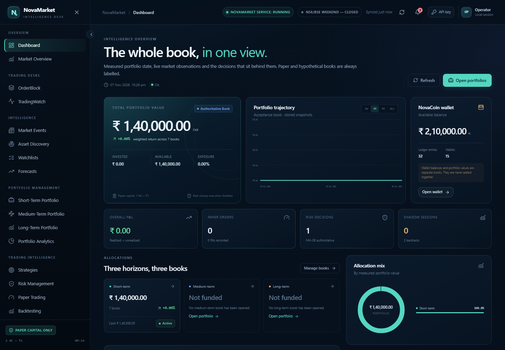
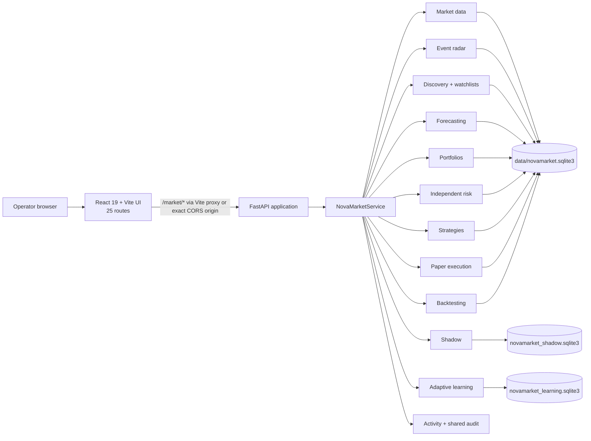

# NovaMarket

**Paper-only financial intelligence, portfolio, risk and simulated-execution desk.**

NovaMarket is a standalone web application for market research, portfolio construction, independent risk assessment, strategy proposals, **simulated** paper execution, backtesting, shadow observation and controlled adaptive learning.

> **Safety boundary:** NovaMarket has no broker client, no live-order route and no real-money trading path. `GET /market/execution/status` reports `paper_only: true`, `live_trading: false` and `broker_connected: false`. Paper fills are simulation results, not exchange executions. Market-data availability does not imply live trading capability.

**Status:** NM-01 through NM-14 accepted baseline (9 November 2026), extended by the PI-01 through PI-24 prediction-intelligence roadmap (18 November 2026). NM-14 acceptance is **PASS within internal acceptance scope** (25/25 routes, 480/480 recorded controls, 792 passed tests, 2 skipped); PI-24 closes at **PASS for implementation and integration scope**, with its production/live-data qualification **PARTIAL**. The generated API reference covers **933 routes**. External WCAG certification and independent penetration testing are **not** claimed. See [Release Notes](docs/RELEASE_NOTES.md), the [NM-14 final report](docs/NM14_FINAL_ACCEPTANCE_REPORT.md) and the [PI-24 final report](docs/PI24_FINAL_COMPLETION_REPORT.md).



*Dashboard captured in the isolated acceptance environment. It is evidence of the implemented interface, not a current quote or a recommendation.*

## What NovaMarket is

NovaMarket combines one backend service with one React frontend:

- **Market intelligence:** NSE/BSE instruments, stored OHLCV, quotes with provenance, market events, discovery candidates and watchlists.
- **Research:** measured probabilistic forecasts with model provenance and uncertainty.
- **Portfolio management:** short-, medium- and long-term books, explicit funding, holdings, valuation and performance.
- **Risk:** an independent, versioned policy engine that can approve, restrict, reject or require review; it never executes the action it evaluates.
- **Strategies:** catalogue-backed signal engines, lifecycle state and risk-gated proposals.
- **Paper execution:** simulated orders, partial/full fills, fees, slippage, reservations, positions and reconciliation.
- **Backtesting:** isolated point-in-time replay with costs, risk decisions and reproducibility checks.
- **Shadow mode:** hypothetical decisions and projections with no wallet, ledger, portfolio or execution gateway.
- **Adaptive learning:** evidence, experiments, candidate evaluation, governance, versioning and rollback.
- **Event intelligence:** ingestion, normalization, classification, verification, instrument/sector mapping, impact, timeline and outcome tracking over NM-04 evidence.
- **Prediction intelligence:** point-in-time datasets, features and regimes; statistical, gradient-boosting and LSTM models; ensembles with calibration, disagreement and uncertainty; chronological evaluation, research, filings and event-aware outcomes.
- **Forecast optimization:** PI-23 selection, reliability, calibration, drift and fallback records, exposed to decisions as **read-only evidence**.
- **Autonomous management and risk intelligence:** PI-21 review cycles, capital allocation and advisory proposals; PI-22 explainable position, concentration, correlation, volatility, scenario and liquidity risk.
- **Scheduling and dashboards:** PI-09/PI-10 lifecycle checkpoints, PI-16 drift and degradation monitoring, and consolidated dashboard and alert surfaces.

NovaMarket does **not** provide real-money execution, a brokerage connection, bank rails, investment advice or guaranteed returns.

## Project objectives

1. Make market observations auditable: every stored value carries source and time, and unavailable data is shown as unavailable.
2. Separate books: the wallet, each portfolio, paper execution, backtests, shadow sessions and learning records have explicit boundaries.
3. Make risk independent: strategies and execution cannot bypass the risk decision.
4. Keep every financial mutation deterministic and explainable, using exact decimal accounting and an append-only ledger.
5. Keep the product honest: empty, stale, blocked and unverified states are displayed as such.

## Major capabilities

| Area | What is implemented |
|---|---|
| Market data | Yahoo, CoinGecko and optional Alpha Vantage adapters; official NSE/BSE bhavcopy import scripts; append-only SQLite observations and bars; freshness/quality checks |
| Discovery | Event radar, candidate scoring, watchlist lifecycle and membership history |
| Forecasting | Probabilistic point forecasts, ranges, calibration and model lifecycle |
| Portfolios | Three horizons, funding from a NovaCoin wallet, valuation, holdings, performance, rebalance proposals and reconciliation |
| Risk | Independent policy gates, decisions, alerts, stress scenarios and versioned limits |
| Strategies | Catalogue, configuration versions, signals, conflicts and proposals |
| Paper execution | Simulated market/limit/stop/stop-limit orders, fills, fees, slippage, reservation and expiry |
| Backtesting | Historical replay, costs, risk, walk-forward, sensitivity, data quality and verification |
| Shadow | Non-executing sessions, decisions, projections, outcomes, comparisons and health |
| Learning | Evidence, experiments, candidate evaluation, approval, promotion, rollback and monitoring |
| Operations | Health, capabilities, activity, audit, notifications and lifecycle controls |
| Event intelligence | Event ingestion, normalization, classification, verification, instrument/sector mapping, impact, timeline and outcomes |
| Prediction intelligence | Datasets, features/regimes, statistical, gradient and LSTM models, ensembles, chronological evaluation and event-aware outcomes |
| Forecast optimization | PI-23 selection, reliability, calibration, drift and fallback records, surfaced as read-only decision evidence |
| Portfolio management | PI-21 review cycles, allocation, rebalance proposals, attribution and advisory hand-off |
| Risk intelligence | PI-22 position, concentration, correlation, volatility, scenario, stress and liquidity analytics with explicit evidence gaps |
| Research and filings | Company research, filing ingestion and evidence libraries |
| Scheduling and dashboard | Lifecycle checkpoints, drift monitoring, consolidated dashboards, alerts and notifications |

## Architecture at a glance



NovaMarket composes the existing NovaControl runtime, event bus, state store and audit logger. It does not create a second runtime or database engine. See [Architecture](docs/ARCHITECTURE.md) for boundaries and data ownership.

## Technology stack

Verified from `pyproject.toml`, `web/package.json` and the running application:

| Layer | Technology |
|---|---|
| Backend | Python 3.12+, FastAPI 0.141.1, Starlette 1.6.0, Uvicorn, Pydantic 2 |
| Persistence | Python standard-library SQLite, WAL mode, append-only financial histories |
| Runtime | NovaControl application/module lifecycle, typed event bus, state store, audit logger |
| Frontend | React 19.1, TypeScript 5.8, Vite 6, lucide-react |
| Tests | pytest, mypy strict, Node for frontend build/type checking |
| HTTP documentation | FastAPI OpenAPI at `/docs`, `/redoc`, `/openapi.json`, plus [generated API.md](docs/API.md) |

The acceptance machine ran Python 3.13, Node 24 and npm 11. Python 3.12 is the declared minimum. Node 18+ is Vite 6's minimum; Node 20/22 LTS is recommended.

## Installation

The repository's verified local path is Windows PowerShell. The launcher expects the virtual environment **one directory above `novamarket/`**.

```powershell
# From the parent NovaControl directory
python -m venv .venv
.\.venv\Scripts\python.exe -m pip install --upgrade pip
.\.venv\Scripts\python.exe -m pip install -e ".[dev]"

cd novamarket
..\.venv\Scripts\python.exe -m pip install -e ".[dev]"

cd web
npm install

cd ..
.\start.ps1
```

The launcher starts the API on `http://127.0.0.1:8011`, the web UI on `http://127.0.0.1:5173`, waits for readiness and opens the browser. Use `.\start.ps1 --dry-run` to see the chosen ports, or `.\start.ps1 --no-open` to suppress the browser.

See [Installation and Setup](docs/INSTALLATION.md) for prerequisites, manual startup, database creation, provider configuration and troubleshooting.

## Startup URLs

| Service | Default URL |
|---|---|
| NovaMarket UI | http://127.0.0.1:5173/#/dashboard |
| API | http://127.0.0.1:8011 |
| API health | http://127.0.0.1:8011/health |
| OpenAPI / Swagger | http://127.0.0.1:8011/docs |
| ReDoc | http://127.0.0.1:8011/redoc |
| Legacy read-only workspace page | http://127.0.0.1:8011/market/workspace |

The Vite UI is the primary interface. The FastAPI root (`/`) belongs to NovaControl, not to the React NovaMarket desk.

## Configuration and data

NovaMarket configuration is validated, versioned and persisted in `data/novamarket.json`; its live view is `GET /market/config`. The default mode is `observe`; `live` is refused and `paper` is reserved by the contract. Runtime financial state lives in:

- `data/novamarket.sqlite3` — market data, radar, discovery, forecasts, wallets, ledger, portfolios, risk, strategies, decisions and paper execution.
- `data/novamarket_shadow.sqlite3` — shadow sessions and decisions.
- `data/novamarket_learning.sqlite3` — learning evidence, experiments, candidates and versions.
- `data/novamarket_forecast_intelligence.sqlite3` — PI-23 selection, reliability and fallback evidence.
- `data/novamarket_risk_intelligence.sqlite3` — PI-22 risk assessments and snapshots.
- `data/novamarket_portfolio_management.sqlite3` — PI-21 review cycles, capital and snapshots.
- `data/novamarket_event_intelligence.sqlite3` — PI-24 event evidence and outcomes.
- `data/novamarket_evaluation.sqlite3`, `data/novamarket_research.sqlite3`, `data/novamarket_rl.sqlite3`, `data/novamarket_adaptive.sqlite3`, `data/novamarket_multiagent.sqlite3`, `data/novamarket_optimization.sqlite3`, `data/novamarket_dashboard.sqlite3` — PI-11 evaluation, research, RL, adaptive learning, multi-agent, optimisation and dashboard stores.
- `data/audit/audit.jsonl` — shared NovaControl audit trail.

The isolated `.ui_audit/` directory contains acceptance evidence and a separate SQLite database. It is **not** the normal runtime database.

See [Configuration Reference](docs/CONFIGURATION.md) for environment variables, all major settings, provider credential references, SMTP and database boundaries.

## Paper-only safety

- No broker client is implemented.
- No live-order execution path exists.
- No real-money trading is supported.
- `paper_only = true`, `live_trading = false` and `broker_connected = false` are reported by `GET /market/execution/status`.
- Shadow and learning status endpoints report `real_money: false` and `execution_connected: false`.
- Backtesting is isolated from paper books; shadow mode is non-executing.
- The risk gate cannot be bypassed from the UI or API.
- A paper fill is a simulated result, not a market fill.

Read [Paper Trading Guide](docs/PAPER_TRADING_GUIDE.md) before creating a paper order.

## Market-data scope and limitations

The 9 November acceptance evidence uses an **isolated audit database**, not the default runtime database:

- 4,535 of 4,535 eligible instruments were scanned: 0 skipped, 0 failed, 0 duplicates, 0 synthetic bars.
- 667 official NSE futures contracts across 224 underlyings.
- 6,625 official NSE index-option contracts; the reported NIFTY snapshot has 147 strikes and PCR 1.6528.
- Options IV is **model-derived with Black-Scholes**, not provider-reported IV.
- 99 BSE instruments have no bar because their symbols were absent from the downloaded BSE session; 151 recent listings have only 3–29 bars.
- The official derivatives snapshot is EOD data for 6 November 2026, not a live intraday feed.
- Yahoo and CoinGecko are delayed/unofficial sources with their own coverage limits; Alpha Vantage is optional and requires a credential reference.

**Do not treat screenshots, audit snapshots or historical bars as current market data.** See the [NM-14 report](docs/NM14_FINAL_ACCEPTANCE_REPORT.md) for the full evidence and dates.

## Testing and verification

Run from `novamarket/` with the parent virtual environment:

```powershell
$env:PYTHONPATH = "src"
..\.venv\Scripts\python.exe -m pytest tests/test_novamarket*.py tests/test_market_screener.py -q
..\.venv\Scripts\python.exe -m pytest tests/ -q
..\.venv\Scripts\python.exe -m mypy src
..\.venv\Scripts\python.exe -m mypy src --platform win32
..\.venv\Scripts\python.exe scripts\generate_api_reference.py --check
..\.venv\Scripts\python.exe scripts\verify_novamarket_chain.py
cd web
npm run build
```

The 9 November full regression was **792 passed, 2 skipped, 938 subtests passed in 176.90 s**. The production build succeeded with 1,598 modules; the chunk-size warning is informational.

These checks verify software behavior. They do **not** constitute an external accessibility audit, penetration test or investment-performance validation.

## Documentation

| Document | Purpose |
|---|---|
| [User Guide](docs/USER_GUIDE.md) | Every screen, control, workflow, expected output and limitation |
| [Installation](docs/INSTALLATION.md) | Prerequisites, setup, startup, database initialization and provider configuration |
| [Architecture](docs/ARCHITECTURE.md) | Backend/frontend structure, data boundaries, engines and integrations |
| [API Guide](docs/API_GUIDE.md) | Authentication, route groups, conventions and examples |
| [Generated API reference](docs/API.md) | Complete registered route inventory, generated from the API surface |
| [Configuration](docs/CONFIGURATION.md) | Environment variables, settings, providers, SMTP and database paths |
| [Paper Trading](docs/PAPER_TRADING_GUIDE.md) | Full simulated life cycle, fees, fills, ledger, reconciliation and learning |
| [Developer Guide](docs/DEVELOPER_GUIDE.md) | Development, adding routes/pages, tests, builds and safe financial changes |
| [Troubleshooting](docs/TROUBLESHOOTING.md) | Symptoms, supported causes, diagnostics and safe resolutions |
| [Release Notes](docs/RELEASE_NOTES.md) | NM-14 acceptance baseline, evidence, performance and limitations |
| [PI-24 final report](docs/PI24_FINAL_COMPLETION_REPORT.md) | PI-01 through PI-24 reconciliation, event-aware intelligence, verdict and limitations |
| [Prediction Intelligence architecture](docs/PREDICTION_INTELLIGENCE_ARCHITECTURE.md) | Datasets, models, ensembles, evaluation, forecast optimisation and decision evidence |
| [Filings](docs/FILINGS.md) | Filing ingestion, evidence and research integration |
| [Documentation Completion Report](docs/DOCUMENTATION_COMPLETION_REPORT.md) | What was documented, verified and left open |

## Known limitations

- **Paper-only by design.** There is no broker integration and no real-money path.
- **Data coverage is incomplete.** The full audit catalogue is not the default store, BSE has 99 zero-bar names and 151 recent listings have short histories.
- **Derivatives coverage is an official EOD snapshot.** There is no live option-chain or provider IV feed.
- **Model-derived IV.** Black-Scholes output is not an exchange-reported implied volatility.
- **EOD/delayed market data.** Quotes are observations at their timestamps; freshness must be checked before use.
- **Provider dependence.** Yahoo/CoinGecko availability and rate limits are outside NovaMarket's control.
- **Internal reviews only.** Accessibility and security results are automated/internal, not certifications.
- **PI-23 evidence scope is unresolved in production.** Decision signals carry the portfolio horizon (`short_term`, `medium_term`, `long_term`) while PI-23 records are keyed by `5m`…`90d`; the live decision path therefore records `unknown horizon 'short_term'` and attaches no evidence until a scope rule is chosen.
- **AT-03 candidate selection is blocked by an exchange-identifier mismatch.** Monitoring stores venue codes (`NSE`, `BSE`) while instrument ids are MIC-prefixed (`XNSE:`, `XBOM:`), so a real monitoring cycle produces no decision candidates. Both items are open defects found in live verification.
- **No investment advice.** Backtests and forecasts are research outputs, not promises.

## License and ownership

The package metadata declares a proprietary license. This documentation does not grant rights to redistribute the application or market data.
