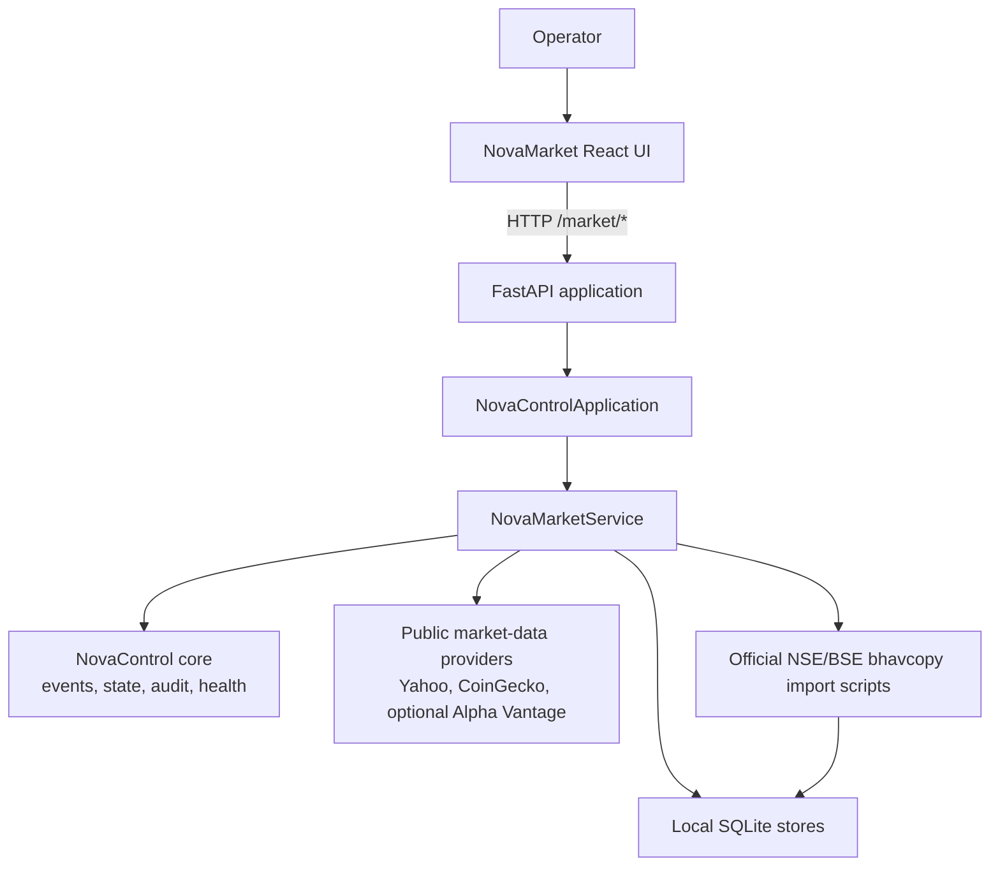
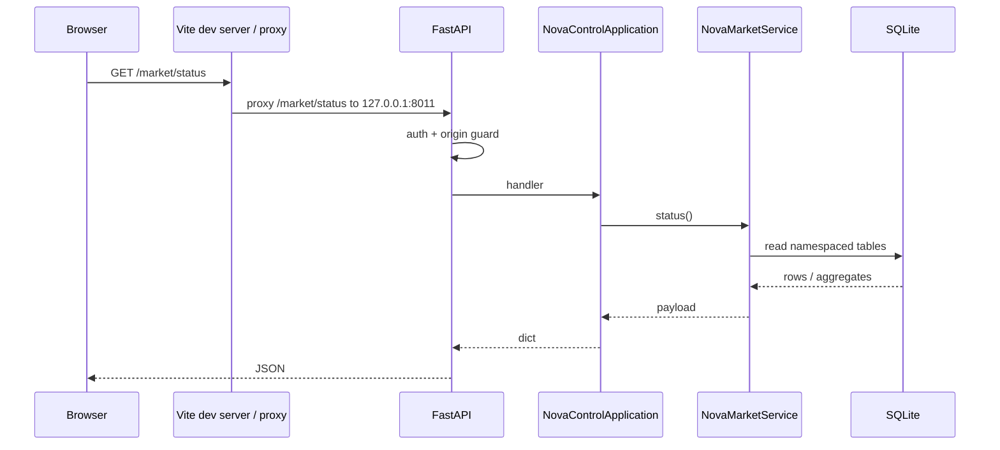
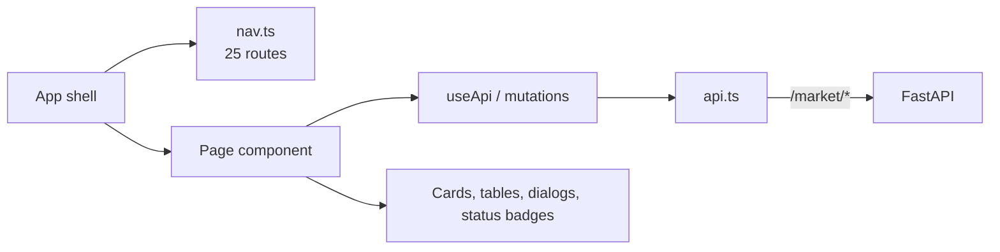
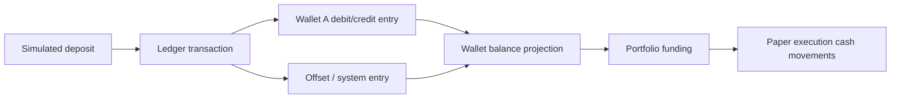
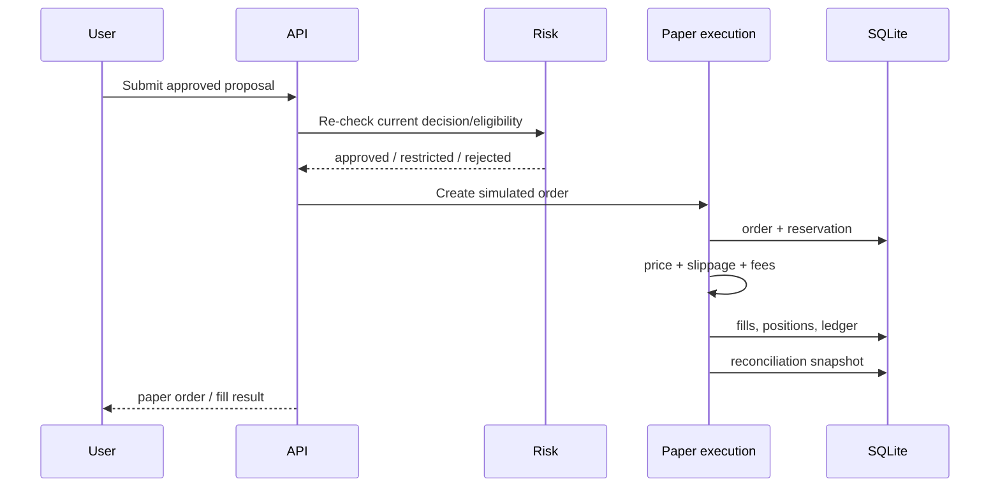
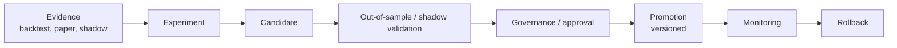

# NovaMarket Architecture

This document describes the **implemented** accepted baseline (NM-01–NM-14). It is an explanation, not a redesign proposal. NovaMarket is a paper-only system: there is no broker client, live-order path or real-money component.

## Contents

1. [System context](#1-system-context)
2. [Process and request structure](#2-process-and-request-structure)
3. [Backend architecture](#3-backend-architecture)
4. [Frontend architecture](#4-frontend-architecture)
5. [API layer](#5-api-layer)
6. [Market data](#6-market-data)
7. [Instruments, bars and observations](#7-instruments-bars-and-observations)
8. [NovaCoin wallet and ledger](#8-novacoin-wallet-and-ledger)
9. [Portfolio engine](#9-portfolio-engine)
10. [Risk engine](#10-risk-engine)
11. [Strategy engine](#11-strategy-engine)
12. [Paper execution](#12-paper-execution)
13. [Backtesting](#13-backtesting)
14. [Shadow mode](#14-shadow-mode)
15. [Adaptive learning](#15-adaptive-learning)
16. [Events, audit and notifications](#16-events-audit-and-notifications)
17. [Database boundaries](#17-database-boundaries)
18. [External providers](#18-external-providers)
19. [Error handling and recovery](#19-error-handling-and-recovery)
20. [Dependencies and integration rules](#20-dependencies-and-integration-rules)
21. [Prediction Intelligence (PI-01)](#21-prediction-intelligence-pi-01)
22. [Historical Market Datasets (PI-02)](#22-historical-market-datasets-pi-02)
23. [Low-Latency Market Data Gateway (PI-03)](#23-low-latency-market-data-gateway-pi-03)
24. [Feature Engineering & Market Regime Detection (PI-04)](#24-feature-engineering--market-regime-detection-pi-04)
25. [Statistical Baseline Forecasting (PI-05)](#25-statistical-baseline-forecasting-pi-05)
26. [Gradient-Boosting Forecasting (PI-06)](#26-gradient-boosting-forecasting-pi-06)
27. [LSTM Deep-Learning Forecasting (PI-07)](#27-lstm-deep-learning-forecasting-pi-07)

## 1. System context



NovaMarket is a module inside the existing NovaControl runtime. It reuses NovaControl's application lifecycle, state store, typed event bus and automation audit log instead of starting a separate server framework or a second event system. The frontend is its own Vite/React application.

The **paper-only boundary is structural**, not a UI preference:

- the execution package has no broker adapter;
- no configuration value selects a live venue;
- no API route submits a real order;
- risk approval cannot be skipped by the paper executor;
- shadow sessions have no execution gateway;
- learning cannot execute trades.

## 2. Process and request structure



Requests are asynchronous at the FastAPI boundary. Domain services are composed lazily by `NovaMarketService`; SQLite stores are local to the process. Market-data fetches may run in worker threads and are published through the NovaControl event bus as progress events.

The UI calls the API through relative paths (`/market/...`). In development Vite proxies them; in a built frontend the API origin is configured at build time. The API's CORS allowlist and origin guard are separate controls, both intentional.

## 3. Backend architecture

### Composition root

`NovaMarketService` (`src/novacontrol/novamarket/service.py`) is the domain composition root. It owns lifecycle state and lazily constructs:

- market-data engine and store;
- event radar and discovery;
- watchlists;
- forecasting;
- finance/wallet and portfolio engines;
- risk engine;
- strategy engine;
- paper execution service;
- backtesting service;
- shadow service;
- learning service.

It also reports module status, permissions, contracts and readiness. It is constructed by `NovaControlApplication`; the API does not instantiate feature services directly.

### Lifecycle

NovaMarket has explicit lifecycle states and operational guards. Starting the standalone app enables the module. When NovaMarket is not operational, dependent features raise an operational error that the API maps to **409 Conflict** rather than returning a misleading empty success.

The service exposes a status surface that reports module phases (NM-01 through NM-14), subsystem availability and contracts. The execution and shadow status payloads are the authoritative runtime safety declarations.

### Package map

```text
src/novacontrol/novamarket/
├── service.py            # composition, lifecycle, status, cross-module orchestration
├── config.py             # validated NovaMarket configuration
├── marketdata/           # providers, store, ingestion, universe, calibration, options/futures
├── radar/                # event detection and observation store
├── discovery/            # candidates and watchlists
├── forecasting/          # NM-06 probabilistic forecasts
├── prediction/           # PI-01 prediction contracts, lifecycle, ensemble, evidence
├── datasets/             # PI-02 historical dataset versions and training samples
├── gradient/             # PI-06 XGBoost/LightGBM forecasting, artifacts and explanations
├── lstm/                 # PI-07 CPU PyTorch sequence models, artifacts and explanations
├── finance/              # NovaCoin wallet, ledger, portfolios
├── risk/                 # policies, decisions, alerts, stress
├── strategy/             # catalogue, signals, proposals
├── execution/            # paper orders, pricing, fees, fills, positions, reconciliation
├── backtesting/          # historical replay and verification
├── shadow/               # non-executing observation
└── learning/             # evidence, experiments, candidates, promotion
```

Package boundaries are deliberate. A route may compose domain services, but a domain service should not import FastAPI or browser concepts.

### Startup order

The parent application loads settings before constructing the brain/runtime, then constructs NovaMarket with the configured data directory. NovaMarket schema creation is idempotent. Lazy feature services are created on first use so a failure in an optional subsystem does not prevent the rest of the desk from starting; that failure is surfaced in status and in the API error, not hidden as an empty dataset.

## 4. Frontend architecture

The frontend lives in `web/` and is a React 19 + TypeScript + Vite single-page application.

- `src/App.tsx` owns the route shell, sidebar, active page, API-token dialog and global layout.
- `src/nav.ts` is the route/navigation registry: **25 routes in 7 groups**.
- `src/pages/*.tsx` contains the screen-level workflows.
- `src/lib/api.ts` provides the authenticated JSON client, error normalization and typed helpers.
- `src/components/*` contains shared layout, tables, badges, dialogs, toasts and charts.
- `src/lib/format.ts` centralizes money, date and number formatting.

Routing is hash-based (`#/dashboard`, `#/market`, etc.). Each page uses a shared `useApi` hook for reads and explicit mutation helpers for writes. Financial arithmetic is never performed in a browser for authority: the UI renders backend balances, quantities, prices and fees.



The UI is presentation and orchestration. It does not own the ledger, risk policy, fill logic or valuation. A control such as **Deposit** posts to the API and then refreshes the authoritative response.

### Route groups

| Group | Routes |
|---|---|
| Overview | Dashboard, Market Overview |
| Trading desks | OrderBlock, TradingWatch |
| Intelligence | Market Events, Asset Discovery, Watchlists, Forecasts |
| Portfolio Management | Short-Term, Medium-Term, Long-Term Portfolio, Portfolio Analytics |
| Trading Intelligence | Strategies, Risk Management, Paper Trading, Backtesting, Shadow Mode, Adaptive Learning |
| Financial Records | NovaCoin Wallet, Transaction History, Ledger |
| System | Notifications, Activity and Audit, System Health, Settings |

## 5. API layer

The API is created by `create_app()` in `src/novacontrol/api/app.py`. NovaMarket routes are registered under `/market`. The generated inventory is [API.md](API.md); the main guide is [API_GUIDE.md](API_GUIDE.md).

Important API properties:

- `GET /health` is public.
- Protected routes use the shared `require_auth` dependency: if `NOVACONTROL_API_TOKEN` is set, a valid `Authorization: Bearer` header is required.
- Mutations are checked by an origin guard in addition to CORS. Browser requests with a foreign `Origin` are rejected.
- `NOVAMARKET_CORS_ORIGINS` is an exact allowlist. `NOVAMARKET_ALLOWED_ORIGINS` extends the application's origin guard for trusted local origins.
- FastAPI validation errors return 422; domain/state errors are mapped to explicit HTTP statuses. NovaMarket is not operational → 409; unauthorized → 401; forbidden origin → 403.
- `/docs`, `/redoc` and `/openapi.json` are available for the running application.

The API surface is registered in more than one place by design: the handler, the `ApiSurface` registry, route-consumer declarations and generated reference must agree. `scripts/generate_api_reference.py --check` is the synchronization gate.

## 6. Market data

### Ingestion paths

| Source | Use | Status |
|---|---|---|
| Yahoo Finance | Public quote/history adapter | Implemented; unofficial, delayed/limited |
| CoinGecko | Crypto quotes/history | Implemented; public API limits apply |
| Alpha Vantage | Optional public provider | Implemented; needs a configured credential reference |
| NSE bhavcopy importer | Official NSE equity EOD data | Implemented script |
| BSE bhavcopy importer | Official BSE equity EOD data | Implemented script |
| NSE F&O bhavcopy importer | Official NSE futures/options EOD data | Implemented script |

Provider data is **observed**, timestamped and stored. NovaMarket never rewrites an observation to look fresher. The market-data store keeps an append-only observation history plus instrument and bar tables.

### Data quality and freshness

The market-data layer tracks quality, staleness and provenance. A quote has an observed timestamp and source; a bar has a session date and source. Consumers such as risk and forecasting must decide from the freshness fields whether the input is usable.

The accepted audit found:

- 4,535 of 4,535 eligible instruments scanned;
- 0 skipped, failed or duplicate records;
- 99 BSE instruments with no bar because their symbols were absent from the downloaded BSE session;
- 151 recent listings with only 3–29 bars;
- no synthetic bars introduced to fill gaps.

These are **audit-database** results. A normal runtime store may be empty, partial or older. Never present an audit result as a current market snapshot.

### Official derivatives snapshot

The NSE F&O importer produced an official EOD snapshot for the audit:

- 667 futures contracts across 224 underlyings;
- 6,625 index-option contracts;
- 147 NIFTY option strikes;
- PCR 1.6528.

Option **implied volatility is model-derived** with Black-Scholes from the official settlement/premium data. It is not a provider-reported IV. The snapshot's trade date (6 November 2026 in the acceptance evidence) must be shown with any use of the data.

## 7. Instruments, bars and observations

The core model separates:

- **instrument identity** — symbol, exchange, asset class, currency, sector/industry and identifiers;
- **observation** — a timestamped provider value with source and quality metadata;
- **bar** — an OHLCV interval keyed by instrument and time;
- **contract metadata** — expiry, strike, option type, underlying for derivatives.

This separation prevents a quote, a daily close and a model-derived value from being treated as the same kind of fact. Instrument discovery and universe sync add identities; they do not fabricate prices. A missing bar remains missing and is visible in data-quality output.

## 8. NovaCoin wallet and ledger

NovaCoin (NC) is the application's **simulated unit**, with 1 NC = ₹1 for paper accounting. It is not a cryptocurrency, bank balance or withdrawable asset.



Properties:

- amounts are exact decimals, with at most 2 decimal places for wallet operations;
- the ledger is append-only; corrections are mirrored/reversal entries, not destructive edits;
- every wallet balance is derived from and reconcilable against ledger entries;
- transfers are atomic and conserve NC across wallets;
- idempotency keys protect deposit/withdraw/transfer requests from duplicate posting;
- a portfolio is funded by an explicit wallet operation; the UI does not invent cash.

The wallet, portfolio cash and paper fees share one unit and one ledger authority. The browser never performs authoritative balance arithmetic.

## 9. Portfolio engine

Three explicit horizons exist:

| UI label | Stored horizon |
|---|---|
| Short-Term Portfolio | `short_term` |
| Medium-Term Portfolio | `medium_term` |
| Long-Term Portfolio | `long_term` |

A portfolio is a book with:

- initial capital and current cash;
- holdings and quantities;
- valuation and cost basis;
- realized/unrealized performance and fees;
- lifecycle status: `initializing`, `active`, `under_review`, `rebalancing`, `paused`, `suspended`, `closed`;
- contribution/withdrawal or funding movements through the wallet;
- a current rebalance proposal and its history.

Portfolio Analytics is a separate read surface over all books. Cross-portfolio totals are not a substitute for each book's ledger/cash reconciliation.

### Portfolio proposals

A portfolio rebalance proposal is **not** a strategy proposal. It is a validated, versioned intent describing target weights/orders for that portfolio. It can be applied only after validation. Its statuses are `validated`, `applied`, `rejected`, `expired`, `superseded`, `failed`. It does not connect to a broker.

## 10. Risk engine

Risk is an independent service, not a function inside the strategy or execution code. It consumes a proposal/order intent, the portfolio state, the market snapshot and a **versioned policy**, then returns one of:

`approved`, `rejected`, `restricted`, `requires_review`, `insufficient_data`.

The policy is versioned so a decision can be audited against the limits that produced it. NovaMarket includes short/medium/long-term policy defaults for concentration, sector exposure, cash, drawdown, volatility, liquidity, turnover, forecast/data/state age and aggregate exposure. Defaults are simulation defaults, not personal investment advice.

Risk can:

- approve with conditions;
- reduce/restrict size;
- reject and state the violated rule;
- require review;
- return insufficient data when evidence is stale or missing;
- produce alerts and stress-test scenarios.

Risk does **not** place, amend or cancel an order. Execution must honor a current approval; risk eligibility is re-checked rather than inferred from a proposal's label.

## 11. Strategy engine

The strategy subsystem contains:

- a catalogue and category metadata;
- deterministic signal engines;
- versioned strategy configurations;
- signal/conflict records;
- proposal lifecycle;
- evaluation and explanation.

Strategy lifecycle statuses are `draft`, `active`, `paused`, `degraded`, `suspended`, `retired`. Proposal statuses are `created`, `pending_risk`, `approved`, `rejected`, `restricted`, `expired`, `cancelled`, `forwarded_to_execution`.

A strategy proposal is a **request**, not an order. It becomes usable by paper execution only after risk approval, while unexpired and with its quantities/prices still valid. The UI can show a proposal's risk decision and then offer **Submit from proposal**.

## 12. Paper execution



The execution service:

1. validates the proposal and quantity;
2. enforces current risk approval;
3. creates a paper order with a reservation;
4. prices the simulated fill from available market evidence;
5. applies configured slippage and fee components;
6. writes fills and positions;
7. posts the wallet/ledger cash movements;
8. records reconciliation;
9. reports status and provenance.

Order statuses: `created`, `pending_validation`, `accepted`, `open`, `partially_filled`, `filled`, `cancel_pending`, `cancelled`, `rejected`, `expired`, `failed`.

The fill is **simulated**. The engine can model partial fills and cancel/expire unfilled remainder, but it never sends an order to an exchange or broker. There is no live-order code path, and the status contract reports `live_trading: false` and `broker_connected: false`.

## 13. Backtesting

Backtesting is a historical replay engine, not a paper book and not a live strategy run. It uses:

- a strategy version and configuration;
- stored instrument bars;
- point-in-time events/forecasts where configured;
- the same class of risk policy evaluation;
- explicit fees and slippage;
- a deterministic clock and run identity.

It produces metrics, trades, orders, decisions, signals, data-quality findings, comparisons and a verification/reproducibility result. Sensitivity and walk-forward runs are explicit variants, not hidden optimization. A backtest has no wallet, no live portfolio mutation and no broker gateway. Its database rows are separate runs keyed by backtest ID, even though the accepted store shares the main SQLite file.

Backtest output is conditional on input data. Missing bars, short histories and stale snapshots are reported; they are not backfilled with synthetic prices.

## 14. Shadow mode

Shadow mode observes a strategy/portfolio allocation and records hypothetical decisions without moving money or touching the execution gateway.

- lifecycle statuses: `created`, `running`, `paused`, `stopped`, `completed`, `cancelled`, `failed`;
- records decisions, projections/outcomes, comparisons and health;
- `GET /market/shadow/status` reports `real_money: false` and `execution_connected: false`;
- `nm13_activated` is false in the accepted baseline.

Shadow results estimate what would have happened under stated assumptions. They are not live performance, paper fills or proof of profitability. Shadow data lives in `novamarket_shadow.sqlite3`.

## 15. Adaptive learning

The learning subsystem is an evidence-governed improvement loop:



It stores evidence, experiments, candidates, evaluations, approvals, promotions, versions and monitoring. Candidate statuses include `generated`, `evaluating`, `pending_approval`, `approved`, `shadow_validation`, `promoted`, `rolled_back`, `archived`.

Promotion is versioned and reversible. Learning cannot execute a trade, alter the ledger or bypass the risk engine. `GET /market/learning/status` reports `executes_trades: false`, `execution_connected: false` and `real_money: false`.

Learning data lives in `novamarket_learning.sqlite3`, separate from paper financial state. It is not a guarantee that a promoted model improves future returns.

## 16. Events, audit and notifications

NovaMarket uses the shared NovaControl event bus. Feature modules publish typed events (for example, market-data progress, risk/alert changes, execution and shadow status). The API can expose an SSE activity stream for live progress; the React UI subscribes to it through the documented activity client.

Audit:

- the shared audit logger records operator/system activity and automation actions;
- the NovaMarket **Activity and Audit** page reads the activity surface;
- the ledger and execution records are themselves append-only evidence;
- notifications are separate from audit and can be marked read/dismissed where supported.

Events are not a substitute for durable state. If the UI disconnects, the authoritative data remains in SQLite and the page can refetch it.

## 17. Database boundaries

| Store | Default path | Owns |
|---|---|---|
| Main runtime | `data/novamarket.sqlite3` | instruments, bars, observations, radar, discovery, watchlists, forecasts, wallets, ledger, portfolios, risk, strategies, paper execution, backtests |
| Shadow | `data/novamarket_shadow.sqlite3` | shadow sessions, decisions, projections, outcomes, comparisons |
| Learning | `data/novamarket_learning.sqlite3` | evidence, experiments, candidates, approvals, versions, monitoring |
| Config | `data/novamarket.json` | validated NovaMarket configuration snapshot |
| Shared audit | `data/audit/audit.jsonl` | NovaControl audit trail |
| Acceptance audit | `.ui_audit/nse_import.sqlite3` | isolated NM-14 evidence; **not** the runtime store |

Each database uses its own schema and connections. Do not copy shadow/learning rows into the main financial database, and do not treat `.ui_audit` as production data. Backups must include all three databases and the config file if you need a complete, reproducible desk.

## 18. External providers

| Provider | Credential | Data | Caveat |
|---|---|---|---|
| Yahoo Finance | None required | Public quotes/history | Unofficial; availability and delay vary |
| CoinGecko | None required | Public crypto quotes | Rate limits and coverage vary |
| Alpha Vantage | Credential reference | Optional quotes/history | Requires configuration; limits apply |
| NSE/BSE bhavcopy files | None in app | Official EOD equities/derivatives | Must be downloaded/imported; coverage depends on the session file |
| SMTP | Host/user/password/from | Notification email | Optional; no email is sent unless configured |

Provider credentials are resolved through the existing NovaControl credential mechanism, not written into the React bundle. No provider is a broker. A market-data key gives you data access only; it does not create order capability.

## 19. Error handling and recovery

- **Validation errors** are explicit: invalid quantities, prices, identifiers, config values or state transitions are refused with a message.
- **Operational errors** are 409 when NovaMarket or a subsystem is not ready. They are not silently converted to success.
- **Not found** resources return 404 where the route supports it.
- **Risk refusals** are domain outcomes, not HTTP glitches; the UI shows the violated rule.
- **Duplicate mutations** are protected by idempotency keys where the ledger/execution contract requires them.
- **Reconciliation** compares wallet/portfolio/execution records and reports mismatches. It does not invent a repair or hide a discrepancy.
- **Partial failures** leave evidence (status, audit/activity, error detail) and do not report a completed financial action.
- **Execution restarts** re-read durable orders/fills; there is no in-memory-only order book as the authority.

The system is designed to fail visibly. If a required data or risk input is missing, the correct outcome is `insufficient_data`, `blocked` or `failed`, not a guessed success.

## 20. Dependencies and integration rules

### Direction of dependencies

```text
React pages -> API client -> FastAPI handlers -> NovaControlApplication -> NovaMarketService
                                                        -> domain services -> SQLite
                                                        -> shared core (events, audit, state)
```

Domain packages may depend on shared core primitives and each other through the service interfaces. They must not depend on React, FastAPI request objects or a second persistence engine.

### Preserve these boundaries

- The **risk engine** remains independent; do not fold risk checks into strategy or execution.
- **Paper execution** remains the only order execution implementation; do not add a broker adapter.
- **Shadow mode** stays non-executing and separate; do not route it through the paper ledger.
- **Backtests** stay historical/reproducible and separate from live paper books.
- **Ledger** entries stay append-only and exact-decimal.
- **Provider observations** stay source/time-labelled; never synthesize missing bars.
- **API registration** stays synchronized across handler, surface registry, route-consumer declarations and generated docs.
- **Frontend authority** stays on the backend; do not calculate balances, prices or fees locally.

## 21. Prediction Intelligence (PI-01)

PI-01 adds the Prediction Intelligence contracts and existing-system integration
without replacing any NM authority. The full architectural reference is
[PREDICTION_INTELLIGENCE_ARCHITECTURE.md](PREDICTION_INTELLIGENCE_ARCHITECTURE.md).

The seven capability domains are declared in `PREDICTION_DOMAIN_BOUNDARIES`:
virtual market/financial system, market-data intelligence, prediction
intelligence, forecast lifecycle, autonomous trading intelligence,
reinforcement learning and performance/observability. The additive PI-01–PI-16
roadmap is `PREDICTION_ROADMAP`; it does not rename or reorder the canonical
NM-01–NM-14 roadmap.

PI-16 adds isolated adaptive-learning research (regime evidence, drift and
degradation detection, advisory recommendations and bounded reassessment).
PI-17 adds nine coordinated read-only financial specialists, validated evidence
provenance and an advisory aggregation/handoff layer. Neither phase changes the
authority boundary below: multi-agent output is research evidence, and any paper
action must still be re-derived by PI-12, reassessed by NM-08 and submitted by
NM-10.

The core boundaries are:

- `PredictionDataGateway` reads the existing NM-02 engine and preserves both
  source-observed and received timestamps; a cached observation never becomes
  fresh.
- `EnsembleAssembler` filters eligible model outputs, weights them, detects
  disagreement and abstains instead of inventing certainty. Probabilities are
  carried only when all participants declare calibration.
- `PredictionIntelligenceService` persists immutable T−20/T−5/T−1 forecasts and
  evaluates them at T. Missing or stale data is recorded as skipped/unconfirmed,
  never fabricated.
- `DecisionForecastEvidence` is read-only and always has
  `authorizes_action=false`. NM-08 remains the sole risk authority and NM-10 the
  sole paper-execution authority.
- Prediction tables share the existing NovaMarket SQLite file; forecasts,
  stages, evaluations and evidence are protected by immutable triggers.
- The low-latency intraday path has its own bounded policy, but preserves the
  15-minute general refresh floor, existing rate limits, fair rotation and the
  20-instrument discovery cap.

PI-01 adds no HTTP routes and no production forecasting scheduler, model
training or reinforcement-learning implementation. Those belong to later PI
phases; the contracts and safety boundaries they must use are now implemented.

## 22. Historical Market Datasets (PI-02)

PI-02 adds `src/novacontrol/novamarket/datasets/` as an additive layer over the
NM-02 market-data engine. It stores dataset versions and member references; it
does not add a provider, collector, price store or second database. Full design
details are in
[PREDICTION_INTELLIGENCE_ARCHITECTURE.md](PREDICTION_INTELLIGENCE_ARCHITECTURE.md#16-historical-market-dataset-engine-pi-02)
and verification in [PI02_COMPLETION_REPORT.md](PI02_COMPLETION_REPORT.md).

The boundaries are:

- Acquisition calls `MarketDataEngine.ingest_history`, preserving adapter
  selection, retries, rate limits, circuit breakers, fair rotation and the
  existing normalization/quality/store path.
- Dataset members reference authoritative `bar_id`s. OHLCV is never copied into
  dataset tables and no dataset can rewrite a stored observation.
- Dataset tables share the existing NovaMarket SQLite file and are protected by
  immutable triggers for versions, members, selections, gaps and training rows.
- Raw and adjusted series stay separate. Adjusted views are derived on retrieval
  only from sourced, verified corporate actions with an explicit price factor.
- Training sets are chronological and purged; features are at or before the
  decision timestamp and targets are strictly later. Invalid or unverified data
  cannot enter trusted training membership.
- Dataset quality is its own vocabulary and does not replace NM-02 `DataQuality`.

PI-02 added no HTTP routes and did not implement PI-03. Its capabilities, events
and permissions extend the existing PI-01 registries and are reported through
`/market/status` and `/market/contracts`. PI-03 is an additive gateway over the
same engine and is described next.

## 23. Low-Latency Market Data Gateway (PI-03)

PI-03 adds `marketdata/gateway.py` as the controlled acquisition and
distribution boundary for new market-data consumers. It is a composition layer,
not a second market-data subsystem:

- The gateway owns no provider, transport, SQLite store, validation engine,
  scheduler queue or historical authority. It calls the existing
  `MarketDataEngine`, `MarketDataStore`, provider adapters, calendars,
  freshness/quality code, retry policy, rate limiters, quotas and circuit
  breakers. Historical reads delegate to the engine and therefore to PI-02.
- `NovaMarketService.gateway()` opens it lazily over the same operational
  engine. The gateway is reported in `status.gateway` and `contracts.gateway`;
  it adds no HTTP route in PI-03. `PredictionIntelligenceService` and the
  historical dataset service keep their existing authorities.
- `GatewaySettings` is opt-in (`gateway.enabled=false` by default). The general
  worker keeps its `ingestion.poll_seconds=900` floor. The intraday path has
  its own bounded interval (the composed configuration requires less than the
  900-second floor), limited to resolutions the configured providers actually
  offer, and is started separately by the service lifecycle.
  It never changes the general poll interval or the 20-instrument discovery
  cap.

### Acquisition paths

The general path is the existing scheduled `MarketDataEngine.run_ingestion`
cycle and all existing general/historical consumers still use it. The intraday
path is `run_intraday_cycle`: it selects a bounded, fair, priority-aware batch,
skips instruments whose exchange calendar is closed (unless explicitly
configured to run when closed), and performs one quote/intraday-bar cycle using
the engine's existing `force_quotes` option only for that explicit batch. Both
paths use the same adapters and validation/store code. An on-demand
`gateway.refresh` is quote-only and is coalesced; it does not alter the general
schedule.

### Priority and fair rotation

Subscriptions carry one of six application-state priorities: active position,
pending paper order, forecast confirmation, autonomous candidate, watchlist and
general. The batch cap is the existing 20-instrument limit. Higher priorities
receive the primary allocation; a reserved lower-priority slice plus per-level
rotation prevents a large active-position book from starving watchlist or
general instruments. Priority never increases provider limits. The gateway's
aggregate request budget (`max_requests_per_minute`) is enforced in addition to
each adapter's own limiter and daily quota.

### Reads, cache and checkpoints

`current`, `observation` and `latest` read the latest validated reconciliation.
The read cache stores the engine result for `cache_ttl_seconds`, but freshness is
recomputed on every read; a cache hit never upgrades stale data to fresh.
`checkpoint` is the forecast-confirmation contract: it returns `available=true`
only when an observation exists, is usable, and its freshness is explicitly
accepted (default `fresh`). Missing, delayed, stale or conflicting data returns
`available=false` with the observation only as context, plus whether it is newer
than the previous checkpoint. The gateway never invents a price for a
checkpoint. The PI-09 scheduler remains the future caller; PI-03 supplies the
acquisition answer only.

### Provider contracts and provenance

Every provider adapter declares `source_class`, streaming support,
publication-timestamp support and its existing capabilities. The supported
classes are exchange, authorized redistribution, third-party delayed, delayed,
cached, historical, scraped and unknown. The free providers currently installed
are reported as delayed third-party sources; none is labelled exchange
real-time and none offers streaming. A selected provider other than the first
configured provider that declares the instrument's market is marked as a
fallback with the preferred provider and its last failure, preserving the
selected provider's identity and source timestamp.

Gateway observations retain source-observed, provider-response/reception,
validation, persistence and consumer-availability timestamps. Source age,
source-to-reception, provider request latency (from the append-only retrieval
log), persistence, distribution and total internal time are reported where the
underlying timestamps permit. Parsing and validation durations are not exposed
separately by the engine and are reported as unavailable rather than
fabricated. A separate publication timestamp is not supplied by the installed
providers, so source publication delay is explicitly unmeasurable. P50/P95/P99
are computed only from actual collected samples; fixture tests are not
presented as live latency evidence.

### Failure and conflict safety

HTTP 429 and other typed provider failures use the existing retry/backoff,
`Retry-After`, limiter, daily-quota and circuit-breaker paths. The gateway adds
provider failure classes, cooldown/throttle telemetry, retry counts, cache and
coalescing counters, and stale/checkpoint reasons. Reconciliation remains the
engine's responsibility: conflicting providers produce a conflict with every
observation retained and no selected/averaged price. The gateway reports the
conflict and never presents a lower-quality or stale fallback as a fresh
observation. Provider failure is isolated by the engine and cannot crash
unrelated NovaMarket functions.

## 24. Feature Engineering & Market Regime Detection (PI-04)

PI-04 adds `src/novacontrol/novamarket/features/` as the centralized feature and
regime layer over the existing PI-01 contracts, PI-02 dataset references and
PI-03/NM-02 validated observations. Full definitions and formulas are in
[PREDICTION_INTELLIGENCE_ARCHITECTURE.md](PREDICTION_INTELLIGENCE_ARCHITECTURE.md#18-feature-engineering--market-regime-detection-pi-04);
verification evidence is in [PI04_COMPLETION_REPORT.md](PI04_COMPLETION_REPORT.md).

- It owns no provider, collector, database file, indicator implementation,
  validation authority, risk authority or execution path. All indicator math
  lives in the existing `strategies/indicators.py`; features compose it.
- Generation is point-in-time: only completed bars with source observation time
  at or before `as_of` are accepted; quality-invalid bars are excluded; partial,
  future, duplicate, gap and out-of-order counts are recorded in lineage.
- The 122-feature registry is versioned (`pi04-feature-set-1.0`) and split into
  intraday, swing and long-term profiles. Feature sets are immutable,
  deterministic and persisted with definition/source/generation provenance.
- Multi-timeframe features use validated series or completed finer-bar
  aggregation. The current partial week/month bucket is never treated as a
  closed weekly/monthly observation.
- `RegimeDetector` (`pi04-regime-1.0`) reports one primary regime, simultaneous
  secondary conditions, supporting features, data quality and transitions;
  confidence stays uncalibrated (`None`). Uncertain/insufficient evidence is an
  explicit result, not a forced classification.
- Preprocessing fits only on supplied training rows and keeps missing/imputed
  status; selection reports correlation, redundancy, missingness, instability
  and leakage candidates without auto-deleting features.
- `NovaMarketService.feature_service` exposes generation, reads, preprocessing
  and selection; status/contracts are reported under `features`. PI-04 adds no
  HTTP route and cannot authorize an action or create a paper order.

For contribution procedures and verification commands, see [Developer Guide](DEVELOPER_GUIDE.md).

## 25. Statistical Baseline Forecasting (PI-05)

PI-05 adds `src/novacontrol/novamarket/statistical/` as the first operational
forecasting model family. It consumes the existing PI-01 contracts, PI-02
dataset versions (or the same NM-02 validated bars), PI-03 quality/freshness
decisions and PI-04 feature/regime outputs. It owns no market-data, dataset,
feature, risk or execution authority and introduces no new database.

- Models: `naive_last`, `random_walk`, `historical_return`, `seasonal_naive`,
  `sma`, `wma`, `ema`, `ses`, `holt`, `holt_winters` and a bounded pure-stdlib
  `arima` with ADF-style stationarity diagnostics, differencing, AR/MA fitting,
  companion stability, Ljung-Box residual diagnostics and normal-residual
  intervals. `statsmodels` is not installed; the limitation is documented.
- Every result is the existing PI-01 `ForecastOutput`, persisted in
  `prediction_forecasts`; model metadata is in `prediction_models`; evaluation
  history uses the existing NM-06 `ForecastStore`. No second persistence or
  prediction authority exists.
- Multi-horizon compatibility follows PI-01: 5m/15m/20m/1h intraday,
  1d/3d/5d swing and 30d/90d long-term. Daily bars cannot support intraday
  claims; targets use the exchange calendar when available. Insufficient
  history or an unsupported resolution is `unavailable`, not a fabricated
  forecast.
- Validation is chronological and walk-forward. Model/configuration selection
  uses validation return MAE plus directional accuracy; test data is scored
  only after selection. No random shuffling or future observations enter a fit.
  Reports retain dataset id/version, date ranges, origins and failure reasons.
- Direction is `up|down|neutral|uncertain`; the neutral band is configurable and
  an interval crossing zero is `uncertain`. Probabilities/confidence are always
  withheld (`unavailable`/`not_applicable`), because PI-05 has no calibrated
  probability estimator. Point baselines report no interval support.
- Metrics cover price/return error, bias, directional accuracy, precision,
  recall, F1, confusion, bullish/bearish/neutral accuracy, interval coverage
  and width, and by-regime/by-horizon breakdowns. Fewer than five samples in a
  regime is reported as insufficient.
- Existing `/market/forecasts*` routes are reused through
  `engine=statistical`; status/contracts are nested under `statistical`. Missing
  data is 422, unknown ids 404. A failed model is isolated and recorded as
  unavailable; it is never silently substituted.
- NM-08 remains the sole risk authority and NM-10 the sole paper-execution
  authority. No automatic model promotion occurs.

Full definitions, evaluation semantics and limitations are in
[PREDICTION_INTELLIGENCE_ARCHITECTURE.md](PREDICTION_INTELLIGENCE_ARCHITECTURE.md#19-statistical-baseline-forecasting-pi-05);
the consolidated evidence is in [PI05_COMPLETION_REPORT.md](PI05_COMPLETION_REPORT.md).

## 26. Gradient-Boosting Forecasting (PI-06)

PI-06 adds the `novacontrol.novamarket.gradient` forecasting family over the
same PI-01 contracts, PI-02 datasets, PI-04 features and stores used by PI-05.
It does not add a second dataset, feature, prediction or execution system.

- XGBoost and LightGBM use their native Python boosters. Each horizon gets an
  independent regressor for the forward simple return and, where supported, an
  independent three-class direction classifier. Price is derived from the
  reference close at inference; the classifier probabilities are withheld
  until calibrated.
- All PI-01 horizons are supported by target generation: 5m/15m/20m/1h
  intraday, 1d/3d/5d swing and 30d/90d long-term. A horizon is refused when the
  observed input resolution is too coarse or usable rows are insufficient;
  daily bars cannot produce an intraday claim.
- Chronological train/validation/test splits include a target-window purge gap.
  Preprocessing statistics, residual intervals and the neutral band are fitted
  on training/validation data only; the test block is scored once. Three
  bounded configurations are selected by validation price MAE (direction is
  only a tie-break), then refit on train + validation. Random splits,
  test-set tuning and future features are prohibited.
- Walk-forward evaluation refits the selected configuration on expanding
  windows and reports per-fold MAE/direction metrics and variation. It is
  separate from the single held-out test report.
- PI-05 baselines (last-value/random walk, SMA, SES, ARIMA) are scored at the
  exact same test origins. Per-family suitability is one of
  `gradient_suitable`, `baselines_preferred`, `provisional` or
  `insufficient_data`; overall preference is a family or
  `statistical_baseline`. Baseline-relative price/direction and interval
  coverage are checked; no universal accuracy cut-off is used. No result
  promotes a model automatically.
- Uncertainty is a validation-residual interval labelled uncalibrated. The
  forecast contract exposes validity/abstention reasons and missing-feature
  fraction, and inference abstains above the bounded interval width. Feature
  importance is native gain; local explanations are
  on-demand XGBoost/LightGBM TreeSHAP contributions, never confidence.
- Models persist natively under the store's data directory
  (`data/novamarket/gradient_models` in the application) with checksums,
  dependency versions, dataset/feature versions, target definition, splits,
  metrics and feature schema. Existing `/market/forecasts*` routes are reused
  through `engine=gradient`; `GET /market/forecasts/{forecast_id}/explain`
  adds on-demand local explanation. The React Forecasts page distinguishes
  statistical, XGBoost and LightGBM results and shows unsupported forecasts.
- Failures are isolated per family/horizon and preserve the actual model
  identity. Missing dependencies, insufficient data, schema mismatch, fit and
  artifact-load failures become explicit unavailable/failed records.
- NM-08 remains the sole risk authority and NM-10 the sole paper-execution
  authority. PI-06 adds no approval, trading or promotion authority.

Full definitions and limitations are in
[PREDICTION_INTELLIGENCE_ARCHITECTURE.md](PREDICTION_INTELLIGENCE_ARCHITECTURE.md#20-pi-06--gradient-boosting-forecasting);
the consolidated evidence is in [PI06_COMPLETION_REPORT.md](PI06_COMPLETION_REPORT.md).

## 27. LSTM Deep-Learning Forecasting (PI-07)

PI-07 adds `novacontrol.novamarket.lstm`, a CPU-first PyTorch sequence family
over the same PI-01 contracts, PI-02 datasets, PI-04 features, PI-05
baselines, PI-06 matrix/comparison helpers and existing stores. It is not a
second dataset, feature, prediction or model-registry system.

- A configurable chronological window of PI-04 feature vectors feeds a small
  LSTM with a return-regression head and a three-class direction head. Windows
  are built inside PI-02's train/validation/test blocks, so no future
  observation or target can enter an input.
- Sequence defaults are horizon-specific (30/20 intraday, 30 swing, 15 for
  30d/90d) and can be overridden. Every horizon is supported only when the
  observed resolution and post-purge history are sufficient; daily bars never
  establish an intraday claim.
- Preprocessing is a training-only robust median/IQR transform with explicit
  missing masks. It is persisted with the feature schema and loaded with the
  model; validation/test/inference reuse it, and targets are inverse-scaled.
- Training is bounded and deterministic: three architecture candidates, 40
  epochs maximum, early stopping, best-validation-state restoration, dropout,
  weight decay and gradient clipping. Validation price MAE selects; the test
  block is scored once and is never used for tuning.
- Uncertainty is a validation-residual interval, not a calibrated probability.
  Inference abstains on excessive interval width, missing/out-of-distribution
  inputs or artifact incompatibility. Classifier probabilities are withheld.
- Walk-forward refits, PI-05 baselines and PI-06 XGBoost/LightGBM on the exact
  same matrix are reported. Suitability is `lstm_suitable`,
  `baselines_preferred`, `provisional` or `insufficient_data`; no model is
  promoted automatically and LSTM has no risk or execution authority.
- Native state dictionaries persist under `data/novamarket/lstm_models` with
  SHA-256 and byte-size checks. Metadata, scaler, schema, provenance and
  metrics use the existing prediction/forecast stores. A failed fit or load
  leaves prior artifacts intact and other forecast families usable.
- Existing `/market/forecasts*` routes are reused through `engine=lstm` and
  the shared explain route. The React Forecasts page distinguishes
  statistical, XGBoost, LightGBM and LSTM engines and marks the sequence model
  experimental/provisional.

Recorded evidence covers RELIANCE daily and ADANIENT 1-minute data. Eight of
ten cases trained; 90d and 1h were refused for insufficient post-purge history.
All eight were provisional because residual intervals under-covered; the 30d
case had lower test MAE than the best PI-05 baseline but is not eligible. No
case reached `lstm_suitable`, so the simple baseline remains preferable.
Full definitions are in
[PREDICTION_INTELLIGENCE_ARCHITECTURE.md](PREDICTION_INTELLIGENCE_ARCHITECTURE.md#21-pi-07--lstm-deep-learning-forecasting);
the consolidated evidence is in [PI07_COMPLETION_REPORT.md](PI07_COMPLETION_REPORT.md).

## PI-19 — Advanced Market Intelligence and Financial Research

PI-19 adds `novacontrol.novamarket.research` as an isolated, advisory research
package over the existing NovaMarket service. It does not add a market-data
provider, forecast model, risk engine, portfolio optimizer, ledger or execution
path. `NovaMarketService` supplies a read-only context from NM-02 stored data,
PI-04 features/regimes, existing forecasts, the NM-04 event radar, sector flow
and NM-07 portfolio detail.

- `models.py` owns the versioned contracts: ten horizons, analysis types,
  verification statuses, evidence, statements, ratios, events, news, peers,
  macro observations, valuation assumptions/results, thesis and authority
  flags. Every run records its research ID, as-of cutoff, configuration and
  contract/schema versions, plus a horizon-derived `valid_until`; reading an
  expired run reports `expired: true` without deleting its evidence.
- `financials.py` preserves original values and units, normalizes units with an
  explicit multiplier, converts currencies only with a timestamped FX rate,
  selects the latest pre-cutoff restatement per period/basis/type, keeps
  consolidated and standalone statements separate, computes TTM only from four
  contiguous quarters, and returns unavailable ratios instead of undefined or
  misleading values.
- `evidence.py` applies point-in-time filtering and source-tier verification.
  Primary official records may be verified; independent records require two
  independent sources; AI/derived interpretation and instruction-bearing text
  remain unverified. Conflicting profile/claim values are preserved and marked
  `conflicting_evidence`.
- `intelligence.py` builds corporate events, news, sector, peer and macro
  context. Announcement, effective date and occurrence are separate; rumours
  never become confirmed events. Deterministic news sentiment is explicitly not
  a price-direction forecast.
- `valuation.py` exposes relative valuation and transparent DCF with explicit
  assumptions, a 3x3 discount-rate/terminal-growth sensitivity and stated
  limitations. An estimate is always labelled a derived research estimate.
- `thesis.py` links every factor to evidence, separates source reliability,
  evidence strength, forecast confidence and decision confidence, refuses to
  collapse them into a probability, and permits `insufficient_evidence`.
- `store.py` persists only `pr_*` tables in `novamarket_research.sqlite3`:
  runs, evidence, claims, sections, theses and audit events. It has no
  portfolio, position, ledger, order or risk tables.
- `service.py` owns bounded synchronous orchestration, concurrency and timeout
  limits, cancellation, idempotency, point-in-time refresh/versioning,
  rate-limited targeted monitoring (including stale runs), PI-04 feature
  candidates and structured PI-12/PI-17/PI-18 handoffs. Retention is bounded by
  the store's `pr_*` row limits; there is no separate archive endpoint.

Research is advisory. `can_submit_orders`, `can_mutate_portfolio`,
`can_write_ledger` and `can_change_autonomy` are false; NM-08 remains the sole
risk authority and NM-10 the sole paper-execution authority. Research features
are versioned and flagged `approved_for_production_forecasting: false` until
PI-04 evaluates them. No automatic model retraining, portfolio reallocation,
autonomy change, broker connection or background polling exists.

The HTTP surface is 24 routes under `/market/research*`, registered in
`api/app.py`, `ApiSurface`, `ROUTE_CONSUMERS` and regenerated `docs/API.md`.
The React workspace is the Financial Research page under Trading Intelligence.
Verification and limitations are recorded in
[PI19_COMPLETION_REPORT.md](PI19_COMPLETION_REPORT.md).

## PI-20 — Prediction Intelligence Dashboard and Decision Explainability

PI-20 adds `novacontrol.novamarket.dashboard` as a read-only composition layer
over the existing NovaMarket services. It owns no market data, model, forecast,
risk decision, portfolio valuation or order path. `DashboardService` receives
the live `NovaMarketService` and reads the existing PI-04 to PI-19 stores and
contracts; all authoritative calculations stay in their original services.

- `models.py` owns dashboard filters, status constants (`AVAILABLE`,
  `PARTIAL_DATA`, `STALE`, `INSUFFICIENT_EVIDENCE`, `UNAVAILABLE`, `FAILED`),
  bounded query helpers, the authority contract and the presentation-only
  preference model. `authority_contract()` reports `read_only: true` and the
  NM-08 risk / NM-10 execution ownership explicitly.
- `store.py` owns an isolated SQLite file with only `pd_dashboard_meta` and
  `pd_dashboard_configs`: filter presets and their timestamps. The selected
  view is a browser-local preference, not a financial table. There are no
  portfolio, position, ledger, risk, order or fill tables. A `:memory:` store is
  supported for tests, and the service closes it on shutdown.
- `service.py` composes and normalizes the read models: overview counts, model
  inventory and disagreement, instrument detail and bounded OHLCV history,
  forecast summaries, compatible-horizon comparison, multi-horizon views,
  PI-09 lifecycle checkpoints, PI-11 metrics, PI-04/PI-16 regime history,
  PI-17 decision cycles and evidence, PI-19 research, PI-18 portfolio context,
  PI-14/PI-15 experimental policy state, explainability and point-in-time
  replay. Missing collections are reported with a status and empty rows, never
  zero-filled financial values.
- Every read carries source timestamps, model/version identifiers where the
  source provides them, freshness and validity. Calibrated probability is only
  exposed under its own field; an uncalibrated detector/agent score is shown
  with its recorded kind and is never converted into a probability. Feature
  attribution is only included when the source explain endpoint actually
  returns computed contributions, and is labelled non-causal. Forecast
  accuracy, decision quality, execution quality and portfolio return remain
  separate fields.
- Replay filters forecasts, evidence, research, regimes, bars and news to the
  decision cutoff. It returns the recorded cycle and marks reconstructed values;
  it does not expose subsequently published sources as though they were known.

`NovaMarketService` constructs the dashboard lazily and exposes the read methods;
the application closes it during shutdown. The HTTP surface is 22 authenticated
routes under `/market/intelligence/*`, registered in `api/app.py`, `ApiSurface`
and `ROUTE_CONSUMERS`; `docs/API.md` is regenerated and the API reference is in
sync at 836 routes. The React workspace is `PredictionIntelligence.tsx`, mounted
at `#/predictionintel` through the existing `App.tsx` route switch and `nav.ts`.
It reuses `ui.tsx`, `charts.tsx`, `useApi` and the existing hash navigation
rather than adding a second frontend framework.

The workspace refreshes from the existing app-wide `GET /events/stream` SSE
channel. One `EventSource` listens for NovaMarket forecast, prediction,
lifecycle, regime, portfolio-valuation, data-freshness and market-event types;
relevant events bump a revision consumed by `useApi`'s `refreshKey`, so active
views refetch without timer polling. The Vite dev proxy forwards `/events` to
the same API origin as `/market`. A dropped stream is left to `EventSource`'s
bounded reconnect and never turns into a polling loop or blocks the page.

Security boundaries are structural: the dashboard imports no NM-07, NM-08 or
NM-10 mutation path, has no route that mutates a portfolio, ledger, position,
fill or order, and cannot activate or promote an RL policy. Its only writes are
saved dashboard preferences. Operator authentication remains server-side on
every route; UI hiding is not treated as authorization. Full contracts,
uncertainty rules and limitations are in
[PI20_COMPLETION_REPORT.md](PI20_COMPLETION_REPORT.md).

## PI-21 — Advanced Autonomous Portfolio Management

PI-21 adds `novacontrol.novamarket.portfolio_management` as a coordination and
advisory layer over the authoritative portfolio, risk, execution, prediction,
research, optimisation and multi-agent services. It does not own a ledger,
valuation, cash balance, position, fill, order, risk decision or autonomy
runtime. Every management cycle reads an authoritative NM-07 snapshot and ends
with recommendations; only the separate explicit handoff can continue a
persisted AT-03 proposal that NM-08 already approved, by calling the existing
`autonomy_execution_run(proposal_id=...)` path. NM-10 remains the only
execution and reconciliation authority.

### Package boundaries

- `models.py` defines the management vocabulary, horizons, cycle and handoff
  statuses, validated configuration, stable identifiers and the authority
  contract. `authority_contract()` reports `read_only_financial`, NM-08 risk
  ownership, NM-10 execution ownership, 1 NC = INR 1, long-only/paper-only and
  no portfolio, ledger, order, risk-override, policy-activation, broker or live
  trading capability.
- `store.py` owns the isolated `novamarket_portfolio_management.sqlite3`
  database. Its `pm_*` tables hold cycles, snapshots, position assessments,
  opportunities, decisions, capital/cash/exposure/rebalance proposals, handoff
  and reconciliation state, configuration versions and events. There are no
  portfolio, position, wallet, ledger, risk, order or fill tables. Cycle claims
  are atomic, enforce one active production cycle, persist an idempotency key
  and can interrupt stale work after a restart.
- `evidence.py` defines `ManagementSources`, the composition-root callback
  contract, and a per-cycle evidence cache. Reads are bounded and repeated
  instrument/forecast/research lookups reuse one result.
- `service.py` owns lifecycle, status, navigation, configuration, snapshot and
  monitoring, anomaly detection, cycle orchestration and shutdown.
- `analysis.py` owns position intelligence, opportunity discovery, exposure,
  capital and cash planning, rebalancing, decision aggregation, proposal
  matching, analytics and the shared evidence views.
- `actions.py` owns cycle/detail queries, the explicit PI-12 handoff, NM-10
  reconciliation, recovery, event history and handoff-status derivation.

### Monitoring and evidence

A snapshot pins the portfolio id, valuation and snapshot version, NC and INR
values, positions, pending orders, reservations, fills and source timestamps.
Missing prices remain `null` and make the cycle `WAITING_FOR_EVIDENCE`; they
are never replaced with zero. Stale prices/valuations, unexpected quantity
changes, expired pending orders, reservation/order mismatches and concentration
changes are reported as anomalies. Position assessment combines stored,
valid forecasts (direction, expected return, uncertainty, model agreement and
freshness), regime, research, liquidity, agent evidence, portfolio
contribution, holding horizon and existing AT-05 protective configuration. A
losing position is not automatically an exit, and a profitable position is not
automatically a hold. Evidence scores are explicitly not probabilities.

Opportunity discovery only considers instruments with valid stored forecasts.
It applies data freshness, evidence, positive expected return, sector/position
limits, portfolio compatibility, liquidity, costs and available capital. No
forecast means no invented opportunity. Capital planning reconciles available
NC, reserved capital and pending buy commitments, respects the configured cash
reserve, and supports deploy, partial deployment, retain cash, wait and no
deployment without forcing full investment. Cash planning never creates or
mutates money.

Exposure analysis reports instrument, sector, correlation-proxy, cash and
concentration metrics with research thresholds. Rebalancing compares current
and PI-18 target weights, applies threshold, minimum-trade, expected
improvement, turnover, cooldown and per-cycle change limits, and never executes
a change. Recommendations are horizon-specific across intraday (5/15/20/60m),
swing (1/3/5 trading days) and long-term (30/90 calendar days); a forecast from
another horizon is not silently substituted.

### Decisions, handoff and failure states

Decision outputs are OPEN, ADD, HOLD, REDUCE, EXIT, RETAIN_CASH, WAIT and
NO_ACTION, with stable ids, cycle/portfolio/instrument context, horizon,
supporting and contradictory evidence, portfolio and capital impact, forecast
uncertainty, NM-08 reference, timestamp and configuration version. WAIT and
NO_ACTION are valid portfolio outcomes. PI-17 agent findings remain advisory and
conflicting evidence is preserved; majority voting never overrides NM-08.
PI-15/PI-16 policies are exposed as advisory-only suitability evidence and can
never be activated, promoted, or used to change state or autonomy.

Scheduled review requires an enabled, non-killed autonomy runtime; manual
read-only review is permitted while autonomy is disabled or monitoring.
Handoff additionally requires autonomous mode, a valid lease and matching
persisted risk-approved proposals. A kill switch blocks new work without
claiming outstanding orders were cancelled. Submitted, pending, partially
filled and unknown executions are distinct; reconciliation goes through NM-10
and never treats an acknowledgement as a fill. Recovery interrupts stale local
cycles, reconciles through the existing autonomy recovery path, and always
returns autonomy to disabled without auto-resume. Recommendation accuracy,
decision quality, execution quality and P&L are separate analytics; P&L is not
used as proof of decision quality.

### Application, API and frontend

`NovaMarketService` lazily constructs the service, wires every source callback
to existing services, and closes the store on shutdown. The HTTP surface is 21
routes under `/market/portfolio-management/*`, authenticated server-side; all
mutations additionally require the dedicated autonomy-operator token. There is
no route that directly mutates a portfolio, cash balance, ledger, fill or
order. `ApiSurface` and `ROUTE_CONSUMERS` carry every route and `docs/API.md` is
regenerated (857 routes total).

The React **Portfolio Management** workspace (`PortfolioManagement.tsx`,
`#/portfoliomanagement`) reuses the existing `ui.tsx`, `useApi`, hash navigation
and toast system. It provides Command overview, Position intelligence,
Opportunities, Capital & cash, Rebalancing, Decision history and Autonomous
status views. Controls only call the authorized review/handoff/reconcile/recover
routes; no direct financial mutation control exists. Full evidence, tests and
limitations are in [PI21_COMPLETION_REPORT.md](PI21_COMPLETION_REPORT.md).

## PI-22 — Advanced Risk Intelligence and Portfolio Protection

PI-22 adds `novacontrol.novamarket.risk_intelligence` as an advisory analytical
layer over the existing authorities. It does not replace or bypass NM-08, NM-10,
PI-21, PI-18, NM-07 accounting or valuation. The package owns only `ri_*`
tables in `novamarket_risk_intelligence.sqlite3`.

The coordinator produces one assessment from an authoritative portfolio
snapshot and records: instrument, position, sector, portfolio, regime, liquidity
and capital-allocation evidence; concentration/HHI; exact-timestamp correlation;
historical volatility, downside deviation, VaR and CVaR; drawdown episodes;
advisory warnings; protective recommendations; scenario and stress results; and
evidence/provenance. The headline level is the maximum explained component
level. No arbitrary weighted composite score is used. Missing evidence is
`null` or `insufficient_data`, never zero risk.

### Risk methodologies

- **Volatility:** population standard deviation of simple returns, annualised by
  `sqrt(periods_per_year)`, using the NM-08 metric implementation.
- **VaR/CVaR:** one-day historical simulation at the configured confidence. No
  normal-distribution assumption is made. VaR is a quantile loss, not maximum
  possible loss; CVaR is the mean loss beyond that threshold.
- **Correlation:** Pearson correlation on returns paired at identical
  observation timestamps. Unequal calendars are intersected; unmatched
  observations are excluded. Rolling change is descriptive, not a forecast.
- **Concentration:** normalised position weights and the NM-08 HHI, with
  effective holdings, top-one/top-three, sector and industry weights.
- **Drawdown:** peak-to-trough decline of stored authoritative valuation
  snapshots from the most recent bounded window, with duration, episodes and
  monetary impact derived from historical peak/episode values in NC/INR.
- **Liquidity:** mean `close × volume` over up to 20 daily bars, position/ADV
  days and explicit 5%–20% participation impact ranges. Order-book depth is
  never fabricated; a supplied spread is labelled `quote_only`. Positions
  without evidence are reported as uncovered and are not treated as liquid.
- **Scenarios:** deterministic price, sector, instrument, volatility, liquidity,
  correlated, cash-depletion and pending-order assumptions on isolated
  analytical values. Volatility expansion scales one-day VaR; correlated decline
  assumes perfect correlation; combined and liquidity scenarios report cost
  coverage and missing evidence. They are labelled hypothetical and are never
  predictions.
- **Stress:** historical valuation drawdown, hypothetical shocks, per-position
  VaR, correlation stress, liquidity cost and combined price/liquidity stress.
  Inputs, assumptions, methodology and result digests are persisted.

### Authority and workflow

PI-22 reads NM-08 portfolio/position assessments and records their references. It
cannot create or override a risk decision, mutate a portfolio/cash/ledger/fill,
submit an order or bypass an autonomy control. Recommendations are advisory; the
authorized path remains PI-21 review, NM-08 assessment, PI-12 orchestration and
NM-10 paper execution. Scheduled analysis is refused while autonomy is disabled;
operator actions need the autonomy-operator token; recovery only settles
interrupted analytical records and returns to the existing disabled state.

### API and frontend

The API surface is 26 authenticated routes under `/market/risk-intelligence/*`,
with reads under `require_auth` and analytical writes under
`require_autonomy_operator`. `ApiSurface`, `ROUTE_CONSUMERS` and `docs/API.md`
are synchronized at 883 routes. The React **Risk Intelligence** workspace
(`web/src/pages/RiskIntelligence.tsx`, `#/riskintelligence`) has seven views:
overview, position risk, concentration/correlation, volatility/drawdown,
liquidity, scenarios/stress and alerts/recommendations. It has no order,
execution or financial mutation control. Full evidence is in
[PI22_COMPLETION_REPORT.md](PI22_COMPLETION_REPORT.md).

## PI-23 — Predictive Intelligence and Forecast Optimization

PI-23 adds `novacontrol.novamarket.forecast_intelligence` as an advisory
composition layer over the existing PI-05 statistical, PI-06 gradient, PI-07
LSTM, PI-08 ensemble, PI-09 scheduler/lifecycle, PI-10 multi-horizon and PI-11
evaluation infrastructure. It does not implement another forecasting model or a
second ensemble. NM-08 remains the sole risk authority and NM-10 the sole
paper-execution authority; PI-23 cannot promote a model, overwrite production
ensemble weights, create a risk decision, submit an order or mutate a ledger.
It owns only `fi_records` and `fi_config` in
`novamarket_forecast_intelligence.sqlite3`.

Selection ranks validation and walk-forward evidence from training runs only.
Stored test scorecards are monitoring evidence and never contribute to a rank;
a report that declares test-set selection has its validation evidence withheld.
Point-in-time `as_of` cutoffs, exact horizon/target grouping and chronological
calibration holdouts prevent future-outcome leakage. Missing or stale evidence
is reported as `insufficient_data`/`stale_data`, never coerced to zero error.

### Optimization evidence

- **Calibration:** Platt, isotonic and temperature scaling fit on the earliest
  chronological segment and are evaluated once on a later holdout. The
  calibrator is not attached to a production forecast.
- **Uncertainty:** empirical interval coverage/width plus separately named
  model, data, market and regime limitations. Labels are not calibrated
  probabilities.
- **Disagreement:** compatible current forecasts are clustered by target and
  generation tolerance; stale, missing and incompatible models are named.
- **Multi-horizon consistency:** each horizon keeps its own objective and target
  ordering. Opposite directions are reported as horizon divergence, not
  automatically as a failed forecast.
- **Drift:** PSI and two-sample KS when explicit reference/current feature
  distributions are supplied; otherwise chronological residual behaviour is
  used. Unavailable input drift is explicit and persistence is required before
  confirmation.
- **Degradation and reliability:** degradation is measured against a
  chronological baseline. Reliability is categorical only, with no numeric
  composite or probability claim.
- **Weights and fallback:** weight recommendations are bounded validation-rank
  changes with `applied=false`; fallback/abstention never manufactures a
  forecast.

### API and frontend

The API surface is 25 authenticated routes under
`/market/forecast-intelligence/*`. Reads use `require_auth`; evaluation,
selection, calibration, configuration and full analysis use
`require_autonomy_operator`. `ApiSurface`, `ROUTE_CONSUMERS` and `docs/API.md`
are synchronized at 908 routes. The React **Forecast Optimization** workspace
(`web/src/pages/ForecastOptimization.tsx`, `#/forecastoptimization`) has nine
views: performance, comparison, horizons, reliability, calibration,
disagreement, drift, selection and fallback. Full evidence is in
[PI23_COMPLETION_REPORT.md](PI23_COMPLETION_REPORT.md).

## PI-24 — Event-Aware Predictive Intelligence and Final Integration

PI-24 adds `novacontrol.novamarket.event_intelligence` as an advisory layer over
the existing NM-04 event radar and PI-19 research. It introduces no news feed,
collector, research platform or forecasting model. NM-04 remains the normalized,
immutable event/evidence history; PI-24 owns only `ei_records` and `ei_config`
in `novamarket_event_intelligence.sqlite3`. NM-08 remains the sole risk engine,
NM-10 the sole paper-execution engine and the existing portfolio accounting the
only financial authority. PI-24 cannot change a forecast, promote a model,
create a risk decision, submit an order or mutate a ledger.

### Evidence path

`NovaMarketService` injects read-only adapters for NM-04 events, event detail
and history, instrument metadata, regime, stored bars, existing forecasts,
evaluations and portfolio detail. `EventIntelligenceService` normalizes each
radar event into the PI-24 contract: event id/version, corporate, economic,
market or company-specific group, title/description, affected instruments,
companies and sectors, exchange/market, event date, publication, retrieval and
acquisition timestamps, source references, verification detail, importance,
confidence, mappings, related events and processing status. The original radar
row is never rewritten. NM-04's verification states map to PI-24 statuses:
`verified`, `unverified`, `conflicted`, `expired`, `completed`, `duplicate` and
`irrelevant`; an unresolved radar row is `detected`. Malformed rows are reported
in `skipped` or `errors`, never silently converted into a fabricated event.

### Relevance, warnings and impact

Relevance is categorical: `direct`, `sector_related`, `market_wide`, `indirect`,
`not_relevant` or `insufficient_evidence`. It uses evidence-based instrument
mappings first, target/event sector overlap second and declared market-wide
families third. A future publication or missing timestamp is
`insufficient_evidence`; it is never treated as current evidence. Market regime
and horizon group are attached to the assessment, while `direction` stays
`not_estimated`. Sentiment is never converted into an up/down prediction.

Warnings are horizon-aware (`5m` through `90d`) and statuses are `normal`,
`event_approaching`, `event_uncertainty`, `event_volatility_risk`,
`unverified_event` or `insufficient_evidence`. Warnings carry event ids,
verification, importance and explanations, but no fabricated probability:
`calibrated_event_probability` is `None` and `probability_claimed` is `false`.
Stale event evidence and source failures are explicit. Impact analysis reports
channels and observed stored outcome statistics only; it never applies a price
adjustment or claims causation.

### Point-in-time features and forecasting

`features` returns a versioned snapshot with explicit `value`, `zero` and
`missing` states, provenance event ids, publication/event/retrieval times and
`pi04_rows` in the existing `news_events` shape. It filters by `as_of`, includes
no future event, no future bar and no outcome observed after the cutoff. PI-04
already consumes the NM-04 radar for its `news_*` features; PI-24 adds the
event-specific view without a second feature pipeline. `forecast-context` reports
event suitability, warnings and the stored forecast list with
`event_adjustment.applied=false`, `price_adjustment=none`,
`direction=not_estimated`, `forecast_mutated=false` and
`model_version_changed=false`. No event adjustment is forced when evidence is
insufficient, and no forecast or model version is rewritten.

### Outcome evaluation and handoffs

Outcomes use stored OHLCV bars only. Daily, hourly and five-minute resolutions
are selected from the horizon; at least two pre-event bars and one post-event bar
are required, otherwise the result is `insufficient_data`. A stored forecast at
or before the event can be compared with the observed close, but the result
records `causation_established=false`, `correlation_only=true` and the method
used. The study endpoint groups immutable outcome records by horizon and marks
samples below the configured minimum as insufficient. PI-17 receives verified
and unverified events separately through the existing multi-agent context; the
Market Research Agent consumes `market.events`, and no agent gains execution
authority. PI-22 reads portfolio event exposure through an injected loader and
emits event warnings as additional PI-22 alerts while NM-08 still decides.

### API and frontend

The API surface has 23 authenticated routes under
`/market/event-intelligence/*`. Reads use `require_auth`; configuration writes,
evidence-writing analyses, sync/ingest and full analysis use
`require_autonomy_operator`. `ApiSurface`, `ROUTE_CONSUMERS` and `docs/API.md`
are synchronized at 931 routes. The React **Event Intelligence** workspace
(`web/src/pages/EventIntelligence.tsx`, `#/eventintelligence`) has eight views:
overview, timeline, relevance, impact, warnings, features, outcomes and agent
evidence. It displays only backend values and exposes no forecast, risk, order
or ledger control. Full evidence and the final reconciliation are in
[PI24_FINAL_COMPLETION_REPORT.md](PI24_FINAL_COMPLETION_REPORT.md).

## Multi-Timeframe Trading Intelligence (post-PI-24)

`src/novacontrol/novamarket/multitimeframe/` adds the missing decision hierarchy
without adding a scheduler, indicator set, risk engine or execution path. It
reads completed observations through the existing market-data store, builds
20-minute context from complete 5-minute buckets, evaluates a 5-minute setup
against that context and a 1-minute entry/exit trigger, then resolves the three
views with an explicit conflict matrix. Missing, stale, partial or gapped layers
fail closed to `WAIT_FOR_CONFIRMATION`; opposing setup/context is
`REJECT_SIGNAL`. A candidate is only a BUY/SELL candidate.

`StrategyEngine.run` consults the hierarchy only for `short_term` (day-trading)
portfolios: BUY/SELL proposals need the matching candidate side, EXIT/HOLD pass,
and WAIT/REJECT/HOLD block new entries. The signal record remains auditable. The
gate runs **before** NM-08, so a rejected hierarchy creates no proposal and
nothing to forward; approved candidates still receive an independent risk
decision and use the unchanged NM-10 bridge. Swing and long-term books are not
gated.

`ForecastHorizon.MINUTES_1` adds a real one-minute forecast cycle (initial at
creation, T−30s and T−5s confirmations). Routes:
`GET /market/multi-timeframe/status` and
`GET /market/multi-timeframe/analysis?portfolio_id=…`. The API reference is in
sync at **935 routes**. Rules, failure handling, tests, the real-data
chronological comparison and latency measurements are in
[MULTITIMEFRAME_TRADING_INTELLIGENCE.md](MULTITIMEFRAME_TRADING_INTELLIGENCE.md).
