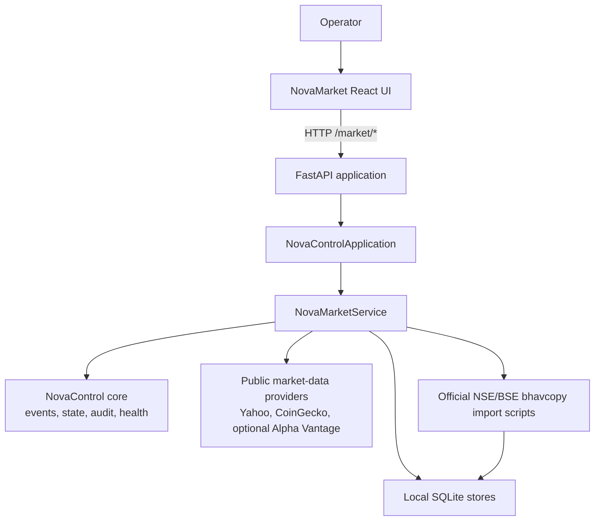
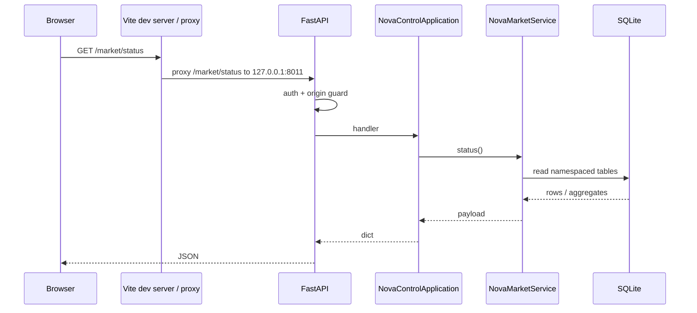
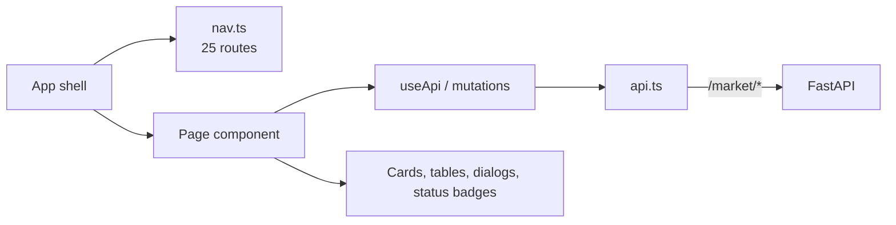
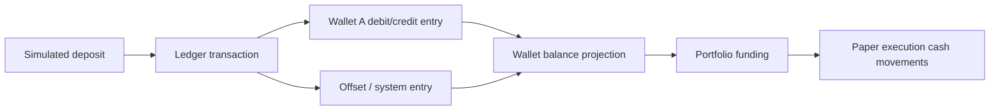
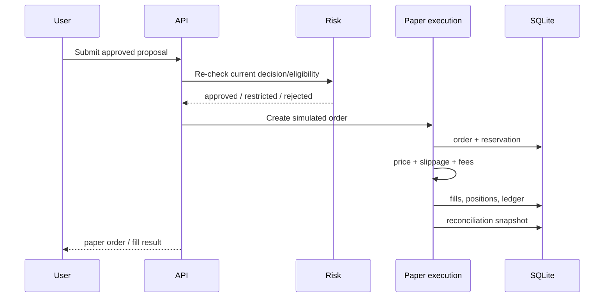
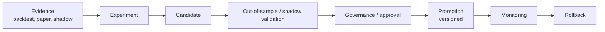

# NovaMarket Architecture

This document describes the **implemented** accepted baseline (NM-01–NM-14). It is an explanation, not a redesign proposal. NovaMarket is a paper-only system: there is no broker client, live-order path or real-money component.

## Contents

1. [System context](#1-system-context)
2. [Process and request structure](#2-process-and-request-structure)
3. [Backend architecture](#3-backend-architecture)
4. [Frontend architecture](#4-frontend-architecture)
5. [API layer](#5-api-layer)
6. [Market data](#6-market-data)
7. [Instruments, bars and observations](#7-instruments-bars-and-observations)
8. [NovaCoin wallet and ledger](#8-novacoin-wallet-and-ledger)
9. [Portfolio engine](#9-portfolio-engine)
10. [Risk engine](#10-risk-engine)
11. [Strategy engine](#11-strategy-engine)
12. [Paper execution](#12-paper-execution)
13. [Backtesting](#13-backtesting)
14. [Shadow mode](#14-shadow-mode)
15. [Adaptive learning](#15-adaptive-learning)
16. [Events, audit and notifications](#16-events-audit-and-notifications)
17. [Database boundaries](#17-database-boundaries)
18. [External providers](#18-external-providers)
19. [Error handling and recovery](#19-error-handling-and-recovery)
20. [Dependencies and integration rules](#20-dependencies-and-integration-rules)

## 1. System context



NovaMarket is a module inside the existing NovaControl runtime. It reuses NovaControl's application lifecycle, state store, typed event bus and automation audit log instead of starting a separate server framework or a second event system. The frontend is its own Vite/React application.

The **paper-only boundary is structural**, not a UI preference:

- the execution package has no broker adapter;
- no configuration value selects a live venue;
- no API route submits a real order;
- risk approval cannot be skipped by the paper executor;
- shadow sessions have no execution gateway;
- learning cannot execute trades.

## 2. Process and request structure



Requests are asynchronous at the FastAPI boundary. Domain services are composed lazily by `NovaMarketService`; SQLite stores are local to the process. Market-data fetches may run in worker threads and are published through the NovaControl event bus as progress events.

The UI calls the API through relative paths (`/market/...`). In development Vite proxies them; in a built frontend the API origin is configured at build time. The API's CORS allowlist and origin guard are separate controls, both intentional.

## 3. Backend architecture

### Composition root

`NovaMarketService` (`src/novacontrol/novamarket/service.py`) is the domain composition root. It owns lifecycle state and lazily constructs:

- market-data engine and store;
- event radar and discovery;
- watchlists;
- forecasting;
- finance/wallet and portfolio engines;
- risk engine;
- strategy engine;
- paper execution service;
- backtesting service;
- shadow service;
- learning service.

It also reports module status, permissions, contracts and readiness. It is constructed by `NovaControlApplication`; the API does not instantiate feature services directly.

### Lifecycle

NovaMarket has explicit lifecycle states and operational guards. Starting the standalone app enables the module. When NovaMarket is not operational, dependent features raise an operational error that the API maps to **409 Conflict** rather than returning a misleading empty success.

The service exposes a status surface that reports module phases (NM-01 through NM-14), subsystem availability and contracts. The execution and shadow status payloads are the authoritative runtime safety declarations.

### Package map

```text
src/novacontrol/novamarket/
├── service.py            # composition, lifecycle, status, cross-module orchestration
├── config.py             # validated NovaMarket configuration
├── marketdata/           # providers, store, ingestion, universe, calibration, options/futures
├── radar/                # event detection and observation store
├── discovery/            # candidates and watchlists
├── forecast/             # models, calibration, lifecycle
├── finance/              # NovaCoin wallet, ledger, portfolios
├── risk/                 # policies, decisions, alerts, stress
├── strategy/             # catalogue, signals, proposals
├── execution/            # paper orders, pricing, fees, fills, positions, reconciliation
├── backtesting/          # historical replay and verification
├── shadow/               # non-executing observation
└── learning/             # evidence, experiments, candidates, promotion
```

Package boundaries are deliberate. A route may compose domain services, but a domain service should not import FastAPI or browser concepts.

### Startup order

The parent application loads settings before constructing the brain/runtime, then constructs NovaMarket with the configured data directory. NovaMarket schema creation is idempotent. Lazy feature services are created on first use so a failure in an optional subsystem does not prevent the rest of the desk from starting; that failure is surfaced in status and in the API error, not hidden as an empty dataset.

## 4. Frontend architecture

The frontend lives in `web/` and is a React 19 + TypeScript + Vite single-page application.

- `src/App.tsx` owns the route shell, sidebar, active page, API-token dialog and global layout.
- `src/nav.ts` is the route/navigation registry: **25 routes in 7 groups**.
- `src/pages/*.tsx` contains the screen-level workflows.
- `src/lib/api.ts` provides the authenticated JSON client, error normalization and typed helpers.
- `src/components/*` contains shared layout, tables, badges, dialogs, toasts and charts.
- `src/lib/format.ts` centralizes money, date and number formatting.

Routing is hash-based (`#/dashboard`, `#/market`, etc.). Each page uses a shared `useApi` hook for reads and explicit mutation helpers for writes. Financial arithmetic is never performed in a browser for authority: the UI renders backend balances, quantities, prices and fees.



The UI is presentation and orchestration. It does not own the ledger, risk policy, fill logic or valuation. A control such as **Deposit** posts to the API and then refreshes the authoritative response.

### Route groups

| Group | Routes |
|---|---|
| Overview | Dashboard, Market Overview |
| Trading desks | OrderBlock, TradingWatch |
| Intelligence | Market Events, Asset Discovery, Watchlists, Forecasts |
| Portfolio Management | Short-Term, Medium-Term, Long-Term Portfolio, Portfolio Analytics |
| Trading Intelligence | Strategies, Risk Management, Paper Trading, Backtesting, Shadow Mode, Adaptive Learning |
| Financial Records | NovaCoin Wallet, Transaction History, Ledger |
| System | Notifications, Activity and Audit, System Health, Settings |

## 5. API layer

The API is created by `create_app()` in `src/novacontrol/api/app.py`. NovaMarket routes are registered under `/market`. The generated inventory is [API.md](API.md); the main guide is [API_GUIDE.md](API_GUIDE.md).

Important API properties:

- `GET /health` is public.
- Protected routes use the shared `require_auth` dependency: if `NOVACONTROL_API_TOKEN` is set, a valid `Authorization: Bearer` header is required.
- Mutations are checked by an origin guard in addition to CORS. Browser requests with a foreign `Origin` are rejected.
- `NOVAMARKET_CORS_ORIGINS` is an exact allowlist. `NOVAMARKET_ALLOWED_ORIGINS` extends the application's origin guard for trusted local origins.
- FastAPI validation errors return 422; domain/state errors are mapped to explicit HTTP statuses. NovaMarket is not operational → 409; unauthorized → 401; forbidden origin → 403.
- `/docs`, `/redoc` and `/openapi.json` are available for the running application.

The API surface is registered in more than one place by design: the handler, the `ApiSurface` registry, route-consumer declarations and generated reference must agree. `scripts/generate_api_reference.py --check` is the synchronization gate.

## 6. Market data

### Ingestion paths

| Source | Use | Status |
|---|---|---|
| Yahoo Finance | Public quote/history adapter | Implemented; unofficial, delayed/limited |
| CoinGecko | Crypto quotes/history | Implemented; public API limits apply |
| Alpha Vantage | Optional public provider | Implemented; needs a configured credential reference |
| NSE bhavcopy importer | Official NSE equity EOD data | Implemented script |
| BSE bhavcopy importer | Official BSE equity EOD data | Implemented script |
| NSE F&O bhavcopy importer | Official NSE futures/options EOD data | Implemented script |

Provider data is **observed**, timestamped and stored. NovaMarket never rewrites an observation to look fresher. The market-data store keeps an append-only observation history plus instrument and bar tables.

### Data quality and freshness

The market-data layer tracks quality, staleness and provenance. A quote has an observed timestamp and source; a bar has a session date and source. Consumers such as risk and forecasting must decide from the freshness fields whether the input is usable.

The accepted audit found:

- 4,535 of 4,535 eligible instruments scanned;
- 0 skipped, failed or duplicate records;
- 99 BSE instruments with no bar because their symbols were absent from the downloaded BSE session;
- 151 recent listings with only 3–29 bars;
- no synthetic bars introduced to fill gaps.

These are **audit-database** results. A normal runtime store may be empty, partial or older. Never present an audit result as a current market snapshot.

### Official derivatives snapshot

The NSE F&O importer produced an official EOD snapshot for the audit:

- 667 futures contracts across 224 underlyings;
- 6,625 index-option contracts;
- 147 NIFTY option strikes;
- PCR 1.6528.

Option **implied volatility is model-derived** with Black-Scholes from the official settlement/premium data. It is not a provider-reported IV. The snapshot's trade date (6 November 2026 in the acceptance evidence) must be shown with any use of the data.

## 7. Instruments, bars and observations

The core model separates:

- **instrument identity** — symbol, exchange, asset class, currency, sector/industry and identifiers;
- **observation** — a timestamped provider value with source and quality metadata;
- **bar** — an OHLCV interval keyed by instrument and time;
- **contract metadata** — expiry, strike, option type, underlying for derivatives.

This separation prevents a quote, a daily close and a model-derived value from being treated as the same kind of fact. Instrument discovery and universe sync add identities; they do not fabricate prices. A missing bar remains missing and is visible in data-quality output.

## 8. NovaCoin wallet and ledger

NovaCoin (NC) is the application's **simulated unit**, with 1 NC = ₹1 for paper accounting. It is not a cryptocurrency, bank balance or withdrawable asset.



Properties:

- amounts are exact decimals, with at most 2 decimal places for wallet operations;
- the ledger is append-only; corrections are mirrored/reversal entries, not destructive edits;
- every wallet balance is derived from and reconcilable against ledger entries;
- transfers are atomic and conserve NC across wallets;
- idempotency keys protect deposit/withdraw/transfer requests from duplicate posting;
- a portfolio is funded by an explicit wallet operation; the UI does not invent cash.

The wallet, portfolio cash and paper fees share one unit and one ledger authority. The browser never performs authoritative balance arithmetic.

## 9. Portfolio engine

Three explicit horizons exist:

| UI label | Stored horizon |
|---|---|
| Short-Term Portfolio | `short_term` |
| Medium-Term Portfolio | `medium_term` |
| Long-Term Portfolio | `long_term` |

A portfolio is a book with:

- initial capital and current cash;
- holdings and quantities;
- valuation and cost basis;
- realized/unrealized performance and fees;
- lifecycle status: `initializing`, `active`, `under_review`, `rebalancing`, `paused`, `suspended`, `closed`;
- contribution/withdrawal or funding movements through the wallet;
- a current rebalance proposal and its history.

Portfolio Analytics is a separate read surface over all books. Cross-portfolio totals are not a substitute for each book's ledger/cash reconciliation.

### Portfolio proposals

A portfolio rebalance proposal is **not** a strategy proposal. It is a validated, versioned intent describing target weights/orders for that portfolio. It can be applied only after validation. Its statuses are `validated`, `applied`, `rejected`, `expired`, `superseded`, `failed`. It does not connect to a broker.

## 10. Risk engine

Risk is an independent service, not a function inside the strategy or execution code. It consumes a proposal/order intent, the portfolio state, the market snapshot and a **versioned policy**, then returns one of:

`approved`, `rejected`, `restricted`, `requires_review`, `insufficient_data`.

The policy is versioned so a decision can be audited against the limits that produced it. NovaMarket includes short/medium/long-term policy defaults for concentration, sector exposure, cash, drawdown, volatility, liquidity, turnover, forecast/data/state age and aggregate exposure. Defaults are simulation defaults, not personal investment advice.

Risk can:

- approve with conditions;
- reduce/restrict size;
- reject and state the violated rule;
- require review;
- return insufficient data when evidence is stale or missing;
- produce alerts and stress-test scenarios.

Risk does **not** place, amend or cancel an order. Execution must honor a current approval; risk eligibility is re-checked rather than inferred from a proposal's label.

## 11. Strategy engine

The strategy subsystem contains:

- a catalogue and category metadata;
- deterministic signal engines;
- versioned strategy configurations;
- signal/conflict records;
- proposal lifecycle;
- evaluation and explanation.

Strategy lifecycle statuses are `draft`, `active`, `paused`, `degraded`, `suspended`, `retired`. Proposal statuses are `created`, `pending_risk`, `approved`, `rejected`, `restricted`, `expired`, `cancelled`, `forwarded_to_execution`.

A strategy proposal is a **request**, not an order. It becomes usable by paper execution only after risk approval, while unexpired and with its quantities/prices still valid. The UI can show a proposal's risk decision and then offer **Submit from proposal**.

## 12. Paper execution



The execution service:

1. validates the proposal and quantity;
2. enforces current risk approval;
3. creates a paper order with a reservation;
4. prices the simulated fill from available market evidence;
5. applies configured slippage and fee components;
6. writes fills and positions;
7. posts the wallet/ledger cash movements;
8. records reconciliation;
9. reports status and provenance.

Order statuses: `created`, `pending_validation`, `accepted`, `open`, `partially_filled`, `filled`, `cancel_pending`, `cancelled`, `rejected`, `expired`, `failed`.

The fill is **simulated**. The engine can model partial fills and cancel/expire unfilled remainder, but it never sends an order to an exchange or broker. There is no live-order code path, and the status contract reports `live_trading: false` and `broker_connected: false`.

## 13. Backtesting

Backtesting is a historical replay engine, not a paper book and not a live strategy run. It uses:

- a strategy version and configuration;
- stored instrument bars;
- point-in-time events/forecasts where configured;
- the same class of risk policy evaluation;
- explicit fees and slippage;
- a deterministic clock and run identity.

It produces metrics, trades, orders, decisions, signals, data-quality findings, comparisons and a verification/reproducibility result. Sensitivity and walk-forward runs are explicit variants, not hidden optimization. A backtest has no wallet, no live portfolio mutation and no broker gateway. Its database rows are separate runs keyed by backtest ID, even though the accepted store shares the main SQLite file.

Backtest output is conditional on input data. Missing bars, short histories and stale snapshots are reported; they are not backfilled with synthetic prices.

## 14. Shadow mode

Shadow mode observes a strategy/portfolio allocation and records hypothetical decisions without moving money or touching the execution gateway.

- lifecycle statuses: `created`, `running`, `paused`, `stopped`, `completed`, `cancelled`, `failed`;
- records decisions, projections/outcomes, comparisons and health;
- `GET /market/shadow/status` reports `real_money: false` and `execution_connected: false`;
- `nm13_activated` is false in the accepted baseline.

Shadow results estimate what would have happened under stated assumptions. They are not live performance, paper fills or proof of profitability. Shadow data lives in `novamarket_shadow.sqlite3`.

## 15. Adaptive learning

The learning subsystem is an evidence-governed improvement loop:



It stores evidence, experiments, candidates, evaluations, approvals, promotions, versions and monitoring. Candidate statuses include `generated`, `evaluating`, `pending_approval`, `approved`, `shadow_validation`, `promoted`, `rolled_back`, `archived`.

Promotion is versioned and reversible. Learning cannot execute a trade, alter the ledger or bypass the risk engine. `GET /market/learning/status` reports `executes_trades: false`, `execution_connected: false` and `real_money: false`.

Learning data lives in `novamarket_learning.sqlite3`, separate from paper financial state. It is not a guarantee that a promoted model improves future returns.

## 16. Events, audit and notifications

NovaMarket uses the shared NovaControl event bus. Feature modules publish typed events (for example, market-data progress, risk/alert changes, execution and shadow status). The API can expose an SSE activity stream for live progress; the React UI subscribes to it through the documented activity client.

Audit:

- the shared audit logger records operator/system activity and automation actions;
- the NovaMarket **Activity and Audit** page reads the activity surface;
- the ledger and execution records are themselves append-only evidence;
- notifications are separate from audit and can be marked read/dismissed where supported.

Events are not a substitute for durable state. If the UI disconnects, the authoritative data remains in SQLite and the page can refetch it.

## 17. Database boundaries

| Store | Default path | Owns |
|---|---|---|
| Main runtime | `data/novamarket.sqlite3` | instruments, bars, observations, radar, discovery, watchlists, forecasts, wallets, ledger, portfolios, risk, strategies, paper execution, backtests |
| Shadow | `data/novamarket_shadow.sqlite3` | shadow sessions, decisions, projections, outcomes, comparisons |
| Learning | `data/novamarket_learning.sqlite3` | evidence, experiments, candidates, approvals, versions, monitoring |
| Config | `data/novamarket.json` | validated NovaMarket configuration snapshot |
| Shared audit | `data/audit/audit.jsonl` | NovaControl audit trail |
| Acceptance audit | `.ui_audit/nse_import.sqlite3` | isolated NM-14 evidence; **not** the runtime store |

Each database uses its own schema and connections. Do not copy shadow/learning rows into the main financial database, and do not treat `.ui_audit` as production data. Backups must include all three databases and the config file if you need a complete, reproducible desk.

## 18. External providers

| Provider | Credential | Data | Caveat |
|---|---|---|---|
| Yahoo Finance | None required | Public quotes/history | Unofficial; availability and delay vary |
| CoinGecko | None required | Public crypto quotes | Rate limits and coverage vary |
| Alpha Vantage | Credential reference | Optional quotes/history | Requires configuration; limits apply |
| NSE/BSE bhavcopy files | None in app | Official EOD equities/derivatives | Must be downloaded/imported; coverage depends on the session file |
| SMTP | Host/user/password/from | Notification email | Optional; no email is sent unless configured |

Provider credentials are resolved through the existing NovaControl credential mechanism, not written into the React bundle. No provider is a broker. A market-data key gives you data access only; it does not create order capability.

## 19. Error handling and recovery

- **Validation errors** are explicit: invalid quantities, prices, identifiers, config values or state transitions are refused with a message.
- **Operational errors** are 409 when NovaMarket or a subsystem is not ready. They are not silently converted to success.
- **Not found** resources return 404 where the route supports it.
- **Risk refusals** are domain outcomes, not HTTP glitches; the UI shows the violated rule.
- **Duplicate mutations** are protected by idempotency keys where the ledger/execution contract requires them.
- **Reconciliation** compares wallet/portfolio/execution records and reports mismatches. It does not invent a repair or hide a discrepancy.
- **Partial failures** leave evidence (status, audit/activity, error detail) and do not report a completed financial action.
- **Execution restarts** re-read durable orders/fills; there is no in-memory-only order book as the authority.

The system is designed to fail visibly. If a required data or risk input is missing, the correct outcome is `insufficient_data`, `blocked` or `failed`, not a guessed success.

## 20. Dependencies and integration rules

### Direction of dependencies

```text
React pages -> API client -> FastAPI handlers -> NovaControlApplication -> NovaMarketService
                                                        -> domain services -> SQLite
                                                        -> shared core (events, audit, state)
```

Domain packages may depend on shared core primitives and each other through the service interfaces. They must not depend on React, FastAPI request objects or a second persistence engine.

### Preserve these boundaries

- The **risk engine** remains independent; do not fold risk checks into strategy or execution.
- **Paper execution** remains the only order execution implementation; do not add a broker adapter.
- **Shadow mode** stays non-executing and separate; do not route it through the paper ledger.
- **Backtests** stay historical/reproducible and separate from live paper books.
- **Ledger** entries stay append-only and exact-decimal.
- **Provider observations** stay source/time-labelled; never synthesize missing bars.
- **API registration** stays synchronized across handler, surface registry, route-consumer declarations and generated docs.
- **Frontend authority** stays on the backend; do not calculate balances, prices or fees locally.

For contribution procedures and verification commands, see [Developer Guide](DEVELOPER_GUIDE.md).
