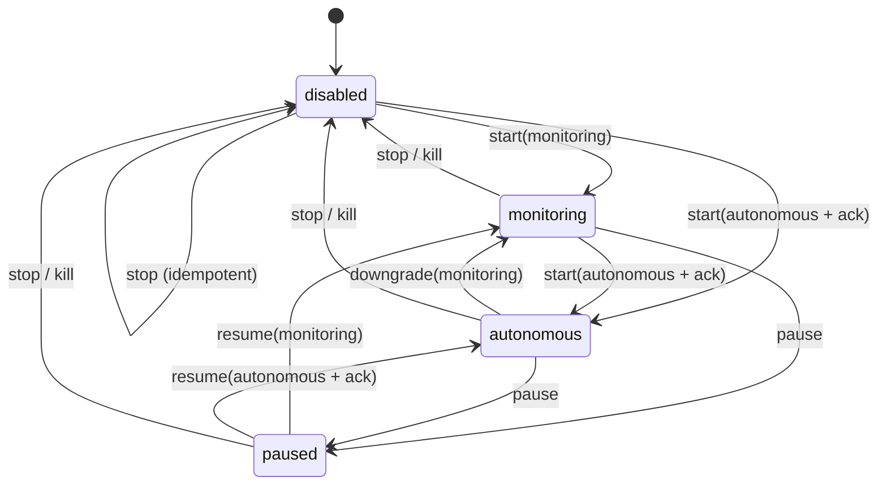
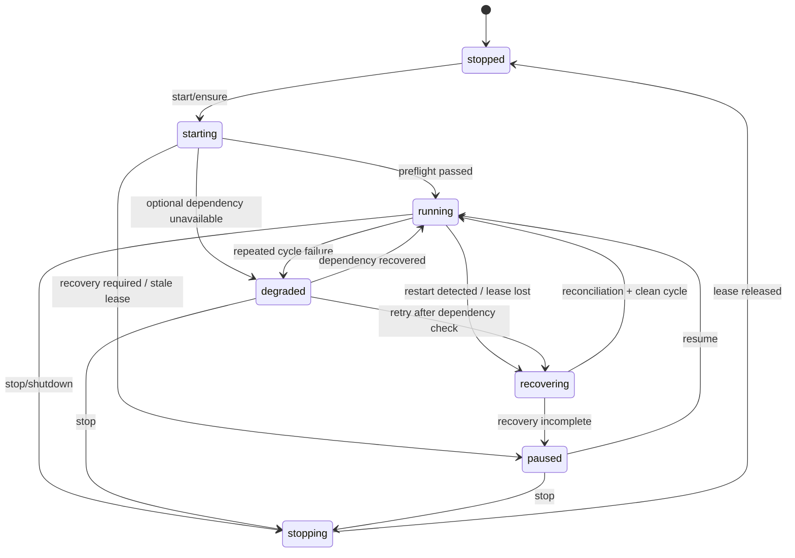
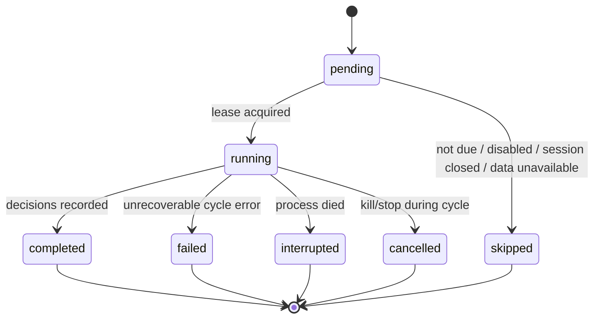
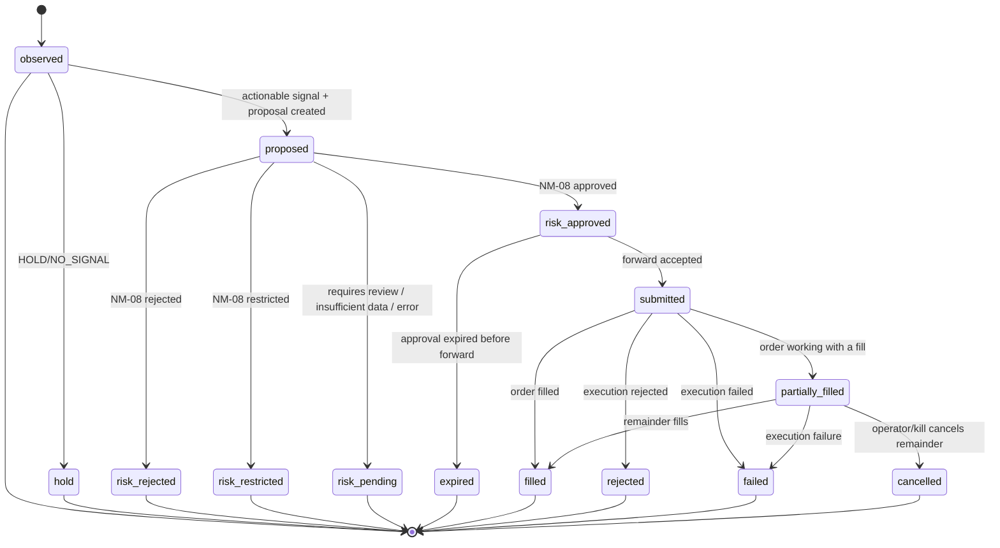

# Autonomous Paper Trading — State Machine

**Status:** **AT-01 IMPLEMENTED SUBSET** — modes, durable state, lease and the one-cycle invariant exist; cycle/decision/exit states below remain design for AT-02–AT-06, which are not approved or implemented. Where this document conflicts with `AUTONOMOUS_TRADING_OWNER_DECISIONS.md` (owner-approved 10 November 2026), the owner decisions win.
**Date:** 9 November 2026
**Scope:** Operating modes, runtime states, cycle states, autonomous decision states and their failure/recovery transitions. This document describes proposed behavior; no source code is changed.

---

## 1. Two different state dimensions

A common source of ambiguity is treating "mode" and "runtime health" as the same thing. This design separates them.

**Operating mode** answers: *what is the operator allowing?*

- `disabled`
- `monitoring`
- `autonomous`
- `paused`

**Runtime state** answers: *what is the process actually doing?*

- `stopped`
- `starting`
- `running`
- `recovering`
- `degraded`
- `stopping`

A runtime can be `running` while the mode is `monitoring` or `paused`. A runtime can be `degraded` in any active mode. A kill switch moves the mode to `disabled` and the runtime to `stopped`; it is not a fifth mode.

A third dimension is **cycle state**, which is per portfolio/horizon attempt, and a fourth is **decision/order state**, which is per instrument. The state tables below are deliberately separate.

---

## 2. Operating modes

### 2.1 Allowed transitions



### 2.2 Mode table

| Mode | Scan | Signals/proposals/risk | New entries | Protective exits | Open autonomy orders | Notes |
|---|---|---|---|---|---|---|
| `disabled` | No | No | No | No | No new processing | Kill/stop target |
| `monitoring` | Yes | Yes | No | Recorded, not executed | No | Safe observation |
| `autonomous` | Yes | Yes | Yes | Yes | Yes | Full paper lifecycle |
| `paused` | Protected/exit scopes | Exit evaluation only | No | Yes by default | Exit orders only | Pause, not stop |

### 2.3 Mode guards

| Operation | Guard | On failure |
|---|---|---|
| `start(monitoring)` | service operational; config valid; portfolio allowlist non-empty | 409/422, mode unchanged |
| `start(autonomous)` | above + `acknowledge_paper_only=true` + execution flags paper-only | 409/422, mode unchanged |
| `pause` | mode is `monitoring` or `autonomous` | 409, idempotent if already paused |
| `resume(monitoring)` | mode is `paused`; service operational | 409 |
| `resume(autonomous)` | above + acknowledgement + paper-only flags + recovery complete | 409 |
| `stop` | any mode | idempotent; mode becomes `disabled` |
| `kill` | any mode; confirmation string | 422; on success mode `disabled`, lease revoked |
| `downgrade` | mode is `autonomous`; operator action | 409 |

### 2.4 Semantics

- **Stop vs disable:** both end autonomous activity. `stop` is the operator control and sets mode `disabled`; application shutdown sets runtime `stopped` but preserves the desired mode for restart policy.
- **Pause vs stop:** `paused` keeps the runtime and position protection alive; `disabled` does not.
- **Kill vs stop:** kill is an emergency stop that also revokes the lease and optionally cancels open autonomy orders. Stop is orderly and does not cancel open orders unless requested.
- **No live mode:** there is no mode value, query parameter or configuration field that enables live trading.

---

## 3. Runtime states

### 3.1 Transitions



### 3.2 State definitions

| State | Meaning | Orders possible? |
|---|---|---|
| `stopped` | No tick processing; lease released or never held | No |
| `starting` | Preflight in progress; no cycle running | No |
| `running` | Tick loop active; cycles may run according to mode | Only `autonomous` (or protective paused exits) |
| `recovering` | Crash/restart reconciliation in progress | No |
| `degraded` | Runtime alive but a dependency failed repeatedly | No new orders; exits may be blocked by stale data |
| `stopping` | Graceful shutdown; current step draining | No new submissions; in-flight order state remains authoritative |

### 3.3 Runtime health fields

The status surface includes:

- `mode`
- `runtime_state`
- `lease_owner`, `lease_expires_at`, `heartbeat_at`
- `generation`
- `last_tick_at`
- `last_successful_scan_at`
- `last_successful_execution_at`
- `last_cycle_id`, `last_cycle_status`
- `next_due_at`
- `consecutive_failures`
- `last_error`
- `circuit_breaker` (`closed|open|half_open`)
- `recovery_required`

---

## 4. Cycle state machine

A cycle is one attempted scope: one portfolio and one horizon. Discovery may be shared by several scopes in the same tick; the cycle record is still per scope so that counts and leases are clear.



### 4.1 Cycle status and reason codes

| Status | Meaning | Counts as failure? |
|---|---|---|
| `pending` | Durable intent created, no work | No |
| `running` | Lease held; phase in progress | No |
| `completed` | All phases finished, even if some instruments skipped | No |
| `skipped` | No work because of session/coverage/mode/data | No; reason is recorded |
| `failed` | A phase failed and the cycle could not finish | Yes |
| `interrupted` | Process stopped while `running`; recovery required | Yes |
| `cancelled` | Kill/stop requested during the cycle | No; operator action |

Reason codes: `session_closed`, `holiday`, `coverage_unverified`, `mode_disabled`, `mode_paused`, `data_stale`, `data_unavailable`, `risk_unavailable`, `execution_unavailable`, `portfolio_unavailable`, `lease_lost`, `cycle_in_progress`, `operator_cancelled`, `internal_error`.

### 4.2 Phase order

A cycle must follow this order. A failure in one phase does not silently continue into an order phase.

```text
1. lease + lock
2. mode/session/coverage preflight
3. portfolio/risk/execution availability
4. market-data freshness check (and bounded refresh if needed)
5. discovery (global, once per tick)
6. strategy evaluation/proposals (per portfolio/horizon)
7. decision persistence + risk result classification
8. approved-only execution forwarding
9. open autonomy order processing
10. position/exit monitoring
11. learning evidence for terminal fills
12. final status + counters + release lease
```

Steps 5 and 6 are skipped in `paused`; only exit monitoring and exit-order processing are allowed. Steps 8–10 are skipped entirely in `monitoring`.

### 4.3 Cycle identity

`cycle_key` is deterministic:

```text
{mode}:{portfolio_id}:{horizon}:{scheduled_for_utc}:{config_version}
```

A unique constraint on `autonomy_cycles.cycle_key` prevents a retry/restart/UI double-click from creating a second cycle for the same scope and scheduled window. If an earlier cycle is `interrupted`, a recovery cycle gets a new key with a `recovery` component; it does not reuse the interrupted key.

### 4.4 Open-order processing

Open orders are not separate cycles. The runtime processes them within the current cycle, bounded by:

- only orders whose `actor` starts with `autonomy:`;
- only orders in `open`/`partially_filled` states;
- a maximum number per cycle;
- a maximum age/TTL enforced by NM-10;
- no processing if the market session or data is invalid.

A partially filled order may be processed repeatedly across cycles. Each processing call is idempotent by fill ID and order ID; the execution engine owns the state transitions.

---

## 5. Decision state machine

A decision is an autonomy read-model row. It is not a second source of financial truth; it references the strategy signal, proposal, risk decision and order.



### 5.1 Status definitions

| Status | Meaning |
|---|---|
| `observed` | Strategy evaluated; no actionable proposal |
| `hold` | HOLD/NO_SIGNAL recorded |
| `proposed` | Proposal exists; risk result not yet classified |
| `risk_approved` | Approved and eligible for forwarding |
| `risk_rejected` | NM-08 rejected; no order |
| `risk_restricted` | NM-08 restricted; no order |
| `risk_pending` | Review/insufficient/error; no order |
| `submitted` | Forward accepted; order exists |
| `partially_filled` | Order has fills and remaining quantity |
| `filled` | Terminal fill |
| `rejected` | Execution rejected before/at order acceptance |
| `failed` | Execution/validation failure |
| `cancelled` | Remaining quantity cancelled |
| `expired` | Proposal/order expired |

### 5.2 Decision invariants

- A decision may only become `submitted` from `risk_approved` for the same proposal and risk decision.
- A decision may not skip `proposed` to `filled`.
- A `risk_rejected`, `risk_restricted` or `risk_pending` decision never has an order ID.
- A `hold` decision never has a proposal ID.
- The decision's order ID must equal the order returned by `ExecutionEngine.submit/order_for_proposal`.
- A failed/terminal order is not resubmitted; a new strategy signal with a new data cutoff is required.

---

## 6. Order state relationship

Autonomy does not own order states. It mirrors the NM-10 state, which is authoritative:

```text
created -> pending_validation -> accepted -> open
  -> partially_filled -> filled
  -> cancelled / expired / rejected / failed
```

`ExecutionStore` already enforces this transition table. The autonomy decision maps only the terminal/working categories needed for the UI. It must not attempt an order transition that NM-10 rejects.

---

## 7. Failure states and behavior

| Failure | Runtime state | Mode | Order behavior | Recovery |
|---|---|---|---|---|
| Market closed | `running` | unchanged | No new orders; open orders may be processed only if NM-10 finds a valid reference | Wait for next session |
| Holiday/weekend | `running` | unchanged | No new orders | Next session open |
| Calendar coverage unknown | `degraded` | unchanged, but entries blocked | No new entries; protective exits only if data is valid | Install/verify calendar coverage; operator review |
| Stale quote/bars | `degraded` | unchanged | No order for affected instruments | Refresh data; next cycle |
| Risk unavailable/error | `degraded` | unchanged | No order | Retry next cycle; fail closed |
| Execution unavailable | `degraded`/`paused` | `paused` after threshold | No new submissions; open orders remain | Restore execution; reconcile |
| Portfolio unreadable/not active | `degraded` | unchanged | No order for that portfolio | Repair portfolio; next cycle |
| Lease lost | `recovering`/`stopped` | `paused` | No order | New process acquires lease; recovery |
| Process crash | persisted `running` becomes `interrupted` | `paused` on boot | No new order until recovery and clean cycle | `recover_pending`, reconcile, clean scan |
| Repeated cycle errors | `degraded` then `paused` | `paused` | No new entries | Operator inspection, then resume |
| Kill switch | `stopped` | `disabled` | No new orders; optional cancellation of open autonomy orders | Manual review and restart |

### 7.1 Circuit breakers

| Breaker | Opens after | Effect | Reset |
|---|---|---|---|
| Data | 3 consecutive stale/unavailable cycles | No entries for the affected scope | One clean fresh-data cycle |
| Risk | 2 consecutive risk-service errors | No entries for all scopes | Risk health probe and clean cycle |
| Execution | 2 consecutive submit/process failures | Pause new submissions | Reconcile and operator resume |
| Runtime | 5 consecutive cycle failures | Runtime `degraded`, then `paused` | Manual/automatic retry with backoff |
| Lease | Lease conflict/expiry | Stop cycle immediately | New process/lease acquisition |

Breakers are not risk approvals. They only reduce activity.

---

## 8. Application close, restart and recovery

### 8.1 Orderly application close

`NovaMarketService.shutdown()` calls the autonomy runtime's `close()`:

1. stop accepting new cycles;
2. let the current phase finish or cancel at a safe boundary;
3. mark an in-flight cycle `cancelled` or leave it for the normal phase completion;
4. release the cycle lease;
5. persist `runtime_state=stopped` and preserve the desired mode;
6. do not change open paper orders; their state is durable in NM-10.

No new order is submitted after the shutdown flag is set. If a submit was already in progress, its idempotent order record is authoritative and recovery can reconcile it.

### 8.2 Restart

On the first autonomy tick after a process restart:

1. read the persisted runtime row and any `running` cycle;
2. acquire the lease if free; if an unexpired foreign lease exists, remain `stopped`/`degraded` and do not trade;
3. call `ExecutionEngine.recover_pending()`;
4. call `ExecutionEngine.reconcile()` for open/uncertain orders;
5. reconcile each active portfolio (`PortfolioEngine.reconcile`);
6. mark orphaned `running` cycles `interrupted`;
7. rehydrate exit high-water marks from stored state/positions;
8. set `runtime_state=recovering`;
9. set mode `disabled` and stop — a restart never auto-resumes (OD-06);
10. an authorized operator must start the shell again; no persisted mode is restored automatically.

### 8.3 Crash

The lease has a bounded expiry (`max_cycle_seconds + grace`, with a minimum). A crash leaves the cycle `running` and the lease until expiry. The next process either waits for expiry or, if it owns the same instance ID and can prove the old process is gone, marks it interrupted. It never starts a second order submission for the same cycle.

---

## 9. Pause, stop and kill semantics

### Pause

- allowed from `monitoring` or `autonomous`;
- cancels no open orders;
- blocks new entries;
- keeps the runtime and position monitoring alive;
- protective exits continue under the fixed `paused_exit_policy="protective"` (OD-02); `monitor_only` is not supported;
- records `pause_reason` and `paused_at`.

### Stop

- allowed from any mode;
- sets mode `disabled`;
- stops new cycles and new submissions;
- leaves open paper orders alone unless `cancel_open_orders=true` is explicitly requested;
- releases the lease;
- requires an explicit start to run again.

### Kill switch

- emergency control;
- requires `confirm="KILL AUTONOMY"`;
- revokes the lease immediately;
- sets mode `disabled`;
- prevents all new autonomy submissions;
- cancels open autonomy orders through `ExecutionEngine.cancel()` when `cancel_open_orders=true` (default for kill);
- preserves fills, ledger entries and positions;
- records `kill_switch_at`, actor, reason and the cancelled order IDs;
- requires manual review before any restart.

The kill switch does not use a new broker or a new execution path. It is a control over the orchestration layer and the existing paper order cancellation method.

---

## 10. State-persistence rules

Every transition that matters for safety is persisted before the next external action:

- mode and runtime state before a cycle starts;
- cycle `running` and lease before discovery;
- decision `proposed` before risk;
- decision `risk_approved` before forward;
- order/decision IDs after submit;
- exit attempt/high-water mark before an exit proposal;
- terminal cycle status in `finally`;
- lease release in `finally`.

If a persistence write fails, the cycle is failed closed: no order is submitted. The runtime records `last_error` and enters `degraded`.

---

## 11. Invariants

1. No mode other than `autonomous` can create a new entry.
2. `paused` cannot create a new entry.
3. `disabled` cannot create or process an autonomous order.
4. A cycle cannot submit before its `risk_approved` decision is persisted.
5. A decision cannot submit an order without an approved, unexpired proposal and risk decision.
6. Two cycles cannot hold the same lease.
7. A cycle cannot process another runtime's open order.
8. A restart cannot auto-submit before reconciliation and a clean monitoring cycle.
9. A stop/kill cannot be overridden by a late in-flight coroutine; the submission gate is checked immediately before forward.
10. Every terminal decision has a reason and a link to the relevant signal/proposal/risk/order record.
