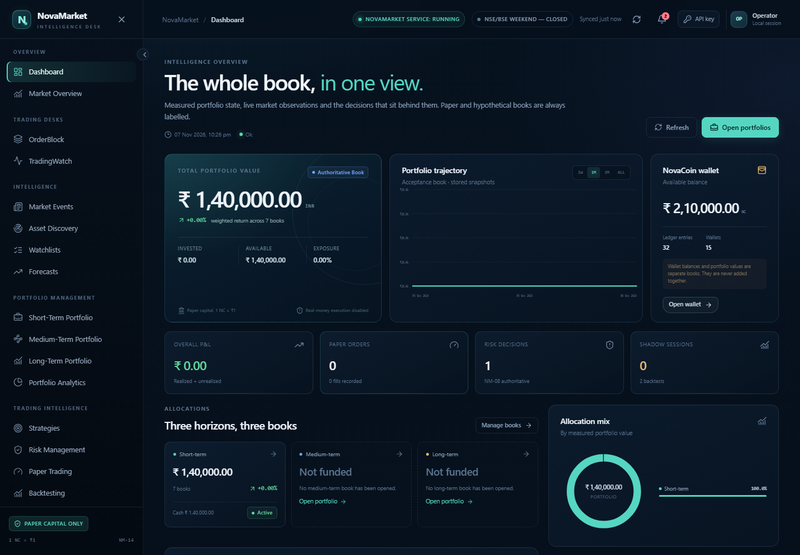
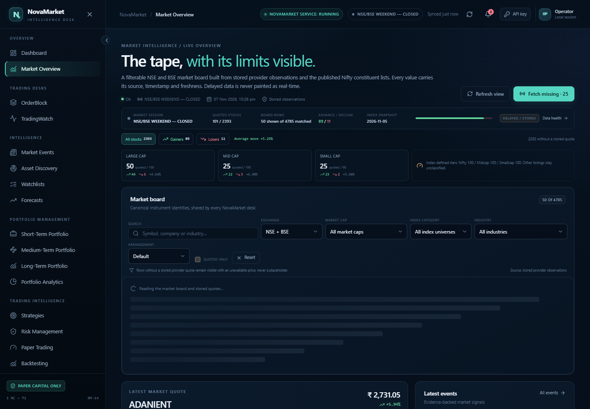
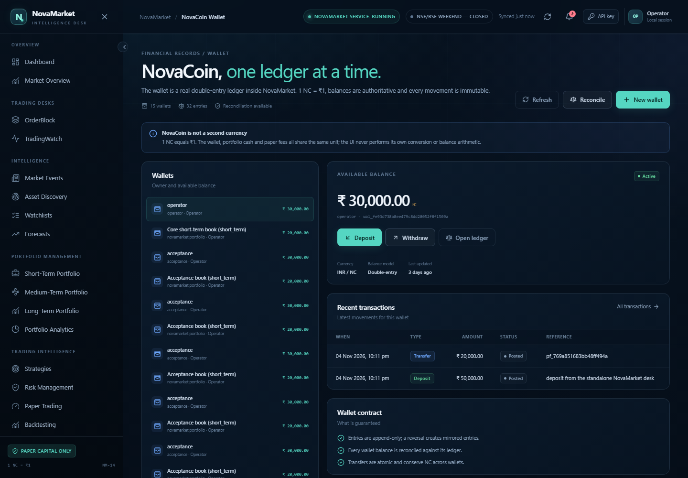
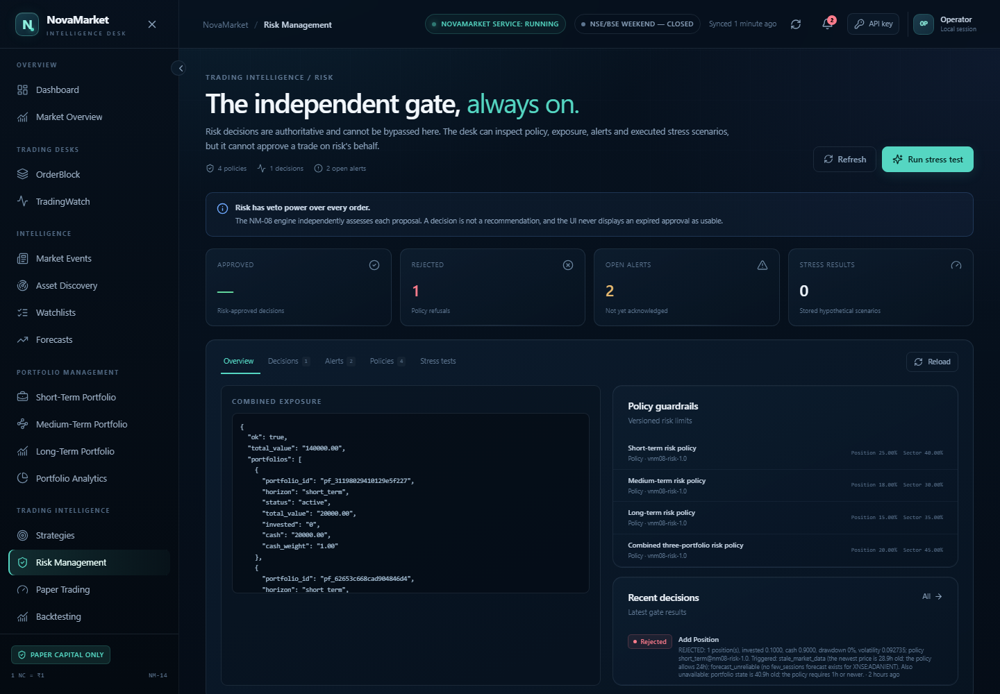
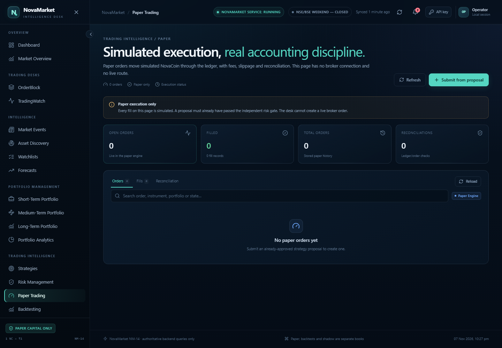
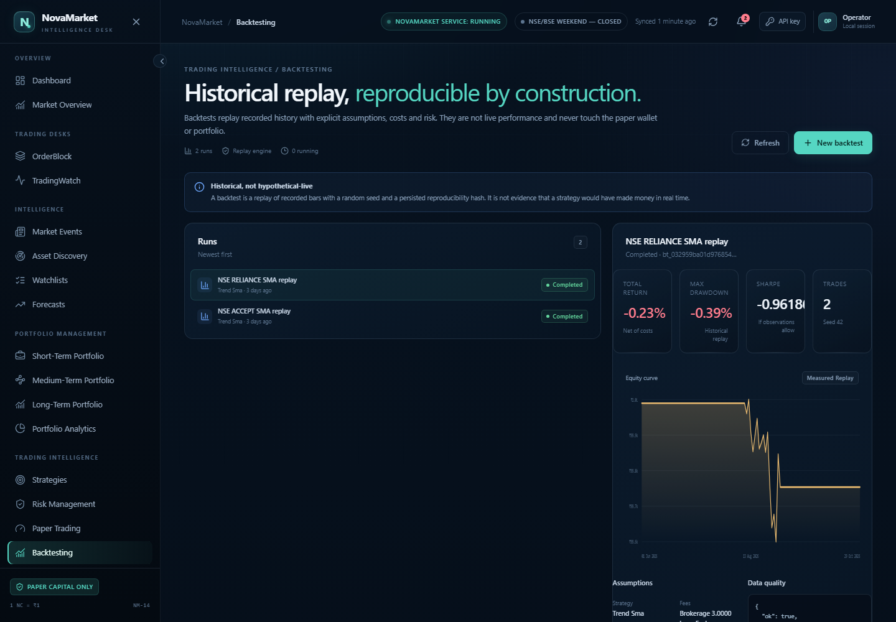
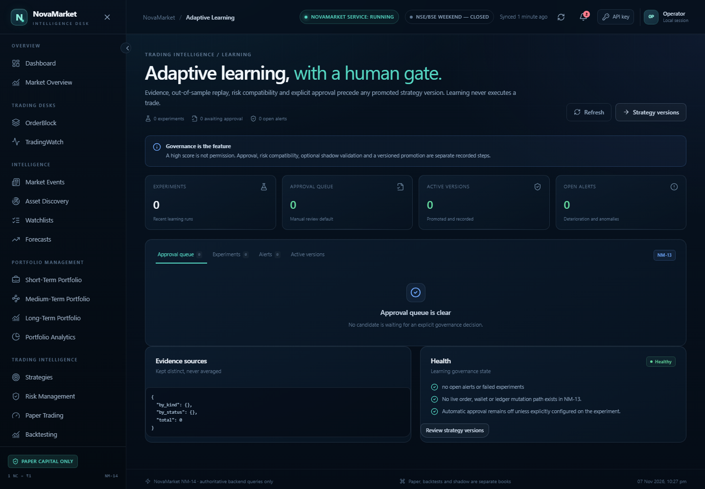

# NovaMarket User Guide

This guide is for a first-time operator. It describes the implemented screens of the accepted NM-01–NM-14 baseline, what their controls do, what output to expect and which limitations to check.

> **NovaMarket is paper-only.** No broker is connected, no live order can be sent and no real money is at risk or can be deposited. NovaCoin (NC) is simulated. A paper fill is a simulation result, not an exchange execution.

*The dashboard in the isolated acceptance environment. Amounts and observations in screenshots are evidence from that environment, not current data or advice.*

## Contents

1. [Getting started](#1-getting-started)
2. [Reading the interface](#2-reading-the-interface)
3. [Dashboard](#3-dashboard)
4. [Market Overview](#4-market-overview)
5. [OrderBlock](#5-orderblock)
6. [TradingWatch](#6-tradingwatch)
7. [Market Events](#7-market-events)
8. [Asset Discovery](#8-asset-discovery)
9. [Watchlists](#9-watchlists)
10. [Forecasts](#10-forecasts)
11. [Portfolio Management](#11-portfolio-management)
12. [NovaCoin Wallet, Transactions and Ledger](#12-novacoin-wallet-transactions-and-ledger)
13. [Risk Management](#13-risk-management)
14. [Strategies](#14-strategies)
15. [Paper Trading](#15-paper-trading)
16. [Backtesting](#16-backtesting)
17. [Shadow Mode](#17-shadow-mode)
18. [Adaptive Learning](#18-adaptive-learning)
19. [Notifications, Activity and Health](#19-notifications-activity-and-health)
20. [Settings](#20-settings)
21. [Common workflows](#21-common-workflows)
22. [Verification checklist and limitations](#22-verification-checklist-and-limitations)

## 1. Getting started

1. Start the stack with `.\start.ps1` and open `http://127.0.0.1:5173/#/dashboard`.
2. If the backend uses `NOVACONTROL_API_TOKEN`, a token dialog appears. Paste the token. It is kept only in `sessionStorage` for the current tab.
3. Check **System Health**. The page must show the API/lifecycle state, not an offline placeholder.
4. If the market catalogue is empty, open **Settings → Sync public universe**.
5. Create a wallet and deposit simulated capital before creating a funded portfolio.

You do **not** need a broker login. The app has no field for one. If an instruction elsewhere asks you to connect a brokerage account, it is not describing this build.

## 2. Reading the interface

### Navigation map

| Group | Screen | Main purpose |
|---|---|---|
| Overview | Dashboard | Whole-book state and attention items |
| Overview | Market Overview | Screener, sectors, market pulse |
| Trading desks | OrderBlock | Order-block/structure board |
| Trading desks | TradingWatch | Momentum, zones, heatmap, replay, derivatives availability |
| Intelligence | Market Events | Evidence-backed event feed |
| Intelligence | Asset Discovery | Ranked candidates and discovery cycles |
| Intelligence | Watchlists | Persisted lists and membership history |
| Intelligence | Forecasts | Stored probabilistic forecasts |
| Portfolio Management | Short/Medium/Long-Term Portfolio | Three separate books |
| Portfolio Management | Portfolio Analytics | Cross-book comparison and totals |
| Trading Intelligence | Strategies | Catalogue, signals, proposals |
| Trading Intelligence | Risk Management | Policies, decisions, alerts, stress |
| Trading Intelligence | Paper Trading | Simulated orders, fills, reconciliation |
| Trading Intelligence | Backtesting | Historical replay |
| Trading Intelligence | Shadow Mode | Non-executing observation |
| Trading Intelligence | Adaptive Learning | Evidence, experiments, approval, versions |
| Financial Records | NovaCoin Wallet | Simulated wallets and transfers |
| Financial Records | Transaction History | Wallet movements |
| Financial Records | Ledger | Append-only accounting entries |
| System | Notifications | Alerts and recent activity |
| System | Activity and Audit | Published activity and shared audit trail |
| System | System Health | Lifecycle, dependencies, capabilities |
| System | Settings | API token, notifications, data, lifecycle |

The sidebar also shows a `UI v...` build stamp. After an update, a fully stale embedded tab may need to be closed and reopened; a normal reload is enough for the no-cache assets.

### Units and labels

- **INR** — money of account for portfolio values, prices and fees.
- **NC** — NovaCoin, the simulated wallet unit; **1 NC = ₹1** for paper accounting.
- **Book** — a portfolio. Short-, medium- and long-term books are separate.
- **Proposal** — a request that may become a paper order (strategy proposal) or a rebalance intent (portfolio proposal). A proposal is **not** an order.
- **Paper fill** — a simulated execution written by the paper engine. It is never an exchange fill.
- **Hypothetical** — shadow/backtest output. It is not included in current portfolio value.
- **Model IV** — implied volatility calculated by NovaMarket from option prices; it is not provider-reported IV.

Colour and status badges are informative, but **read the timestamp and status**. A green badge does not make stale data current.

## 3. Dashboard

**Purpose:** a measured overview of funded portfolios, wallet, market pulse, recent intelligence, allocation, alerts, watchlists and activity.

**What it displays**

- Total portfolio value, its weighted return, invested/available/exposure, and a stored valuation trajectory.
- NovaCoin available balance and ledger/wallet counts. Wallet and portfolio books are shown separately and are never added together.
- Overall realised + unrealised P&L and the three horizon books.
- Latest observations, recent verified events, allocation, attention items, watchlist highlights and committed activity.
- A health dot and generation timestamp.

**Controls**

- **Refresh** — refetch the overview.
- **Open portfolios** — go to the short-term book.
- **Open wallet** — go to the NovaCoin wallet.
- Range toggle on the trajectory chart — change the displayed window.
- Cards/links — open Market, Events, Watchlists or Activity.

**Inputs/outputs:** no form inputs. Outputs are read-only aggregates. If no portfolio is funded, the value shows **Not funded**, not zero or an invented amount. If the API is unavailable, the page shows an error and deliberately invents no balance.

**Verify:** generation timestamp is recent; health is not offline; wallet and portfolio totals are not combined; an empty book says it is unfunded. **Limitation:** it is a summary, not the ledger of record.

## 4. Market Overview

**Purpose:** inspect the instrument catalogue, quote freshness, market moves, sectors and index membership, and screen the stored market.

**What it displays**

- A screener table with symbol/name, exchange, sector, last price, change, volume, market cap/index tags and quote freshness.
- Filters for exchange, market-cap band, index, sector, movers and availability, plus text search and sorting.
- Sector/market breadth and recent evidence-backed events.
- A data contract explaining what the board may claim.
- Empty/missing values are marked unavailable rather than filled.

**Controls**

- **Fetch latest** — request a current data cycle; this may be subject to provider coverage/limits.
- **Refresh** / **Reset filters** — reread stored state or clear filters.
- **Previous/Next** — page the result table.
- **Watchlists** — open persisted lists; row actions can add an instrument to a watchlist.
- **System health** / **Data settings** — diagnose or configure sources.

**Inputs/outputs:** filters/search; output is a ranked table. A stale quote remains visibly stale. **Verify:** quote timestamp/provider, whether the row is available, and that a "latest" fetch actually changed data. **Limitations:** the acceptance audit covers 4,535 instruments in an isolated database; the normal runtime may be smaller, and 99 BSE names and 151 recent listings have incomplete history.

## 5. OrderBlock

**Purpose:** inspect bullish/bearish order-block structure, liquidity, invalidation levels and sector flow over stored OHLCV.

**What it displays**

- Ranked structure boards, sector filters, setup labels and an instrument detail panel.
- Closed-candle structure, order blocks, liquidity zones, invalidation levels and a chart.
- Sector flow summary and F&O coverage where available.
- A selected instrument's watchlist action.

**Controls**

- Search, sector/setup filters, **Show all** / reset.
- Select a row to inspect its structure.
- **Refresh**, add to watchlist, **Open TradingWatch**.
- Interval/limit selectors where returned by the backend.

**Inputs/outputs:** interval and filters; output is a read-only structural analysis, not a trade signal or order. **Verify:** the candles are closed, the interval is the one you chose, and the displayed level is derived from stored data. **Limitations:** no live book/depth; liquidity is inferred from stored bars, not a consolidated order book.

## 6. TradingWatch

**Purpose:** a multi-view momentum and structure desk with explicit derivatives availability and a historical replay.

**What it displays**

- Momentum radar, zone board, heatmap, market flow and sector direction.
- Index options/futures availability; an official EOD snapshot can show futures/options counts, NIFTY strikes and PCR.
- Replay of one instrument's history with indicator values computed only from the prefix at each cursor.
- Watchlist enrichment with latest stored price and freshness.

**Controls**

- Search/direction/sector filters; clear.
- Select an instrument; open OrderBlock; add to watchlist.
- Replay: **Start**, **Play/Pause**, **Previous bar**, **Next bar**, **Reload**.
- Interval/limit selectors where exposed.

**Inputs/outputs:** instrument, interval and replay end date; output is analysis. **Verify:** replay cursor and the "as of" date; option IV is model-derived; derivatives data is EOD, not a live chain. **Limitations:** no provider IV, no live option-chain streaming, and missing contracts are not fabricated.

## 7. Market Events

**Purpose:** review evidence-backed events and understand their effect/mapping without treating a headline as a verified fact.

**What it displays**

- Event list filtered by category, verification, importance, instrument, sector or time.
- Event detail with evidence/source records, version history and lifecycle transitions.
- Source health and last fetch outcome.
- Events without an evidence array are explicitly not treated as verified.

**Controls**

- Search/filter and **Refresh view**.
- **Fetch live feeds** — fetch enabled event sources.
- Open an event for its evidence/source detail; close.
- Source enable/disable where the source row supports it.

**Inputs/outputs:** time/category/verification filters; output is stored event evidence. **Verify:** event date, source, verification state and evidence. **Limitation:** a fetch failure stores nothing and is shown as a failure; absence of events is not proof that nothing happened.

## 8. Asset Discovery

**Purpose:** generate and review ranked instrument candidates from the discovery engine.

**What it displays**

- Candidate table with score, factors, instrument, sector, discovery time and evaluation history.
- Filters/search and a count of displayed rows.
- Candidate detail with factor breakdown; explanation of why it ranked.

**Controls**

- **Run discovery cycle** / **Run first cycle** — execute one bounded cycle.
- **Refresh**.
- Open a candidate; **Add to watchlist**; **Manage watchlists**.

**Inputs/outputs:** optional minimum score/search; output is a ranked candidate set, not a recommendation. **Verify:** cycle time, score factors, and whether the candidate is already a watchlist member. **Limitation:** only eligible instruments with sufficient stored history can be assessed; an empty cycle is reported as empty.

## 9. Watchlists

**Purpose:** persist a set of instruments for repeated review across discovery and forecasts.

**What it displays**

- All lists with kind, description and active member count.
- Selected list and its ranked members with latest stored price/freshness.
- Membership contract/history.

**Controls**

- **New watchlist** — name and optional description/kind.
- **Rename**; **Add instrument**; remove a member; refresh.
- Add selected instrument from OrderBlock/TradingWatch.

**Inputs/outputs:** names and canonical `MIC:SYMBOL` ids. Membership is persisted with a reason and history, not a browser bookmark. **Verify:** member count and stable list id after rename; removal retains history. **Limitation:** a watchlist does not fetch a new price and does not create orders.

## 10. Forecasts

**Purpose:** generate and inspect probabilistic forecasts with model provenance and later evaluation.

**What it displays**

- Stored forecasts with instrument, horizon, point estimate, interval, model id/version, data cutoff and status.
- Model coverage and performance/calibration context where available.
- Outcome state for forecasts whose target window has data.

**Controls**

- **Generate forecast** — choose instrument and horizon, then **Generate and store**.
- Filter by instrument/horizon/status; search; **Refresh**.
- Open a forecast for detail.

**Inputs/outputs:** instrument + horizon; output is a stored probability/interval, not a guaranteed close. **Verify:** model/data cutoff and interval; don't treat a point estimate as a promise. **Limitation:** insufficient or stale history is refused rather than filled; a forecast can miss.

## 11. Portfolio Management

### Short-, Medium- and Long-Term Portfolio

The three screens use the same implemented book workflow but separate horizons.

**Purpose:** create, fund, value and manage one simulated book.

**What it displays**

- Total value, cash, invested value, exposure, return/P&L and valuation history.
- Holdings with quantities, weights, cost/price and P&L.
- Allocation donut/bars.
- Tabs for **Holdings**, **Proposals**, **History** and performance.
- Lifecycle/status and book constraints.

**Controls**

- **New book** / **Create and fund a book** — name, funding wallet and capital; **Create and fund**.
- **Propose rebalance** / **Propose now** — ask the backend for a validated rebalance proposal.
- **Review** a validated proposal, then **Apply proposal** or **Keep unapplied**.
- **Pause** / **Resume** when available; **Reload book**; **Risk**.
- **Refresh**.

**Inputs/outputs:** horizon, name, funding wallet, positive capital. Creation must post a real simulated ledger transfer; a book cannot be funded with implied money. Output is the authoritative valuation/holdings response. **Verify:** the funding transaction in the wallet ledger, cash + holdings reconcile, and no capital is implied before funding. **Limitation:** valuation uses available stored prices; unpriced holdings are marked rather than given a guessed price. A rebalance proposal is not automatically an order.

### Portfolio Analytics

**Purpose:** compare books without losing their separate ledgers.

**What it displays**

- Total value by horizon, return and count.
- Book comparison chart/table, allocation and performance metrics.
- Explicit empty/unfunded states.

**Controls:** refresh and row selection/navigation. **Verify:** totals come from the same overview aggregate; each book still reconciles separately. **Limitation:** cross-book totals are an analytic aggregate, not a combined spendable balance.

## 12. NovaCoin Wallet, Transactions and Ledger

**Purpose:** hold and move simulated capital with exact, auditable accounting.

### Wallet

**Displays:** wallet list, owner/label, available/total balance, currency (INR/NC), double-entry model, last update, recent transactions, ledger counts and reconciliation action.

**Controls**

- **Create wallet** — owner and optional label; new wallet opens at zero.
- **Deposit** / **Withdraw** — amount (up to 2 decimal places) and reference; posts a simulated ledger transaction.
- **Open ledger**; **Reconcile every wallet? → Run reconciliation**.
- Select a wallet from the rail.

**Inputs/outputs:** positive decimal amount for deposits/withdrawals; backend returns the posted transaction and authoritative balance. **Verify:** the new transaction and ledger entries exist; a deposit is not a bank transfer. **Limitation:** NC cannot leave the application and is not a cryptocurrency.

### Transaction History

**Displays:** movements filtered by wallet and type, with time, amount, status and reference. **Controls:** wallet/type filters, reload. **Verify:** the transaction appears in the selected wallet's ledger; a transfer has both sides. **Limitation:** it is a read view; corrections are reversals, not edits.

### Ledger

**Displays:** append-only entries with debit/credit, transaction, wallet, time and amount. **Controls:** filter by wallet/transaction, reload. **Verify:** entries balance and sum to the wallet projection. **Limitation:** no entry may be deleted or overwritten; do not edit SQLite to "fix" a balance.

## 13. Risk Management

**Purpose:** inspect and use the independent risk gate. It can refuse, restrict or require review; it cannot be bypassed from the desk.

**What it displays**

- Combined exposure and portfolio risk metrics.
- **Decisions:** outcome, action, portfolio, explanation, policy version, time.
- **Alerts:** severity, category, message, status, opened time; acknowledge/resolve controls.
- **Policies:** versioned limits (position, sector, drawdown, uncertainty, aggregate scope).
- **Stress tests:** labelled hypothetical scenarios and results.

**Controls**

- Tabs: **Overview**, **Decisions**, **Alerts**, **Policies**, **Stress tests**.
- **Run stress test** / **Run scenario** — choose a portfolio and scenario, then **Run and store result**.
- **Acknowledge** / **Resolve** an alert; **Refresh** / **Reload**.

**Inputs/outputs:** policy evaluation input comes from a proposal/order; stress input is a portfolio + scenario. Outputs are decisions/alerts/hypothetical impacts. **Verify:** outcome and explanation cite the applicable policy version; an approval is bound to its proposal. **Limitation:** stress is hypothetical; the screen does not place or cancel orders. Risk approval does not mean an order will fill.

## 14. Strategies

**Purpose:** configure a catalogued strategy, evaluate stored data, produce signals and risk-gated proposals, and forward an approved proposal to paper execution.

**What it displays**

- Strategy register with catalogue, lifecycle state and version.
- Proposals with instrument, direction, quantity, status, risk decision and expiry.
- Catalogue and risk-boundary contracts.
- Signals/conflicts and performance/lifecycle detail where available.

**Controls**

- **New strategy** — choose a catalogue item, name, create.
- **Run strategies** — choose a portfolio (and optionally instruments/top 10 from screener); **Run and create proposals**.
- Open a strategy; **Pause strategy** / **Activate strategy**.
- **Forward to paper** on an approved proposal (this forwards, it does not fill).
- **Refresh**, **Reload**, **Open risk management**.

**Inputs/outputs:** catalogue item, portfolio, universe/instruments; output is a proposal with a risk decision. **Verify:** a proposal is approved/unexpired and its risk decision is current before submission. **Limitation:** signals are not orders; only the paper engine can create a simulated fill.

## 15. Paper Trading

**Purpose:** submit an approved proposal as a simulated order and inspect its lifecycle, fills and reconciliation.

**What it displays**

- Safety banner/status (`paper_only: true`, `live_trading: false`, `broker_connected: false`).
- Order table: order/instrument/portfolio/strategy/side/quantity/status; detail includes transitions/fills/reservations.
- Fills: executed time, side, quantity, price, slippage, fees, net cash.
- Reconciliation reports with differences and detail; never repairs evidence.
- Fee schedule and slippage model cards.

**Controls**

- **Submit from proposal** — choose an approved proposal, optional quantity, order type, limit/trigger price (conditional types), expiry; **Submit paper order**.
- Tabs **Orders / Fills / Reconciliation**; **Process** an open order; **Cancel** remaining quantity; **Reconcile now**; **Refresh** / **Reload**.

**Inputs/outputs:** approved proposal + optional quantity/type/prices/expiry; output is a simulated order result. **Verify:** the proposal is approved and unexpired; the order/fill is labelled paper; the ledger cash movement and reconciliation match. **Limitation:** no broker, no live route, no real fill; the engine may partially fill or reject based on data/liquidity.

## 16. Backtesting

**Purpose:** replay a strategy over stored history with explicit costs, risk policy and reproducibility evidence.

**What it displays**

- Run list with status; total return, max drawdown, Sharpe and trade count.
- Equity curve, assumptions (strategy, fees, slippage, benchmark), data-quality payload and replayed trades.
- Configuration hash, random seed, policy snapshot and evaluation frequency are persisted.

**Controls**

- **New backtest** — name, strategy, instruments, historical window/config, risk policy; **Create and start**.
- Select a run; **Start** a created run; **Cancel**; **Refresh**.

**Inputs/outputs:** strategy config, instruments, window and risk policy. Output is a historical result, not live performance. **Verify:** the data window, fees/slippage, seed and policy snapshot. **Limitation:** short/missing history is reported; no synthetic bars; backtest does not mutate a paper wallet/book.

## 17. Shadow Mode

**Purpose:** observe what a strategy would have decided without executing anything.

**What it displays**

- Session list/status, cycles, decisions, baseline, data source and explicit hypothetical guarantees.
- Decision history with instrument/action/reason/projection.
- Counts of decisions, projections, outcomes and errors.
- `real_money: false`, `execution_connected: false` in status.

**Controls**

- **New session** — name, portfolio baseline, instruments, strategies; **Create session**.
- Lifecycle controls such as **Start**, **Pause**, **Resume**, **Stop**, **Complete**, **Cancel** (shown according to state).
- **Refresh**; select a session.

**Inputs/outputs:** portfolio and at least one strategy/instrument. Outputs are hypothetical decisions, never orders, wallet entries or portfolio mutations. **Verify:** the hypothetical label and `execution_connected: false`; a session's projections do not appear in portfolio value. **Limitation:** small samples and unresolved outcomes are shown as such; shadow performance is not live performance.

## 18. Adaptive Learning

**Purpose:** review evidence, experiments and candidates, and make explicit governance decisions before any strategy version is promoted.

**What it displays**

- Approval queue with candidate strategy, objective, risk compatibility, shadow validation, out-of-sample status and reasons.
- Experiments with status/method/candidates and start/cancel controls.
- Learning alerts with acknowledge.
- Active versions with strategy/version id; evidence sources and health.
- Status guarantees: no execution path, no wallet/ledger mutation, explicit approval.

**Controls**

- Tabs **Approval queue**, **Experiments**, **Alerts**, **Active versions**.
- **Evaluate**, **Shadow validate**, **Reject**, **Approve** on a candidate; rejection requires a reason where shown.
- **Start**/**Cancel** an experiment; **Acknowledge** an alert.
- **Strategy versions** / **Review strategy versions**; **Refresh**.

**Inputs/outputs:** evidence and experiment configuration; outputs are evaluations, approvals and version records. **Verify:** out-of-sample and shadow gates, approval reason and active version pointer. **Limitation:** promotion is not proof of future returns; learning cannot execute a trade or change a financial balance. This screen does not create NM-15.

## 19. Notifications, Activity and Health

### Notifications

Displays live risk/learning alerts and recent committed activity; each row can **Open** the related screen or be **Dismissed**. **Restore dismissed** returns local dismissals. **Verify:** the notification's source/time; a local dismissal is not a backend resolution. **Limitation:** no unread count is invented.

### Activity and Audit

Displays a read-only timeline of published activity and shared NovaControl audit rows, with correlation ids where present. **Controls:** refresh and type filters. **Verify:** the correlation id/timestamp. **Limitation:** activity is not a second financial ledger; no editing/deleting from this screen.

### System Health

Displays lifecycle/health state and reasons, dependencies, safety contract, capability registry and verification evidence. **Controls:** **Enable NovaMarket** / **Disable** (with confirmation), **Refresh**, links to Settings/audit. **Verify:** a missing probe is shown as unknown/degraded, never green; disabling is an operational action, not a reset. **Limitation:** health does not certify market-data accuracy.

## 20. Settings

**Displays/controls**

- **API connection:** current API origin, transport, live status, lifecycle; session token field; **Save**; **Clear session token**; **Reconnect**.
- **Operating boundaries:** read-only safety contract.
- **Subsystem lifecycle:** **Start NovaMarket** / **Stop NovaMarket**; **Refresh status**.
- **Notifications:** recipient, thresholds, open/close alert toggles, **Save alerts**, **Send test email**.
- **Continuous monitor:** pause/resume; **Stop NovaMarket**.
- **NSE/BSE catalogue:** coverage and **Sync public universe**.
- **Frontend deployment:** build/dev/CORS commands.

**Inputs/outputs:** token, email/thresholds, pause state. Token is session-only; notification settings are persisted by the backend. **Verify:** after saving/reloading, the server reports the change; a test email result is shown honestly. **Limitation:** SMTP credentials are server environment variables and are never displayed; the UI cannot enable live trading.

## 21. Common workflows

### First simulated trade

1. **Wallet:** create a wallet, deposit simulated NC.
2. **Short-Term Portfolio:** create/fund a book from that wallet.
3. **Market Overview / Asset Discovery:** inspect an instrument with fresh stored data.
4. **Strategies:** create and activate a catalogue strategy, then **Run strategies** against the book.
5. **Risk Management:** confirm the proposal's decision and explanation.
6. **Paper Trading:** **Submit from proposal**, choose type/prices/expiry, submit.
7. **Process** only if the simulation still needs a fill; use **Cancel** for the remainder.
8. **Fills / Reconciliation:** verify simulated price/fees and ledger match.
9. **Ledger:** inspect the append-only entries.

You can stop at any step. Nothing contacts a broker.

### Research-only session

Market Overview → OrderBlock/TradingWatch → Market Events → Forecasts → Watchlists. No wallet or portfolio is required. Forecasts and signals remain research outputs.

### Backtest vs shadow vs paper

- **Paper:** simulated orders and ledger movements in a funded book.
- **Backtest:** historical replay; no wallet/book mutation.
- **Shadow:** hypothetical observation; no execution gateway, wallet or ledger.

## 22. Verification checklist and limitations

Before trusting a result, check:

- **Time:** quote/bar timestamp and session date, not just the page load time.
- **Source:** provider/file; official EOD versus delayed public data.
- **Freshness:** FRESH/DELAYED/STALE/CLOSED_MARKET as reported.
- **Identity:** canonical instrument and exchange; don't match only on a display name.
- **Book boundaries:** wallet, portfolio, backtest and shadow values are separate.
- **Risk:** decision outcome, explanation and policy version.
- **Paper:** order/fill is simulated and the ledger reconciles.
- **Derivatives:** EOD snapshot, model-derived IV, missing strikes/contracts not filled.
- **Reproducibility:** backtest config hash, seed, window and data-quality payload.

Known limitations:

- no broker, live order path or real-money trading;
- paper fills are simulated, not market executions;
- public providers can be delayed, rate-limited or incomplete;
- the acceptance audit is an isolated snapshot, not current data;
- BSE coverage has 99 zero-bar symbols, and 151 recent listings have only 3–29 bars;
- options IV is Black-Scholes model-derived;
- forecasts and backtests are uncertain research, not guarantees;
- accessibility/security reviews are internal, not certifications.

For diagnosis, see [Troubleshooting](TROUBLESHOOTING.md). For the full simulated lifecycle and accounting rules, see [Paper Trading Guide](PAPER_TRADING_GUIDE.md).
