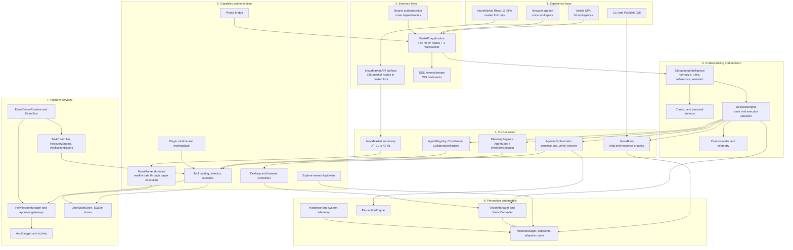
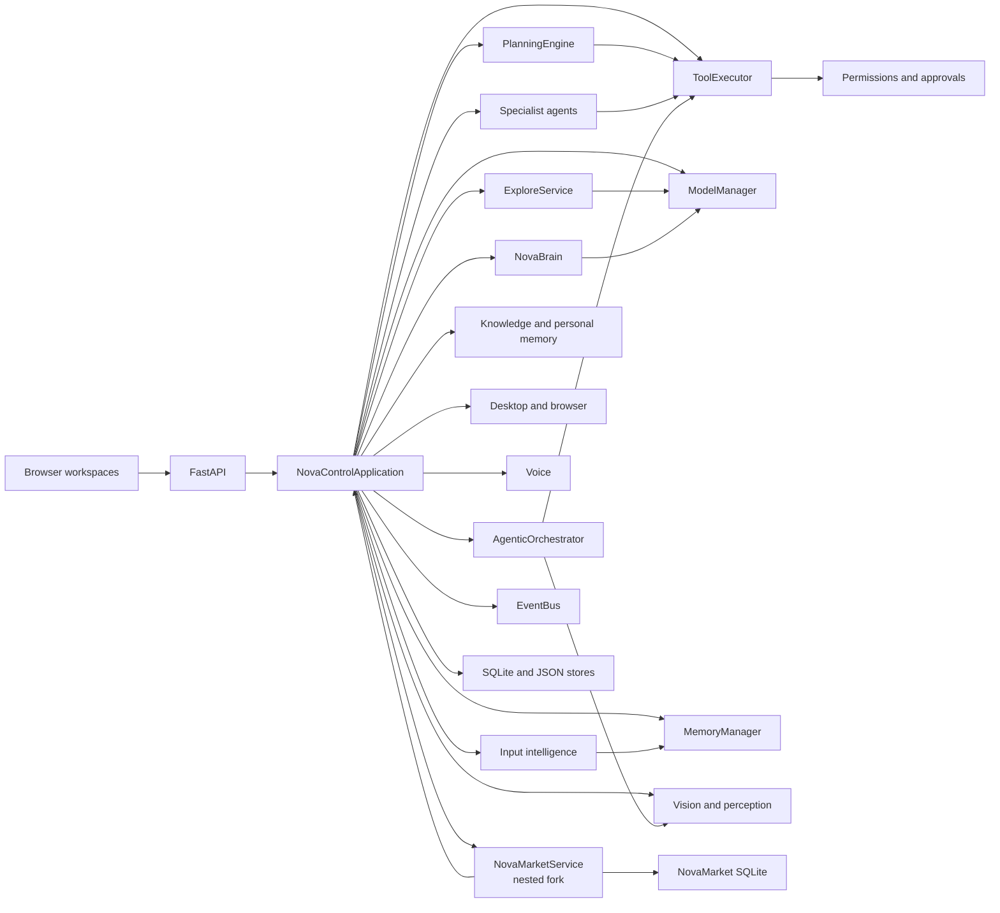
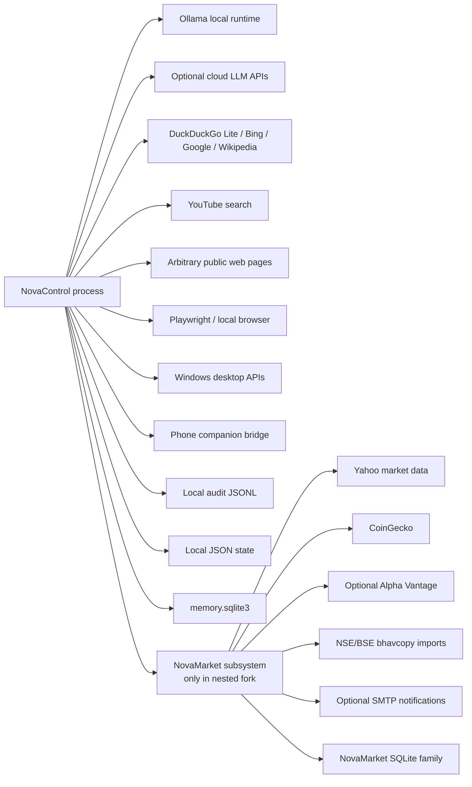

# 01 — System Architecture Overview

**Status:** Current-state discovery  
**Snapshot date:** 2026-11-14  
**Method:** source inspection of the repository as it exists on disk. Application code, schemas, configuration and runtime behavior were not changed.

## 1. Scope and an important repository finding

This repository contains **two distinct Python source trees**:

| Tree | Role | Python files |
|---|---|---:|
| `src/novacontrol/` | The main NovaControl application. | 490 |
| `novamarket/src/novacontrol/` | A full NovaControl fork with the `novamarket` package added. | 605, including 151 under `novamarket/` |

`novamarket/` has its own `.git` directory and is ignored by the root repository's `.git/info/exclude`.

The root NovaControl tree:

- does **not** contain a `novamarket` package;
- does **not** import or register NovaMarket in `src/novacontrol/application.py`;
- registers Memory, Planning, Agent, Tool, Explore, Plugin, Knowledge, Desktop, Phone, Browser, Vision, Voice, Evaluation, Training, Preference, RLHF and RLVR modules only.

The nested fork **does** integrate NovaMarket:

- constructs `NovaMarketService` at `novamarket/src/novacontrol/application.py:1789`;
- registers `NovaMarketModule` at line 2268;
- shuts it down at line 2921;
- starts its continuous monitor from the nested API startup hook (`novamarket/src/novacontrol/api/app.py:430`).

Therefore, this documentation distinguishes:

- **NovaControl** — the root application, and the base runtime inherited by the fork;
- **NovaMarket** — a financial-intelligence subsystem implemented only in the nested fork;
- **Integrated NovaControl + NovaMarket** — the nested fork, which is the only source tree where the two actually run together.

Calling NovaMarket a package of the root application would be inaccurate. Calling it an independent product would also be incomplete: inside the nested fork it is a first-class runtime module using the fork's event bus, permission manager, capability registry, state store and audit logger.

## 2. What the system is

NovaControl is a local-first, modular AI operating environment. Its implemented architecture combines:

- a FastAPI server and a no-build vanilla web workspace;
- a deterministic global input intelligence (NLU) and decision layer;
- a capability and tool runtime with permission gating;
- an event-driven module lifecycle;
- an LLM/Ollama model manager with optional cloud providers and adaptive routing;
- persistent conversation, lexical/vector memory, personal knowledge and audit storage;
- planning, specialist agents, collaboration and an observe–act–verify agent loop;
- Explore research using public search providers, page extraction and evidence synthesis;
- desktop, browser, phone, vision and voice control surfaces;
- plugin lifecycle and capability registration.

NovaMarket adds a paper-only financial subsystem: market data, events, discovery, forecasting, portfolios, wallets/ledger, independent risk, strategies, paper execution, backtesting, shadow mode, adaptive learning and autonomy orchestration.

## 3. Architectural layers

**Layer evidence:** `src/novacontrol/application.py` (composition), `api/app.py`, `intelligence/engine.py`, `decision/engine.py`, `planning/`, `agents/`, `agentcore/`, `tools/`, `explore/service.py`, `desktop/`, `browser/`, `vision/`, `models/`, `memory/`, `persistence/`, `reliability/`; `novamarket/src/novacontrol/novamarket/service.py`.

The layers are logical boundaries, not separate processes. Almost all of NovaControl runs **in one Python process** on the operator's machine. The NovaMarket React UI is a separate Vite development server / static build; its API is the same FastAPI process in the fork.

## 4. Major subsystem map

## 5. User-facing workspaces

The root web UI is a single `index.html` with 14 panels (`data-panel` values): Home, Atrium, Chat, Explore, Routing, Jarvis, Vision, Operations, NovaForge, Build, Learn, System, Settings and CLI. It has no frontend build step; assets are cache-busted by a content hash.

The nested fork adds a React frontend at `novamarket/web` with 26 navigation destinations in `nav.ts`, grouped into Overview, Trading Desks, Intelligence, Portfolio Management, Trading Intelligence, Financial Records and System. It is served by Vite on port 5173 and proxies `/market` to the FastAPI process on port 8011. The FastAPI root page and legacy static workspace remain NovaControl surfaces, not the React desk.

## 6. External and optional dependencies

**Status distinction:** Ollama, public search, web pages, OS automation, Playwright, Yahoo and CoinGecko are implemented integrations. Cloud LLMs, Alpha Vantage, SMTP and the phone bridge require configuration or an external device and may be unavailable. Optional extras (`redis`, `celery`, `langgraph`, `chromadb`, `postgres`) are declared in `pyproject.toml` but are **not** the default active runtime; no Docker, Redis, Celery, PostgreSQL or external worker is required or started by the default application.

## 7. Status summary

| Area | Status | Notes |
|---|---|---|
| Root NovaControl API and SPA | IMPLEMENTED | FastAPI; 454 measured HTTP decorators and one WebSocket |
| Event-driven runtime | IMPLEMENTED | Start/stop, retries, reverse shutdown, typed event bus |
| NLU and deterministic decision layer | IMPLEMENTED | Optional external Jev-compatible advisor is disabled by default |
| Chat | IMPLEMENTED | `/ask`, conversation manager, transcript, model/scratch modes |
| Explore | IMPLEMENTED | Search, page reading, video lookup, synthesis, citations |
| Jarvis | PARTIALLY_IMPLEMENTED | UI workspace plus voice/desktop/browser/phone dispatch; no backend `jarvis` module or agent |
| Planning and specialist agents | IMPLEMENTED | Separate planner, agent loop, four specialists, collaboration engine |
| Tools | IMPLEMENTED | 24 catalog metadata entries plus registry/selector/executor |
| Vision and perception | IMPLEMENTED | OCR-first VisionManager, VLM escalation, screenshot verification |
| Models and hardware | IMPLEMENTED | Ollama backend, optional cloud, adaptive router, hardware monitor |
| Plugins | IMPLEMENTED | Marketplace plus SDK manager, lifecycle and permission withdrawal |
| Reliability | IMPLEMENTED | Task states, retries, recovery, verification, audit |
| NovaMarket in root tree | NOT_IMPLEMENTED | No package, import or registration |
| NovaMarket in nested fork | IMPLEMENTED | NM-01..NM-14; 99-table primary database, paper only |
| NovaMarket live trading / broker | NOT_IMPLEMENTED | Explicitly absent and reported false |
| NovaMarket RL policy training | PLANNED | PI-13..PI-15; contract boundary only, no training store |
| NovaMarket named multi-agent team | NOT_IMPLEMENTED | Deterministic pipelines, not agent classes |

## 8. Reading guide

- Components and request path: [02 — NovaControl Architecture](02-NOVACONTROL-ARCHITECTURE.md)
- Per-module diagrams: [03 — Module Architectures](03-NOVACONTROL-MODULE-ARCHITECTURES.md)
- Financial subsystem and authorities: [04 — NovaMarket Architecture](04-NOVAMARKET-ARCHITECTURE.md)
- Stores, ownership and entity groups: [05 — Data Architecture](05-DATA-ARCHITECTURE.md)
- Processes and startup: [06 — Runtime and Deployment](06-RUNTIME-AND-DEPLOYMENT.md)
- End-to-end sequences: [07 — Cross-System Workflows](07-CROSS-SYSTEM-WORKFLOWS.md)
- Confirmed issues: [08 — Findings](08-ARCHITECTURE-FINDINGS.md)
- Evidence inventory: [09 — Evidence and Component Inventory](09-EVIDENCE-AND-COMPONENT-INVENTORY.md)
- Navigation: [10 — Index](10-ARCHITECTURE-INDEX.md)
- Consolidated report: [00 — Current Architecture Discovery Report](00-CURRENT-ARCHITECTURE-REPORT.md)

## 9. Diagram legend

| Visual convention | Meaning |
|---|---|
| Solid blue component | Implemented and reachable |
| Amber component | Partial, optional, or configuration-dependent |
| Grey dashed component | Planned or contract-only |
| Red-bordered component | Financial authority or safety gate |
| Green cylinder | Persistent store |
| Violet component | External system |
| `-->` solid arrow | Confirmed call, event, or data path |
| `-.->` dashed arrow | Optional, inferred, or planned path |

All Mermaid diagrams use the same convention unless a diagram states otherwise.
