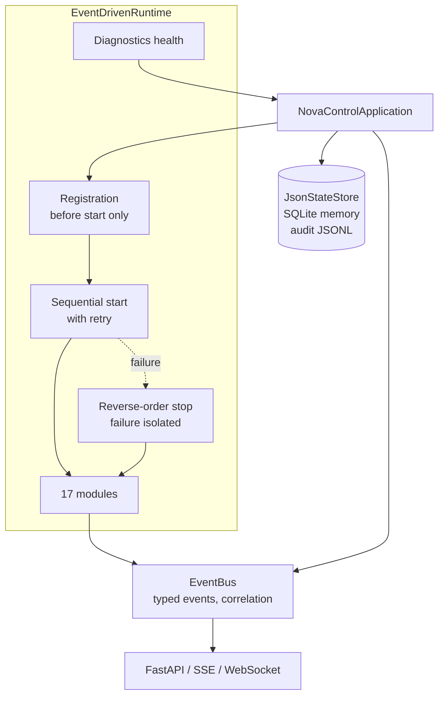
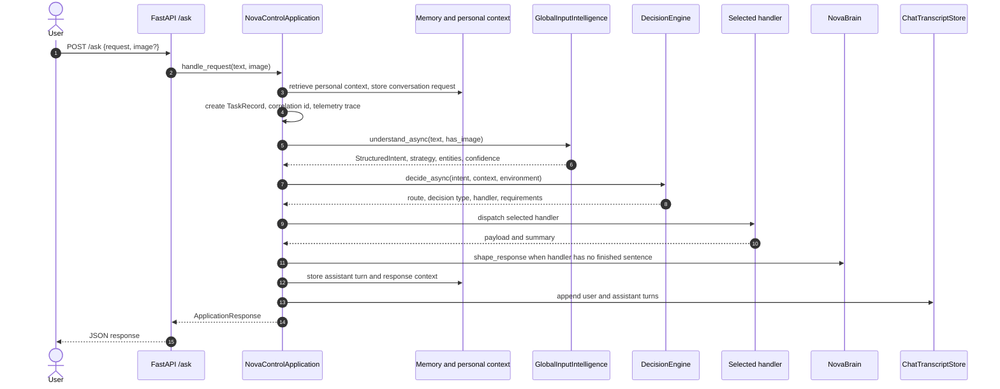
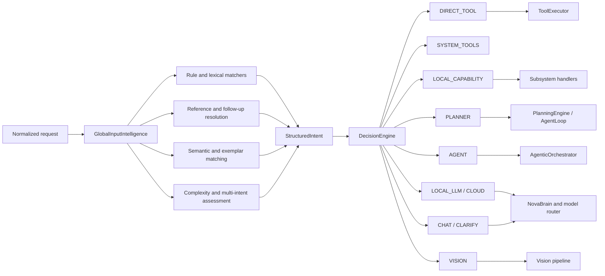
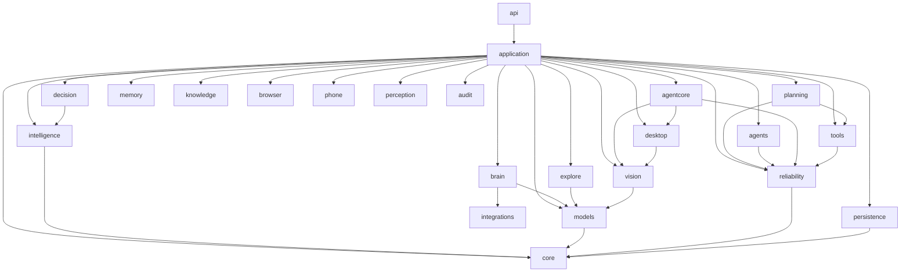

# 02 — NovaControl Architecture

This document describes the root NovaControl application. NovaMarket is covered separately in [04](04-NOVAMARKET-ARCHITECTURE.md) because it is present only in the nested fork.

## 1. Composition root

`NovaControlApplication` (`src/novacontrol/application.py:1388`) is the single composition root. Its constructor:

- resolves the data directory, defaulting to `data/` (`application.py:1391`, `:1414`);
- creates the event bus, runtime, diagnostics, state store, memory, audit logger and service container;
- instantiates the intelligence, decision, planning, agent, tool, Explore, desktop, browser, phone, vision, voice, evaluation, training, preference, RLHF and RLVR subsystems;
- registers runtime modules before the runtime starts;
- wires diagnostics and applies execution-mode, evaluation and training settings.

There is no dependency-injection framework and no second composition root. API and CLI construct this application and call it.

### Runtime modules registered at boot

| Module | Implementation | Responsibility |
|---|---|---|
| Memory | `memory/runtime.py` | Memory operations over the event bus |
| Planning | `planning/runtime.py` | Plan requests and workflow execution |
| Agent | `agents/runtime.py` | Agent registry and delegation |
| Tool | `tools/runtime.py` | Tool execution requests |
| Explore | `explore/runtime.py` | Research requests and completion |
| Plugin marketplace | `plugins/runtime.py` | Discover/install/enable/disable |
| Knowledge | `knowledge/` | Search, ingest, context |
| Desktop automation | `desktop/runtime.py` | Desktop plans and actions |
| Phone control | `phone/runtime.py` | Phone bridge requests |
| Browser automation | `browser/runtime.py` | Browser plans and actions |
| Vision | `vision/runtime.py` | OCR, screen/image/document understanding |
| Voice | `voice/runtime.py` | Transcribe, speak, wake word, interrupt |
| Evaluation | `evaluation/` | Trajectory recording and evaluation requests |
| Training | `training/` | Status, dataset, run and model requests |
| Preference | `preference/` | Preference dataset and review surface |
| RLHF | `rlhf/` | Feedback and preference-based RL surface |
| RLVR | `rlvr/` | Verifiable-reward surface |

Registration is at `application.py:2431–2470`. NovaMarket is absent from this list in the root tree.

## 2. Runtime lifecycle and event infrastructure

`EventDrivenRuntime` (`core/runtime.py`) owns module startup and shutdown:

- every module is registered before start; registration after start is rejected;
- startup is sequential in registration order;
- each module start is wrapped in a retry policy; retries publish `runtime.module_start_retrying`;
- a failed start stops already-started modules and raises `ModuleLifecycleError`;
- shutdown is in reverse registration order and isolates stop failures;
- health is collected through `DiagnosticsRegistry`.

`EventBus` (`core/events.py:592`) provides typed subscriptions, publish results, wildcard/subscriber inspection and correlation. `EventType` defines the lifecycle vocabulary, including `intent.detected`, `decision.created`, `plan.created`, `task.*`, `tool.*`, `verification.*`, `recovery.*`, `model.*`, `vision.*` and plugin events.

## 3. Interface layer

`src/novacontrol/api/app.py` builds the FastAPI app. Measured from route decorators in the current file:

- **454 HTTP routes**;
- **1 WebSocket route** (`/ws/events`);
- an SSE stream at `/events/stream`;
- static UI mounted at `/static`;
- `/` serves `web/static/index.html`;
- `/health`, `/status`, `/system/health`, `/system/telemetry`, `/system/harden`, `/system/package` are operational endpoints.

Most functional routes declare `Depends(require_auth)`. `ApiTokenAuthenticator` reads `NOVACONTROL_API_TOKEN`; when no token is configured the status surface reports `auth_enabled: false` (`api/app.py:269`, `api/auth.py`). This is a single-operator token boundary, not a multi-user identity system.

The same API process serves:

- request handling (`POST /ask`);
- chat reset and transcript history;
- planning and agent execution;
- Explore and research progress;
- desktop/browser/phone planning and execution;
- vision and model management;
- tasks, settings, knowledge, training and evaluation;
- live event delivery.

## 4. Request-to-response architecture

The central request path is `NovaControlApplication.handle_request` (`application.py:3760`).

### Handler selection

`_GIL_ROUTES` and `_GIL_HANDLER_KEYS` map understood intents to concrete handlers. The decision layer is authoritative about the **executor**, not only the route. The application:

1. prefers the handler implied by the decision when the intent table has no entry;
2. forces the vision handler for `DecisionRoute.VISION`;
3. promotes a multi-action planning decision to the planning handler;
4. otherwise uses the legacy `NovaBrain` classifier as the fallback;
5. re-routes chat-classified research questions into Explore so Chat returns a sourced report.

The decision itself executes nothing. Approval, permission checks and tool execution happen later.

## 5. Intelligence and orchestration topology

### Distinguishing the three “planning” mechanisms

They are real and separate, which is an important architectural fact:

1. **`planning/engine.py` `PlanningEngine`** creates a `Plan`; `WorkflowExecutor` executes typed steps.
2. **`planning/agent.py` `AgentLoop`** runs a bounded understand–decide–plan–execute–verify cycle.
3. **`agentcore/orchestrator.py` `AgenticOrchestrator`** plans desktop/browser work and observes–acts–verifies–recovers against a UI state.

They share tools and reliability primitives but are not one class with different names.

## 6. Shared infrastructure

### Capability and permission system

- `core/interfaces.py` defines `Capability` and runtime module contracts.
- `intelligence/intent.py` defines intent, capability availability and registry structures.
- `reliability/permissions.py` `PermissionManager` declares, resolves and checks permission scopes; it can require confirmation for high-risk or destructive actions.
- `core/security.py` supplies approval gateways; the default is deny-by-default for actions that need approval.
- The tool executor consults the permission manager before execution and publishes approval events when confirmation is required.

### Persistence

- `JsonStateStore` under `data/` stores bounded JSON namespaces (scheduler, projects, knowledge, automation, chat transcript, configuration and records).
- `memory.sqlite3` contains the lexical memory table.
- `audit/audit.jsonl` stores audit records.
- SQLAlchemy models and migrations exist for optional relational deployment, but `data/novacontrol.sqlite3` does not exist in this checkout and is not the active default persistence path.

### Observability

- `RecentActivityLog`, `BugLog`, `TaskRecord` store and diagnostics registry feed status surfaces.
- `intelligence/telemetry.py` records per-request stage timings, routing and token/resource estimates.
- `SystemTelemetry` samples expensive hardware metrics in a daemon thread and serves cached readings.

## 7. Internal dependency diagram

The arrows above are import/call dependencies, not events. The event bus adds a runtime path between modules and API streaming, but most request handling still consists of direct synchronous or awaited calls inside the application. This is a **modular monolith**, not a microservice architecture.

## 8. Architectural characteristics

**Confirmed strengths**

- One composition root and one runtime lifecycle make startup and shutdown inspectable.
- Decision and execution are separated; decisions do not grant permission.
- Tool execution is centrally gated rather than each module inventing authorization.
- Deterministic local fallbacks (scratch brain, rules, telemetry answers) mean no single model is a hard dependency for every request.
- Persistence boundaries are explicit and mostly local, which is appropriate for a single-operator desktop AI environment.

**Confirmed tensions**

- `application.py` is very large and owns many unrelated feature constructions, making the composition root a coupling hotspot.
- There are multiple overlapping abstractions for agents, planning and perception.
- The decision/GIL and legacy brain paths coexist; handler selection contains special cases to reconcile them.
- The API surface is extremely broad (454 routes) and lacks resource-level separation.
- Authentication is optional single-token authentication, not multi-user authorization.
- Root and nested NovaControl trees duplicate 490+ files, creating drift risk.

See [08 — Findings](08-ARCHITECTURE-FINDINGS.md) for IDs, evidence and severity.
