# 03 — NovaControl Module Architectures

This document covers the major modules individually. Each section states implementation status, inputs, internal components, flow, outputs, persistence, dependencies and failure behavior. Planned or partial functions are labelled; nothing is shown as implemented solely because a roadmap or README says so.

## 3.1 Explore

**Status:** IMPLEMENTED  
**Primary source:** `src/novacontrol/explore/` (15 files), `api/app.py:6093–6140`, `application.py` Explore wiring  
**Entry points:** `POST /explore`, `GET /explore/trending`, event-bus `ExploreModule`, Chat research re-routing  
**Persistence:** short-lived in-process report cache and recent-topic list; completed reports join conversation memory; no dedicated Explore database table was found.

```mermaid
flowchart LR
    Q["User query<br/>ExploreRequest"] --> F["Follow-up resolution<br/>query.py"]
    F --> C{"Cache hit?"}
    C -->|yes| OUT["ExploreReport"]
    C -->|no| P["Research planning<br/>planner.py"]
    P -->|model available and within budget| PM["Model-authored queries"]
    P -->|timeout or CPU guard| PD["Deterministic query plan"]
    PM --> S["Resilient search<br/>DuckDuckGo Lite, Bing, Google, Wikipedia"]
    PD --> S
    S --> RR["Page reading<br/>page_reader.py"]
    S --> V["YouTube video search"]
    RR --> E["Evidence extraction<br/>evidence.py"]
    V --> E
    E --> SY["Synthesis<br/>synthesizer.py"]
    SY -->|model| MA["Model answer + citations"]
    SY -->|no usable model| LA["Evidence-ranked local answer"]
    MA --> OUT
    LA --> OUT
    OUT --> UI["Explore panel<br/>progress events"]
    OUT --> MEM["Conversation memory"]
```

**Flow.** `ExploreService.research` (`explore/service.py:116`) resolves vague follow-ups, checks the report cache, optionally plans queries, performs multi-provider search with retry, reads pages and searches video concurrently, builds evidence, synthesizes, caches, tracks the topic and emits progress. A degraded search result is cached for at most 30 seconds rather than the normal 15-minute TTL.

**Source verification and citations.** Evidence is sentence-scored and associated with source metadata; the local synthesizer composes from selected evidence when model synthesis is unavailable or too slow. The report includes source URLs and warnings. This is source attribution, not independent fact-checking.

**Failure paths.** Search providers can fail independently through `ResilientSearchProvider`; page reads can fail per source; synthesis falls back to the local evidence answer; planning is skipped on slow local models; no sources yields a degraded/offline report with warnings.

## 3.2 Chat

**Status:** IMPLEMENTED  
**Primary source:** `brain/brain.py`, `brain/conversation.py`, `core/chat_transcript.py`, `api/app.py:522`, `application.py:3760`  
**Entry point:** `POST /ask`  
**Persistence:** conversation ring buffer in memory; bounded `chat_transcript.json` via `JsonStateStore` (200 turns); conversation records in `memory.sqlite3`.

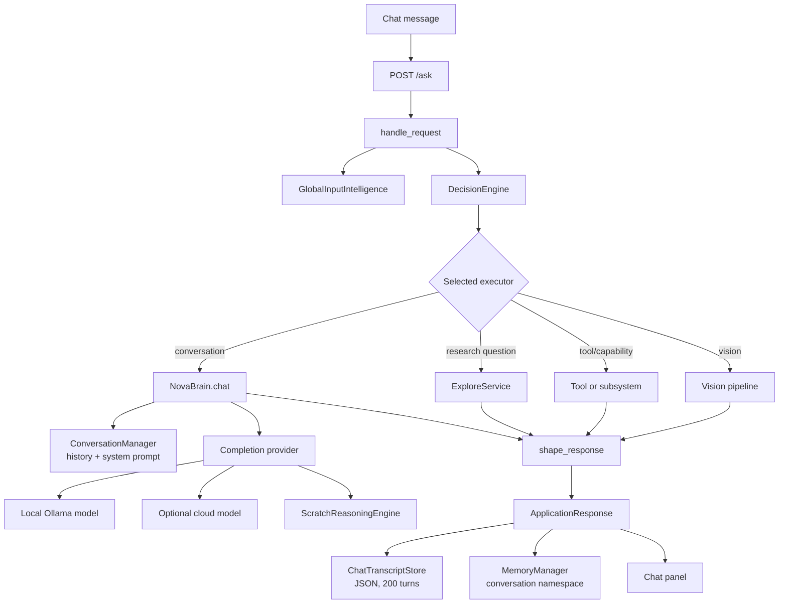

**Conversation context.** `ConversationManager` keeps recent messages and turns and builds model messages. `NovaBrain` attaches a labelled conversation-context block and local knowledge context when building prompts. `handle_request` resolves personal context before NLU and stores both the request and assistant response.

**Model modes.** `auto`, `llm`, `scratch` and `cloud` are explicit. `auto` prefers the boot/local model and falls back to scratch. Storing a cloud key does **not** activate cloud; the user must select cloud, and execution mode can close the cloud slot entirely.

**Tool calling.** No OpenAI-style function-calling loop exists in `NovaBrain`. Chat does not invoke tools directly; tool use is chosen by the NLU/decision/tool pipeline or by a planning/agent handler around chat. Response shaping is only applied when a handler result has no finished user-facing sentence.

**Streaming.** The response endpoint returns JSON. Live progress is delivered through SSE `/events/stream` and WebSocket `/ws/events`. Token-by-token LLM streaming was not found in this chat path.

**Failure paths.** Provider exceptions become a user-visible “Model provider failed” answer; a routing defect falls back to the provider; a missing model falls back to scratch; transcript persistence is bounded and nonessential to answering.

## 3.3 Jarvis

**Status:** PARTIALLY_IMPLEMENTED as a named module; its capabilities are IMPLEMENTED across other modules.  
**Primary source:** `web/static/index.html:617–667`, `web/static/js/voice.js`, `web/static/js/render-panels.js`, `api/app.py:1188–1245`, `desktop/`, `browser/`, `phone/`, `voice/`  
**Finding:** there is **no** `novacontrol/jarvis` Python package, `JarvisModule`, or Jarvis agent. “Jarvis” is the device-control workspace and command lifecycle, not an independent backend subsystem.

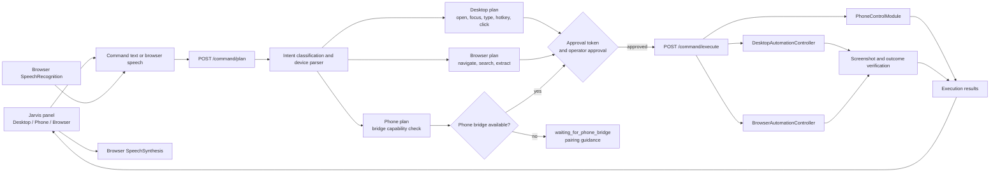

**Voice.** The web workspace uses the browser Web Speech API for recognition and synthesis. The transcript is placed in the Chat input and submitted through the normal Chat path (`voice.js:30–44`). The backend `VoiceModule` is a separate event-driven speech surface (`voice.transcribe`, `voice.speak`, wake word, interrupt) with basic and native processor implementations; it is not the orchestrator of Jarvis device commands. Whisper/pyttsx3 are optional extras, not default dependencies.

**Command lifecycle.** Plan first, return an approval token, execute only with the token, then report per-action results. The UI deliberately suppresses “Approve and Run” when the phone bridge is unavailable. `/command/execute` re-dispatches by intent so the same approval button covers desktop and browser commands.

**Failure/recovery.** Unsupported commands fail at planning; missing approval returns 403; missing phone bridge returns a waiting state; desktop actions are verified and failures recorded in the bug log; browser actions use the Playwright/local runner.

## 3.4 Memory and Context

**Status:** IMPLEMENTED  
**Primary source:** `memory/manager.py`, `memory/stores.py`, `memory/personal.py`, `intelligence/context.py`, `core/chat_transcript.py`, `application.py`  
**Store:** `data/memory.sqlite3`; observed schema contains one table, `memory_records` (205 rows in this checkout).

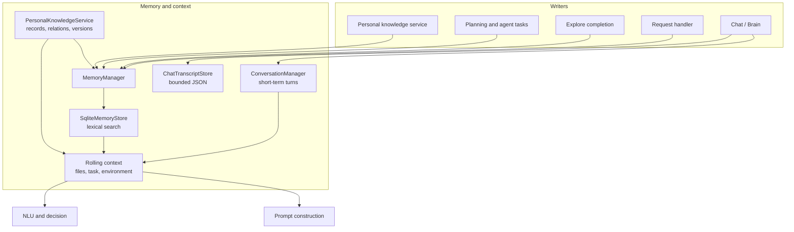

**Namespaces.** `conversation`, `project`, `knowledge`, `short_term`, `long_term` (`memory/models.py`). Records support importance, metadata, TTL and expiration cleanup. Retrieval is lexical, not a dedicated vector database in the default path.

**Personal knowledge.** `PersonalKnowledgeService` adds typed records, versions, relations, privacy/status, conflict resolution, consolidation, export and deletion over the same memory repository. It is user-scoped by access helpers, not by a multi-user account system.

**Context construction.** `handle_request` injects a bounded personal-context block (300 tokens) into the brain request context. `ConversationManager` contributes recent turns; `GlobalInputIntelligence` maintains rolling context of recent files, task and environment. Memory influences understanding and prompts but does not itself authorize actions.

**Failure behavior.** A corrupted personal index is reported in status and does not prevent boot. Expired records are cleaned up. Transcript persistence degrades to non-persistent turns if no state store exists.

## 3.5 NLU and Decision Engine

**Status:** IMPLEMENTED; optional Jev-compatible provider is PARTIAL/disabled by default.  
**Primary source:** `intelligence/engine.py`, `intelligence/rules.py`, `intelligence/registry.py`, `intelligence/semantic.py`, `decision/engine.py`, `decision/providers.py`, `decision/models.py`  
**Output contract:** `Decision` with type, route, capability, tool, model, actions, confidence, requirements, reason code, handler and provider.

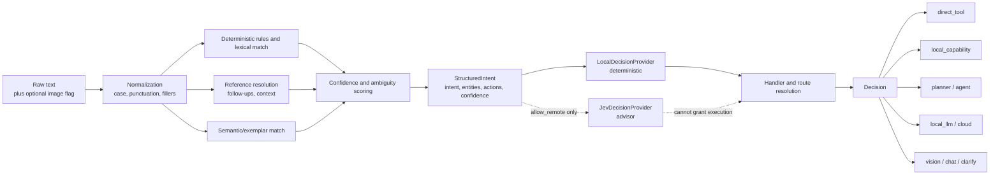

**Intent coverage.** The registry defines deterministic intents for system readings, files, desktop, browser, phone, knowledge, Explore, vision, planning, code/build, conversation and clarification. Rules, lexical similarity, exemplars and optional embeddings contribute with calibrated thresholds (`NluSettings`). Multi-intent/complexity assessment can require planning.

**Decision behavior.** The decision engine is deterministic and offline by default. `JevDecisionProvider` exists behind `DecisionSettings.provider = "jev"`, `allow_remote`, an endpoint and a timeout. It receives a redacted request and can only advise a route; the local layer always resolves the handler, and the provider cannot clear confirmation or name an executor. Default installs never contact it.

**Failure behavior.** Low confidence yields clarification or a safer fallback. Remote provider failure/refusal falls back to the local provider. A decision never executes an action.

## 3.6 Planner and Task Decomposition

**Status:** IMPLEMENTED, with two distinct planners.  
**Primary source:** `planning/engine.py`, `planning/executor.py`, `planning/agent.py`, `planning/runtime.py`, `agentcore/planner.py`, `agentcore/orchestrator.py`  
**Persistence:** plan and task state in application task records and agent state; agentcore task state is bounded in memory with event announcements.

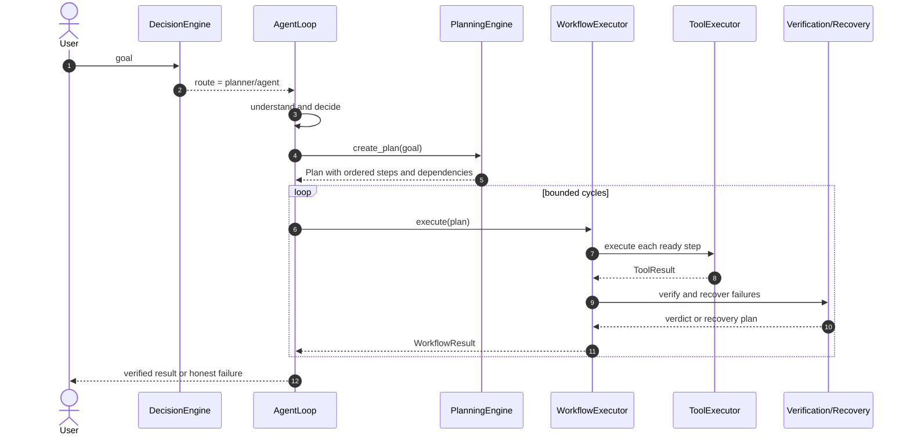

**Two planners.**

- `PlanningEngine` is deterministic: it splits a goal on “then”, semicolons, newlines or “and”; a single goal gets Understand → Execute → Verify steps, while multiple fragments become sequential dependent steps. `ClarificationPolicy` can refuse ambiguous goals.
- `AdaptivePlanner` in `agentcore` interprets desktop/browser goals into typed steps (`OPEN`, `FOCUS`, `TYPE`, `CLICK`, `HOTKEY`, `NAVIGATE`, `RESEARCH`, `VERIFY`), supports remembered workflows and replanning after failure.

**Execution.** `WorkflowExecutor` resolves ready steps by dependency, executes through a step runner/tool executor, applies retry policy, verifies outcomes and records context. `AgentLoop` bounds total cycles and step attempts, escalates to clarification when the plan is ambiguous, and can replan after a failed workflow.

**Limits.** `PlanningSettings` caps cycles at 10 and step attempts at 10, defaulting to 2 each. Replanning is bounded. There is no durable distributed workflow engine.

## 3.7 Agent Execution and Orchestration

**Status:** IMPLEMENTED.  
**Primary source:** `agents/` (14 files), `agentcore/` (12 files), `application.py:2335–2410`  
**Registry/specialists:** `AgentRegistry`, `CoordinatorAgent`, `DeveloperAgent`, `ResearchAgent`, `DataAnalysisAgent`, `VerificationAgent`, `CollaborationEngine`.

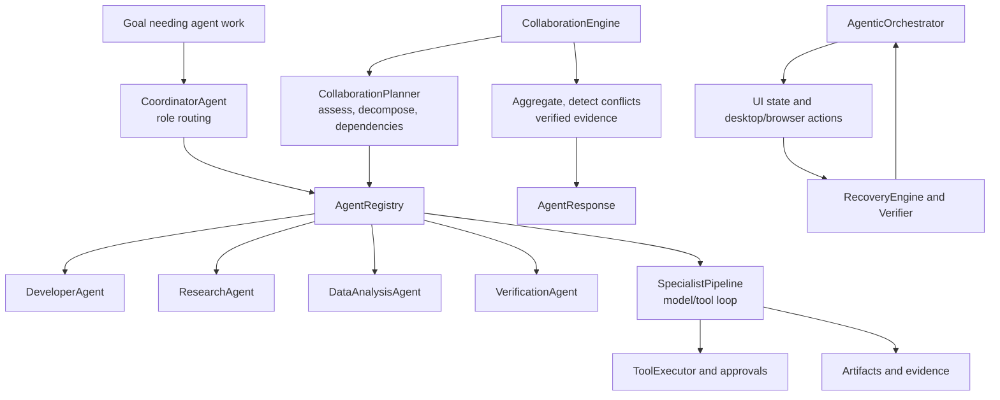

**Execution model.** The four specialists are real classes with distinct prompts and verification expectations. `CollaborationEngine` sits above the registry: it assesses whether collaboration is useful, builds a dependency-aware plan, runs subtasks through existing specialists, aggregates results, detects conflicting values, persists bounded task state and can resume/cancel. It does not create a second planner or a separate agent process.

**Agentic loop.** `AgenticOrchestrator` is a separate UI-facing loop for desktop/browser tasks: interpret → plan → execute step → observe state → verify → recover/replan. It uses `UiPerceptionEngine`, `ActionEngine`, `Verifier` and `RecoveryEngine`.

**Failure behavior.** Failed subtasks fail their dependents; cancellation stops remaining work; a declined specialist is recorded; conflicts are surfaced instead of silently choosing one value; verification must pass before aggregation is presented as verified.

**Not present.** No independent long-lived agent processes, message broker, or swarm runtime. The current implementation is in-process.

## 3.8 Tool Selection and Execution

**Status:** IMPLEMENTED.  
**Primary source:** `tools/registry.py`, `tools/catalog.py`, `tools/selection.py`, `tools/executor.py`, `tools/validation.py`, `tools/cache.py`, `tools/runtime.py`, `reliability/permissions.py`  
**Catalog:** 24 `ToolMetadata` declarations in `tools/catalog.py`; the live registry also accepts plugin tools.

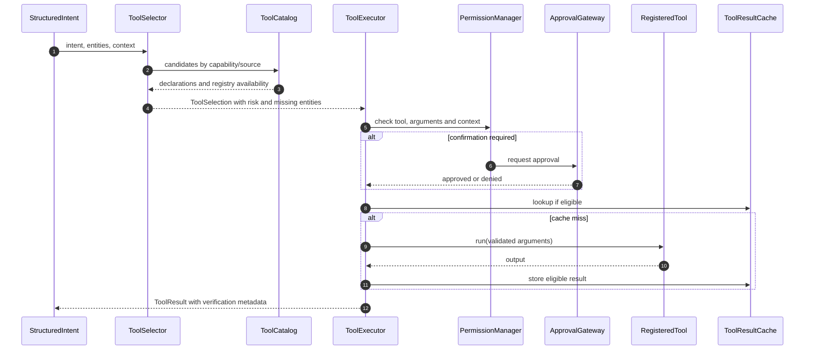

**Selection.** Deterministic scoring over declared capabilities, intent service mapping, entity completeness, availability and catalog order. The selector reports candidates and reasons. It does not use an LLM to choose tools.

**Validation and permissions.** `ToolRequest` arguments are validated against the tool schema. `PermissionManager` resolves declared scopes, risk, destructiveness, reversibility and external side effects; high-risk actions require approval. Deny-by-default gateways are the safe default. Plugins must withdraw tools and declarations on disable/unload.

**Failure behavior.** Missing entities degrade rather than dispatch; unavailable capabilities are reported in the selection; permission denial prevents execution; tool exceptions become failed `ToolResult`s; retries are limited and policy-controlled; cache is bypassed for non-idempotent or sensitive actions.

## 3.9 Vision and Perception

**Status:** IMPLEMENTED.  
**Primary source:** `vision/manager.py`, `vision/models.py`, `vision/runtime.py`, `desktop/vision.py`, `desktop/capture.py`, `perception/engine.py`, `perception/routing.py`, `perception/frames.py`, `perception/scene.py`  
**Inputs:** screenshots, attached images, documents, frame sequences.  
**Outputs:** OCR text, image type, summary, UI elements, located point/region, confidence, verification evidence.

```mermaid
flowchart LR
    SRC["Screen, image, document<br/>or frame source"] --> CAP["Frame acquisition<br/>capture or supplied frames"]
    CAP --> PRE["Preprocessing<br/>normalize, resize, quality"]
    PRE --> OCR["OCR first<br/>text and word geometry"]
    OCR --> ROUTE{"Can text answer?"}
    ROUTE -->|read or locate| ANS["Text-grounded result"]
    ROUTE -->|needs visual understanding| VLM["Vision model<br/>local or configured cloud"]
    VLM --> ANS
    ANS --> ELEM["UI elements / regions / point"]
    ELEM --> DEC["Decision, planner or agent"]
    DEC --> ACT["Desktop/browser action"]
    ACT --> AFTER["After screenshot"]
    AFTER --> VER["Pixel diff + OCR + model verification"]
    VER --> BUG["Bug log and recovery"]
```

**VisionManager behavior.** OCR is the first attempt, not a fallback: pure text tasks avoid a VLM; locate tasks use OCR geometry when the target word is present; otherwise the VLM is called with a constrained JSON contract. Results carry the answer source and confidence.

**Desktop control.** `VisionController` captures the screen through the desktop controller's approved screenshot path, locates an element, clicks or focuses it, takes an after screenshot and verifies change near the click plus OCR evidence. Failures are recorded in the bug log.

**Perception engine.** A separate broader perception stack (`perception/`) supports frame sources, sampling, tracking, temporal/spatial scene representation, routing between fast deterministic perception and a VLM. It is used by the agentic/UI loop, not by every request.

**Limits.** OCR quality depends on the installed engine; VLM availability and memory fit decide escalation; UI element detection is screenshot-based, not DOM/accessibility-tree based. Vision models are optional.

## 3.10 Model and Hardware Management

**Status:** IMPLEMENTED, with optional cloud and adaptive routing.  
**Primary source:** `models/manager.py`, `models/adaptive.py`, `models/hardware.py`, `models/profiles.py`, `intelligence/model_manager.py`, `telemetry/hardware.py`  
**Entry points:** `/models/status`, `/models/load`, `/models/unload`, `/brain/*`, chat, Explore synthesis, vision.

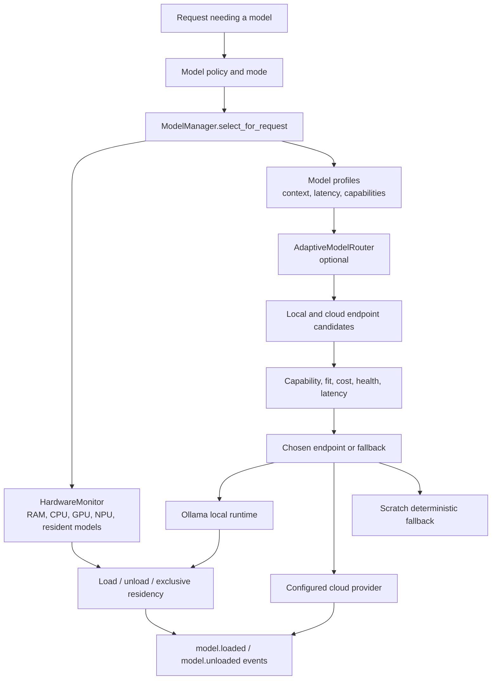

**Local inference.** Model lifecycle is abstracted by `ModelBackend`; `OllamaBackend` implements list, residency, load, unload, capability and memory probes. The older `intelligence/model_manager.py` provides the same idea for the brain; `models/` is the broader Phase 7 manager. This duplication is real.

**Routing.** `AdaptiveModelRouter.complete` scores endpoints by capability, hardware fit, provider health, cost and latency and can fall back. Model selection does not grant execution authority. Cloud access can be closed by execution mode; storing a key does not activate it.

**Hardware.** `HardwareMonitor` reports measured RAM, CPU, GPU utilization/memory when available, NPU probe and resident models. Model fit is based primarily on available RAM; GPU figures are reported for the operator. Expensive probes are cached/sampled.

**Failure behavior.** No model → scratch/offline path; model too large → plan/refuse; provider failure → fallback or visible error; an unreachable backend yields `None` rather than a fabricated reading.

## 3.11 Plugin and Capability Management

**Status:** IMPLEMENTED.  
**Primary source:** `plugins/manager.py`, `plugins/sdk.py`, `plugins/sdk_manager.py`, `plugins/runtime.py`, `plugins/repository.py`, `plugins/models.py`  
**Entry points:** marketplace discover/install/trust/enable/disable events; `PluginManager` lifecycle.

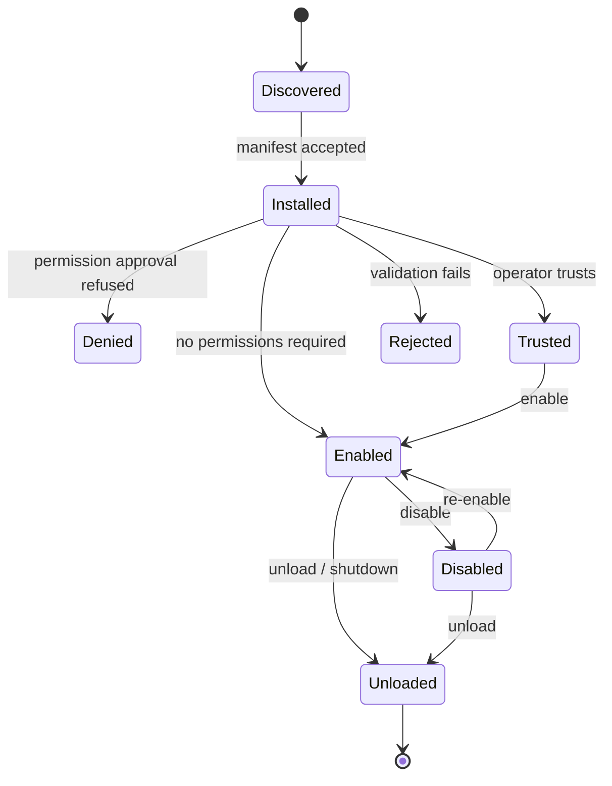

**Two layers.** `PluginMarketplace` manages discovery, permissions, trust and install/enable records. `PluginManager` provides the runtime lifecycle: validate, configure, load, initialize, enable, disable, unload; it registers tools and capabilities, declares permissions, resolves requirements and withdraws everything on disable/unload. `Plugin`/`PluginContext` form the SDK.

**Capability flow.** Plugin tools enter the same `ToolRegistry` and catalog; plugin capabilities enter the same `CapabilityRegistry`; declarations enter the same `PermissionManager`. There is no separate plugin execution path or separate approval system.

**Failure behavior.** Invalid manifests are rejected; missing requirements prevent enable; permission declarations trigger approval; enable failure rolls back registrations; unload removes tool names so disabled code is not callable.

## 3.12 Reliability, Recovery and Lifecycle

**Status:** IMPLEMENTED.  
**Primary source:** `reliability/task_state.py`, `reliability/control.py`, `reliability/recovery.py`, `reliability/verification.py`, `reliability/permissions.py`, `core/runtime.py`, `core/events.py`, `audit/logger.py`

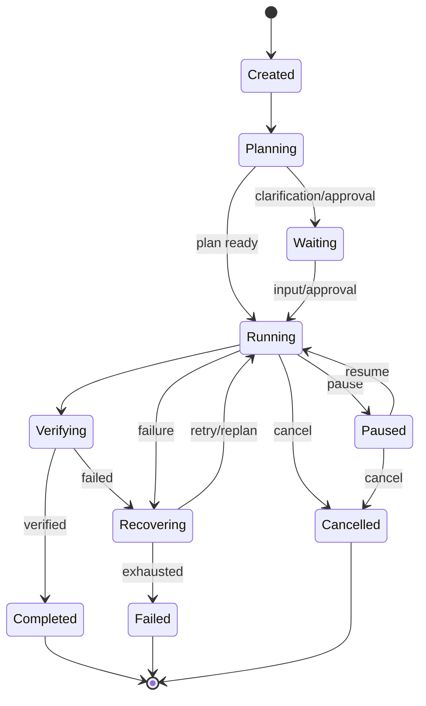

**Layers.**

- **Lifecycle:** module start retries, reverse shutdown, stop-failure isolation, health diagnostics.
- **Task control:** `TaskStateMachine` validates transitions; `TaskController` supports pause, resume, cancel, checkpoints and cancel hooks.
- **Recovery:** `RecoveryEngine` classifies failures, chooses retry, alternative tool, replan, clarification or abort, and runs recovery with verification.
- **Verification:** `VerificationEngine` checks outputs and can use tool-specific strategies; step and task results are recorded.
- **Permissions:** centralized approval and denial; a failed or denied action is not reported as success.
- **Audit:** JSONL audit records with redaction and retention; status/telemetry are separate from the audit trail.

**Failure propagation.** Module start failure during boot aborts the runtime after stopping already-started modules. During operation, tool failures are contained in task/agent state; agent collaboration fails dependents; recovery is bounded; unresolved failures remain failed with reasons. The FastAPI process itself has no supervisor/restart policy; process-level recovery is external.
