# 04 — NovaMarket Architecture

## 1. Scope and integration boundary

**Implementation status:** NM-01 through NM-14 IMPLEMENTED in the nested fork; PI-01/PI-02/PI-04/PI-05 services IMPLEMENTED additively; PI-06 onward PLANNED.  
**Code root:** `novamarket/src/novacontrol/novamarket/` (151 Python files).  
**Primary database:** `novamarket/data/novamarket.sqlite3`, 99 tables, 35,827,712 bytes at inspection.

NovaMarket is a **paper-only financial-intelligence subsystem** hosted by NovaControl. In the fork it is integrated at four points:

1. **Composition:** `NovaControlApplication` constructs `NovaMarketService` with the application's `JsonStateStore`, `EventBus`, `PermissionManager`, `CapabilityRegistry` and data directory (`novamarket/src/novacontrol/application.py:1789–1800`).
2. **Lifecycle:** `NovaMarketModule` is registered with `EventDrivenRuntime` (`application.py:2268`). Its `start` attaches the one event bus and calls `auto_start`; a NovaMarket failure records ERROR but does not stop NovaControl booting. Shutdown withdraws declarations and subscriptions.
3. **Permissions/capabilities:** NovaMarket declares its permission model and capabilities into the existing registries, then withdraws them.
4. **API/UI:** the fork's FastAPI app exposes 258 `/market` routes and starts a continuous monitor at API startup. The React 19/Vite desk calls those routes through a Vite proxy or exact CORS origin.

The root tree has none of this: no `novamarket` package, no import, no registration. See [01 §1](01-SYSTEM-ARCHITECTURE-OVERVIEW.md#1-scope-and-an-important-repository-finding).

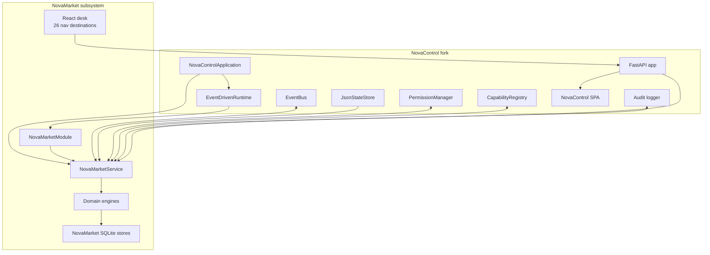

## 2. Internal composition

`NovaMarketService` lazily constructs and owns the domain engines. The primary domains and their phase labels are declared in `architecture.py`:

| Phase | Domain | Implementation status |
|---|---|---|
| NM-01 | Architecture, contracts, integration | IMPLEMENTED |
| NM-02 | Market data reliability | IMPLEMENTED |
| NM-03 | NovaCoin wallet and ledger | IMPLEMENTED |
| NM-04 | Evidence-backed event radar | IMPLEMENTED |
| NM-05 | Asset discovery and watchlists | IMPLEMENTED |
| NM-06 | Probabilistic forecasting | IMPLEMENTED |
| NM-07 | Three-horizon portfolios | IMPLEMENTED |
| NM-08 | Independent risk engine | IMPLEMENTED |
| NM-09 | Trading strategies | IMPLEMENTED |
| NM-10 | Realistic paper execution | IMPLEMENTED |
| NM-11 | Reproducible backtesting | IMPLEMENTED |
| NM-12 | Shadow mode | IMPLEMENTED |
| NM-13 | Controlled adaptive learning | IMPLEMENTED |
| NM-14 | Integrated workspace and acceptance | IMPLEMENTED |
| PI-01 | Prediction contracts and evidence | IMPLEMENTED |
| PI-02 | Datasets and historical foundations | IMPLEMENTED |
| PI-03 | Low-latency data gateway | IMPLEMENTED as a controlled gateway over NM-02 |
| PI-04 | Features and regime detection | IMPLEMENTED |
| PI-05 | Statistical baseline forecasting | IMPLEMENTED |
| PI-06 | Sequence/deep model family | PLANNED |
| PI-07 | Ensemble selection and uncertainty | PARTIAL: ensemble contract/assembler; not the full PI-07 program |
| PI-08–PI-12 | Intraday/swing/fundamental/decision feedback | PLANNED or partial contracts |
| PI-13 | Reinforcement-learning environment | PLANNED |
| PI-14 | Policy evaluation and governance | PLANNED |
| PI-15 | Registry and drift | PLANNED |
| PI-16 | Performance and acceptance | PLANNED |

## 3. Domain model and status

NovaMarket has three kinds of domain, and keeping them distinct is essential to the architecture:

- **Authoritative books and gates:** NM-03 wallet/ledger, NM-07 portfolio, NM-08 risk and NM-10 paper execution. These own financial mutations or veto them.
- **Evidence and analytical domains:** NM-02 market data, NM-04 events, NM-05 discovery, NM-06/PI forecasting, PI-04 features and the market workbench. These produce records and evidence but do not move money.
- **Orchestration and governance:** NM-09 strategies, AT-01–AT-05 autonomy, NM-11 backtesting, NM-12 shadow, NM-13 learning and NM-14 workspace. These coordinate or evaluate but still pass through the authoritative gates.

The sections below follow the requested domain categories. Where a requested capability is not implemented, the section says so explicitly.

## 4.1 Domain A — Virtual market and financial system

**Status:** IMPLEMENTED. **Convention:** 1 NC = ₹1.  
**Authorities:** `WalletEngine`/`WalletStore` (NM-03) for money and ledger entries; `PortfolioEngine`/`PortfolioStore` (NM-07) for portfolios, positions, valuation and performance; NM-10 for paper orders/fills.

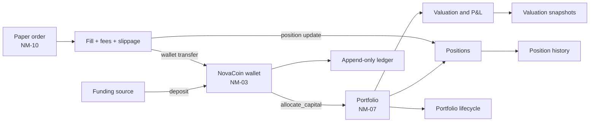

**Implemented financial records.** Wallets have balances and transactions; transfers are idempotent and reversible; ledger entries preserve debits/credits and references. Portfolios have short/medium/long horizons, capital, positions, valuation history, performance, decisions, proposals and lifecycle. In the inspected database: 16 wallets, 17 wallet transactions, 34 ledger entries, 7 portfolios, 10 valuations, 0 positions.

**Valuation.** `PortfolioEngine._valuate` combines cash and marked positions using market data; valuation snapshots and performance are stored. Missing prices are surfaced as unavailable rather than fabricated.

## 4.2 Domain B — Market data intelligence

**Status:** IMPLEMENTED.  
**Sources:** Yahoo, CoinGecko, optional Alpha Vantage; official NSE/BSE bhavcopy import scripts.  
**Stores:** `market_instruments`, `market_bars`, `market_observations`, `market_corrections`, `market_retrieval_log`, `market_provider_health`, `market_quality_events`.

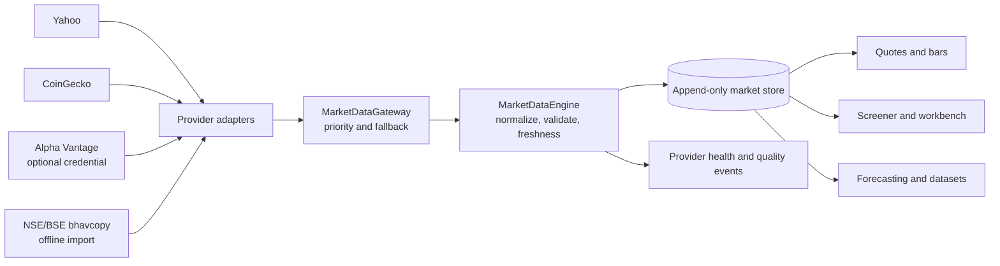

**Behavior.** Fetching, normalization, provenance, freshness and quality are owned by NM-02. Observations are append-only; corrections are recorded rather than overwriting history. The gateway adds priorities, rate/credential constraints and failure classification. The inspected database contains 4,813 instruments, 33,561 bars and 185 observations. Provider coverage and delay limitations are real; stored history is not a live quote.

## 4.3 Domain C — Prediction intelligence

**Status:** statistical forecasting IMPLEMENTED (PI-05); sequence/deep models and full ensemble governance PLANNED.  
**Primary sources:** `forecasting/`, `statistical/`, `datasets/`, `features/`, `prediction/`.  
**Implemented model ids:** `naive_last`, `random_walk`, `historical_return`, `seasonal_naive`, `sma`, `wma`, `ema`, `ses`, `holt`, `holt_winters`, `arima`.

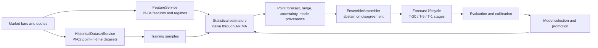

**Implemented.** Probabilistic point forecasts, empirical/normal residual intervals, model metadata, forecast lifecycle stages, calibration/performance records, model promotion, evaluation against outcomes, and a statistical baseline service. The database has 6 `forecast_records`, 6 `forecast_models`, 0 `prediction_forecasts`, and 0 `prediction_ensembles` rows at inspection.

**Partial/planned.** Sequence and deep-learning model families (PI-06), full ensemble weighting/selection (PI-07), intraday and long-term fundamental intelligence (PI-08/PI-10), RL feedback (PI-13), and drift/registry completion (PI-15). The code contains an ensemble contract and assembler; this is not evidence that the full PI-07 program is accepted.

**Safety.** Prediction is read-only evidence. It cannot mutate portfolio, wallet, risk or execution state.

## 4.4 Domain D — Financial research intelligence

**Status:** PARTIALLY_IMPLEMENTED relative to the requested full research domain.  
**Implemented evidence surfaces:** market-event radar with source evidence and verification state; news/event ingestion; discovery candidates and scoring; watchlists; market workbench; forecast evidence and provenance.  
**Not found:** a dedicated company financial-statement database, ratio engine, fundamental-analysis service, sentiment-scoring model, or a “Financial Research Agent.” Long-term fundamental intelligence is PI-10, PLANNED.

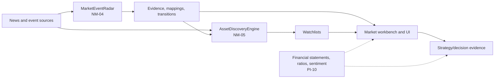

**Evidence model.** Events carry timestamps, sources, evidence rows, verification state and version/history. Discovery candidates retain the evidence that caused them to appear. This is auditable market-event research, not fundamental equity research.

## 4.5 Domain E — Autonomous trading intelligence

**Status:** IMPLEMENTED for paper-only autonomy (AT-01 through AT-05).  
**Modes:** `disabled`, `monitoring`, `autonomous`, `paused`.

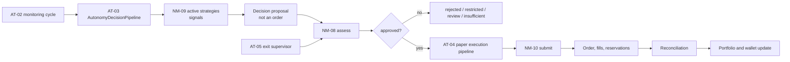

**AT-03** evaluates strategies and instruments, creates persisted signals and proposals, and calls NM-08. It does not forward a proposal to execution itself. **AT-04** reads only `risk_approved` proposals, re-verifies the persisted NM-08 decision and lease, then calls NM-10. **AT-05** supervises stop-loss, target and trailing-stop exits for long positions through the same risk/execution path.

**Controls.** The autonomy lease is short and renewed; one cycle at a time; autonomous mode requires explicit paper-only acknowledgement; pause/resume/stop/recovery are operator actions; runtime and session status expose `paper_only`, `live_trading` and `broker_connected`. The inspected DB has one autonomy runtime row and zero execution intents.

## 4.6 Domain F — Reinforcement learning and adaptive intelligence

**Status:** NM-13 adaptive learning IMPLEMENTED; RL environment/policy training PLANNED (PI-13–PI-15).  
**Implemented:** shadow mode, backtesting, learning evidence, experiments, candidates, approvals, versions, promotion/rollback, alerts and shadow validation in separate stores. **Not implemented:** an RL environment, policy network, reward implementation, RL training run, or production policy authority.

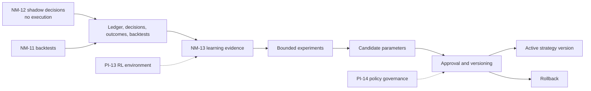

**Boundary.** Adaptive learning can propose bounded, reversible parameter changes; it cannot loosen a risk limit, write the ledger, send an order or grant execution authority. No current code path promotes an RL policy into production.

## 4.7 Domain G — Multi-agent financial intelligence

**Status:** NOT_IMPLEMENTED as named financial agents.  
There are no `ResearchAgent`, `TechnicalAnalysisAgent`, `FundamentalAnalysisAgent`, `PredictionAgent`, `MarketRegimeAgent`, `RiskAnalysisAgent`, `PortfolioAgent`, `RLPolicyAgent` or `TradingDecisionAgent` classes in the `novamarket` package. A repository-wide class search found no `*Agent` in the package. NovaControl’s generic agent system exists in the fork, but it is not wired as a NovaMarket financial agent team.

The requested functions exist as deterministic pipeline stages and evidence producers:

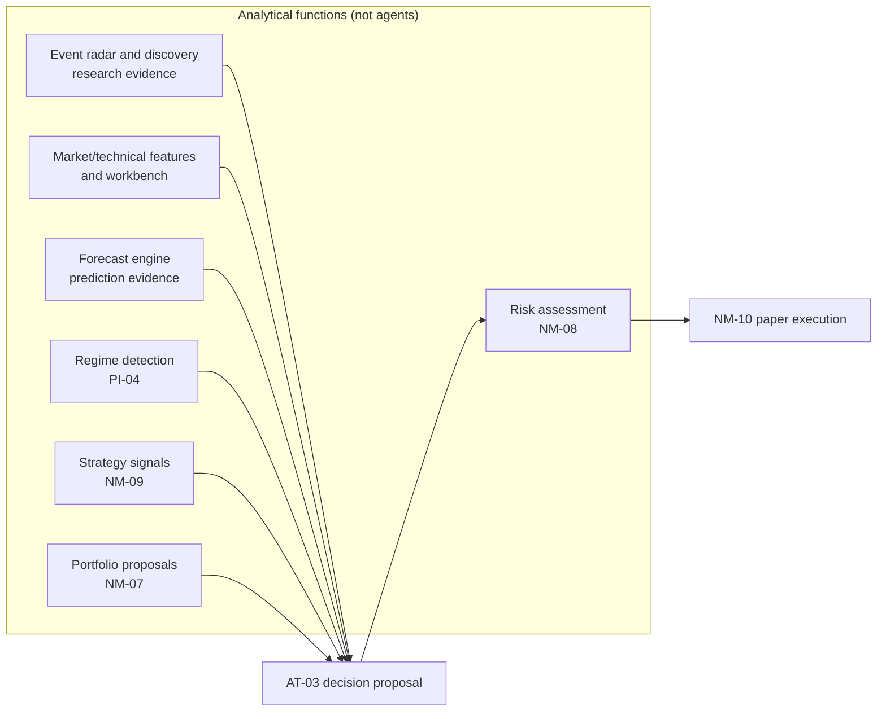

This is a **single deterministic orchestration pipeline with functional stages**, not autonomous agents negotiating with each other. The distinction matters: the safety properties come from fixed call order and authority gates, not from agent reasoning.

## 4.8 Domain H — Portfolio management and optimization

**Status:** IMPLEMENTED.  
**Horizons:** short/day, medium/swing, long.  
**Features:** capital allocation, positions, valuation, performance, rebalance proposals, constraints, lifecycle, reconciliation, close.

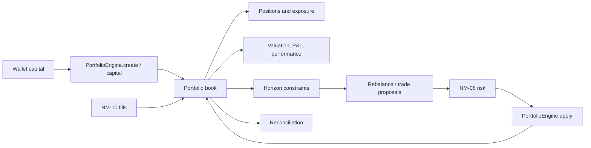

**Horizon behavior.** Creation validates the horizon and funding; valuation uses current market prices; proposals are constrained by horizon rules; performance derives from valuation history and cash flows. Portfolio proposals are not orders. `PortfolioEngine.apply` is the authorized mutation path used by approved risk decisions; NM-10 also writes position rows through the portfolio store during a fill.

**Inspected state.** 7 portfolios, 0 current positions, 10 valuations. Empty positions mean no live paper exposure in this checkout.

## 4.9 Domain I — Risk intelligence

**Status:** IMPLEMENTED. NM-08 is the sole authoritative risk engine.  
**Outcomes:** `approved`, `rejected`, `restricted`, `requires_review`, `insufficient_data`.  
**Policy dimensions include:** position/sector/aggregate weight, invested and cash fractions, drawdown, volatility, liquidity, turnover, data/forecast/state age, minimum observations, uncertainty and restricted instruments.

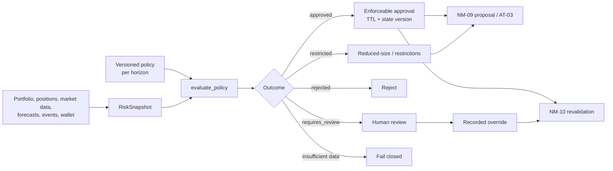

**Independence.** The risk engine does not propose trades. It reads existing state, produces a persisted decision with policy version, state version and expiry, and can be re-run. NM-10 independently re-reads the decision and re-runs `assess` against the actual notional before accepting an order. Missing risk capability or errors fail closed.

**Apply gate.** `RiskEngine.apply_decision` can apply **portfolio proposals** after checking approval, expiry, policy version, portfolio/proposal state version and consumption. It calls `PortfolioEngine.apply`; it does not create orders. This is a risk-authorized portfolio mutation path, not a second execution engine.

**Inspected state.** One risk decision, two alerts. The absence of many decisions is consistent with an empty paper book, not evidence of missing implementation.

## 4.10 Domain J — Dashboard and UI

**Status:** IMPLEMENTED for the React desk and legacy workspace.  
**Frontend:** `novamarket/web/src`, React 19.1, TypeScript 5.8, Vite 6. `nav.ts` currently defines 26 destinations.  
**Backend:** 258 `/market` routes measured in the fork API, plus shared NovaControl routes.

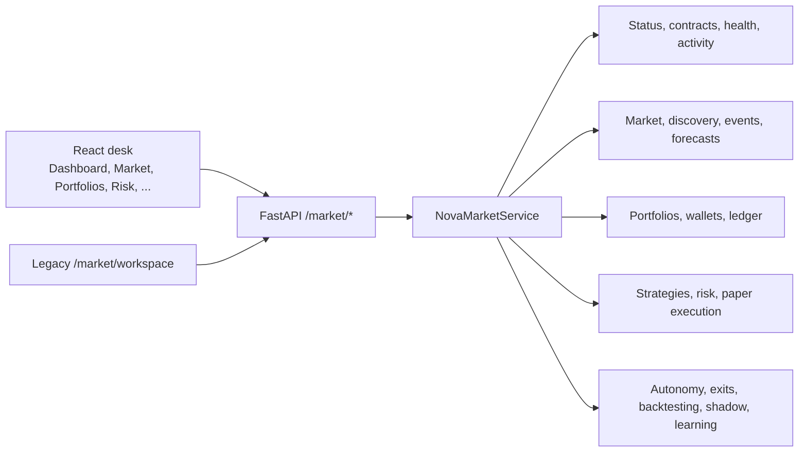

**Pages.** Dashboard; Market Overview; OrderBlock; TradingWatch; Market Events; Asset Discovery; Watchlists; Forecasts; Day/Swing/Long portfolios; Portfolio Analytics; Strategies; Risk Management; Paper Trading; Backtesting; Shadow Mode; Adaptive Learning; NovaCoin Wallet; Transactions; Ledger; Autonomy; Notifications; Activity and Audit; System Health; Settings.

**UI safety.** Paper-only status is displayed; no broker/live controls exist; an autonomy operator token is required for protected autonomy actions (`X-Autonomy-Operator-Token`). The UI does not itself enforce authority—the API/service does.

## 5. Financial authority architecture

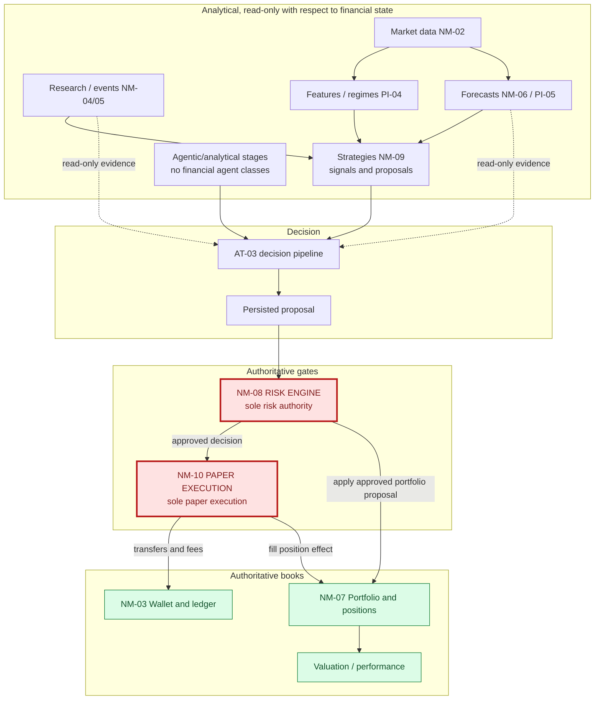

### Authority findings

| Claim | Finding | Evidence |
|---|---|---|
| NM-08 is the sole authoritative risk engine | **CONFIRMED** | Only `RiskEngine.assess` persists risk decisions; NM-10 revalidates them and fails closed; AT-03 calls NM-08 |
| NM-10 is the sole authoritative paper execution engine | **CONFIRMED** | Only `ExecutionEngine.submit/process` creates orders/fills; AT-04 forwards to it; no broker client |
| Wallet/ledger is authoritative for money | **CONFIRMED** | NM-10 uses `WalletEngine.transfer`; ledger entries are append-only; no direct balance writes found |
| Portfolio/valuation is authoritative for positions | **CONFIRMED with a boundary caveat** | `PortfolioEngine` owns valuation and `apply`; NM-10 writes position rows through `PortfolioStore` inside its fill transaction |
| Analytical modules cannot mutate financial state | **MOSTLY CONFIRMED** | Forecast, research and strategy modules produce records/proposals; they have no wallet/ledger/execution handles in their normal paths |
| RL policies have no production authority | **CONFIRMED (not implemented)** | No RL environment/policy exists; PI-13–PI-15 are planned; learning has governance and no execution gateway |

**Important caveat: cross-store consistency is compensation-based, not one SQLite transaction.** A fill writes an inflight journal, then wallet transfers, then a position transaction, then the fill/order. A failure triggers idempotent wallet reversals and position reversal; an unrecoverable failure retains the journal for startup recovery. This is a deliberate safety design, but it is not atomic across the wallet and portfolio stores.

## 6. Paper order lifecycle

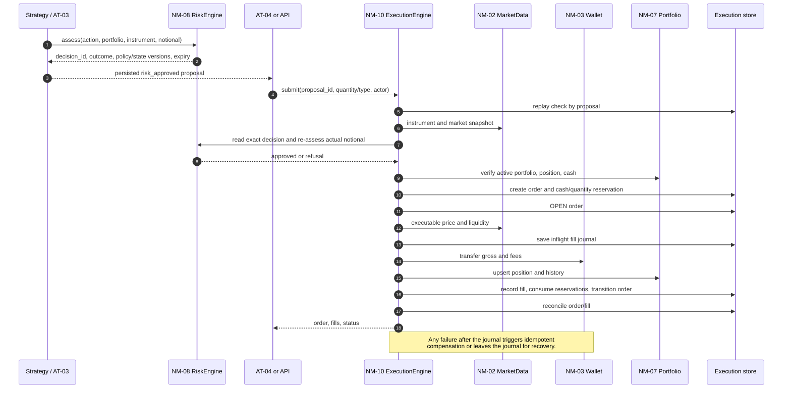

**Order types:** market, limit, stop, stop-limit. **Sides:** buy, sell. **Statuses:** created, pending validation, accepted, open, partially filled, filled, cancel pending, cancelled, rejected, expired, failed. Sell orders require existing long quantity; there is no short-selling path.

**Validation gates:** proposal approved, approved risk outcome and decision reference, unexpired approval, active portfolio, valid order-type fields, non-crypto instrument, positive snapshot price, no unenforceable risk restrictions, positive quantity, actual-notional risk revalidation, unchanged state version, sufficient simulated cash/position.

## 7. Safety restrictions — actual behavior

| Restriction | Status | Evidence |
|---|---|---|
| Paper-only operation | ENFORCED | `PAPER_ONLY=True`; execution status `paper_only: true` |
| No live trading | ENFORCED | `LIVE_TRADING=False`; no live-order route |
| No broker connection | ENFORCED | `BROKER_CONNECTED=False`; no broker client |
| No real-money transactions | ENFORCED | NovaCoin only; wallet ledger is simulated |
| No short selling | ENFORCED in strategy/execution paths | Position quantity check; catalog rules “no short selling” |
| No direct ledger mutation by analytics | CONFIRMED | Only `WalletEngine` writes ledger; analytical modules have no ledger gateway |
| Autonomy permissions/lease | ENFORCED | Mode/lease checks, operator token, one-cycle rule |
| Recovery constraints | IMPLEMENTED | Inflight journal, idempotent compensation, startup recovery |
| Crypto paper execution | NOT_IMPLEMENTED | Explicitly rejected as outside NM-10 scope |

**Not claimed:** external penetration testing, WCAG certification, investment-performance validation, or that stored/backfilled data is live. The project’s own README explicitly disclaims these.

## 8. Current data snapshot

| Table | Rows |
|---|---:|
| `market_instruments` | 4,813 |
| `market_bars` | 33,561 |
| `market_observations` | 185 |
| `market_events` | 415 |
| `market_event_evidence` | 311 |
| `wallets` | 16 |
| `wallet_transactions` | 17 |
| `ledger_entries` | 34 |
| `portfolios` | 7 |
| `portfolio_positions` | 0 |
| `portfolio_valuations` | 10 |
| `risk_decisions` | 1 |
| `strategy_signals` | 212 |
| `strategy_proposals` | 1 |
| `execution_orders` | 0 |
| `execution_fills` | 0 |
| `decision_proposals` | 0 |
| `forecast_records` | 6 |
| `prediction_forecasts` | 0 |
| `backtest_runs` | 2 |

Counts are evidence of current local state, not acceptance totals.

## 9. Key architectural findings

1. **Integration exists only in the fork.** Root NovaControl cannot show or use NovaMarket.
2. **The financial authority chain is real and unusually defensive.** Risk is independently re-evaluated at execution; failure never becomes approval.
3. **Execution is not atomic across stores.** Wallet and position writes are compensated, not one transaction. Crashes rely on journal recovery.
4. **Portfolio store is a shared mutation surface.** NM-10 writes position rows directly rather than going through a public portfolio mutation method.
5. **“Multi-agent financial intelligence” is not implemented.** The behavior is a deterministic pipeline. Documents that imply independent agents would be inaccurate.
6. **RL and deep-learning prediction are planned, not present.** Do not treat roadmap phases as current capability.
7. **Research is event/evidence-centric, not fundamental-statement analysis.** PI-10 would be required for the latter.
8. **The UI is broad and real, but the local database shows little paper activity.** Zero orders/fills and zero positions mean the paper execution path is implemented but lightly exercised in this checkout.

See [08 — Findings](08-ARCHITECTURE-FINDINGS.md) for severity and recommendations.
