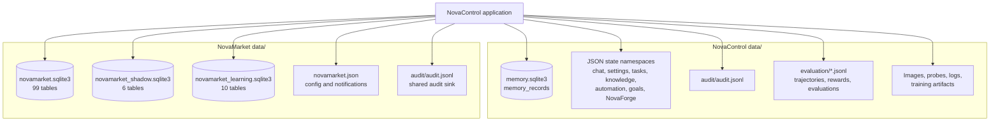
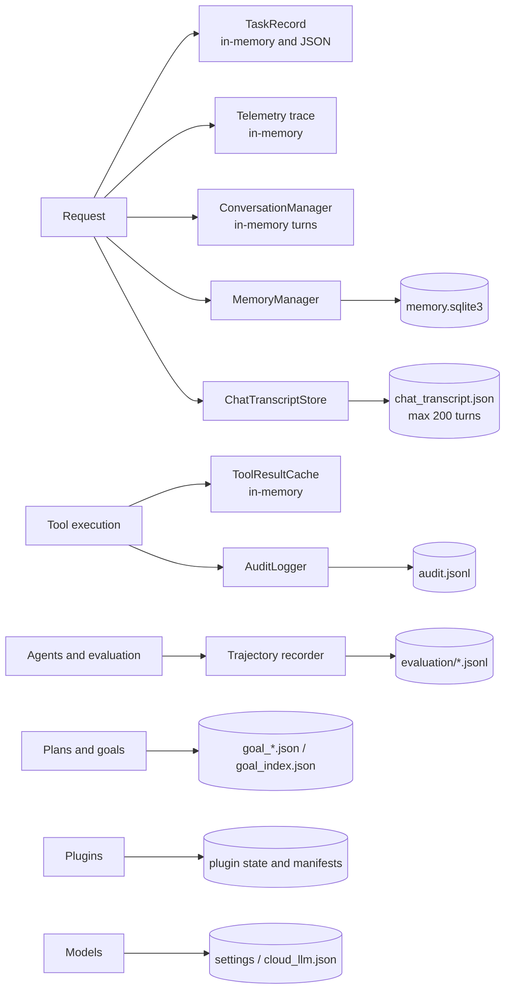
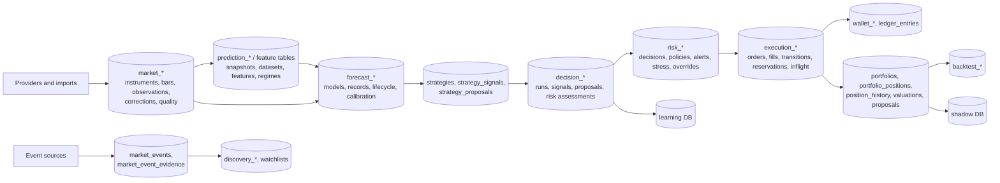
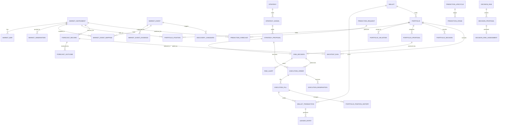
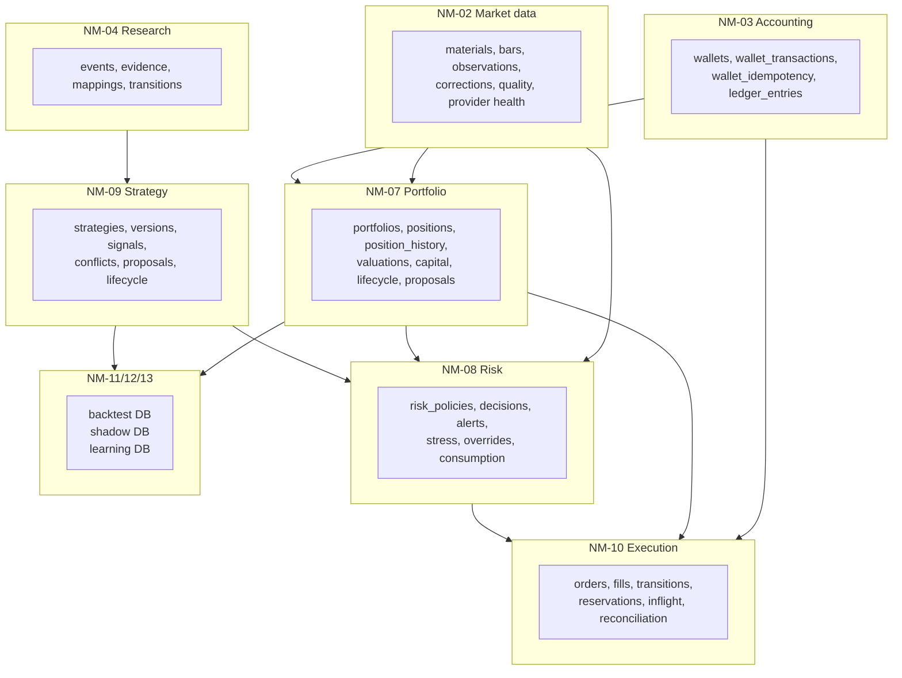

# 05 — Data Architecture

## 1. High-level data topology

NovaControl and NovaMarket use **local files and SQLite**, not a database server. There is no active PostgreSQL, Redis, object store or external queue in the default runtime. SQLAlchemy support is an optional extra; `data/novacontrol.sqlite3` does not exist in this checkout and is not the path the running application uses.

**Observed sizes:** root `memory.sqlite3` 479,232 bytes with 205 memory rows; root audit 8.57 MB; NovaMarket primary DB 35.83 MB; shadow 147 KB; learning 164 KB. These are local-state observations, not capacity limits.

## 2. NovaControl data flows

**Namespaces.** The memory repository uses `conversation`, `project`, `knowledge`, `short_term` and `long_term`. JSON state is namespace-per-feature rather than one schema: the inspected `data/` directory contains separate files for chat transcript, scheduler, projects, knowledge, knowledge index, automation, tasks, settings, collaboration, embodied sessions, goals, NovaForge state and multiple timeline snapshots.

**Bounded vs unbounded.** Chat transcript is explicitly bounded to 200 turns. Audit and telemetry/retention policies are configurable. Some JSON stores are append-mostly and can grow (timeline snapshots, task records), and large artifact directories are not automatically pruned by the architecture.

## 3. NovaMarket data flows

**Write ownership.** NM-02 owns market observations/bars. NM-03 owns wallet and ledger. NM-04 owns events/evidence. NM-05 owns discovery/watchlists. NM-06/PI-05 own forecasts. NM-07 owns portfolio/positions/valuation. NM-08 owns risk decisions/policies/alerts. NM-09 owns strategies/signals/proposals. NM-10 owns orders/fills/reservations/transition history. NM-11/12/13 own their separate databases. The service exposes all through one API surface but does not collapse the ownership boundaries.

## 4. Major entity relationships

The following is a **logical ER view**, grouped to stay readable. SQLite foreign-key enforcement is not uniformly declared; many relationships are application-enforced via IDs. The diagram therefore shows domain relationships, not a claim that every edge is a database constraint.

**Relationship caveats.**

- `EXECUTION_FILL` stores ledger transaction IDs and a position-effect object as JSON, not normalized join rows. The ER edge to `WALLET_TRANSACTION` is therefore by stored IDs.
- `EXECUTION_ORDER` references `proposal_id` and `risk_decision_id`; not every proposal type is a strategy proposal.
- `MARKET_INSTRUMENT` is referenced by ID across market, event, position, forecast and execution tables.
- `PORTFOLIO_POSITION_HISTORY` records fill effects but is not the same as execution fills.
- Backtests use isolated `backtest_*` tables and do not mutate production paper books.

## 5. Authoritative ownership

**Authoritative data rules found in code:**

- Ledger entries are written by the wallet engine, append-only, with idempotency keys. Analytical engines have no ledger handle.
- Portfolio valuation is computed from cash and marked positions; position rows are owned by the portfolio store.
- Risk decisions include policy version, state version, expiry and decision ID; execution re-reads and revalidates them.
- Execution orders/fills are append-oriented and transition-checked; reservations are released/consumed with the fill.
- Prediction and research records are evidence/proposals; they do not overwrite authoritative financial state.

## 6. Cross-database boundaries

| Store | Owns | Not allowed to own |
|---|---|---|
| `novamarket.sqlite3` | Market data, events, discovery, forecasts, wallets, ledger, portfolios, risk, strategies, execution, autonomy, backtests | Shadow/learning histories, NovaControl chat/memory |
| `novamarket_shadow.sqlite3` | Shadow sessions, decisions, projections, outcomes, comparisons, errors | Wallet, ledger, portfolio, orders, fills |
| `novamarket_learning.sqlite3` | Evidence, experiments, candidates, versions, approvals, rollbacks, alerts | Risk policy, orders, ledger, production promotion without governance |
| `data/memory.sqlite3` | Memory records | Conversation transcript file, audit |
| `data/*.json` | Bounded feature state | Financial ledger |
| `data/audit/audit.jsonl` | Append-only audit events | Source-of-truth application state |

**Physical separation is real but not encrypted at rest.** The stores rely on OS filesystem permissions. Any process with access to the data directory can read or modify them; the architecture does not provide database-level row security.

## 7. Retention, backup and recovery

- **Chat:** bounded (200 turns), no archival copy beyond the JSON file.
- **Audit:** JSONL with configurable redaction/retention; observed file is large (8.57 MB).
- **Evaluation:** JSONL trajectory/reward/evaluation files can be large; retention is configured by evaluation settings.
- **NovaMarket financial histories:** append-only by design; corrections are new records. No automatic compaction was found.
- **Backups:** no application-level backup scheduler or point-in-time recovery was found. SQLite WAL and file copies are the practical mechanisms; operational backup is external.
- **Recovery:** execution stores an inflight fill journal before external writes and reconciles on startup. Portfolios reconcile positions against execution history. Shadow/learning have their own recovery/rollback surfaces.

## 8. Data architecture findings

1. **Persistence is genuinely local-first and multi-store.** This is simple to operate but makes cross-store atomicity impossible without compensation.
2. **Execution is the only path that spans wallet, portfolio and execution stores.** It is correctly ordered and compensated, but a crash can leave an inflight row requiring recovery.
3. **JSON state is fragmented.** Useful for feature isolation; costly for global inspection, backup and schema migration.
4. **There is no single canonical relational schema for NovaControl.** The SQLAlchemy models are not the default path; memory is its own SQLite table and most feature state is JSON.
5. **NovaMarket’s 99-table schema is broad and domain-separated.** The main risk is not missing structure but drift between 99 tables and the services/routes that reference them.
6. **Observed state is sparse.** Zero positions/orders/fills and zero prediction forecasts mean many paths are structurally present but not represented in current data.
