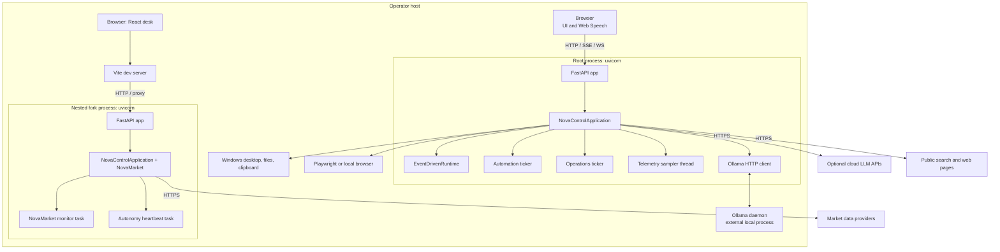
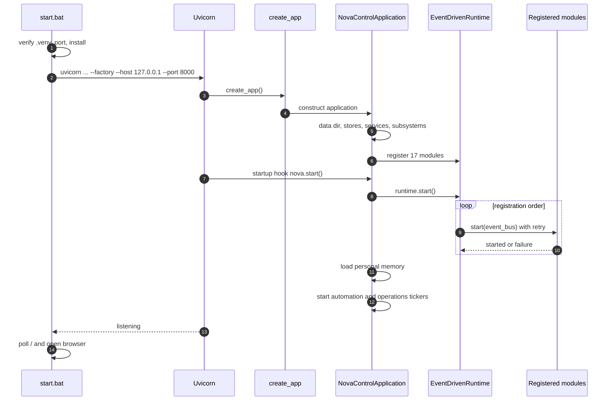
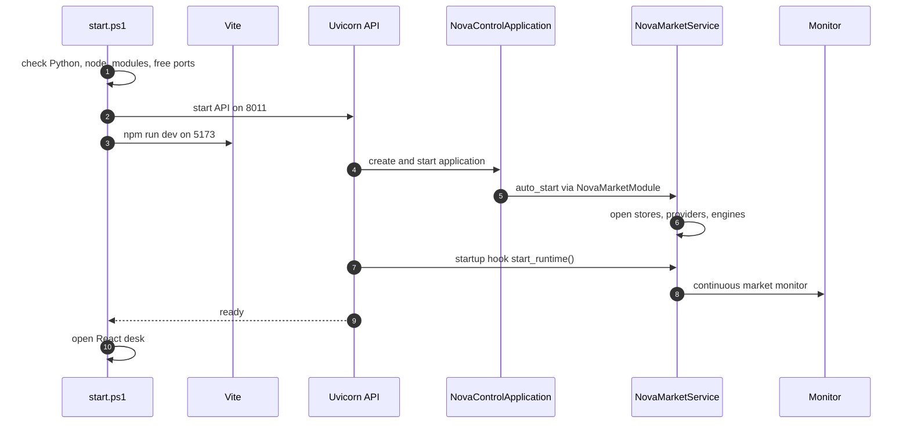
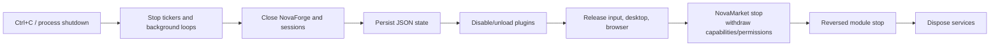
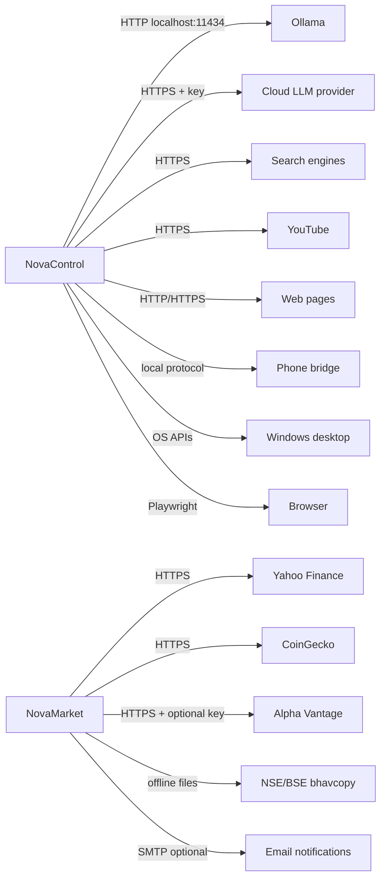
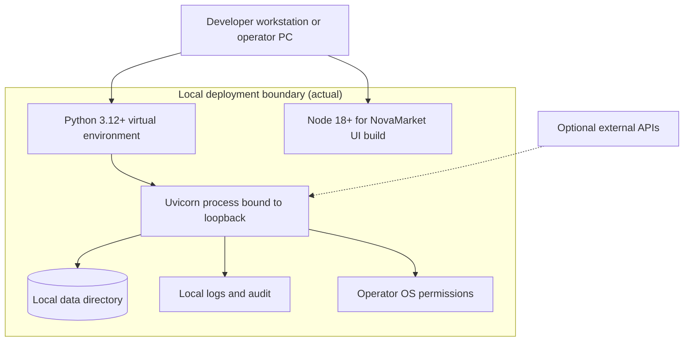

# 06 — Runtime and Deployment Architecture

## 1. Verified runtime model

Both source trees are **single-host, single-process web applications** with local persistence.

| Runtime | Root NovaControl | Nested NovaControl + NovaMarket |
|---|---|---|
| API process | Uvicorn serving `novacontrol.api.app:create_app` | Same, from the fork |
| Default API URL | `http://127.0.0.1:8000` via `start.bat` | `http://127.0.0.1:8011` via `start.ps1` |
| Frontend | Static no-build SPA served by FastAPI | React/Vite dev server at `http://127.0.0.1:5173`, proxy `/market` |
| Frontend process | None | Node/Vite process or prebuilt assets |
| Worker/queue | None by default | None by default |
| Database server | None | None |
| Cache server | None | None |
| Containers | None | None |

**Declared but inactive by default:** PostgreSQL, Redis, Celery, LangGraph, ChromaDB. They exist in optional dependency groups, but the default application constructs none of them and requires none of them. There is no Dockerfile or Compose file in the root tree; deployment is a Python virtual environment plus OS-level launch scripts.

## 2. Process and service relationships

**Important:** these are alternative deployments, not normally running together. The root and nested applications use the same package name and cannot safely share one Python environment as two installed editable distributions. A developer runs one tree at a time (or uses separate environments).

## 3. Startup sequence

### Root NovaControl

**Failure behavior.** A module start failure stops modules already started and aborts runtime start; FastAPI startup then fails. Feature-level failures inside modules are expected to be contained and reported in status where the module implements that isolation. NovaMarket’s fork-specific module deliberately contains its own startup failure and does not abort NovaControl startup.

### Nested NovaMarket

Startup order in `NovaMarketService` constructs config, market data, wallet, events, discovery, forecasts, features, prediction, portfolios, risk, strategies, execution, autonomy, backtests, shadow and learning on demand. The service is designed to fail into ERROR with a status explanation rather than crash the host application.

## 4. Shutdown sequence

Root `NovaControlApplication.stop` performs ordered cleanup:

1. stop operations and automation tickers;
2. stop NovaForge experiment/benchmark/evaluation loops and sessions;
3. persist application state;
4. unload plugins and withdraw their tools;
5. release embodied inputs;
6. flush generalization evaluation state;
7. close desktop capture worker and browser;
8. stop the runtime in reverse module order;
9. dispose the service container.

The nested fork additionally calls NovaMarket `stop_runtime`, then application `stop`, which shuts NovaMarket down twice (explicitly and via its module) in an idempotent sequence. This is safe but redundant.

## 5. Long-lived tasks and concurrency

- **Automation ticker:** application-created asyncio task for scheduled automation.
- **Operations ticker:** application-created task for persistent operations.
- **Telemetry sampler:** daemon thread for expensive GPU/network/temperature probes; FastAPI serves cached values.
- **NovaMarket monitor:** asyncio background task started at API startup; market-session aware, with pause flags.
- **Autonomy heartbeat:** renews the autonomy lease independently of market refresh.
- **Execution lock:** NM-10 serializes order submission/processing with an `asyncio.Lock`.
- **Event bus:** in-process, asynchronous dispatch; no external broker.

There is no general-purpose job queue, scheduler service, distributed lock, or worker pool. Long-running work does not survive process exit; durable records may, but execution resumes only through explicit recovery or a new request.

## 6. External integrations

**Availability is not implied.** Cloud LLM, Alpha Vantage, SMTP and the phone bridge require configuration or a physical device. Search engines can rate-limit or change markup. Market data can be delayed, incomplete or unofficial. The UI is expected to expose unavailable states rather than substitute fabricated values.

## 7. Configuration

Configuration is layered from dataclass defaults, environment variables and persisted JSON settings. Important keys observed:

| Key/area | Effect |
|---|---|
| `NOVACONTROL_API_TOKEN` | Enables bearer authentication when set |
| `NOVACONTROL_NLU_*` | NLU thresholds |
| `NOVACONTROL_EXECUTION_MODE` / settings | Local-only vs cloud-allowed behavior |
| `NOVACONTROL_DISABLE_OLLAMA` (or equivalent probe gate) | Prevents local runtime probing |
| `NOVACONTROL_ALLOWED_ORIGINS` | Origin guard for API |
| `NOVAMARKET_API_ORIGIN` | Vite proxy target |
| `NOVAMARKET_ALLOWED_ORIGINS` | NovaMarket CORS/origin guard |
| `NOVAMARKET_OPERATOR_TOKEN` | Autonomy operator authentication |
| `NOVAMARKET_SMTP_*` | Notification email credentials |
| `OPENAI_API_KEY` / provider key | Cloud model access, if selected |
| Alpha Vantage credential reference | Optional market data provider |

Secrets are not to be committed. The presence of `.env` in the nested tree is used by the launcher to pass SMTP environment variables into the process; this documentation does not inspect or reproduce secret values.

## 8. Network exposure and security posture

- Both launchers bind to **127.0.0.1**, not `0.0.0.0`.
- Root API authentication is optional unless `NOVACONTROL_API_TOKEN` is set. When unset, `/status` reports `auth_enabled: false`; this is suitable only for a trusted local machine.
- NovaMarket adds origin guard, trusted-host middleware, optional CORS allowlist, API authentication and a separate operator token for autonomy actions.
- The root app has security headers, request logging and rate limiting middleware (`api/middleware.py`) but no end-user accounts, roles or per-resource authorization.
- Tool/action approval is a separate application-level control and does not replace API authentication.
- Browser and desktop automation execute with the operator's OS privileges. There is no sandbox or container boundary.

## 9. Deployment architecture

**What is not deployed:** no reverse proxy, TLS termination, container orchestration, managed database, remote object storage, centralized log aggregation, secrets manager, or autoscaling. A production-like multi-user deployment would require additional architecture that does not exist in this repository.

**Packaging.** `pyproject.toml` defines `novacontrol` and `novacontrol-dashboard` console scripts; the root launcher installs the package editable into `.venv`. The nested launcher requires its own source tree plus `web/node_modules`. The root `SystemHealthMonitor`, `ReleaseHardeningChecker` and `RuntimePackageBuilder` inspect/package local builds, but they do not create a deployable container.

## 10. Runtime risks

1. **Single process, no supervisor.** A crash of Uvicorn stops all features; recovery is manual or external.
2. **Loopback-only is the security boundary.** Optional API auth means a local untrusted process can reach the API when no token is set.
3. **Long tasks are not durable.** Only persisted task/execution state can be recovered; the coroutine itself is lost.
4. **Ollama is a hard dependency for local LLM quality.** Without it, the system is functional but falls back to scratch/offline behavior.
5. **Two source trees increase deployment ambiguity.** Starting the wrong tree produces a NovaControl without NovaMarket.
6. **Background monitors consume model/provider resources.** Market monitoring, telemetry and model probes are concurrent and must be bounded by configuration.
7. **No process-level sandbox for desktop/browser execution.** Approval is a policy control, not OS isolation.
