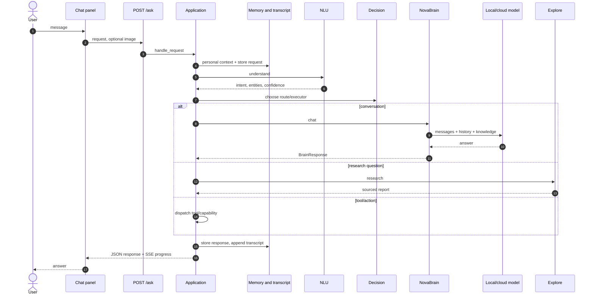
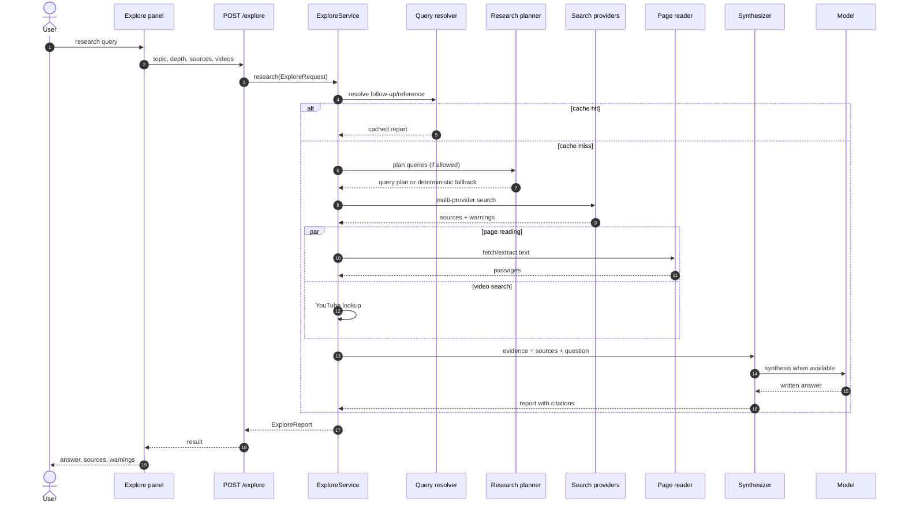
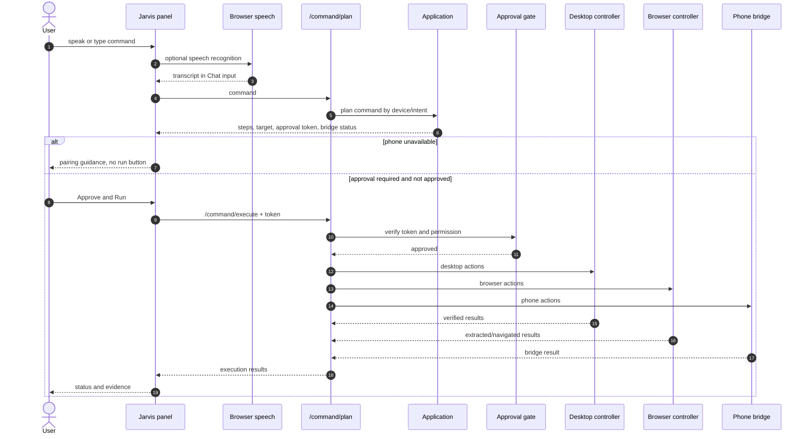
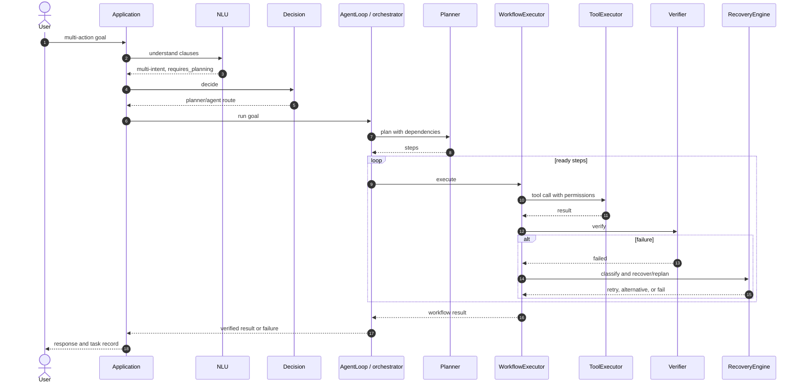
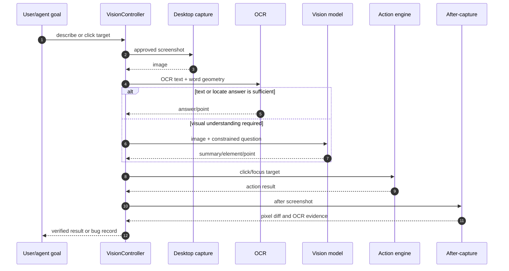
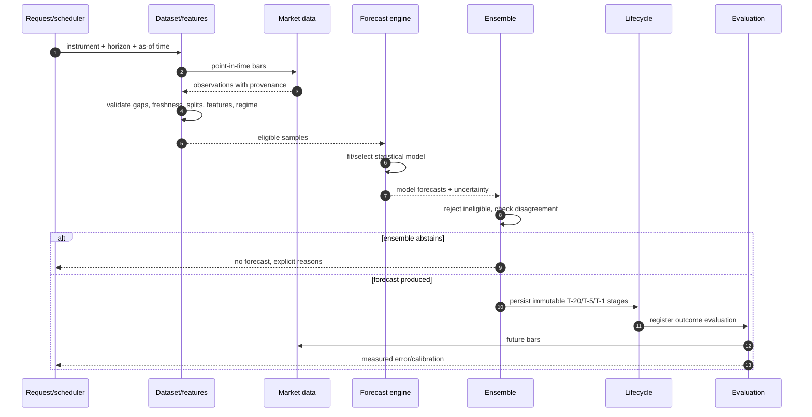
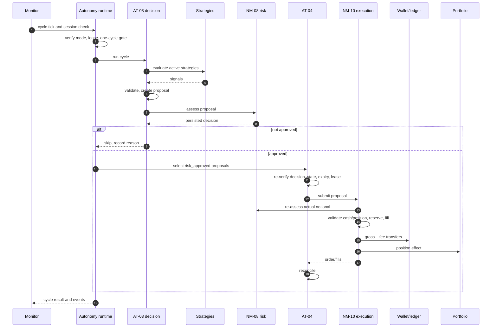
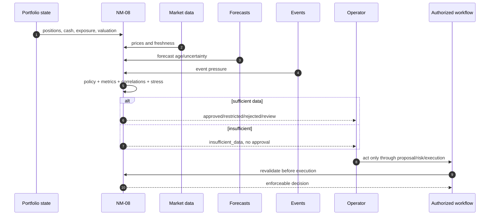
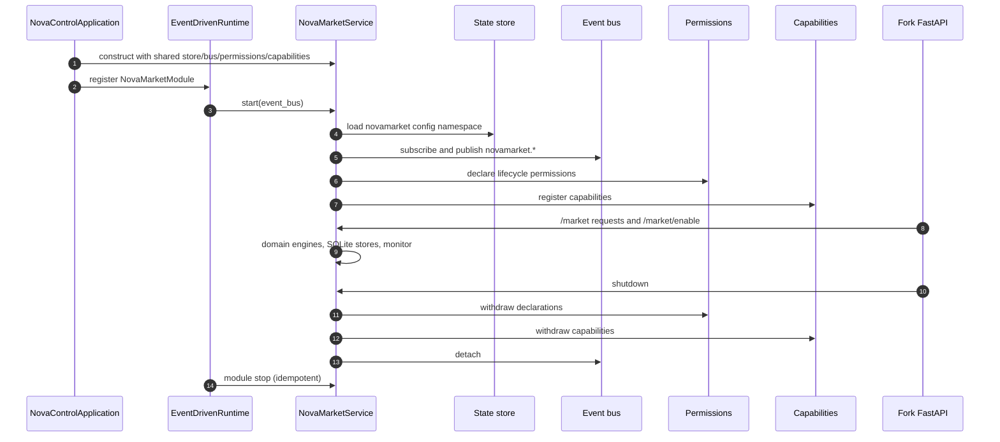

# 07 — Cross-System Workflows

These sequences show the actual current paths. Where the implementation differs from the originally proposed flow, the difference is called out.

## Flow A — Chat request

**Actual:** `/ask` always passes through global input intelligence and the decision engine before a chat answer. Research-looking chat questions can be redirected into Explore. The brain shapes a response only when a handler has no finished sentence.

**Differences from the proposed flow:** model routing/tool selection is not a single LLM function-calling loop. Tool selection is deterministic and occurs before execution; Chat itself does not call tools.

## Flow B — Explore research

**Failure differences:** provider failures do not abort the whole search; a degraded report is returned with warnings. Model synthesis can be skipped because of slow local hardware; the evidence-ranked answer is used.

## Flow C — Jarvis command

**Actual:** “Jarvis” is a UI/device-control workflow. There is no Jarvis NLU or Jarvis agent; intent parsing and device dispatch are in the application’s command planner/executor.

## Flow D — Complex task execution

**Difference:** planning is deterministic decomposition plus bounded agentic execution, not an LLM-authored arbitrary DAG. `AdaptivePlanner` can replan desktop/browser steps after observation.

## Flow E — Visual perception and action

## Flow F — NovaMarket prediction

**Current scope:** 11 statistical models and forecast lifecycle. Deep/sequence models and full ensemble selection are planned; the flow above labels the existing contract/assembler as the ensemble stage.

## Flow G — NovaMarket autonomous paper trading

## Flow H — Risk management

## Flow I — NovaControl and NovaMarket integration

**Integration truth:** this sequence exists in `novamarket/src/novacontrol`, not in the root tree. NovaMarket uses the shared runtime, bus, state store, permissions, capabilities and audit; it does not create a second bus or second NovaControl runtime. Its financial stores are separate by design.

## Flow comparison summary

| Proposed flow | Actual implementation |
|---|---|
| Chat → model routing → tools | Deterministic NLU/decision chooses executor; Chat does not call tools |
| Explore → research acquisition → synthesis | Implemented, with provider/page/video concurrency and degraded answers |
| Jarvis voice → NLU → planner → execution | UI/voice path plus command planner; no Jarvis module or agent |
| Goal → planner → agents → tools → validation | Implemented with two planners and separate orchestration loops |
| Screen → OCR/VLM → decision → action | Implemented in VisionController/PerceptionEngine |
| Market data → features → models → ensemble → lifecycle | Statistical models and lifecycle implemented; deep models/full ensemble planned |
| Prediction + research → agents → portfolio → risk → execution | Implemented as deterministic pipeline, not agents |
| Portfolio → risk → stress → recommendation → NM-08 | Implemented; recommendations do not bypass proposal/decision gate |
| NovaControl hosts NovaMarket | Only in the nested fork, through runtime module and shared services |
